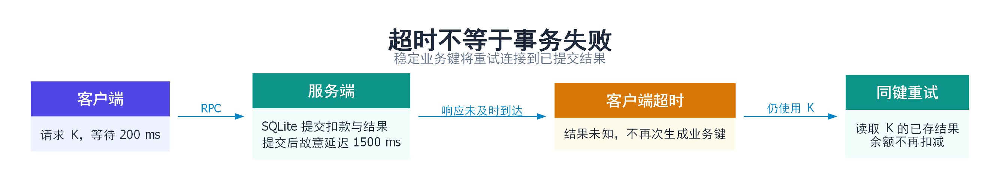
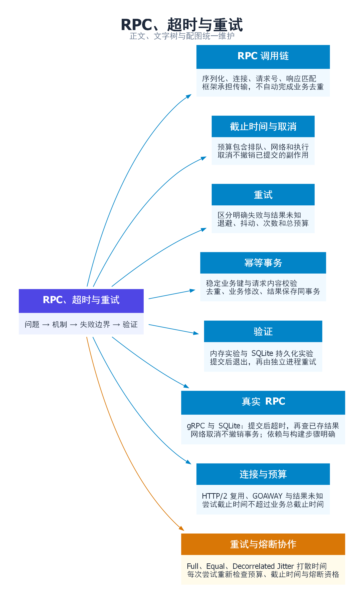

# RPC、超时与重试

支付已扣款，但响应在途中丢失。调用方超时后怎样重试？

[上一篇：副本、共识与 Raft](../03-%E5%89%AF%E6%9C%AC%E3%80%81%E5%85%B1%E8%AF%86%E4%B8%8E%20Raft/%E5%89%AF%E6%9C%AC%E3%80%81%E5%85%B1%E8%AF%86%E4%B8%8E%20Raft.md) · [返回目录](../README.md) · [下一篇：分布式锁、租约与 ID](../05-%E5%88%86%E5%B8%83%E5%BC%8F%E9%94%81%E3%80%81%E7%A7%9F%E7%BA%A6%E4%B8%8E%20ID/%E5%88%86%E5%B8%83%E5%BC%8F%E9%94%81%E3%80%81%E7%A7%9F%E7%BA%A6%E4%B8%8E%20ID.md)

上一篇讨论了存储何时确认写入。本篇换到调用方的视角。即使服务已经提交，响应也可能在返回途中丢失。

**阅读准备：** 先读上一篇的主线案例；本文涉及的 C++ 实验需要理解函数、容器与基本线程同步。

**快速阅读：**先读“从付款请求到安全重试”，再读“面试表达”和 Q&A；遇到说不清原因的结论，回到对应原理小节。

**深入学习：**按正文顺序推演每一步，运行文内完整示例，修改故障发生位置并核对结果。模拟程序只验证写明的假设；真实网络、磁盘和组件行为需按文中的验证步骤另行测试。

实验前先核对[环境、依赖与验证边界](../README.md#lab-compatibility)，各篇已执行与待执行的状态以对应实验说明为准。

<details>
<summary>本文目录（含小节）</summary>

- [从付款请求到安全重试](#section-01)
- [请求去重](#section-02)
- [截止时间](#section-03)
- [退避与重试预算](#section-04)
- [重试风暴：怎样打散时间，并服从熔断状态？](#jitter-breaker)
- [两个请求同时到达](#section-05)
- [从网络字节到一次 RPC](#section-06)
  - [服务端应该存哪些字段？](#detail-04-1)
- [C++ 实验：第一次扣款成功，第二次只取结果](#section-07)
- [框架如何承载一次远程调用](#section-08)
  - [可运行的 C++17 实验](#detail-04-2)
- [真实 gRPC 实验：服务已提交，客户端却超时](#section-09)
  - [环境和文件](#detail-04-3)
  - [从结果定位问题](#detail-04-4)
- [brpc 和 Thrift：与 gRPC 比较时看哪一层](#section-10)
- [HTTP/2 连接复用、GOAWAY 与框架重试](#section-11)
- [面试表达](#section-12)
- [Q&A（常见问题与解答）](#section-13)
  - [用了随机抖动，是否还需要重试预算？](#detail-04-5)
  - [Open 期间已经安排的重试能继续发吗？](#detail-04-6)
  - [GOAWAY 表示业务没执行吗？](#detail-04-7)
  - [本次尝试能有独立的较短超时吗？](#detail-04-8)
  - [客户端超时，服务端为什么仍扣款成功？](#detail-04-9)
- [思维导图总结](#section-14)

</details>

<a id="section-01"></a>

## 从付款请求到安全重试

假设付款键 K 对应“订单 42 支付 50 元”。把一笔付款拆成请求、执行、记录结果、回复四步，重试决策才有依据。

| 调用方看到什么 | 已知信息 | 处理方式 |
| --- | --- | --- |
| 参数错误 | 这份参数被明确拒绝 | 修正参数后再发起合适的请求 |
| 响应超时 | 未收到最终结果 | 查询 K 或沿用 K 重试 |
| 服务确认过载 | 本次调用受到限流或拒绝 | 按协议和剩余预算决定是否稍后尝试 |
| 得到成功响应 | 取得已确认结果 | 保存结果并推进订单 |

如果扣款和去重记录在同一个库，唯一约束、扣款更新和结果写入可以放在同一事务中。第二个请求发现 K 后要校验金额等参数，并读取原结果。若钱由外部支付系统扣除，本地事务无法包住外部调用。可以先保存 K 和待支付状态，把同一个 K 传给支付系统。遇到提交后断线，查对方的 K，再更新本地状态。这样也覆盖“外部扣款成功，本地还没更新就重启”的情况。

总期限还要覆盖排队和退避。比如 300 毫秒的请求第一次用了 120 毫秒，等 30 毫秒再重试，只剩约 150 毫秒。若下游一次调用通常就需要 180 毫秒，这次重试大概率赶不上期限。此时返回待确认并保留查询入口，比继续等待更符合产品约定。

<a id="section-02"></a>

## 请求去重

给同一笔业务请求分配一个稳定的幂等键。首次处理时，服务端把扣款结果和请求标识一起提交。收到同一个键时，先校验请求内容是否匹配，再返回已有结果。两份请求同时到达时，靠唯一约束或条件更新决定谁先处理，只用“先查再写”会留下竞争窗口。

<a id="section-03"></a>

## 截止时间

设置总截止时间并传给下游。若总预算 300 毫秒，前两层已花掉 220 毫秒，下游至多还有约 80 毫秒可用。客户端结束等待后，服务端已经完成的修改仍然存在。取消请求只能尽量阻止尚可取消的工作。

<a id="section-04"></a>

## 退避与重试预算

暂时性错误可以有限重试，参数错误应尽快返回。退避让连续失败的尝试间隔变长，随机抖动把同时醒来的请求错开。若三层调用各自最多尝试三次，最坏情况下底层一次业务可能收到 27 次调用。因此要明确重试在哪一层做，并设置整体预算。

<a id="jitter-breaker"></a>

## 重试风暴：怎样打散时间，并服从熔断状态？

一万个客户端同时超时，即使都按 100、200、400 毫秒指数退避，下一轮仍会同时到达。抖动（Jitter）让每次等待从一个范围中随机选择，减少同步脉冲；它不减少重试次数上限，所以仍需总预算。

设基础等待 b>0，上限 c≥b，第 k 次重试从 k=0 开始；`U(a,b)` 表示在区间内均匀采样。先算 `B_k=min(c,b*2^k)`，整数实现应在翻倍前检查上限，避免溢出。

| 策略 | 本次等待 | 取舍 |
| --- | --- | --- |
| 不加抖动 | `B_k` | 同时失败的客户端容易再次同时到达 |
| Full Jitter | `U(0,B_k)` | 分布范围大，也可能得到很短的等待 |
| Equal Jitter | `B_k/2 + U(0,B_k/2)` | 至少等半个退避窗口，随机范围较窄 |
| Decorrelated Jitter | `min(c,U(b,3*previous))`，初始 previous=b | 下一次范围依赖上次实际等待；不同实现的截断方式要核对 |

例如 b=100 ms、c=1000 ms、k=2，Full 范围为 0～400 ms，Equal 为 200～400 ms。Decorrelated 若上次实际等待 150 ms，本次范围为 100～450 ms。这里只比较范围，不声称某一策略对所有业务都最快。[AWS 退避与抖动算法](https://aws.amazon.com/blogs/architecture/exponential-backoff-and-jitter/)

随机数生成器不要让每个客户端每次重试都用同一个固定种子重新初始化；固定种子只适合可复现实验。实际尝试还要同时满足：错误可重试、业务可安全重复、未超过次数和截止时间、重试预算有余额。

熔断检查必须覆盖每一次真正发往下游的尝试，而不只检查最外层逻辑请求。Open 状态直接结束本轮调用或返回约定的降级结果；本地“熔断拒绝”不应再被重试层当作普通超时立即重试。已经睡眠的重试醒来后，也必须重新检查熔断状态。Half-Open 只允许原子申请成功的有限探测通过，其他调用快速失败；不要绕过熔断去探测同一个故障目标。

退避使用可取消的单调计时；若等待加上最小执行预算已超过剩余期限，就停止重试，不把所有等待压缩到同一个截止时刻。改变目标实例只能在重试语义和隔离范围允许时进行。熔断按“每次尝试”还是“逻辑请求”统计也要明确，避免同一个错误被多层重复计数。

验收：同时制造大量失败，按时间桶观察真实下游尝试数；随后强制 Open，确认新增下游尝试归零；转 Half-Open 时确认只有允许数量的探测。随机打散不等于流量已有上限，两项应分别检查。

<a id="section-05"></a>

## 两个请求同时到达

请求甲和乙都携带订单号 K。甲先成功写入唯一记录并完成事务。乙随后发现 K 已有结果，返回同一结果。若甲回滚，乙可以在规则允许时接手。外部支付若不在本地事务内，需要把 K 继续传给支付服务，由对方提供幂等保障。


<a id="section-06"></a>

## 从网络字节到一次 RPC

客户端把方法名、参数、请求 ID 编码成字节，并通过连接发送。接收端先按协议边界组装消息，再解码并调用服务方法。TCP 一次 read 可能只得到半条消息，也可能读到多条，因此协议常携带长度。响应通过请求 ID 匹配等待者。重试会新发一次网络请求，业务幂等键仍应沿用原值。连接超时、排队超时和执行截止时间应分别观察，避免误把网络连接正常理解为调用一定能完成。

可以按四个时间点推演：连接成功、请求到达、事务提交、响应返回。分别在每两个时间点之间断开连接，判断服务端是否可能已经提交。尤其要验证提交后断线的情况，重试应返回已保存结果。

<a id="detail-04-1"></a>

### 服务端应该存哪些字段？

为幂等记录保存业务键、关键参数摘要、处理状态、最终结果和更新时间。状态至少区分处理中、成功与明确失败。收到重复请求时，成功就返回已保存结果，处理中就按接口约定等待或返回查询入口。若旧任务卡住，接手前先查支付流水，避免把“处理中时间太长”误判成“没有扣款”。保存期限应覆盖正常重试、延迟消息和人工重放的时间窗口。

截止时间限制的是本次请求能等多久，服务端收到取消后还应主动停止可取消的工作。例如数据库查询支持取消时可以取消查询，但已经提交的事务仍要靠业务流程处理。[gRPC 截止时间](https://grpc.io/docs/guides/deadlines/)

<a id="section-07"></a>

## C++ 实验：第一次扣款成功，第二次只取结果

把支付服务看成两个动作。先更新余额并保存结果，随后把结果送回客户端。两步之间没有共同事务，网络失败可以发生在扣款之后。下面用进程内调用模拟这条边界：第一次请求完成服务端操作，但调用方丢弃结果，然后两个线程使用同一个键重试。

服务端要把三个动作放进同一个临界区：查键、保存结果、更新余额。如果把查键移到锁外，两个线程可能都判断“尚未执行”，然后各扣一次。真实服务要把这个临界区替换为数据库事务，以便多个进程共享唯一约束，并在进程重启后找回结果。

| 已存记录 | 新请求 | 服务端动作 |
| --- | --- | --- |
| 无 | 合法金额 | 扣款并记录余额，或记录余额不足 |
| 有 | 同一金额 | 返回当初的结果和当初的余额 |
| 有 | 金额不同 | 拒绝键复用 |

实验假设只有一个账户，真实键的作用域还应包含调用方或商户以及操作类型。金额用整数分，避免浮点舍入。余额不足在本实验中是该次操作的最终结果。


把下面代码保存为 `rpc_idempotency.cpp`。需要支持 C++17 和线程库的 GCC。Ubuntu 可用 `sudo apt install build-essential` 安装工具链。

```cpp
#include <array>
#include <cassert>
#include <iostream>
#include <mutex>
#include <stdexcept>
#include <string>
#include <thread>
#include <unordered_map>

struct Result {
    bool paid;
    int balance_after;
};

class Ledger {
    struct Record {
        int amount;
        Result result;
    };
    std::mutex mutex_;
    int balance_ = 10000;
    std::unordered_map<std::string, Record> records_;

public:
    Result charge(const std::string& key, int amount) {
        if (key.empty() || amount <= 0)
            throw std::invalid_argument("invalid payment");

        std::lock_guard<std::mutex> guard(mutex_);
        auto existing = records_.find(key);
        if (existing != records_.end()) {
            if (existing->second.amount != amount)
                throw std::invalid_argument("key reused with different amount");
            return existing->second.result;
        }

        const bool paid = balance_ >= amount;
        const Result result{paid, paid ? balance_ - amount : balance_};
        // 先执行可能因内存分配失败而抛异常的插入。
        records_.emplace(key, Record{amount, result});
        balance_ = result.balance_after;
        return result;
    }
};

int main() {
    Ledger ledger;
    ledger.charge("payment-42", 5000);  // 服务已提交，客户端没有收到回复。

    std::array<Result, 2> replies{};
    std::thread first([&] { replies[0] = ledger.charge("payment-42", 5000); });
    std::thread second([&] { replies[1] = ledger.charge("payment-42", 5000); });
    first.join();
    second.join();

    for (auto result : replies)
        assert(result.paid && result.balance_after == 5000);

    // 用另一个键扣款，检查真实余额，避免只验证缓存结果。
    auto next = ledger.charge("payment-43", 1000);
    assert(next.paid && next.balance_after == 4000);

    bool rejected = false;
    try {
        ledger.charge("payment-42", 3000);
    } catch (const std::invalid_argument&) {
        rejected = true;
    }
    assert(rejected);

    Ledger concurrent;
    std::thread a([&] { replies[0] = concurrent.charge("new-key", 5000); });
    std::thread b([&] { replies[1] = concurrent.charge("new-key", 5000); });
    a.join();
    b.join();
    for (auto result : replies)
        assert(result.paid && result.balance_after == 5000);
    assert(concurrent.charge("probe", 1000).balance_after == 4000);
    std::cout << "replay=5000 next=4000 mismatch=rejected concurrent=ok\n";
}
```

```bash
g++ -std=c++17 -O2 -Wall -Wextra -pthread rpc_idempotency.cpp -o rpc_idempotency
./rpc_idempotency
```

在 Windows MSYS2 UCRT64 的 GCC 上编译并运行，实测输出如下。

```text
replay=5000 next=4000 mismatch=rejected concurrent=ok
```

实际部署时，去重表可用 `(merchant_id, operation, key)` 作唯一键。事务先争取写入这条唯一记录，再更新账户余额并写入结果，最后一起提交。若进程在提交前退出，数据库回滚，后来者可重新尝试。若提交后退出，后来者读取已保存结果。唯一键冲突的等待与读取要按数据库的事务隔离语义处理。

如果扣款由外部机构执行，持有本地 mutex 或数据库事务都无法把外部扣款纳入同一次提交。应先保存业务键和待确认状态，将同一键传给外部支付方。重启后用该键查询或重试，再推进本地状态。若对方既不支持按键去重，也无法查询结果，超时后就缺少安全自动重试所需的信息。实验只验证单进程内的并发和结果复用，重启后内存记录会消失。[AWS 幂等 API 设计](https://aws.amazon.com/builders-library/making-retries-safe-with-idempotent-APIs/)

<a id="section-08"></a>

## 框架如何承载一次远程调用

gRPC 常见 C++ 路径是用 proto 声明方法和字段，由生成的 stub 把业务参数编码并交给 HTTP/2 传输，服务端解码后调处理函数。同步接口可以先建立最小双进程实验，异步接口还要管理完成事件、请求对象寿命和取消。brpc 需要明确所选协议与服务端一致，Thrift 则要同时匹配生成代码、序列化协议和传输方式。

拿 Charge 作为练习，输入应包含业务键与金额，输出应包含业务状态。先设置业务总截止时间；每次尝试的截止时间取总截止时间与“现在加本次上限”的较早值。让服务端在数据库提交后延迟或丢弃响应，第二次沿用原业务键，并计入已经消耗的总预算。客户端的网络结果与业务状态分开保存。下节实验验证的是数据库提交与进程退出边界，接入网络框架时可以沿用同一服务端事务。[gRPC C++ 快速入门](https://grpc.io/docs/languages/cpp/quickstart/)

<a id="detail-04-2"></a>

### 可运行的 C++17 实验

保存为 `durable_payment.cpp`。

```cpp
#include <sqlite3.h>
#include <cstdlib>
#include <iostream>
#include <stdexcept>
#include <string>

void sql(sqlite3* db, const char* statement) {
    if (sqlite3_exec(db, statement, nullptr, nullptr, nullptr) != SQLITE_OK)
        throw std::runtime_error(sqlite3_errmsg(db));
}

int main(int argc, char** argv) {
    if (argc != 3) return 2;
    const std::string mode = argv[2];
    if (mode != "drop" && mode != "retry") return 2;
    sqlite3* db = nullptr;
    try {
        if (sqlite3_open(argv[1], &db) != SQLITE_OK)
            throw std::runtime_error("open failed");
        sql(db, "PRAGMA busy_timeout=3000; PRAGMA synchronous=FULL;");
        sql(db, "BEGIN IMMEDIATE;"
                "CREATE TABLE IF NOT EXISTS wallet(id INTEGER PRIMARY KEY, balance INTEGER);"
                "INSERT OR IGNORE INTO wallet VALUES(1,10000);"
                "CREATE TABLE IF NOT EXISTS receipts(key TEXT PRIMARY KEY, balance INTEGER);"
                "UPDATE wallet SET balance=balance-5000 WHERE id=1 AND "
                "NOT EXISTS(SELECT 1 FROM receipts WHERE key='K');"
                "INSERT OR IGNORE INTO receipts SELECT 'K', balance FROM wallet WHERE id=1;"
                "COMMIT;");
        if (mode == "drop") std::_Exit(23); // 已提交，模拟回包前退出。
        sqlite3_stmt* query = nullptr;
        if (sqlite3_prepare_v2(db, "SELECT balance FROM wallet WHERE id=1;",
                               -1, &query, nullptr) != SQLITE_OK)
            throw std::runtime_error(sqlite3_errmsg(db));
        const int status = sqlite3_step(query);
        const int balance = status == SQLITE_ROW ? sqlite3_column_int(query, 0) : -1;
        sqlite3_finalize(query);
        if (balance != 5000) throw std::runtime_error("unexpected balance");
        std::cout << "balance=" << balance << '\n';
        sqlite3_close(db);
        return 0;
    } catch (const std::exception& error) {
        std::cerr << error.what() << '\n';
        sqlite3_close(db);
        return 1;
    }
}
```

```bash
g++ -std=c++17 -Wall -Wextra durable_payment.cpp -lsqlite3 -o durable_payment
./durable_payment orders.db drop  # 预期退出码 23
./durable_payment orders.db retry
./durable_payment orders.db retry
```

MSYS2 UCRT64 的 GCC 实测结果为 `balance=5000（两次重试）`。在新实验目录执行，确保 orders.db 起初不存在。Ubuntu 可安装 build-essential 和 libsqlite3-dev。三次运行是独立进程，第一次在提交后直接退出，后两次打开同一个数据库。本例使用固定账户、金额和键，通过退出码模拟回包丢失，尚未接入 TCP、远程框架或外部支付。


<a id="section-09"></a>

## 真实 gRPC 实验：服务已提交，客户端却超时

模拟程序能演示重复调用，但没有经过网络。这里用两个 C++ 进程、真实 HTTP/2 RPC 和 SQLite，把“事务成功”和“客户端拿到结果”拆开。服务端第一次提交后故意等 1500 ms；客户端只等 200 ms，因此先超时。再次请求使用同一业务键，服务端返回已保存的结果。

一次调用在框架内部依次经过：生成的 stub 将结构化参数序列化；channel 管理连接并发送 HTTP/2 stream；服务端接收消息、反序列化、调用处理函数；处理函数返回 protobuf 响应和 gRPC 状态。连接成功只说明传输通了，业务提交与响应返回仍是两个时刻。[gRPC C++ 基础教程](https://grpc.io/docs/languages/cpp/basics/)



<a id="detail-04-3"></a>

### 环境和文件

环境：Ubuntu 24.04、发行版提供的 gRPC/protobuf、SQLite 3、C++17。以下实验本轮未在 Linux 中执行；输出是验收预期。依赖版本由系统仓库决定，运行时保存版本记录，不把此处当作固定最新版本承诺。

```bash
sudo apt update
sudo apt install -y build-essential pkg-config protobuf-compiler protobuf-compiler-grpc libprotobuf-dev libgrpc++-dev libsqlite3-dev sqlite3
mkdir -p grpc-payment-lab
cd grpc-payment-lab
protoc --version
pkg-config --modversion grpc++ protobuf sqlite3
```

文件 `payment.proto`：

```protobuf
syntax = "proto3";
package lab;
service Payment { rpc Charge(ChargeRequest) returns (ChargeReply); }
message ChargeRequest { string key = 1; int64 cents = 2; }
message ChargeReply { int64 balance = 1; }
```

**接口文件生成验证：**本轮使用 `libprotoc 33.0` 对上面的 `payment.proto` 执行普通 C++ 代码生成成功。尚未执行 `grpc_cpp_plugin` 生成或链接 gRPC 服务；这不改变服务端、客户端仍待依赖编译和网络联调的状态。

文件 `server.cpp`：

```cpp
#include "payment.grpc.pb.h"
#include <grpcpp/grpcpp.h>
#include <sqlite3.h>
#include <chrono>
#include <iostream>
#include <memory>
#include <mutex>
#include <stdexcept>
#include <string>
#include <thread>

void exec_sql(sqlite3* db, const char* sql) {
    if (sqlite3_exec(db, sql, nullptr, nullptr, nullptr) != SQLITE_OK)
        throw std::runtime_error(sqlite3_errmsg(db));
}
struct Statement {
    sqlite3_stmt* p = nullptr;
    Statement(sqlite3* db, const char* sql) {
        if (sqlite3_prepare_v2(db, sql, -1, &p, nullptr) != SQLITE_OK)
            throw std::runtime_error(sqlite3_errmsg(db));
    }
    ~Statement() { sqlite3_finalize(p); }
    void key(const std::string& value) {
        if (sqlite3_bind_text(p, 1, value.c_str(), -1, SQLITE_TRANSIENT) != SQLITE_OK)
            throw std::runtime_error("bind key failed");
    }
};
class PaymentService final : public lab::Payment::Service {
    sqlite3* db_ = nullptr;
    std::mutex mutex_; // 本例串行使用一个数据库连接。
public:
    PaymentService() {
        if (sqlite3_open("payments.db", &db_) != SQLITE_OK) {
            sqlite3_close(db_); db_ = nullptr;
            throw std::runtime_error("open database failed");
        }
        try {
            exec_sql(db_, "PRAGMA synchronous=FULL; PRAGMA busy_timeout=3000;"
                "CREATE TABLE IF NOT EXISTS wallet(id INTEGER PRIMARY KEY,balance INTEGER NOT NULL);"
                "INSERT OR IGNORE INTO wallet VALUES(1,10000);"
                "CREATE TABLE IF NOT EXISTS receipt(k TEXT PRIMARY KEY,cents INTEGER NOT NULL,balance INTEGER NOT NULL);");
        } catch (...) { sqlite3_close(db_); db_ = nullptr; throw; }
    }
    ~PaymentService() override { sqlite3_close(db_); }
    grpc::Status Charge(grpc::ServerContext*, const lab::ChargeRequest* req,
                        lab::ChargeReply* out) override {
        if (req->key().empty() || req->key().size() > 128 || req->cents() <= 0)
            return {grpc::StatusCode::INVALID_ARGUMENT, "invalid key or amount"};
        bool fresh = false;
        {
            std::lock_guard<std::mutex> lock(mutex_);
            try {
                exec_sql(db_, "BEGIN IMMEDIATE;");
                Statement query(db_, "SELECT cents,balance FROM receipt WHERE k=?;");
                query.key(req->key());
                int rc = sqlite3_step(query.p);
                if (rc == SQLITE_ROW) {
                    if (sqlite3_column_int64(query.p, 0) != req->cents()) {
                        exec_sql(db_, "ROLLBACK;");
                        return {grpc::StatusCode::INVALID_ARGUMENT, "key reused with different amount"};
                    }
                    out->set_balance(sqlite3_column_int64(query.p, 1));
                    sqlite3_reset(query.p);
                } else if (rc == SQLITE_DONE) {
                    Statement update(db_, "UPDATE wallet SET balance=balance-? WHERE id=1 AND balance>=?;");
                    if (sqlite3_bind_int64(update.p, 1, req->cents()) != SQLITE_OK ||
                        sqlite3_bind_int64(update.p, 2, req->cents()) != SQLITE_OK)
                        throw std::runtime_error("bind amount failed");
                    if (sqlite3_step(update.p) != SQLITE_DONE)
                        throw std::runtime_error(sqlite3_errmsg(db_));
                    if (sqlite3_changes(db_) != 1) {
                        exec_sql(db_, "ROLLBACK;");
                        return {grpc::StatusCode::FAILED_PRECONDITION, "insufficient balance"};
                    }
                    Statement insert(db_, "INSERT INTO receipt SELECT ?,?,balance FROM wallet WHERE id=1;");
                    insert.key(req->key());
                    if (sqlite3_bind_int64(insert.p, 2, req->cents()) != SQLITE_OK ||
                        sqlite3_step(insert.p) != SQLITE_DONE)
                        throw std::runtime_error(sqlite3_errmsg(db_));
                    Statement balance(db_, "SELECT balance FROM wallet WHERE id=1;");
                    if (sqlite3_step(balance.p) != SQLITE_ROW)
                        throw std::runtime_error("missing wallet");
                    out->set_balance(sqlite3_column_int64(balance.p, 0));
                    sqlite3_reset(balance.p);
                    fresh = true;
                } else { throw std::runtime_error(sqlite3_errmsg(db_)); }
                exec_sql(db_, "COMMIT;");
            } catch (const std::exception& e) {
                sqlite3_exec(db_, "ROLLBACK;", nullptr, nullptr, nullptr);
                std::cerr << e.what() << '\n';
                return {grpc::StatusCode::INTERNAL, "database failure"};
            }
        } // 已提交并释放数据库锁；延迟不能挡住下一次查询。
        if (fresh) {
            std::cout << "committed " << req->key() << std::endl;
            std::this_thread::sleep_for(std::chrono::milliseconds(1500));
        }
        return grpc::Status::OK;
    }
};
int main() {
    try {
        PaymentService service;
        grpc::ServerBuilder builder;
        builder.AddListeningPort("127.0.0.1:50051", grpc::InsecureServerCredentials());
        builder.RegisterService(&service);
        auto server = builder.BuildAndStart();
        if (!server) throw std::runtime_error("listen failed");
        std::cout << "listening 127.0.0.1:50051" << std::endl;
        server->Wait();
    } catch (const std::exception& e) { std::cerr << e.what() << '\n'; return 1; }
}
```

文件 `client.cpp`：

```cpp
#include "payment.grpc.pb.h"
#include <grpcpp/grpcpp.h>
#include <chrono>
#include <iostream>
#include <string>
int main(int argc, char** argv) {
    if (argc != 4) { std::cerr << "usage: client KEY CENTS DEADLINE_MS\n"; return 2; }
    try {
        auto channel = grpc::CreateChannel("127.0.0.1:50051", grpc::InsecureChannelCredentials());
        auto stub = lab::Payment::NewStub(channel);
        lab::ChargeRequest req;
        req.set_key(argv[1]); req.set_cents(std::stoll(argv[2]));
        lab::ChargeReply reply;
        grpc::ClientContext ctx;
        ctx.set_deadline(std::chrono::system_clock::now() +
                         std::chrono::milliseconds(std::stoll(argv[3])));
        const auto status = stub->Charge(&ctx, req, &reply);
        if (!status.ok()) {
            std::cout << "rpc_code=" << status.error_code() << '\n';
            return 1; // 传输失败不等于付款未提交。
        }
        std::cout << "balance=" << reply.balance() << '\n';
    } catch (const std::exception& e) { std::cerr << e.what() << '\n'; return 2; }
}
```

```bash
protoc -I . --cpp_out=. --grpc_out=. --plugin=protoc-gen-grpc="$(command -v grpc_cpp_plugin)" payment.proto
g++ -std=c++17 -O2 -Wall -Wextra server.cpp payment.pb.cc payment.grpc.pb.cc -o server $(pkg-config --cflags --libs grpc++ protobuf sqlite3) -pthread
g++ -std=c++17 -O2 -Wall -Wextra client.cpp payment.pb.cc payment.grpc.pb.cc -o client $(pkg-config --cflags --libs grpc++ protobuf) -pthread
./server
```

另开一个终端进入同一目录，依次执行：

```bash
./client order-42 2000 200
./client order-42 2000 2000
./client order-42 3000 2000
sqlite3 payments.db 'SELECT * FROM wallet; SELECT * FROM receipt;'
```

验收预期：第一条通常输出 `rpc_code=4`（DEADLINE_EXCEEDED），第二条输出 `balance=8000`，第三条输出 `rpc_code=3`（参数冲突）。数据库只有一条 `order-42` 收据。必须先确认服务日志出现 `committed order-42`，才能把第一次超时解释为“提交后超时”；若请求根本没到服务端，不能套用这个结论。

终止服务端后重启，再用同一键查询，应仍得到 8000。改变金额应继续被拒绝。重复实验使用新目录和新数据库；不要删除已有业务数据库来重置环境。

<a id="detail-04-4"></a>

### 从结果定位问题

| 现象 | 先检查什么 |
| --- | --- |
| 找不到 `grpc_cpp_plugin` | 是否安装 `protobuf-compiler-grpc`，PATH 是否正确 |
| 链接缺少 grpc/protobuf 符号 | 生成器、头文件和库是否来自同一套安装；保留 pkg-config 参数 |
| `rpc_code=14` | 服务是否监听、端口是否相同；这通常是不可用而非预期超时 |
| 第一次直接返回 8000 | 原键已存在，或没有执行到新提交后的延迟 |
| SQLite 打不开或 BUSY | 工作目录、权限、另一个进程是否持有事务 |

本例只监听本机，省略 TLS、用户身份与账户归属验证；真实服务不能仅靠客户端给出的 key 判断谁有权付款。取消也不会回滚已经提交的 SQL。生产中不应故意 sleep，它只是把失败窗口拉长，便于观察。

<a id="section-10"></a>

## brpc 和 Thrift：与 gRPC 比较时看哪一层

brpc 的调用方通过 Channel 选择协议与服务地址，Controller 携带本次 RPC 的超时、错误等状态，框架把请求与响应关联后调用服务方法。异步调用还必须保证请求、响应和完成回调的对象寿命覆盖整个调用。Thrift 从 IDL 生成接口，再组合 transport（字节怎样传输）、protocol（字段怎样编码）和 server（怎样调度处理）。同一份 IDL 并不意味着双方 transport/protocol 任意搭配都能通信。

| 检查项 | 为什么重要 |
| --- | --- |
| 协议与序列化 | 客户端发出的字节必须能由服务端正确解码 |
| 连接与并发模型 | 一个慢调用是否阻塞其他请求，连接何时重建 |
| deadline 与取消 | 排队、网络和处理是否共用同一预算 |
| 对象寿命与回调线程 | 超时后仍到来的回调可能访问已释放对象 |
| 重试与业务结果 | 框架重发只能提高传输成功率，不能代替收据事务 |

因此本节实验可以作为其他框架的对照用例：保持数据库事务与业务键不变，只替换传输层，再检查超时、重复请求和进程重启行为。这里没有把 brpc/Thrift 的接口名字冒充成完整接入教程。


**本节机制与实验参考：** [brpc 客户端调用机制](https://brpc.apache.org/docs/client/basics/)。

<a id="section-11"></a>

## HTTP/2 连接复用、GOAWAY 与框架重试

每次 RPC 都重建 TCP/TLS 连接会重复握手，连接池因此复用底层连接。HTTP/2 在一个连接里用不同 stream ID 区分并发请求：帧交错传输，框架再按 stream 组装响应。它没有取消所有排队：连接级流控、并发 stream 上限和 TCP 丢包仍可能使请求一起变慢。排队消耗的时间也属于调用预算。

服务器优雅关闭 HTTP/2 连接时可发送 GOAWAY，告知不再接收新的 stream，并用 last-stream-id 表达哪些 stream 可能已处理。客户端应把新请求迁移到新连接；已经可能被处理的业务不能因为连接关闭就换业务键重发。进程直接崩溃可能根本发不出 GOAWAY，因此“重启后重新查询”与 GOAWAY 不是同一个概念。

| 框架 | 应检查的默认与配置 | 对业务的含义 |
| --- | --- | --- |
| gRPC C++ | 没有显式 retryPolicy 时，不等于所有层次都绝无重试；框架有受条件限制的透明重试，显式策略通过 service config 设置 | 保存实际 service config、库版本、请求 attempt 指标；业务去重不能依赖猜测重试次数 |
| brpc | 官方客户端说明的 max_retry 默认 3；默认策略不重试超时，连接等错误按策略判断，整体 timeout 约束调用 | 自定义 RetryPolicy、backup request 会改变行为，不能只数业务层的循环次数 |

这不是跨版本永不变化的默认值清单。复现前记录 gRPC/brpc 的版本和实际选项；测试时在服务端记录同一业务键的到达次数，分别注入建连失败、提交前失败、提交后丢响应。[gRPC 重试](https://grpc.io/docs/guides/retry/)；[brpc 客户端说明](https://brpc.apache.org/docs/client/basics/)；[HTTP/2 GOAWAY](https://www.rfc-editor.org/rfc/rfc9113.html#section-6.8)


<a id="section-12"></a>

## 面试表达

远程扣款超时后，调用方不知道业务是否已提交。因此我用稳定业务键，把扣款、去重记录和结果放在同一事务中；重试查询同一结果，并拒绝同键不同金额。所有尝试共享总截止时间，配合退避和次数限制。框架负责连接和传输，不替业务撤销已提交事务。代价是额外存储与去重保留策略，还要考虑超出保留期和外部副作用的恢复。

进一步追问工程边界时，我会补充：Full、Equal、Decorrelated Jitter 打散时间；每次尝试重新检查预算、截止时间与熔断资格。故障验证既检查恢复进度，也检查恢复后是否仍满足原来的业务承诺。

<a id="section-13"></a>

## Q&A（常见问题与解答）

<a id="detail-04-5"></a>

### 用了随机抖动，是否还需要重试预算？

需要。抖动主要打散到达时间，不能限制总尝试量。每层自行重试仍会放大请求，因此要明确重试层级和总预算。

<a id="detail-04-6"></a>

### Open 期间已经安排的重试能继续发吗？

醒来后也应重新检查熔断状态。Open 时停止发送或走约定降级；Half-Open 只有取得探测名额的请求能够通过。

<a id="detail-04-7"></a>

### GOAWAY 表示业务没执行吗？

不能一概而论。要结合 stream 编号及协议确定哪些可能处理过；连接故障下的未知业务结果仍用业务键查询。

<a id="detail-04-8"></a>

### 本次尝试能有独立的较短超时吗？

可以，但不能超过总体剩余预算。较短尝试上限限制一次卡顿，总截止时间限制所有尝试与退避之和。

<a id="detail-04-9"></a>

### 客户端超时，服务端为什么仍扣款成功？

截止时间约束客户端等待。事务若已提交，取消网络调用不会撤销它。再次调用携带同一业务键，服务端查询已保存的结果，而不是再次扣款。

**同一个请求 ID 和同一个幂等键必须相同吗？**

可以分别设计。请求 ID 用来区分每次网络尝试，幂等键用来标识同一笔业务。重试可换请求 ID，业务键保持原值。

**同一个幂等键能对应两种付款金额吗？**

应当拒绝。相同键表示同一个业务操作，服务端需要保存或校验关键请求参数。

[延伸阅读](https://aws.amazon.com/builders-library/timeouts-retries-and-backoff-with-jitter/)

下一篇要回答的问题是：仓库任务拿到锁后暂停，租约过期。新任务开始工作时，旧任务恢复了怎么办？

<a id="section-14"></a>

## 思维导图总结

```text
RPC、超时与重试
├── 重试与熔断协作
│   ├── Full、Equal、Decorrelated Jitter 打散时间
│   └── 每次尝试重新检查预算、截止时间与熔断资格
├── RPC 调用链
│   ├── 序列化、连接、请求号、响应匹配
│   └── 框架承担传输，不自动完成业务去重
├── 截止时间与取消
│   ├── 预算包含排队、网络和执行
│   └── 取消不撤销已提交的副作用
├── 重试
│   ├── 区分明确失败与结果未知
│   └── 退避、抖动、次数和总预算
├── 幂等事务
│   ├── 稳定业务键与请求内容校验
│   └── 去重、业务修改、结果保存同事务
├── 验证
│   ├── 内存实验与 SQLite 持久化实验
│   └── 提交后退出，再由独立进程重试
├── 真实 RPC
│   ├── gRPC 与 SQLite：提交后超时，再查已存结果
│   └── 网络取消不撤销事务；依赖与构建步骤明确
└── 连接与预算
    ├── HTTP/2 复用、GOAWAY 与结果未知
    └── 尝试截止时间不超过业务总截止时间
```


