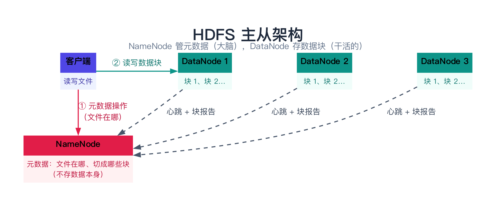
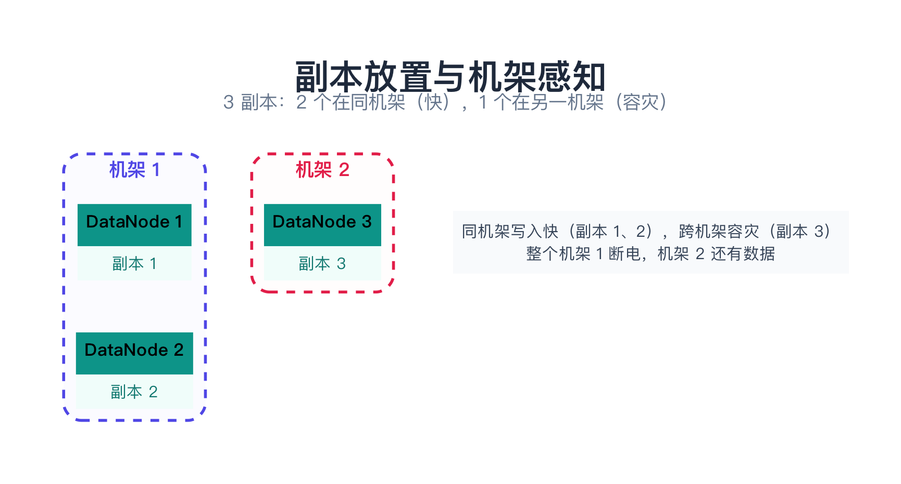
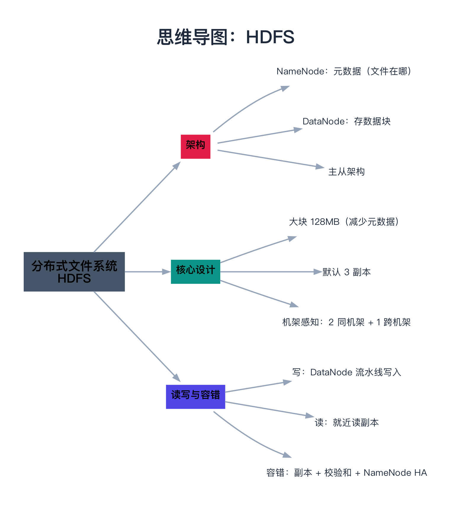

# 分布式文件系统（HDFS）

> 一句话：HDFS（Hadoop Distributed File System）是一个**主从架构**的分布式文件系统——**NameNode 管元数据（文件在哪），DataNode 存数据（切成大块、存多份副本）**。它专为「大文件、顺序读写、一次写多次读」的批处理场景设计。

---

## 目录

1. [为什么需要分布式文件系统](#1-为什么需要分布式文件系统)
2. [从 GFS 到 HDFS](#2-从-gfs-到-hdfs)
3. [HDFS 架构](#3-hdfs-架构)
4. [核心设计](#4-核心设计)
5. [读写流程](#5-读写流程)
6. [容错机制](#6-容错机制)
7. [总结](#7-总结)
8. [延伸阅读](#8-延伸阅读)
9. [思维导图总结](#9-思维导图总结)

---

## 1. 为什么需要分布式文件系统

单机文件系统（如 ext4）能管一块磁盘，但当数据量达到 **TB、PB 级**时，一块磁盘、一台机器根本放不下。这时需要把文件**分散存储到成百上千台机器**上，并对外提供一个统一的文件系统视图——这就是「分布式文件系统」。

它要解决三个核心问题：

1. **容量**：多台机器的磁盘拼成一个巨大的「虚拟磁盘」；
2. **容错**：机器会挂，数据不能丢（靠副本）；
3. **访问**：客户端像访问本地文件一样，读写一个「逻辑文件」，不用关心它在哪台机器上。

> **类比：一个图书馆**。单机文件系统 = 一个小书架，书多了放不下。分布式文件系统 = 一整栋图书馆——**图书管理员（NameNode）**负责登记「哪本书在哪个书架」，**书架（DataNode）**负责真正放书。你要借书，问管理员「书在哪」，管理员告诉你位置，你去对应的书架拿。

---

## 2. 从 GFS 到 HDFS

HDFS 不是凭空设计的，它源自 Google 2003 年的著名论文 **GFS（Google File System）**。GFS 是 Google 内部为处理海量网页爬取、索引数据而设计的分布式文件系统，HDFS 是它的**开源实现**（Hadoop 生态的一部分）。

GFS/HDFS 有几个「反直觉」的设计取舍，都源于一个核心判断：**它面向的是「大文件 + 顺序读写 + 追加写」的批处理场景，而不是「小文件 + 随机读写」的通用场景。**

| 设计取舍 | 为什么 |
|----------|--------|
| 文件块很大（128MB） | 减少元数据数量，适合大文件 |
| 只支持追加写、几乎不支持随机修改 | 简化一致性模型 |
| 「一次写、多次读」 | 批处理（写一次，之后反复分析） |
| 用廉价机器，靠副本容错 | 而不是买昂贵的可靠机器 |

---

## 3. HDFS 架构

HDFS 是典型的**主从（Master-Slave）架构**，两个核心角色：



### 3.1 NameNode（元数据节点，大脑）

NameNode **不存数据**，只存**元数据**：

- 目录树结构（有哪些目录、哪些文件）；
- 每个文件被切成哪些块（block）；
- 每个块存在哪些 DataNode 上（副本位置）。

NameNode 把元数据放在**内存**里（为了快），并持久化到磁盘（FsImage + EditLog）。它是整个集群的**单点**（虽然现代 HDFS 有了 HA，见 6.3）。

> **类比**：NameNode 就是**图书管理员**——他不放书，只拿一个索引本，记录「《三国演义》这本书在第 3、7、12 号书架各有一本」。

### 3.2 DataNode（数据节点，干活的）

DataNode 存**真正的数据块**。每个 DataNode 定期向 NameNode 发送**心跳**（证明自己还活着）和**块报告**（汇报自己存了哪些块）。

> **类比**：DataNode 就是**书架**——真正放书的地方，定期向管理员报告「我还活着，我这里有这些书」。

### 3.3 Secondary NameNode（辅助节点）

注意：Secondary NameNode **不是** NameNode 的热备份。它的作用是**定期合并 NameNode 的 EditLog 到 FsImage**，防止 EditLog 无限增长（用于 NameNode 重启时快速恢复，不是实时容错）。

---

## 4. 核心设计

### 4.1 数据块（Block）：默认 128MB

HDFS 把文件切成大块（block），默认 **128MB**（旧版 64MB）。对比普通文件系统块大小只有 4KB，HDFS 的块**大得多**。

为什么这么大？两个原因：

1. **减少元数据**：一个 1GB 的文件，按 4KB 切是 25 万个块，按 128MB 切只有 8 个块。块越少，NameNode 要记的元数据越少。
2. **适合大文件**：HDFS 面向 GB、TB 级的大文件，块太小会浪费。

### 4.2 副本机制：默认 3 副本

每个块默认存 **3 份副本**（副本因子 replication factor = 3），分别放在**不同的 DataNode** 上。这样任何一个 DataNode 挂了，数据还能从其他副本读。

> **类比**：重要的书，图书馆会**多买几本**放在不同的书架上。烧掉一个书架，其他书架还有。

### 4.3 机架感知（Rack Awareness）

3 个副本不是随便放的，而是遵循「机架感知」策略：

- **前两个副本**放在**同一个机架**的不同机器（写入快）；
- **第三个副本**放在**另一个机架**（防止整个机架断电/故障）。

这样既兼顾了写入性能（同机架快），又保证了容灾（跨机架，一个机架挂了数据还在）。



---

## 5. 读写流程

### 5.1 写流程（流水线写入）

客户端要写文件时，流程如下：

1. 客户端问 NameNode：「我要写 `bigfile.txt`，放哪？」
2. NameNode 返回一组 DataNode 列表（比如 3 个，对应 3 副本）；
3. 客户端把**第一个数据块**发给**第一个 DataNode**；
4. 第一个 DataNode 边收边转发给**第二个 DataNode**，第二个再转发给**第三个**——形成一条**流水线（pipeline）**；
5. 一个块写完，继续写下一个块（重复 1-4）。

关键点：客户端只跟第一个 DataNode 交互，后面的复制由 DataNode 之间**接力**完成，客户端不用操心。

### 5.2 读流程

读比写简单：

1. 客户端问 NameNode：「`bigfile.txt` 的块在哪些 DataNode 上？」
2. NameNode 返回每个块的副本位置（通常按「距离客户端最近」排序）；
3. 客户端从**最近的 DataNode** 读数据。

### 5.3 用 C++ 模拟核心机制

下面用一个简化版，模拟 HDFS 的「切块 + 副本 + 元数据」：

```cpp
#include <iostream>
#include <string>
#include <vector>
#include <map>

struct Block {
    int id;
    std::string data;          // 简化：一个块就是一段字符串
};

struct DataNode {
    std::string name;
    std::vector<Block> blocks;  // 这个 DataNode 存的块
};

struct NameNode {
    std::map<std::string, std::vector<int>> file_to_blocks;      // 文件 → 块列表
    std::map<int, std::vector<std::string>> block_to_nodes;      // 块 → DataNode 列表（副本位置）
};

int main() {
    NameNode nn;
    std::vector<DataNode*> dns;
    DataNode dn1{"dn1"}, dn2{"dn2"}, dn3{"dn3"};
    dns = {&dn1, &dn2, &dn3};

    // 写一个 256MB 的文件，切成 2 个 128MB 的块，每个块 3 副本
    std::string file = "bigfile.txt";
    std::vector<Block> blocks = {{1, "前 128MB"}, {2, "后 128MB"}};

    for (auto& b : blocks) {
        nn.file_to_blocks[file].push_back(b.id);
        for (int i = 0; i < 3; ++i) {                       // 3 副本
            DataNode* dn = dns[(b.id + i) % 3];             // 机架感知会分散，这里简化为轮流
            dn->blocks.push_back(b);
            nn.block_to_nodes[b.id].push_back(dn->name);
        }
    }

    // 打印元数据 + 副本位置
    std::cout << "文件 " << file << " 切成 " << nn.file_to_blocks[file].size() << " 个块\n";
    for (auto& [bid, nodes] : nn.block_to_nodes) {
        std::cout << "块 " << bid << " 的 3 个副本在：";
        for (auto& n : nodes) std::cout << n << " ";
        std::cout << "\n";
    }

    // 容错演示：dn1 挂了，块 1 还有 dn2、dn3 的副本
    std::cout << "dn1 宕机后，块 1 仍能从 dn2 / dn3 读 → 副本容错\n";
    return 0;
}
```

运行结果会看到：文件被切成 2 个块，每个块有 3 个副本分散在 3 个 DataNode 上；即使某个 DataNode 挂了，数据依然可读——这就是 HDFS 副本容错的本质。

---

## 6. 容错机制

### 6.1 副本容错

DataNode 挂了怎么办？NameNode 靠**心跳**发现 DataNode 失联（默认 10 分钟没心跳就判定死亡），然后：

1. 把这个 DataNode 上所有块的副本标记为「不足」；
2. 在**其他 DataNode** 上重新复制，补足到 3 副本。

### 6.2 数据完整性

每个块有**校验和（checksum）**，读取时校验，发现损坏就从其他副本读。

### 6.3 NameNode 的单点故障与 HA

NameNode 是集群的**单点**——它挂了，整个集群就「失明」了（不知道文件在哪）。早期 HDFS 靠 Secondary NameNode 做「冷备」（不是实时切换）。

现代 HDFS 通过 **HA（High Availability）**解决：部署两个 NameNode（Active + Standby），通过 **JournalNode** 共享 EditLog、通过 **ZooKeeper**（ZKFC）做自动故障切换。Active 挂了，Standby 立刻顶上。

---

## 7. 总结

| 方面 | HDFS 的特点 |
|------|-------------|
| 架构 | 主从：NameNode（元数据）+ DataNode（数据） |
| 数据块 | 128MB 大块 |
| 副本 | 默认 3 副本，机架感知放置 |
| 写 | 追加写、流水线写入 |
| 读 | 就近读副本 |
| 适合 | 大文件、顺序读写、批处理、一次写多次读 |
| 不适合 | 小文件、随机写、低延迟、频繁修改 |

一句话：**HDFS 用「大块 + 多副本 + 主从元数据」换来了海量数据的可靠存储，代价是只适合「大文件、顺序读写、批处理」场景。**

下一章进入 [28 数据多副本与故障恢复](28-数据多副本与故障恢复.md)，看多副本系统在节点宕机、数据不一致后，怎么通过反熵、Merkle 树、快照与增量同步把副本「修」回来。

---

## 8. 延伸阅读

- **论文**（HDFS 是"读论文读出来的系统"，两篇原始论文是绕不开的）：
  - Ghemawat, Gobioff, Leung《The Google File System》（SOSP 2003）—— GFS 原文，HDFS 的直接蓝本；「一次写多次读」「大块」「把可靠性交给软件」这些设计取舍都出自这里；
  - Shvachko, Kuang, Radia, Chansler《The Hadoop Distributed File System》（MSST 2010）—— HDFS 自己的论文，重点看它与 GFS 的差异（写流程、Secondary NameNode 的角色、机架感知的默认策略）；
  - Weil 等《Ceph: A Scalable, High-Performance Distributed File System》（OSDI 2006）—— **去中心化**路线的代表：没有 NameNode 这种单点，用 CRUSH 算法让客户端自己算出数据位置，与 HDFS 形成鲜明对照。
- **官方文档**（查参数和默认值最权威）：
  - Apache Hadoop 的 *HDFS Architecture*、*HDFS High Availability Using the Quorum Journal Manager*、*HDFS Commands Guide* 三篇，分别在 [hadoop.apache.org](https://hadoop.apache.org/docs/stable/) 的 HDFS 章节下；
  - 重点看 `dfs.blocksize`、`dfs.replication`、`dfs.namenode.handler.count`、`dfs.datanode.max.transfer.threads` 这几个参数的含义与默认值。
- **工程对照**：
  - Amazon S3 在 2020 年[把一致性模型升级为强一致](https://aws.amazon.com/blogs/aws/amazon-s3-update-strong-read-after-write-consistency/)—— 对象存储的语义演进，正好和 HDFS 的"单一 NameNode 保证强一致"做对比；
  - 想继续挖「元数据怎么扩展」这条线，可以看 HDFS Federation 与阿里 OSS / JuiceFS 这类元数据与数据分离的架构（第 22、24 篇会涉及）。
- **顺着往下读**：[28 数据多副本与故障恢复](28-数据多副本与故障恢复.md)（副本坏了怎么修）与 [23 KV 存储引擎（LSM-Tree）](23-KV存储引擎（LSM-Tree）.md)（HDFS 面向大文件，LSM-Tree 面向高频小写入，两者对比着看更能理解存储引擎的取舍）。

---

## 9. 思维导图总结

```text
分布式文件系统（HDFS）
├── 为什么需要
│   └── 单机磁盘放不下 TB/PB 级数据
├── 起源
│   └── 源自 Google 的 GFS（2003 论文），HDFS 是开源实现
├── 架构（主从）
│   ├── NameNode：管元数据（文件在哪），不存数据
│   ├── DataNode：存真正的数据块
│   └── Secondary NameNode：合并 EditLog，非热备
├── 核心设计
│   ├── 大块：128MB（减少元数据）
│   ├── 副本：默认 3 副本
│   └── 机架感知：2 同机架 + 1 跨机架
├── 读写
│   ├── 写：客户端 → NameNode → DataNode 流水线
│   └── 读：就近读副本
├── 容错
│   ├── 副本容错（心跳发现挂了，补副本）
│   ├── 校验和
│   └── NameNode HA（JournalNode + ZooKeeper）
└── 特点
    └── 适合大文件/顺序写/批处理，不适合小文件/随机写
```


