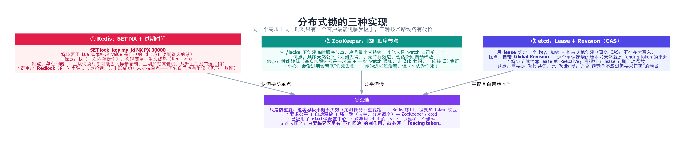
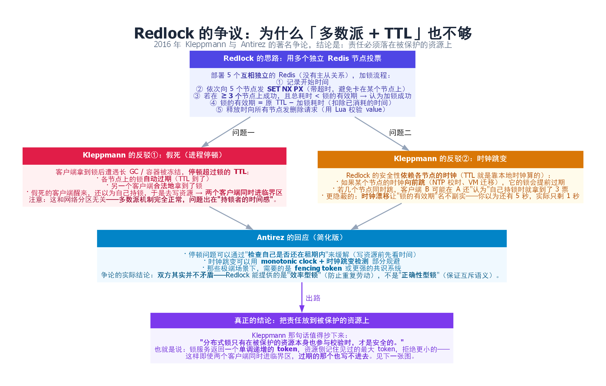
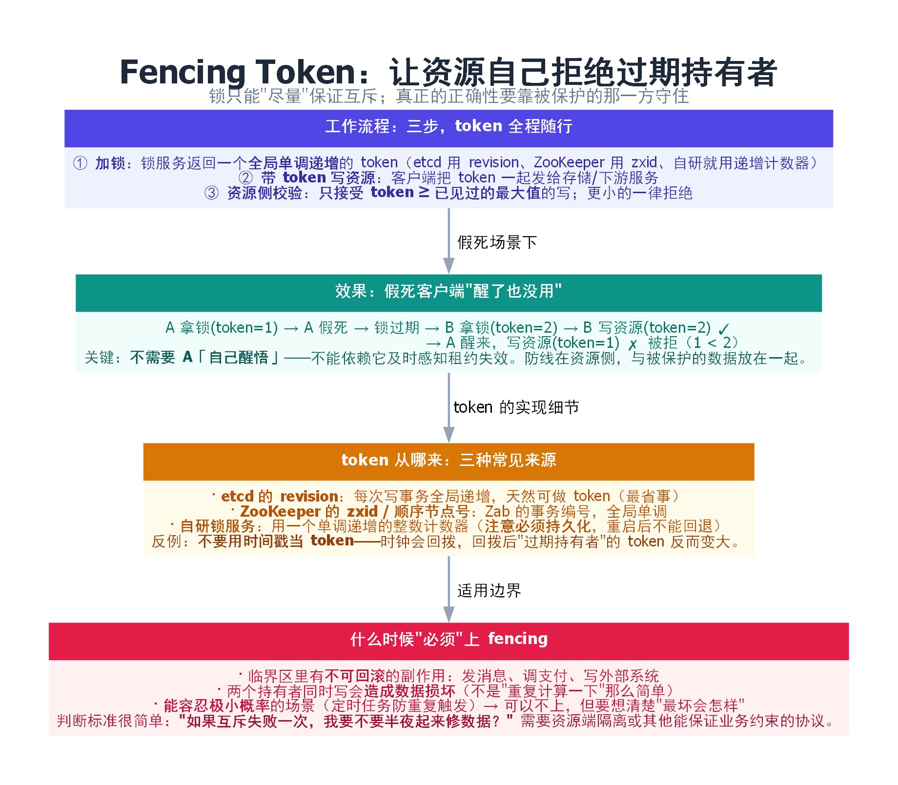
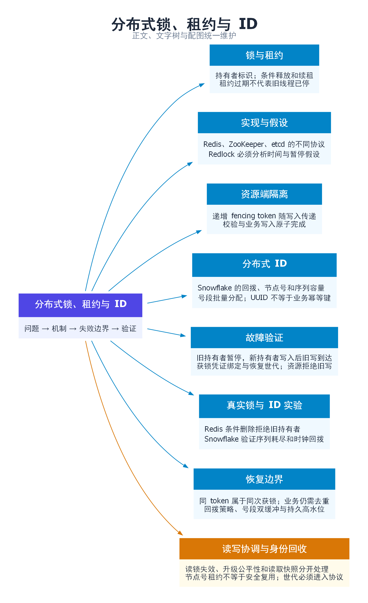

# 分布式锁、租约与 ID

仓库任务拿到锁后暂停，租约过期。新任务开始工作时，旧任务恢复了怎么办？

[上一篇：RPC、超时与重试](../04-RPC%E3%80%81%E8%B6%85%E6%97%B6%E4%B8%8E%E9%87%8D%E8%AF%95/RPC%E3%80%81%E8%B6%85%E6%97%B6%E4%B8%8E%E9%87%8D%E8%AF%95.md) · [返回目录](../README.md) · [下一篇：事务与跨服务业务一致性](../06-%E4%BA%8B%E5%8A%A1%E4%B8%8E%E8%B7%A8%E6%9C%8D%E5%8A%A1%E4%B8%9A%E5%8A%A1%E4%B8%80%E8%87%B4%E6%80%A7/%E4%BA%8B%E5%8A%A1%E4%B8%8E%E8%B7%A8%E6%9C%8D%E5%8A%A1%E4%B8%9A%E5%8A%A1%E4%B8%80%E8%87%B4%E6%80%A7.md)

上一篇用唯一约束防止一次请求执行两遍。本篇考虑多个任务要轮流修改同一资源时，怎样处理锁过期后的旧请求。

**阅读准备：** 先读上一篇的主线案例；本文涉及的 C++ 实验需要理解函数、容器与基本线程同步。

**快速阅读：**先读“把锁服务的判断带到存储端”，再读“面试表达”和 Q&A；遇到说不清原因的结论，回到对应原理小节。

**深入学习：**按正文顺序推演每一步，运行文内完整示例，修改故障发生位置并核对结果。模拟程序只验证写明的假设；真实网络、磁盘和组件行为需按文中的验证步骤另行测试。

实验前先核对[环境、依赖与验证边界](../README.md#lab-compatibility)，各篇已执行与待执行的状态以对应实验说明为准。

<details>
<summary>本文目录（含小节）</summary>

- [把锁服务的判断带到存储端](#section-01)
- [租约](#section-02)
- [旧写入隔离](#section-03)
- [条件更新与 ID](#section-04)
- [按到达顺序检查旧写入](#section-05)
- [三种实现](#section-06)
  - [Redis：SET NX + TTL](#detail-05-1)
  - [ZooKeeper：临时顺序节点](#detail-05-2)
  - [etcd：Lease + CAS](#detail-05-3)
  - [对比与选型](#detail-05-4)
- [Redlock 的争议](#section-07)
  - [Redlock 的思路](#detail-05-5)
  - [反驳一：假死](#detail-05-6)
  - [反驳二：时钟跳变](#detail-05-7)
  - [争论的结论](#detail-05-8)
- [Fencing Token：真正的兜底](#section-08)
- [动手：多节点锁也挡不住的假死（C++）](#section-09)
  - [代码](#detail-05-9)
  - [运行结果与解读](#detail-05-10)
- [常见坑](#section-10)
- [分布式读写锁：多个读者怎样与一个写者协调？](#distributed-rwlock)
- [分布式 ID 的边界条件](#section-11)
- [真实 Redis 实验：旧持有者不能删除新锁](#section-12)
- [C++ 实现 Snowflake 的位布局与拒绝边界](#section-13)
- [时钟回拨和号段恢复：ID 唯一性的账要算完整](#section-14)
- [容器重建后，Snowflake 的节点号能立即复用吗？](#worker-id-lifecycle)
- [面试表达](#section-15)
- [Q&A（常见问题与解答）](#section-16)
  - [拿到写锁后，还能直接使用升级前读到的值吗？](#detail-05-11)
  - [节点号租约到期，旧 Snowflake 实例就不会发号了吗？](#detail-05-12)
  - [etcd revision 可以直接当任何资源的锁凭证吗？](#detail-05-13)
  - [token 相同为什么还可能允许写？](#detail-05-14)
  - [双缓冲号段宕机后为什么允许有空洞？](#detail-05-15)
  - [Lua 条件删除成功，就能保证分布式锁安全了吗？](#detail-05-16)
- [进一步阅读](#section-17)
- [思维导图总结](#section-18)

</details>

<a id="section-01"></a>

## 把锁服务的判断带到存储端

设 A 拿到租约和凭证 41，准备更新库存。A 暂停后租约到期，B 拿到凭证 42。下面的顺序能说明各层该负责什么。

1. B 带着 42 向库存库发更新。库存库比较并记录已接受的最大凭证，同时提交库存修改。
2. A 恢复后，带着 41 发出先前准备的请求。库存库在同一次更新里比较 41 和 42，拒绝旧请求。
3. A 试图释放锁时，锁服务比较持有者标识。当前持有者是 B，A 不能删除 B 的锁。

检查并更新凭证必须在资源端一起完成。若先查最大值，再过一会儿写库存，新的凭证仍可能插进两步之间。每条访问路径都要遵守检查，后台脚本绕过规则也会破坏保护。

如果要保护的是“同一订单只能创建一行”，直接用数据库唯一约束更容易验证。如果要按资源协调长期任务，才需要分析租约、续期、凭证以及资源是否支持比较。

<a id="section-02"></a>

## 租约

租约让锁持有者失联后资源仍能继续使用。持有者标识用于释放时核对身份，避免旧任务删掉新任务的锁。续期延长租约，但无法消除长时间暂停或在网络中延迟的旧请求。

<a id="section-03"></a>

## 旧写入隔离

给每次成功获锁分配递增的 fencing token。A 的凭证是 41，B 的凭证是 42。资源接纳 42 之后，迟到的 41 应被拒绝。比较凭证与提交修改要由资源端作为一个原子操作完成。只在客户端比较，无法挡住已经发出的旧请求。

<a id="section-04"></a>

## 条件更新与 ID

只需要防止重复创建订单时，可以直接用唯一约束或条件更新。需要分布式 ID 时，先确定唯一性范围和排序需求。Snowflake 类方案依赖节点编号和时钟，需要处理回拨。号段由中心批量分配，节点本地递增。UUID 适合独立生成，索引表现取决于版本和布局。

<a id="section-05"></a>

## 按到达顺序检查旧写入

B 的凭证 42 已被库存库接受，随后 A 的请求带着 41 到达。库在同一次更新中比较并拒绝 41。如果资源还没见过 42，它仅凭已保存的 41 无法知道新持有者已经出现。因此要设计新持有者先在资源端建立写入边界。


<a id="section-06"></a>

## 三种实现



<a id="detail-05-1"></a>

### Redis：SET NX + TTL

```text
加锁：SET lock_key <my_id> NX PX 30000     ← NX = 不存在才设置；PX = 30 秒自动过期
解锁：用 Lua 脚本原子地「比对 value 是否是自己，是才删除」
```

两个必须做对的细节：

1. **解锁必须校验 value**：否则 A 的锁过期、B 拿到锁之后，A 的解锁请求会把 **B 的锁**删掉。所以要用 Lua 保证"比对 + 删除"的原子性；
2. **TTL 必须有**：否则客户端崩溃后锁永远不会释放。

**它最大的问题是单点**：Redis 主从是**异步复制**的——主节点刚写入锁就宕机，从节点升主后没有这把锁，另一个客户端就能拿到。这就是 Redlock 想解决的问题。

<a id="detail-05-2"></a>

### ZooKeeper：临时顺序节点

```text
① 在 /locks 下创建【临时顺序节点】lock-0000000001、lock-0000000002 ……
② 拿到子节点列表，自己序号最小 → 持锁
③ 否则只 watch【序号比自己小一位】的那个节点（不是 watch 锁本身！）
④ 被通知后回到 ②
```

- **顺序天然公平**：先到先得，不需要额外协调；
- **无羊群效应**：每次释放只唤醒一个客户端（[副本、共识与 Raft](../03-%E5%89%AF%E6%9C%AC%E3%80%81%E5%85%B1%E8%AF%86%E4%B8%8E%20Raft/%E5%89%AF%E6%9C%AC%E3%80%81%E5%85%B1%E8%AF%86%E4%B8%8E%20Raft.md)）；
- **会话断则自动释放**：进程崩溃 → 心跳停 → 会话过期 → 临时节点消失。

代价是**每次加解锁都要走一遍 Zab 共识**（写日志 + 落盘），吞吐远低于 Redis。

<a id="detail-05-3"></a>

### etcd：Lease + CAS

```text
加锁：用事务 CAS —— 若 lock_key 不存在则创建，并绑定一个 lease（TTL）
解锁：删除 key（或 revoke lease）；进程挂了 lease 到期自动删除
```

**etcd revision 可作为凭证来源，但需要协议设计。** 修改键空间的事务推进 revision，同一事务内多个键的修改共享该 revision；只读或没有修改的事务不能被当成新的获锁编号。应使用能标识本次成功创建锁记录的 revision，确保同一资源不同获取不会复用凭证。跨备份恢复、集群重建还要防编号回退或引入独立世代；资源端负责原子比较并持久保存已见凭证。[etcd 3.5 API 保证](https://etcd.io/docs/v3.5/learning/api_guarantees/)

<a id="detail-05-4"></a>

### 对比与选型

| | Redis | ZooKeeper | etcd |
|---|---|---|---|
| 加锁延迟 | **最低**（内存操作） | 中（走共识） | 中（走共识） |
| 公平性 | 无（要靠客户端排队） | **天然公平**（顺序节点） | 无 |
| 崩溃自动释放 | TTL 到期 | 会话过期 | lease 到期 |
| 主从切换会丢锁吗 | **可能**（异步复制） | 不会（Zab） | 不会（Raft） |
| 自带 fencing token | ❌（要自己造） | ✅ zxid / 顺序号 | ✅ **revision** |
| 适合 | 高频、能容忍极小概率 | 需要公平 + 强一致 | 已用 etcd 的团队 |

**选型先看失效后果**：用于减少重复计算的效率型锁，可考虑 Redis 单实例并接受故障时重复工作。涉及库存或资金时，必须分析切主丢锁与旧进程恢复两种故障。ZooKeeper/etcd 的一致性协调原语改善锁服务状态的安全性，但租约过期不会停止旧进程；业务资源仍需 fencing、条件更新或事务约束拒绝旧写。

<a id="section-07"></a>

## Redlock 的争议



<a id="detail-05-5"></a>

### Redlock 的思路

Redis 作者 Antirez 为了对抗"单点丢锁"，提出了 **Redlock**：

```text
① 部署 5 个【互相独立】的 Redis（没有主从关系）
② 记录开始时间，依次向 5 个节点发 SET NX PX（每个都带短超时）
③ 若在 ≥ 3 个节点上成功，且总耗时 < 锁的有效期 → 加锁成功
④ 锁的有效期 = 原 TTL − 加锁耗时（扣除已消耗的时间）
```

看起来很像共识算法的多数派逻辑。但 2016 年，Kleppmann 写了一篇著名的[《How to do distributed locking》](https://martin.kleppmann.com/2016/02/08/how-to-do-distributed-locking.html)提出反驳，Antirez 也做了[回应](http://antirez.com/news/101)。

<a id="detail-05-6"></a>

### 反驳一：假死

**这是最致命的一击，而且和网络分区无关：**

```text
A 拿到锁（3/5 节点）→ A 遭遇长 GC，停顿超过 TTL
                     → 各节点上的锁【自动过期】
                     → B 合法地拿到锁（3/5 节点）
                     → A 醒来，仍以为自己持锁，去写资源
                     → 两个客户端同时进临界区
```

**多数派机制全程正常**——问题出在"持锁者的时间感"。**多节点投票防的是"节点宕机"，防不了"客户端停顿"。**

<a id="detail-05-7"></a>

### 反驳二：时钟跳变

Redlock 的安全性还**依赖各节点的时钟**（TTL 就是本地时钟算的）：

- 如果某个节点的时钟**向前跳**（NTP 校时、虚拟机迁移），它的锁会**提前过期**；
- 若几个节点同时跳，客户端 B 可能在 A 还"认为"自己持锁时就拿到了 3 票；
- 更隐蔽的是**时钟漂移**：你以为还有 5 秒，实际只剩 1 秒。

<a id="detail-05-8"></a>

### 争论的结论

Antirez 的回应大意是：停顿可以通过"写资源前检查自己是否还在租期内"来缓解，时钟问题可以用 monotonic clock 规避。

**但双方其实并不矛盾**，只是定义了不同强度的"锁"：

| | 效率型锁 | 正确性型锁 |
|---|---|---|
| 目标 | 避免重复劳动 | 保证互斥语义 |
| Redlock / Redis 锁 | ✅ 够用 | ❌ 不够 |
| ZooKeeper / etcd | ✅ | 仍然**需要 fencing** |

这里的工程要点是：如果正确性依赖阻止旧持有者继续写，就需要资源端校验或其他等效的隔离协议。不能只依赖客户端在写之前自行检查租期。

<a id="section-08"></a>

## Fencing Token：真正的兜底



思路只有三步：

```text
① 加锁时，锁服务返回一个【全局单调递增】的 token
② 写资源时，把 token 一起带上
③ 资源侧原子比较 token 与已见最大值：小于则拒绝，大于则更新凭证，同值按本次持有期规则处理
```

效果：

```text
A 拿锁(token=1) → A 假死 → 锁过期 → B 拿锁(token=2) → B 写资源(token=2) ✓
                                  → A 醒来，写资源(token=1) ✗ 被拒绝
```

**关键在于：不需要 A"自己醒悟"**（它可能无法及时发现租约已经失效）。防线在**资源侧**，和被保护的数据放在一起——这也是为什么它叫"fencing"（栅栏）：**把过期持有者挡在数据外面**。

同值能被接受的前提，是一个 token 唯一标识一次获锁，而非多个持有者共用。它允许持有者执行多次写，不保证这些写不重放；单笔业务仍需请求 ID 或状态条件。资源必须将 token 校验、更新最大 token 与业务写入原子完成，并在重启后保存这一约束。

**token 从哪来？**

| 来源 | 说明 |
|------|------|
| **etcd 的锁记录创建 revision** | 同一正常集群历史中递增；要确认获锁唯一性、恢复世代和资源端校验 |
| **ZooKeeper 的 zxid / 顺序节点号** | Zab 的事务编号，天然单调 |
| **自研计数器** | 必须**持久化**，重启后不能回退 |

**反例：不要用时间戳当 token**——时钟可能回拨，回拨之后"过期持有者"的 token 反而更大，栅栏就失效了。

<a id="section-09"></a>

## 动手：多节点锁也挡不住的假死（C++）

下面这个程序模仿 Redlock：**5 个锁节点、quorum=3、TTL 自动过期**，然后让持锁者假死一次，看会发生什么。

<a id="detail-05-9"></a>

### 代码

```cpp
// 分布式锁的「假死」问题：多节点 quorum 加锁也救不了它
// 场景：模仿 Redlock —— 5 个独立节点，客户端要在 >= 3 个节点上抢到锁才算加锁成功，
//       锁带 TTL（自动过期），客户端拿到锁后有一段"持锁时间"。
//   ① 客户端 A 在 5 个节点里的 3 个上抢到锁 → 认为自己持锁成功
//   ② A 遭遇长时间 GC（超过 TTL）→ 各节点的锁自动过期
//   ③ 客户端 B 在另外 3 个节点上抢到锁 → 也认为自己持锁成功
//   ④ 两个客户端同时进入临界区，且 A 后写 → 把 B 的结果覆盖掉
//   ⑤ 加上 fencing token（锁服务返回单调递增的序号，资源侧校验）→ A 的写被拒
// 编译：g++ -std=c++11 -Wall -Wextra -O2 -o lock_demo lock_demo.cpp
#include <algorithm>
#include <iostream>
#include <string>
#include <vector>

struct LockNode {
    std::string name;
    std::string owner;      // 当前持有者（空 = 空闲）
    int expireAt = -1;      // 过期时刻（节点自己的时钟）
    int token = 0;          // 这个节点发出过的最大 token（单调递增）
    explicit LockNode(std::string n) : name(std::move(n)) {}
};

class LockService {
public:
    static const int kTtlMs = 100;

    LockService() : nodes_{LockNode("R1"), LockNode("R2"), LockNode("R3"),
                           LockNode("R4"), LockNode("R5")} {}

    int now() const { return now_; }
    void advance(int ms) {
        for (int i = 0; i < ms; ++i) {
            ++now_;
            for (auto& n : nodes_) if (n.expireAt >= 0 && now_ >= n.expireAt) n.owner.clear();
        }
    }
    std::size_t quorum() const { return nodes_.size() / 2 + 1; }   // 5 节点需要 3

    // 尝试加锁：给每个空闲节点写 owner + TTL，成功数 >= quorum 才算加锁成功
    // 成功时返回 fencing token（取所有节点里最大的 token + 1），失败返回 0
    int tryLock(const std::string& who, const std::vector<std::string>& chosen) {
        int got = 0, maxToken = 0;
        for (const auto& name : chosen) {
            LockNode& n = get(name);
            if (!n.owner.empty()) continue;           // 已被别人持有
            ++got;
            maxToken = std::max(maxToken, n.token);
        }
        if (static_cast<std::size_t>(got) < quorum()) {
            std::cout << "  [" << now_ << "ms] " << who << " 只在 " << got << "/" << nodes_.size()
                      << " 个节点上抢到 → 加锁失败（需要 " << quorum() << "）\n";
            return 0;
        }
        const int myToken = maxToken + 1;
        for (const auto& name : chosen) {
            LockNode& n = get(name);
            if (!n.owner.empty()) continue;
            n.owner = who;
            n.expireAt = now_ + kTtlMs;
            n.token = myToken;
        }
        std::cout << "  [" << now_ << "ms] " << who << " 在 " << got << "/" << nodes_.size()
                  << " 个节点上加锁成功，TTL=" << kTtlMs << "ms，fencing token=" << myToken << "\n";
        return myToken;
    }

    void show() const {
        std::cout << "      节点状态：";
        for (const auto& n : nodes_) {
            std::cout << n.name << "[" << (n.owner.empty() ? "空闲" : n.owner)
                      << ",token=" << n.token << "] ";
        }
        std::cout << "\n";
    }

private:
    LockNode& get(const std::string& n) {
        for (auto& x : nodes_) if (x.name == n) return x;
        return nodes_[0];
    }
    std::vector<LockNode> nodes_;
    int now_ = 0;
};

// 被保护的资源：useFencing = true 时，只接受 token >= 已见过的最大 token 的写
class Resource {
public:
    bool write(const std::string& who, int token, int value, bool useFencing) {
        std::cout << "  [" << who << "] 写 value=" << value << "（携带 token=" << token << "）";
        if (useFencing && token < maxToken_) {
            std::cout << "\n      ✗ 资源侧拒绝：token=" << token << " < 已见过的 " << maxToken_
                      << " —— 这是一个「已被取代的锁持有者」\n";
            return false;
        }
        maxToken_ = std::max(maxToken_, token);
        value_ = value;
        std::cout << " → ✓ 写入成功，资源当前值 = " << value_ << "\n";
        return true;
    }
    int value() const { return value_; }

private:
    int value_ = 0;
    int maxToken_ = 0;
};

int main() {
    LockService svc;
    Resource res;
    const std::vector<std::string> all{"R1", "R2", "R3", "R4", "R5"};

    std::cout << "5 个锁节点，quorum = " << svc.quorum() << "，TTL = " << LockService::kTtlMs << "ms\n\n";

    std::cout << "① 客户端 A 加锁（在 5 个节点上尝试）\n";
    const int tokenA = svc.tryLock("A", all);
    svc.show();

    std::cout << "\n② A 遭遇 250ms 的 GC 停顿：它手上的锁在节点侧陆续过期\n";
    svc.advance(250);
    std::cout << "  （真实时间推进 250ms，A 的锁已过期被自动释放）\n";
    svc.show();

    std::cout << "\n③ 客户端 B 此时来加锁\n";
    const int tokenB = svc.tryLock("B", all);
    svc.show();

    std::cout << "\n④ A 醒来，仍然以为自己持有锁，于是去写资源（此时 B 也在写）\n";
    std::cout << "   —— 先看【资源侧不校验 token】会怎样：\n";
    res.write("B", tokenB, 222, /*useFencing=*/false);
    res.write("A", tokenA, 111, /*useFencing=*/false);
    std::cout << "      ⚠ A 的写覆盖了 B 的写：临界区被两个客户端同时进入了\n";

    std::cout << "\n⑤ 换成【资源侧校验 token】\n";
    res.write("B", tokenB, 333, /*useFencing=*/true);
    res.write("A", tokenA, 111, /*useFencing=*/true);
    std::cout << "      最终资源值 = " << res.value() << "（来自合法持有者 B）\n";

    std::cout << "\n结论：靠 TTL 自动过期 + 多数派加锁，解决的是「节点宕机」这类故障；\n";
    std::cout << "      但解决不了「持锁者假死」——它在锁过期后仍然会去写。\n";
    std::cout << "      唯一可靠的兜底是：让被保护的资源自己校验单调递增的 fencing token。\n";
    return 0;
}
```

<a id="detail-05-10"></a>

### 运行结果与解读

```text
5 个锁节点，quorum = 3，TTL = 100ms

① 客户端 A 加锁（在 5 个节点上尝试）
  [0ms] A 在 5/5 个节点上加锁成功，TTL=100ms，fencing token=1
      节点状态：R1[A,token=1] R2[A,token=1] R3[A,token=1] R4[A,token=1] R5[A,token=1] 

② A 遭遇 250ms 的 GC 停顿：它手上的锁在节点侧陆续过期
  （真实时间推进 250ms，A 的锁已过期被自动释放）
      节点状态：R1[空闲,token=1] R2[空闲,token=1] R3[空闲,token=1] R4[空闲,token=1] R5[空闲,token=1] 

③ 客户端 B 此时来加锁
  [250ms] B 在 5/5 个节点上加锁成功，TTL=100ms，fencing token=2
      节点状态：R1[B,token=2] R2[B,token=2] R3[B,token=2] R4[B,token=2] R5[B,token=2] 

④ A 醒来，仍然以为自己持有锁，于是去写资源（此时 B 也在写）
   —— 先看【资源侧不校验 token】会怎样：
  [B] 写 value=222（携带 token=2） → ✓ 写入成功，资源当前值 = 222
  [A] 写 value=111（携带 token=1） → ✓ 写入成功，资源当前值 = 111
      ⚠ A 的写覆盖了 B 的写：临界区被两个客户端同时进入了

⑤ 换成【资源侧校验 token】
  [B] 写 value=333（携带 token=2） → ✓ 写入成功，资源当前值 = 333
  [A] 写 value=111（携带 token=1）
      ✗ 资源侧拒绝：token=1 < 已见过的 2 —— 这是一个「已被取代的锁持有者」
      最终资源值 = 333（来自合法持有者 B）

结论：靠 TTL 自动过期 + 多数派加锁，解决的是「节点宕机」这类故障；
      但解决不了「持锁者假死」——它在锁过期后仍然会去写。
      唯一可靠的兜底是：让被保护的资源自己校验单调递增的 fencing token。
```

逐条对照：

| 输出片段 | 印证了什么 |
|----------|-----------|
| ① `A 在 5/5 个节点上加锁成功，fencing token=1` | Redlock 式加锁：多节点投票 + TTL |
| ② `A 的锁已过期被自动释放`（节点状态全变空闲） | **TTL 到期，锁自动释放**——这是防"客户端崩溃"的设计 |
| ③ `B 在 5/5 个节点上加锁成功，token=2` | **B 完全合法**：它不知道 A 只是假死 |
| ④ `B 写 → ✓`，`A 写 → ✓` | **资源侧不校验 token 时，假死客户端照样写得进去**——多数派毫无帮助 |
| ⑤ `A 的写被拒绝：token=1 < 已见过的 2` | **fencing 让资源自己挡住过期持有者**，不依赖 A 醒悟 |
| ⑤ `最终资源值 = 333`（B 的值） | 合法持有者的写不受影响 |

> 注意第 ④ 步里 **A 和 B 都在"合法"地执行**：A 认为自己的锁还没过期，B 手里的锁是刚抢到的。**锁服务在这一刻无法裁决谁对**——只有资源侧能做这个判断。

<a id="section-10"></a>

## 常见坑

**① 解锁不校验持有者**

`DEL lock_key` 直接删——如果此时你的锁已经过期、别人刚拿到锁，你就把**别人的锁**删了。必须用 Lua（Redis）或 CAS（etcd/zk）保证"校验 + 删除"原子。

**② 把 TTL 当"业务超时"**

很多人把锁 TTL 设成"业务大概要跑多久"，然后指望它在业务超时后自动兜底。TTL 越短，暂停或网络延迟越容易使租约过期；TTL 越长，持有者崩溃后的接管就越慢。应结合可测的耗时分布与接管目标选择期限，长任务可使用带持有者校验的续租。续租线程也会暂停，网络也会中断，因此不能仅靠“最坏耗时加余量”或看门狗保证安全；资源端仍需拒绝旧持有者的写入。

**③ 锁内做重活**

锁是个**串行点**。在锁里做几百毫秒的 RPC 或大文件处理，会把所有竞争者都卡住——而且容易把锁拖到超时。**锁内只做"判断 + 写标记"，重活挪出去。**

**④ 用时间戳做 token**

见本文 Fencing Token 小节。时钟回拨会让 fencing 失效，而且这种 bug 只在特定时刻出现，极难排查。

**⑤ 忽略"假死"这一整类风险**

很多团队只考虑了"客户端崩溃"（TTL 能兜住），完全没考虑"客户端还活着但不干活了"（TTL 兜不住）。**GC、CPU 限流、VM 挂起**在容器时代都是常态，不是极端情况。

**⑥ 在正确的场景用了错误的锁**

| 场景 | 该用什么 |
|------|----------|
| 单机内多线程互斥 | `std::mutex` / 进程内的锁 |
| 多副本（K8s Pod）同一份数据 | 分布式锁 + fencing |
| 数据库行的互斥更新 | **数据库乐观锁（version 列）**——最省事 |
| 防定时任务重复触发 | 分布式锁（效率型够用）或数据库唯一键 |

最后一行值得强调：**数据库唯一索引**常常是比分布式锁更可靠的"互斥"手段——它就是天然的、带持久化的 fencing。

<a id="distributed-rwlock"></a>

## 分布式读写锁：多个读者怎样与一个写者协调？

读写锁允许多个读者同时进入，但写者需要排他资格。难点不只是数读者：R 持读租约后暂停，租约到期，W 开始修改；R 恢复后若还把自己当作受保护的读者，就可能在 W 修改期间继续读取，得到与承诺不符的视图。

一种排队设计是让每个请求创建带 R/W 类型的临时顺序结点。读者等待它前面的写请求，写者等待它前面的所有请求；新的读者不能越过已经排队的写者，否则持续读流量会饿死写者。ZooKeeper 的共享锁配方体现了这种先后关系，但会话失效后如何访问外部资源，仍由业务协议处理。[ZooKeeper Shared Locks](https://zookeeper.apache.org/doc/current/recipes.html#Shared+Locks)

| 边界 | 不能依赖什么 | 可选处理 |
| --- | --- | --- |
| 读租约失效后恢复 | 进程内的“已获读锁”标志 | 终止本次读取；或由存储提供明确的快照读取与版本校验 |
| 两个读者同时升级为写锁 | 一边保留读锁，一边无限等对方释放 | 明确不支持原子升级，先释放再排队获取写锁，并重新读取验证；或使用支持升级的完整协议 |
| 写者等待时新读者到达 | 任意放行新读者 | 使用有序队列或明确公平策略，限制等待时间 |
| 写者租约到期后恢复 | 仅凭协调端删除了锁记录 | 由写入资源校验世代，拒绝旧写者 |

写入 fencing 不能自动保护所有读取：要承诺读取期间数据不变，就需要读访问也遵循资格校验和有效期，或采用一致快照；只在读前检查一次，再读取多个独立对象，中途仍可能发生写入。若数据库已能提供所需快照，分布式读写锁未必是更简单的选择。

验证时暂停一个读者直到其租约失效，再启动写者，最后恢复读者。检查得到的是协议允许的快照或明确失败，而不是拼接出的半旧半新结果；同时测试两个读者并发升级是否能在截止时间内结束。

<a id="section-11"></a>

## 分布式 ID 的边界条件

以一种 Snowflake 布局为例，时间占 41 位、节点占 10 位、同毫秒内的序列占 12 位。布局本身给出上限：1024 个节点，每节点每毫秒最多 4096 个编号，时间范围约 69 年。节点编号重复时，两台机器在同一毫秒生成同一序列就会碰撞。时间回拨时应等待或拒绝，序列耗尽要等下一毫秒，不能把序列清零继续发。进程重启还需要核对持久保存的时间高水位，或按协议取得与旧实例不会冲突的节点身份。

号段方案由数据库在一个事务里把高水位从 1000 推到 2000，再把区间交给实例。实例可本地递增，也可提前预取下一段。进程退出会留下空号，空号与重复是不同问题。UUID 可独立生成，随机布局与按时间排序的布局对索引局部性有不同影响。订单编号是否可预测、是否泄露时间、是否需要跨地区排序，应与唯一性分别评估。[UUID 规范](https://www.rfc-editor.org/rfc/rfc9562.html)


<a id="section-12"></a>

## 真实 Redis 实验：旧持有者不能删除新锁

把锁想成带姓名的预约记录。A 的预约过期，B 已经重新预约。A 恢复后若直接删除记录，就会删掉 B 的预约。因此释放时需要把“核对当前持有者”和“删除”放在 Redis 内一次完成。Lua 脚本保证执行期间不被其他命令插入，但不保证另一个数据库的写入也被保护。[Redis 锁模式](https://redis.io/docs/latest/develop/clients/patterns/distributed-locks/)

环境：Ubuntu 24.04、Redis 7.x、hiredis、C++17。本轮没有 Redis 服务，以下运行结果为预期。用本机独立测试实例，不连接业务 Redis。

```bash
sudo apt install -y redis-server libhiredis-dev build-essential pkg-config
redis-server --bind 127.0.0.1 --port 6380 --save '' --appendonly no
```

另一个终端把以下代码保存为 `redis_owner.cpp`。每个进程使用命令行传入的持有者标识；实验用 A/B，工程中要为每次获取生成不可复用的随机标识。

```cpp
#include <hiredis/hiredis.h>
#include <chrono>
#include <iostream>
#include <memory>
#include <stdexcept>
#include <string>
#include <thread>
struct ContextFree { void operator()(redisContext* p) const { redisFree(p); } };
struct ReplyFree { void operator()(redisReply* p) const { freeReplyObject(p); } };
using Reply = std::unique_ptr<redisReply, ReplyFree>;
int main(int argc, char** argv) {
    if (argc != 3) { std::cerr << "usage: redis_owner OWNER HOLD_MS\n"; return 2; }
    try {
        const std::string owner = argv[1];
        const auto hold = std::stoll(argv[2]);
        if (owner.empty() || hold < 0) throw std::runtime_error("invalid arguments");
        timeval timeout{2, 0};
        std::unique_ptr<redisContext, ContextFree> c(redisConnectWithTimeout("127.0.0.1", 6380, timeout));
        if (!c || c->err) throw std::runtime_error("connect failed");
        if (redisSetTimeout(c.get(), timeout) != REDIS_OK) throw std::runtime_error("timeout setup failed");
        Reply acquired(static_cast<redisReply*>(redisCommand(c.get(),
            "SET lab:lock %b NX PX 1000", owner.data(), owner.size())));
        if (!acquired) throw std::runtime_error("acquire result unknown");
        if (acquired->type == REDIS_REPLY_NIL) { std::cout << "busy\n"; return 3; }
        if (acquired->type != REDIS_REPLY_STATUS || std::string(acquired->str) != "OK")
            throw std::runtime_error("acquire failed");
        std::cout << "acquired " << owner << std::endl;
        std::this_thread::sleep_for(std::chrono::milliseconds(hold));
        const std::string release =
            "if redis.call('get',KEYS[1]) == ARGV[1] then "
            "return redis.call('del',KEYS[1]) else return 0 end";
        Reply result(static_cast<redisReply*>(redisCommand(c.get(),
            "EVAL %b 1 lab:lock %b", release.data(), release.size(), owner.data(), owner.size())));
        if (!result || result->type != REDIS_REPLY_INTEGER)
            throw std::runtime_error("release result unknown");
        std::cout << "released=" << result->integer << '\n';
    } catch (const std::exception& e) { std::cerr << e.what() << '\n'; return 1; }
}
```

```bash
g++ -std=c++17 -O2 -Wall -Wextra redis_owner.cpp -o redis_owner $(pkg-config --cflags --libs hiredis) -pthread
./redis_owner A 1800 &
a_pid=$!
sleep 1.2
redis-cli -p 6380 SET lab:lock B NX PX 10000
wait "$a_pid"
redis-cli -p 6380 GET lab:lock
```

预期 A 成功获取锁，之后 B 的 SET 返回 OK；A 释放返回 0，最后 GET 仍返回 B。若时序受到机器负载影响，先确认 A 打印 acquired，再开始计时；不能只凭最后输出判断全部步骤成功。进程结束后这个测试键会自然过期。

续期也必须校验持有者，不能无条件 PEXPIRE。以下命令只有 B 仍是持有者时才续期，否则返回 0：

```bash
redis-cli -p 6380 EVAL "if redis.call('get',KEYS[1]) == ARGV[1] then return redis.call('pexpire',KEYS[1],ARGV[2]) else return 0 end" 1 lab:lock B 10000
```

Redisson 看门狗在客户端运行期间安排续期任务，续期仍需要确认当前锁归自己。客户端长暂停、网络中断或 Redis 不可用都可能阻止续期，恢复执行时不能假定租约仍有效。这里已经验证的是“旧人不能误删新锁”，尚未验证“旧人不能写外部资源”；后者仍需要资源端 fencing 或等效的业务条件更新。

若连接失败，检查 Redis 是否监听 6380；若 GET 为 nil，可能 B 的租约也已到期。不要通过无限续期掩盖业务卡死，应同时限制任务截止时间并记录续期失败。此例关闭了持久化，专门观察持有者检查，不代表 Redis 主从切换后的安全锁方案。

<a id="section-13"></a>

## C++ 实现 Snowflake 的位布局与拒绝边界

ID 不是把时间戳直接返回。毫秒内会有多次调用，多台机器也可能同时调用，所以需要“时间 + 节点号 + 毫秒内序号”。本例采用 41/10/12 位布局，用一个互斥锁保护本进程内状态。时间回拨和序号耗尽直接报告错误，让调用方决定等到下一毫秒还是返回繁忙。

保存为 `snowflake.cpp`，使用 C++17。时钟作为参数输入，是为了确定性地触发回拨；生产调用方从 `system_clock` 取得相对约定 epoch 的毫秒数。

```cpp
#include <cassert>
#include <cstdint>
#include <iostream>
#include <mutex>
#include <stdexcept>
class Snowflake {
    std::mutex mutex_;
    const std::uint64_t node_;
    std::uint64_t last_ = 0, sequence_ = 0;
    bool initialized_ = false;
public:
    explicit Snowflake(std::uint64_t node) : node_(node) {
        if (node > 1023) throw std::invalid_argument("node out of range");
    }
    std::uint64_t next(std::uint64_t millis_since_epoch) {
        std::lock_guard<std::mutex> lock(mutex_);
        if (millis_since_epoch >= (std::uint64_t{1} << 41))
            throw std::overflow_error("timestamp out of range");
        if (initialized_ && millis_since_epoch < last_)
            throw std::runtime_error("clock rollback");
        if (initialized_ && millis_since_epoch == last_) {
            if (sequence_ == 4095) throw std::runtime_error("sequence exhausted");
            ++sequence_;
        } else { sequence_ = 0; }
        last_ = millis_since_epoch; initialized_ = true;
        return (last_ << 22) | (node_ << 12) | sequence_;
    }
};
int main() {
    Snowflake generator(7);
    const auto first = generator.next(100);
    auto previous = first;
    for (int i = 1; i < 4096; ++i) {
        auto current = generator.next(100);
        assert(current == previous + 1); previous = current;
    }
    bool exhausted = false, rollback = false;
    try { generator.next(100); } catch (const std::runtime_error&) { exhausted = true; }
    try { generator.next(99); } catch (const std::runtime_error&) { rollback = true; }
    const auto next_ms = generator.next(101);
    assert(exhausted && rollback && next_ms > previous);
    assert(((first >> 12) & 1023) == 7);
    std::cout << "generated=4096 exhausted=rejected rollback=rejected next_ms=ok\n";
}
```

```bash
g++ -std=c++17 -O2 -Wall -Wextra -pthread snowflake.cpp -o snowflake
./snowflake
```

预期输出 `generated=4096 exhausted=rejected rollback=rejected next_ms=ok`。每次生成 O(1)，同一实例内串行更新；并发吞吐不能仅由 4096/毫秒推断，因为还受线程竞争和时钟读取成本影响。

**这个类不是完整的全局 ID 服务。** 它没有分配节点号，也没有保存重启前的时间高水位。同一毫秒内重启、复用同一节点号，可能从序号 0 再次生成旧 ID。部署必须补上身份分配和重启协议；例如保证新进程的时间严格越过旧进程可能用过的窗口，再允许复用身份。号段方案把这个问题转移到数据库中：原子领取不重叠区间，崩溃后放弃剩余号段，不能为了补空号重新发放旧编号。

UUID 的随机型与时间排序型也不能混为一谈：随机碰撞概率和数据库索引局部性是不同指标。使用标准库实现并核对 UUID 版本，避免自己拼接弱随机数；业务幂等仍应使用业务语义键，而不是每次重试重新生成一个 UUID。


**本轮实测：**Windows / MSYS2 GCC，以 `-std=c++17 -Wall -Wextra -pthread` 编译上面的 Snowflake 完整代码成功，输出 `generated=4096 exhausted=rejected rollback=rejected next_ms=ok`。这验证本地发号边界，不验证多机节点号分配与重启恢复。

<a id="section-14"></a>

## 时钟回拨和号段恢复：ID 唯一性的账要算完整

Snowflake 的时间字段不是装饰：同一节点号在相同毫秒内重用相同序列，就产生重复 ID。进程重启忘了上次发到哪里，与时钟回拨造成的风险类似。

| 处理方法 | 为什么能避开重复 | 代价与边界 |
| --- | --- | --- |
| 拒绝回拨期间发号 | 不重新进入已使用的时间区间 | 调用失败，需要业务退避；前文代码采用此法 |
| 等待物理时间追上高水位 | 恢复时使用此前未用过的时间 | 大幅回拨可能等待很久，必须有等待上限 |
| 保持逻辑时间不回退 | 时间字段取当前时间与高水位较大者，继续分配序列 | 序列仍可能耗尽；ID 时间不再精确代表墙上时间，高水位必须可恢复 |
| 重新分配节点身份 | 新实例进入与旧实例不同的编号空间 | 节点号不能与仍可能发号的旧实例重复；租约过期本身不能让旧实例停机 |

号段把协调放在批量申请时：数据库原子地把某业务的高水位从 H 提高到 H+B，返回 `[H,H+B)`。节点在内存里消费这一段。宕机会浪费剩余编号，但已发出的编号不能因恢复而重新分配，因此数据库高水位必须持久保存。

双缓冲指“当前号段仍可用时，提前申请下一段”。切换时应在本地互斥保护下只切换一次，并保证新段与旧段不重叠。预取失败可继续消费当前段，耗尽后必须拒绝或等待，不能绕回起点。多个预取线程重复申请最多造成空洞，重复消费同一段才会破坏唯一性。业务若要求连续无空洞，应重新评估需求，不能同时把崩溃后不重复与不浪费剩余号段视为免费保证。


<a id="worker-id-lifecycle"></a>

## 容器重建后，Snowflake 的节点号能立即复用吗？

容器名和 IP 会变化，直接把静态配置复制到多个实例，可能让它们使用同一个节点号。可以用 etcd 事务抢占一个空槽位，或用 ZooKeeper 顺序注册分配身份；注册记录保存实例唯一标识并绑定租约或会话。续租失败时停止发号，释放时核对持有者，避免旧实例删掉新实例的登记。[etcd 事务与租约接口](https://etcd.io/docs/v3.6/learning/api/)

这只解决协调端“当前把槽位给谁”，还没有解决旧实例恢复。A 暂停后失去节点号 7，B 获得 7；A 若恢复继续发号，两者仍可能生成相同的“时间＋节点号＋序列”。发号前查一次租约也存在检查后暂停的空隙。仅用租约登记，不能在任意长暂停模型下证明唯一性。

| 方案 | 还需要什么条件或代价 |
| --- | --- |
| 不复用仍可能活动的节点号 | 身份空间有限，需要可靠确认旧实例不能继续发号 |
| 将新的世代编码进 ID | 新旧实例使用互不相交的编号空间；占用额外位，并处理世代耗尽与恢复 |
| 分配持久化的不重叠号段 | 未用完的旧号段也不能重新分配；允许空洞，中心维护可靠高水位 |
| 仅允许受控入口接受当前世代的 ID | 可拒绝旧实例提交，但不能宣称旧实例从未在本地生成重复值；所有入口必须覆盖校验 |

若保留原 Snowflake 位布局，不能拿未写进 ID 的租约编号充当“自动去重位”。时间高水位、节点身份和序列恢复必须一起设计。演练应暂停 A、让租约过期并启动 B，再恢复 A，检查两个实例的全部输出和外部接收结果；不能只检查注册中心某一时刻只有一个 owner。

<a id="section-15"></a>

## 面试表达

租约让持有者失联后别人可以接管，但过期不会停止旧进程。条件删除只保护锁记录，真正的业务资源还要原子校验递增 fencing token 或使用状态条件，拒绝旧持有者写入。Redis、ZooKeeper、etcd 的锁服务保证不同，不能消除进程暂停。若只是防重复订单，唯一约束往往更直接；锁的代价是协调延迟、续租和恢复复杂性。

进一步追问工程边界时，我会补充：读锁失效、升级公平性和读取快照分开处理；节点号租约不等于安全复用；世代必须进入协议。故障验证既检查恢复进度，也检查恢复后是否仍满足原来的业务承诺。

<a id="section-16"></a>

## Q&A（常见问题与解答）

<a id="detail-05-11"></a>

### 拿到写锁后，还能直接使用升级前读到的值吗？

不能默认可以。释放读锁再获取写锁之间，别人可能已经修改数据，需要重新读取或验证版本；原子升级必须由协议明确支持。

<a id="detail-05-12"></a>

### 节点号租约到期，旧 Snowflake 实例就不会发号了吗？

不会自动停止。复用前必须解决旧实例恢复的问题，例如采用不重叠身份或号段，并处理持久化高水位；只检查注册表 owner 不足以证明唯一性。

<a id="detail-05-13"></a>

### etcd revision 可以直接当任何资源的锁凭证吗？

不能。需要绑定一次成功获取、明确资源范围与重建世代；同一事务内多个修改共享 revision，资源端还必须原子校验并保存最高凭证。

<a id="detail-05-14"></a>

### token 相同为什么还可能允许写？

同一持有期可能执行多次操作。前提是 token 唯一对应一次获锁，且业务另有重放与顺序约束；不能让不同获取共用 token。

<a id="detail-05-15"></a>

### 双缓冲号段宕机后为什么允许有空洞？

已分配段中的剩余编号可以放弃，但不能回收重发。唯一性优先于连续性，中心持久高水位用于防止重复分配。

<a id="detail-05-16"></a>

### Lua 条件删除成功，就能保证分布式锁安全了吗？

只能证明当前 key 的持有者匹配后才删除。旧进程在租约过期后仍可能写业务数据，因此资源端仍需检查世代或其他并发约束。

**为什么释放锁时比较 UUID，还要另设递增凭证？**

UUID 用于判断释放者是不是当前持有者。递增凭证用于让存储资源识别更旧的写入，两者解决不同步骤的问题。

**能直接把随机 UUID 当 fencing token 吗？**

随机标识适合核对锁归谁持有。要判断哪个持有者更新，资源还需要可比较、单调递增的凭证。

[延伸阅读](https://martin.kleppmann.com/2016/02/08/how-to-do-distributed-locking.html)

<a id="section-17"></a>

## 进一步阅读

- **争论原文（强烈建议两篇都读）**：
  - Martin Kleppmann《[How to do distributed locking](https://martin.kleppmann.com/2016/02/08/how-to-do-distributed-locking.html)》（2016）—— 对 Redlock 的两条反驳，以及"fencing token"的提出；
  - Salvatore Sanfilippo（Antirez）《[Is Redlock safe?](http://antirez.com/news/101)》—— 作者的回应；两篇对照读能看清"效率型锁 vs 正确性型锁"的分界。
- **Redis 官方**：[Distributed Locks with Redis](https://redis.io/docs/manual/patterns/distributed-locks/) —— Redlock 的规范描述与各语言实现列表；同时注意它开头那句"如果你只关心效率，单实例锁就够了"。
- **实现参考**：Redisson（看门狗续期）、Apache Curator 的 `InterProcessMutex`（临时顺序节点）、etcd 的 `concurrency` 包（`clientv3/concurrency` 里的 `Mutex` 直接用了 revision 做 token）。
- **同类问题**：Chubby 论文（Burrows, OSDI 2006）第 2.3 节的租约与序列号设计；Google 的《[Fencing in the Cloud](https://cloud.google.com/blog/products/storage-data-transfer/fencing-in-the-cloud)》类文章。
- **顺着往下读**：[副本、共识与 Raft](../03-%E5%89%AF%E6%9C%AC%E3%80%81%E5%85%B1%E8%AF%86%E4%B8%8E%20Raft/%E5%89%AF%E6%9C%AC%E3%80%81%E5%85%B1%E8%AF%86%E4%B8%8E%20Raft.md)（假死的完整时间线）、[事务与跨服务业务一致性](../06-%E4%BA%8B%E5%8A%A1%E4%B8%8E%E8%B7%A8%E6%9C%8D%E5%8A%A1%E4%B8%9A%E5%8A%A1%E4%B8%80%E8%87%B4%E6%80%A7/%E4%BA%8B%E5%8A%A1%E4%B8%8E%E8%B7%A8%E6%9C%8D%E5%8A%A1%E4%B8%9A%E5%8A%A1%E4%B8%80%E8%87%B4%E6%80%A7.md)（跨资源的原子性）。

下一篇要回答的问题是：订单、库存和支付分属三个服务，库存已扣但支付失败，订单该处于什么状态？

<a id="section-18"></a>

## 思维导图总结

```text
分布式锁、租约与 ID
├── 读写协调与身份回收
│   ├── 读锁失效、升级公平性和读取快照分开处理
│   └── 节点号租约不等于安全复用；世代必须进入协议
├── 锁与租约
│   ├── 持有者标识；条件释放和续租
│   └── 租约过期不代表旧线程已停
├── 实现与假设
│   ├── Redis、ZooKeeper、etcd 的不同协议
│   └── Redlock 必须分析时间与暂停假设
├── 资源端隔离
│   ├── 递增 fencing token 随写入传递
│   └── 校验与业务写入原子完成
├── 分布式 ID
│   ├── Snowflake 的回拨、节点号和序列容量
│   └── 号段批量分配；UUID 不等于业务幂等键
├── 故障验证
│   ├── 旧持有者暂停，新持有者写入后旧写到达
│   └── 获锁凭证绑定与恢复世代；资源拒绝旧写
├── 真实锁与 ID 实验
│   ├── Redis 条件删除拒绝旧持有者
│   └── Snowflake 验证序列耗尽和时钟回拨
└── 恢复边界
    ├── 同 token 属于同次获锁；业务仍需去重
    └── 回拨策略、号段双缓冲与持久高水位
```


