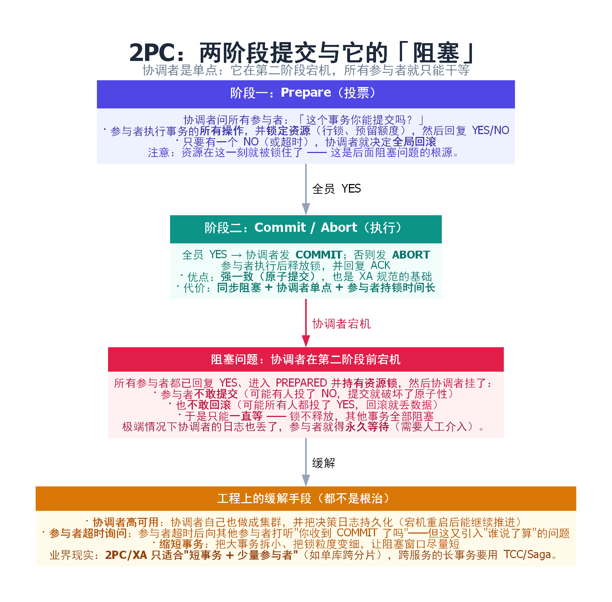
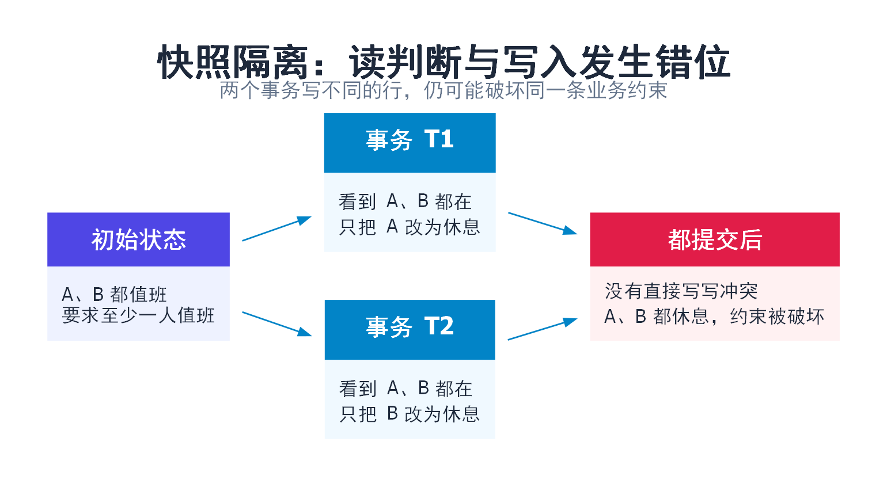
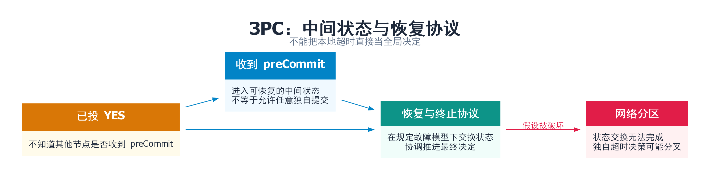
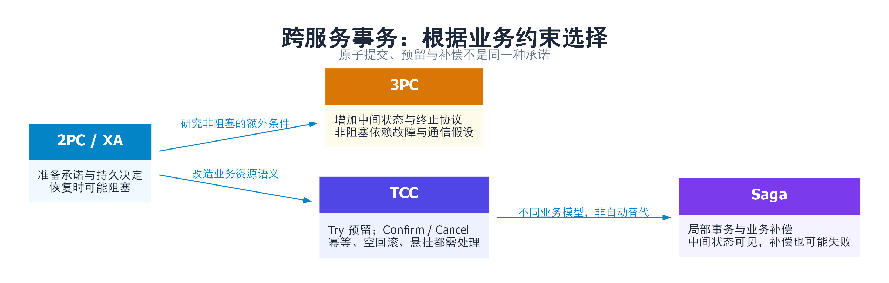
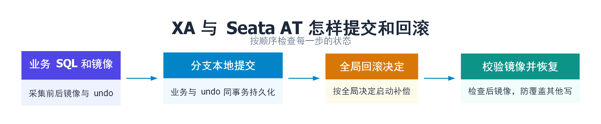
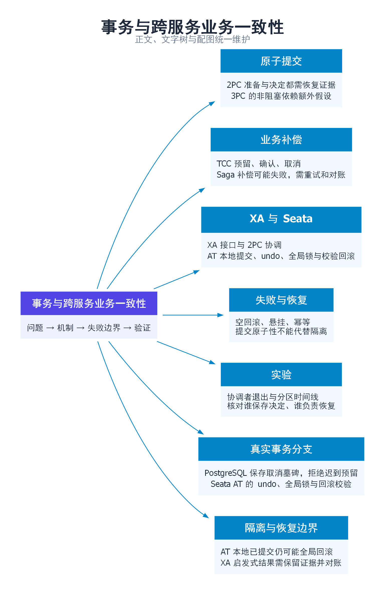

# 事务与跨服务业务一致性

订单、库存和支付分属三个服务，库存已扣但支付失败，订单该处于什么状态？

[上一篇：分布式锁、租约与 ID](../05-%E5%88%86%E5%B8%83%E5%BC%8F%E9%94%81%E3%80%81%E7%A7%9F%E7%BA%A6%E4%B8%8E%20ID/%E5%88%86%E5%B8%83%E5%BC%8F%E9%94%81%E3%80%81%E7%A7%9F%E7%BA%A6%E4%B8%8E%20ID.md) · [返回目录](../README.md) · [下一篇：消息队列与可靠事件](../07-%E6%B6%88%E6%81%AF%E9%98%9F%E5%88%97%E4%B8%8E%E5%8F%AF%E9%9D%A0%E4%BA%8B%E4%BB%B6/%E6%B6%88%E6%81%AF%E9%98%9F%E5%88%97%E4%B8%8E%E5%8F%AF%E9%9D%A0%E4%BA%8B%E4%BB%B6.md)

上一篇处理多个任务对同一资源的竞争。下单还会修改订单、库存和支付等多个资源，需要明确每一步失败后怎样收尾。

**阅读准备：** 先读上一篇的主线案例；本文涉及的 C++ 实验需要理解函数、容器与基本线程同步。

**快速阅读：** 先读“对照同一笔订单的三种处理方式”，再读“面试表达”和 Q&A；遇到说不清原因的结论，回到对应原理小节。

**深入学习：** 按正文顺序推演每一步，运行文内完整示例，修改故障发生位置并核对结果。模拟程序只验证写明的假设；真实网络、磁盘和组件行为需按文中的验证步骤另行测试。

实验前先核对[环境、依赖与验证边界](../README.md#lab-compatibility)，各篇已执行与待执行的状态以对应实验说明为准。

<details>
<summary>本文目录（含小节）</summary>

- [1 对照同一笔订单的三种处理方式](#section-01)
- [2 原子提交](#section-02)
- [3 业务补偿](#section-03)
- [4 状态恢复](#section-04)
- [5 库存已预留，支付超时](#section-05)
- [6 2PC：原子提交的代价](#section-06)
  - [6.1 两个阶段](#detail-06-1)
  - [6.2 阻塞问题](#detail-06-2)
  - [6.3 工程上的缓解手段](#detail-06-3)
  - [6.4 为什么原子提交还不够：快照隔离下的两名值班医生](#isolation-write-skew)
- [7 3PC：非阻塞保证依赖哪些假设](#section-07)
- [8 TCC：业务层的两阶段](#section-08)
  - [8.1 Try / Confirm / Cancel](#detail-06-4)
  - [8.2 三个经典坑：空回滚、悬挂、幂等](#detail-06-5)
- [9 TCC 的状态记录怎样与库存一起提交？](#tcc-local-atomicity)
- [10 Saga：一串本地事务 + 一串补偿](#section-09)
- [11 事务选型：先写业务承诺，再选协议](#transaction-decision)
- [12 动手：三个场景看清 2PC / 3PC 的取舍（C++）](#section-10)
  - [12.1 代码](#detail-06-6)
  - [12.2 运行结果与解读](#detail-06-7)
- [13 常见坑](#section-11)
- [14 XA 与 Seata AT 怎样提交和回滚](#section-12)
- [15 Seata AT 的内部角色与回滚证据](#section-13)
- [16 真实 PostgreSQL 实验：TCC 空回滚为什么要留下记录](#section-14)
- [17 AT 的读隔离与 XA 的启发式结果](#section-15)
- [18 面试表达](#section-16)
- [19 Q&A（常见问题与解答）](#section-17)
  - [19.1 为什么状态表和库存表各自提交还不够？](#detail-06-8)
  - [19.2 高并发库存是不是直接选择 TCC？](#detail-06-9)
  - [19.3 已收到 preCommit 就能独自提交吗？](#detail-06-10)
  - [19.4 AT 普通 SELECT 为什么可能读到后来被撤销的数据？](#detail-06-11)
  - [19.5 空回滚为什么不直接返回成功？](#detail-06-12)
- [20 进一步阅读](#section-18)
- [21 思维导图总结](#section-19)

</details>

<a id="section-01"></a>

<a id="对照同一笔订单的三种处理方式"></a>

## 1 对照同一笔订单的三种处理方式

设订单要占库存、扣款和发货。先画出业务状态：待支付 → 已支付 → 可出库。支付失败时走待取消 → 已取消。发货只能读取“可出库”的订单，这条约束要由业务状态保护。

| 方式 | 正常路径 | 卡在中间时要做什么 |
| --- | --- | --- |
| 2PC | 参与者先准备并持久记录，协调者决定提交或回滚 | 已准备的参与者查决定，等待期间可能继续占资源 |
| TCC | 预留库存，随后确认或释放 | 记录预留的业务编号，防止重复确认、先取消后预留 |
| Saga | 各服务逐步提交本地事务，失败后启动补偿 | 记录补偿进度，重试失败步骤，必要时人工核对 |

支付调用超时时，订单保持待确认。若支付后来成功，接着确认预留。若确认没有扣款，再释放库存。先释放再发现扣款成功，会产生有钱无货的订单。补偿遇到超时也要查询原退款编号，避免发出两笔退款。

选型时问清楚参与者能否提供准备接口、业务能否接受处理中状态，以及不可逆的动作发生在哪一步。发货、通知等外部动作应排到足够确定之后，并有独立的补救路径。

<a id="section-02"></a>

<a id="原子提交"></a>

## 2 原子提交

先列业务约束，例如已取消订单不能继续出库。若多个资源需要共同提交，2PC 先让参与者准备并记录状态，再由协调者发出提交或回滚决定。参与者进入准备状态后可能要持有资源等待决定，因此协调者不可达时可能阻塞。3PC 的进展依赖时延和故障模型假设。

<a id="section-03"></a>

<a id="业务补偿"></a>

## 3 业务补偿

TCC 把业务拆成预留、确认和取消，例如先冻结库存，再确认扣减。Saga 则让每一步独立提交，失败后执行补偿，比如发起退款。退款是一次新操作，可能失败，也无法撤回用户已经收到的通知。对外要明确展示处理中、已取消或待人工核对等状态。

<a id="section-04"></a>

<a id="状态恢复"></a>

## 4 状态恢复

为每步保存业务编号、执行状态和可重试结果。取消消息先到时，要记录已经取消，避免迟到的预留再次占资源。补偿重复到达时，按业务编号核对是否已完成。用对账找出长期卡住的订单，为自动恢复留下入口。

<a id="section-05"></a>

<a id="库存已预留支付超时"></a>

## 5 库存已预留，支付超时

先把订单标成待确认，查询支付结果。若确认扣款成功，再确认库存。若确认失败，再释放库存并取消订单。结果未知时立即释放可能让后续成功的支付找不到库存，因此要定义核对期限与人工处理入口。


<a id="section-06"></a>

<a id="2pc原子提交的代价"></a>

## 6 2PC：原子提交的代价



<a id="detail-06-1"></a>

<a id="两个阶段"></a>

### 6.1 两个阶段

```text
阶段一（Prepare / 投票）：
  协调者 → 所有参与者：这个事务你能提交吗？
  参与者：执行所有操作 + 锁定资源（行锁、预留额度）→ 回复 YES / NO

阶段二（Commit / Abort）：
  全员 YES → 协调者发 COMMIT；否则发 ABORT
  参与者：执行后释放锁，回复 ACK
```

它其实就是 **XA 规范** 描述的东西（数据库的 `XA START / XA END / XA PREPARE / XA COMMIT`）。**优点很明确：强一致的原子提交。代价也很明确：同步阻塞 + 协调者单点 + 持锁时间长。**

<a id="detail-06-2"></a>

<a id="阻塞问题"></a>

### 6.2 阻塞问题

**场景：所有参与者都回复了 YES、进入 PREPARED 并持有资源锁，然后协调者在发 COMMIT 之前宕机了。**

此时参与者的处境是：

- **不敢提交**：万一有人投了 NO，提交就破坏了原子性；
- **不敢回滚**：万一所有人都投了 YES，回滚就丢了本该成功的数据；
- **只能等**：锁一直不放，**其他事务全部被阻塞**。

这就是 2PC 的**阻塞问题**。极端情况下（协调者的决策日志也丢了），参与者需要**永久等待**，只能人工介入。

> **类比**：像一场"所有人都举了手但主持人突然晕倒"的表决——举手的人不敢放下（可能已经通过了），也不敢继续（可能还没通过），只能僵在那里，而且手里还攥着资源不放。

<a id="detail-06-3"></a>

<a id="工程上的缓解手段"></a>

### 6.3 工程上的缓解手段

| 手段 | 做法 | 局限 |
|------|------|------|
| **协调者高可用** | 协调者本身做成集群，决策日志持久化，重启后继续推进 | 只是把单点变小，阻塞窗口仍然存在 |
| **参与者超时询问** | 超时后向其他参与者打听"你收到 COMMIT 了吗" | 又引入"谁说了算"的问题（可能问到的都是 PREPARED） |
| **缩短事务** | 拆小事务、细化锁粒度 | 治标 |
| **最终一致替代** | 换成 TCC / Saga | 放弃原子性 |

**现实结论**：2PC/XA 适合**短事务 + 少量参与者**（典型是单库跨分片、或者同机房的两三个资源），跨服务的长事务一定要换路线。

<a id="isolation-write-skew"></a>

### 6.4 为什么原子提交还不够：快照隔离下的两名值班医生

前面介绍的 2PC 解决“同一个事务的多个参与者是否共同提交”，并不自动决定“多个并发事务能否安全交错执行”。先看一个即使只在单个数据库中也可能出现的例子，它不需要网络分区，也不需要跨服务事务。

假设约束是“至少一名医生值班”。A、B 最初都值班。事务 T1 查询到两人值班，于是把 A 改为休息；T2 同时查询到同样的旧快照，于是把 B 改为休息。两者修改不同的行，都可能成功提交，最后没有人值班。这个问题叫**写偏斜**：每次修改单看都合理，合起来却破坏了跨行约束。

MVCC（多版本并发控制）保留同一行的多个版本，让读事务根据快照选择可见版本，减少读写互相等待。快照解决“本次读取能看到哪个版本”，并不自动解决“两个事务根据旧判断分别写入后是否矛盾”。快照隔离通常阻止直接的写写冲突，上面的冲突却来自读条件与其他事务写入之间的依赖。



| 时间 | T1 | T2 |
| --- | --- | --- |
| 1 | 读到 A、B 都值班 | 读到 A、B 都值班 |
| 2 | 判断 B 还在，把 A 设为休息 | 判断 A 还在，把 B 设为休息 |
| 3 | 提交 A 的修改 | 提交 B 的修改 |
| 结果 | 两行无直接写冲突 | 跨行约束已被破坏 |

解决方式必须覆盖**用于判断的条件**。可以将所有调整集中到同一条排班控制记录上串行处理，也可以对相关记录按固定顺序加锁后重新检查，或使用可串行化隔离并处理事务重试。若条件覆盖未来插入的行，仅锁住当前已有行未必足够，还要考虑谓词或范围保护。

不同数据库对隔离级别的实现不同。以 PostgreSQL 为例，Repeatable Read 使用快照隔离；Serializable 会检测危险依赖，必要时中止事务。收到序列化失败后，要从事务开始重新读取并判断，不能只重试最后一条 UPDATE。[PostgreSQL 事务隔离说明](https://www.postgresql.org/docs/current/transaction-iso.html)

这也解释了为什么 2PC 不能替代隔离：即使 T1、T2 各自都能做到所有修改共同提交，它们仍可能依据旧快照作出相互冲突的决定。2PC 不会自动检测并阻止上述依赖冲突；单库需要合适的并发控制，跨库事务还需要核对这些控制是否能共同提供业务所需的隔离保证。


<a id="section-07"></a>

<a id="3pc非阻塞保证依赖哪些假设"></a>

## 7 3PC：非阻塞保证依赖哪些假设



3PC 在投票和最终提交之间加入 preCommit，目的是让恢复协议获得更多状态证据。可以把它理解为“先收意愿，再形成可推进提交的中间状态”，但不能把某个节点自己的闹钟当作全局决定。

| 阶段 | 参与者知道什么 | 恢复时还需要什么 |
| --- | --- | --- |
| CanCommit / 等待 preCommit | 自己已同意；未必知道其他参与者和协调者的状态 | 询问存活参与者、执行协议规定的终止流程 |
| PreCommit | 收到了进入预提交的指令 | 按恢复协议汇总状态，推进仍落后的参与者 |
| DoCommit | 已取得提交决定 | 持久化并重复执行未完成的提交通知 |

经典非阻塞 3PC 的论证依赖同步时延上界、适用的崩溃故障模型、可通信的存活参与者以及协调者替换/终止协议。具体允许哪些故障组合要随协议版本说明，不能给任意分区网络套用同一套超时规则。资源的预留和持久化也必须足以支持已经投出的 YES，而不能笼统理解成第一阶段完全不约束资源。

**未收到 preCommit，不能推出别人没投 YES。** 可能全员都投了 YES，而协调者正好在发 preCommit 前崩溃。一个节点已收到 preCommit，也不意味着它可以忽略其他节点的状态自行提交。协议要通过可通信参与者间的状态交换确定安全推进方式。

下文场景三刻意使用“收到 preCommit 就超时提交、没收到就超时回滚”的简化规则，演示它在分区下如何产生两个结局。它是错误简化的反例，不是完整 3PC 的实现或证明。前两个模拟场景也固定了投票与消息顺序，没有实现协调者替换和恢复状态交换。

为什么工程上不能仅靠多加一个阶段解决问题？分区之后，两侧无法确认对方是否已推进。若仍要求每侧独立结束，就会重新遇到一致性与可用性的冲突；若等待通信恢复，就不再对该故障模型保证非阻塞。参见[一致性与 CAP](../02-一致性与%20CAP/一致性与%20CAP.md)。

<a id="section-08"></a>

<a id="tcc业务层的两阶段"></a>

## 8 TCC：业务层的两阶段



<a id="detail-06-4"></a>

<a id="try--confirm--cancel"></a>

### 8.1 Try / Confirm / Cancel

TCC 把 2PC 的"数据库行锁"换成了**业务层的资源预留**：

| 阶段 | 做什么 | 注意 |
|------|--------|------|
| **Try** | **预留**资源（冻结额度、锁定库存、生成待确认订单）——**不是直接扣减** | 预留要设置**有效期**，否则会永久占住 |
| **Confirm** | 所有 Try 都成功后，真正扣减 | **必须幂等**（可能被重试多次） |
| **Cancel** | 任何一步失败，逆向释放预留 | **必须幂等**，且要能处理**空回滚** |

**它的本质**：把"锁"从数据库层搬到了业务状态里。好处是**持锁时间短**（Try 只是打标记），坏处是**业务要写三套逻辑**，而且中间态（已 Try 未 Confirm）对外是可见的——**TCC 没有隔离性**。

<a id="detail-06-5"></a>

<a id="三个经典坑空回滚悬挂幂等"></a>

### 8.2 三个经典坑：空回滚、悬挂、幂等

这三个坑都会真的发生，而且根因是同一个：**网络里没有"消息一定按顺序到达"这回事**。

| 坑 | 场景 | 解法 |
|----|------|------|
| **空回滚** | Cancel 比 Try 先到（Try 的请求还在路上/超时重发） | 未执行 Try 时不释放资源，但要持久记录取消状态后返回成功，阻止迟到的 Try |
| **悬挂** | Cancel 已经执行完了，延迟的 Try 才到达 → 资源被**永久预留** | 记录"这个事务已经 Cancel 过"，之后到达的 Try **直接拒绝** |
| **幂等** | Confirm/Cancel 因为超时被重试多次 | 用**全局唯一事务 ID** 去重（一张事务状态表） |

> **注意"悬挂"的后果**：它不会报错，只会让资源**永远卡在预留状态**——库存被冻结但永远不会释放，几周后才发现少了一批货。这类"沉默的数据损坏"比抛异常难查得多。

<a id="tcc-local-atomicity"></a>

<a id="tcc-的状态记录怎样与库存一起提交"></a>

## 9 TCC 的状态记录怎样与库存一起提交？

Try 将可售库存减少 1、预留库存增加 1，却在写入 PREPARED 状态前崩溃。恢复后的 Cancel 找不到状态，误以为从未预留；反过来，若先提交 PREPARED 再改库存，Cancel 又可能释放一份根本没有预留的库存。因此，每个参与者内部的状态记录与对应业务修改必须在同一个本地事务中成功或回滚。

| 请求 | 在同一个本地事务中完成的动作 | 并发或重复请求怎样处理 |
| --- | --- | --- |
| Try | 按分支键建立或锁定状态行；检查未取消；条件预留库存；记 PREPARED | 用唯一约束和锁或条件更新串行化同一分支；库存不足则整笔回滚 |
| Confirm | 仅从 PREPARED 转为 CONFIRMED，并落实对应业务状态 | 已确认返回原结果；遇到已取消按协议拒绝，不能再次扣减 |
| Cancel | PREPARED 时释放预留并写 CANCELLED；从未 Try 时也持久保存取消标记 | 已取消不重复释放；迟到 Try 读到取消标记后拒绝 |

分支键通常由全局事务 ID 加参与者/分支 ID 组成，不能让不同参与者误共用一条状态。两个请求同时查到“不存在”时，要由数据库唯一约束决定谁先建立记录，另一方重读状态后再决定，不能先查后无条件插入。

本地事务只覆盖同一个数据库事务范围；若 Try 还调用了另一个远端服务，那个副作用不会自动跟着本地回滚。应把它作为独立参与者或使用可靠事件衔接。空回滚留下的取消记录也不能随意短期删除，否则极迟到的 Try 可能重新预留资源；清理需要协议规定的重放窗口或可证明不再到达的条件。本文的 PostgreSQL 实验可用于观察并发分支，不能只靠内存状态模拟持久性。

<a id="section-09"></a>

<a id="saga一串本地事务--一串补偿"></a>

## 10 Saga：一串本地事务 + 一串补偿

Saga 的思路最朴素：

```text
把大事务拆成 T1 → T2 → … → Tn
每个 Ti 都对应一个补偿 Ci
某一步失败 → 反向执行已完成的补偿：C(n-1) → … → C1
```

**两种恢复策略**（选择取决于"失败是不是暂时的"）：

| 策略 | 做法 | 适用 |
|------|------|------|
| **正向恢复** | 一直重试当前步骤，直到成功 | 失败是暂时的（网络抖动、下游超时） |
| **反向恢复** | 回滚已完成的部分 | 业务上不该继续（库存不足、风控拒绝） |

**两种编排方式**：

| 方式 | 做法 | 优缺点 |
|------|------|--------|
| **编排式（Orchestration）** | 一个中心协调器依次调用各服务，失败则调补偿 | 逻辑集中、易调试；但协调器是新的复杂度中心 |
| **协同式（Choreography）** | 各服务监听事件、自己决定下一步 | 无中心、松耦合；但**流程散落各处，难追踪** |

**Saga 最大的局限：没有隔离性。** 中间状态对外可见：用户可能看到"订单已创建但库存未扣"的瞬间，甚至看到"已扣款但订单被补偿取消"。常见的缓解手段是**语义锁**（把中间状态标记成"处理中"，让其他事务等待或拒绝）。

<a id="transaction-decision"></a>

<a id="事务选型先写业务承诺再选协议"></a>

## 11 事务选型：先写业务承诺，再选协议

“资金用强一致、通知用最终一致”不足以决定实现。先问：哪些状态必须原子改变？中间状态能否对用户可见？动作能否补偿？参与方能否提供预留或准备接口？如果账务不变量能放在同一数据库事务内维护，优先缩小事务边界，不必为了服务拆分而强行拆开账本。

| 场景与必须保持的约束 | 参与者条件 | 候选方案 | 性能与失败时的取舍 |
| --- | --- | --- | --- |
| 同一账本的借贷记录必须同时提交 | 可由一个事务性存储拥有 | 本地事务；消息另用 Outbox | 原子边界清楚，但需要合理划分数据所有权 |
| 多库写入必须共同决定提交，不能接受普通补偿替代 | 所有资源支持可靠 prepare/commit，协调与恢复可控 | XA/2PC | 准备状态可能长期持锁；原子提交不自动提供跨库可串行化 |
| 库存、额度可以先冻结再确认 | 参与方都能实现业务预留及幂等状态机 | TCC | 多阶段调用、预留占用与取消恢复；不是天然更高吞吐 |
| 订单涉及外部支付、物流等长流程 | 不能统一锁住，但能定义可重试的补偿或人工处理 | Saga | 中间状态可见；退款是新业务动作，不是抹除原支付 |
| 本地订单提交后，通知或索引可以稍后到达 | 本地数据库可原子写业务与事件，消费者可幂等 | Outbox | 异步延迟、重复投递与积压；不保证远端同时成功 |

电商库存高并发时，先在库存拥有方原子检查和扣减或预留，跨服务再选择 TCC 或可靠事件。给热点库存套上分布式事务并不会扩大单键处理能力。资金流程也可能包含 Saga 退款，但核心账本自身必须保持约定的不变量，不能把“能补偿”解释成允许先把账记错。

决策顺序可以是：能否收敛到本地事务 → 是否必须跨资源原子提交且全部支持协议 → 是否能预留资源 → 是否接受补偿与中间状态 → 是否只是可靠传播本地事实。最后列出超时后谁查询状态、谁驱动恢复、多久转人工，不只比较成功路径延迟。

<a id="section-10"></a>

<a id="动手三个场景看清-2pc--3pc-的取舍c"></a>

## 12 动手：三个场景看清 2PC / 3PC 的取舍（C++）

下面固定消息顺序，比较 2PC 等待与两种简化的超时决策。它不实现完整 3PC 的终止协议，不能作为生产事务协调器。

<a id="detail-06-6"></a>

<a id="代码"></a>

### 12.1 代码

```cpp
// 教学模拟：2PC 等待，以及不完整超时规则的成功特例和失败反例。
//   场景一：2PC 中协调者在发出 COMMIT 之前宕机 → 参与者只能干等（阻塞），且一直持有锁
//   场景二：固定所有人都收到 preCommit，演示本地决策的一个成功特例。
//   场景三：错误地省略终止协议，分区两侧仅凭本地状态超时决策，
//           另一半收到并超时（自行 commit）→ 同一笔事务出现两种结局
// 编译：g++ -std=c++11 -Wall -Wextra -O2 -o tx_demo tx_demo.cpp
#include <iostream>
#include <string>
#include <vector>

enum class St { INIT, PREPARED, PRECOMMITTED, COMMITTED, ABORTED };

static const char* stName(St s) {
    switch (s) {
        case St::INIT:          return "INIT";
        case St::PREPARED:      return "PREPARED";
        case St::PRECOMMITTED:  return "PRECOMMITTED";
        case St::COMMITTED:     return "COMMITTED";
        case St::ABORTED:       return "ABORTED";
    }
    return "?";
}

struct Participant {
    std::string name;
    St state = St::INIT;
    bool reachable = true;      // 是否与协调者连通（模拟网络分区）
    explicit Participant(std::string n) : name(std::move(n)) {}
};

// 场景一：2PC
static void twoPhaseCommitCrash() {
    std::cout << "【场景一】2PC：协调者在第二阶段开始前宕机\n";
    std::vector<Participant> ps{Participant("库存服务"), Participant("订单服务"), Participant("账户服务")};

    std::cout << "  阶段 1（Prepare）：协调者问所有参与者「能提交吗？」\n";
    for (auto& p : ps) {
        p.state = St::PREPARED;
        std::cout << "    " << p.name << " 回复 YES → PREPARED（已锁定资源：库存额度 / 订单状态 / 账户余额）\n";
    }
    std::cout << "  阶段 2（Commit）：协调者正准备发 COMMIT …… ✗ 宕机了\n";
    std::cout << "  结果：";
    for (const auto& p : ps) std::cout << p.name << "＝" << stName(p.state) << "；";
    std::cout << "\n  ⚠ 三个参与者都不知道该提交还是回滚，只能【一直等】协调者恢复 ——\n";
    std::cout << "    期间它们持有的资源锁无法释放，其他事务全部被阻塞。这就是 2PC 的「阻塞问题」。\n\n";
}

// 场景二：所有节点预提交的固定特例，省略恢复状态交换。
static void threePhaseCommitTimeout() {
    std::cout << "【场景二】固定特例：所有人已预提交，协调者最后一步宕机\n";
    std::vector<Participant> ps{Participant("库存服务"), Participant("订单服务"), Participant("账户服务")};

    std::cout << "  阶段 1（CanCommit）：所有人回复 YES\n";
    for (auto& p : ps) p.state = St::PREPARED;
    std::cout << "  阶段 2（PreCommit）：协调者广播 preCommit，所有人确认 —— 此时大家已经知道「全员都同意」\n";
    for (auto& p : ps) {
        p.state = St::PRECOMMITTED;
        std::cout << "    " << p.name << " → PRECOMMITTED（此时它已知「全员都同意」）\n";
    }
    std::cout << "  阶段 3（DoCommit）：协调者准备发 COMMIT …… ✗ 宕机了\n";
    std::cout << "  参与者等待超时后【自行决定】：\n";
    for (auto& p : ps) {
        p.state = St::COMMITTED;
        std::cout << "    " << p.name << " 超时 → 我处于 PRECOMMITTED，说明全员都同意过 → 自行 COMMIT\n";
    }
    std::cout << "  固定场景下结局一致；这不能证明任意超时都能安全提交\n\n";
}

// 场景三：简化规则不能替代完整协议的反例。
static void threePhaseCommitPartition() {
    std::cout << "【场景三】简化规则遇到网络分区：同一笔事务出现两种结局\n";
    std::vector<Participant> ps{Participant("节点1"), Participant("节点2"), Participant("节点3")};

    std::cout << "  阶段 1（CanCommit）：三人全部回复 YES → 都进入 PREPARED\n";
    for (auto& p : ps) p.state = St::PREPARED;

    std::cout << "  阶段 2（PreCommit）：preCommit 消息只有【节点3】收到，节点1、2 被分区隔离\n";
    ps[2].state = St::PRECOMMITTED;
    ps[0].reachable = false;
    ps[1].reachable = false;
    std::cout << "    节点3 → PRECOMMITTED（已知全员同意）\n";
    std::cout << "    节点1、2 → 收不到任何消息，停在 PREPARED\n";

    std::cout << "  各自等待超时后按本例不完整规则决策：\n";
    ps[2].state = St::COMMITTED;
    std::cout << "    节点3：我在 PRECOMMITTED → 超时后【提交】\n";
    ps[0].state = St::ABORTED;
    ps[1].state = St::ABORTED;
    std::cout << "    节点1、2：我在 PREPARED（没收到 preCommit）→ 超时后【回滚】\n";

    std::cout << "  最终状态：";
    for (const auto& p : ps) std::cout << p.name << "＝" << stName(p.state) << "；";
    std::cout << "\n  ⚠ 同一笔事务，一边提交、一边回滚 —— 简化规则破坏了原子性，\n";
    std::cout << "    不能把本地超时当作全局状态证据。\n\n";
}

int main() {
    std::cout << "三个场景，看清 2PC / 3PC 的取舍（参与者 = 库存 / 订单 / 账户）\n\n";
    twoPhaseCommitCrash();
    threePhaseCommitTimeout();
    threePhaseCommitPartition();
    std::cout << "结论：\n";
    std::cout << "  · 2PC 的问题是【阻塞】：协调者一挂，参与者既不敢提交也不敢回滚，锁一直不放。\n";
    std::cout << "  · 本例省略了完整恢复和终止协议；独自超时决策不是通用安全做法，\n";
    std::cout << "    网络分区时仍可能一边提交一边回滚（安全性被破坏）。\n";
    std::cout << "  · TCC 与 Saga 是业务层的不同选择，需要按业务约束分别设计 ——\n";
    std::cout << "    TCC 预留后确认或取消；Saga 执行局部事务后按需补偿。\n";
    return 0;
}
```

<a id="detail-06-7"></a>

<a id="运行结果与解读"></a>

### 12.2 运行结果与解读

```text
三个场景，看清 2PC / 3PC 的取舍（参与者 = 库存 / 订单 / 账户）

【场景一】2PC：协调者在第二阶段开始前宕机
  阶段 1（Prepare）：协调者问所有参与者「能提交吗？」
    库存服务 回复 YES → PREPARED（已锁定资源：库存额度 / 订单状态 / 账户余额）
    订单服务 回复 YES → PREPARED（已锁定资源：库存额度 / 订单状态 / 账户余额）
    账户服务 回复 YES → PREPARED（已锁定资源：库存额度 / 订单状态 / 账户余额）
  阶段 2（Commit）：协调者正准备发 COMMIT …… ✗ 宕机了
  结果：库存服务＝PREPARED；订单服务＝PREPARED；账户服务＝PREPARED；
  ⚠ 三个参与者都不知道该提交还是回滚，只能【一直等】协调者恢复 ——
    期间它们持有的资源锁无法释放，其他事务全部被阻塞。这就是 2PC 的「阻塞问题」。

【场景二】固定特例：所有人已预提交，协调者最后一步宕机
  阶段 1（CanCommit）：所有人回复 YES
  阶段 2（PreCommit）：协调者广播 preCommit，所有人确认 —— 此时大家已经知道「全员都同意」
    库存服务 → PRECOMMITTED（此时它已知「全员都同意」）
    订单服务 → PRECOMMITTED（此时它已知「全员都同意」）
    账户服务 → PRECOMMITTED（此时它已知「全员都同意」）
  阶段 3（DoCommit）：协调者准备发 COMMIT …… ✗ 宕机了
  参与者等待超时后【自行决定】：
    库存服务 超时 → 我处于 PRECOMMITTED，说明全员都同意过 → 自行 COMMIT
    订单服务 超时 → 我处于 PRECOMMITTED，说明全员都同意过 → 自行 COMMIT
    账户服务 超时 → 我处于 PRECOMMITTED，说明全员都同意过 → 自行 COMMIT
  固定场景下结局一致；这不能证明任意超时都能安全提交

【场景三】简化规则遇到网络分区：同一笔事务出现两种结局
  阶段 1（CanCommit）：三人全部回复 YES → 都进入 PREPARED
  阶段 2（PreCommit）：preCommit 消息只有【节点3】收到，节点1、2 被分区隔离
    节点3 → PRECOMMITTED（已知全员同意）
    节点1、2 → 收不到任何消息，停在 PREPARED
  各自等待超时后按本例不完整规则决策：
    节点3：我在 PRECOMMITTED → 超时后【提交】
    节点1、2：我在 PREPARED（没收到 preCommit）→ 超时后【回滚】
  最终状态：节点1＝ABORTED；节点2＝ABORTED；节点3＝COMMITTED；
  ⚠ 同一笔事务，一边提交、一边回滚 —— 简化规则破坏了原子性，
    不能把本地超时当作全局状态证据。

结论：
  · 2PC 的问题是【阻塞】：协调者一挂，参与者既不敢提交也不敢回滚，锁一直不放。
  · 本例省略了完整恢复和终止协议；独自超时决策不是通用安全做法，
    网络分区时仍可能一边提交一边回滚（安全性被破坏）。
  · TCC 与 Saga 是业务层的不同选择，需要按业务约束分别设计 ——
    TCC 预留后确认或取消；Saga 执行局部事务后按需补偿。
```

逐条对照：

| 输出片段 | 印证了什么 |
|----------|-----------|
| 场景一 `结果：库存服务＝PREPARED；订单服务＝PREPARED；账户服务＝PREPARED` | **2PC 的阻塞**：协调者挂了，三个参与者都卡在 PREPARED，**资源锁一直不放** |
| 场景二 `超时 → 我处于 PRECOMMITTED → 自行 COMMIT` | **成功特例**：固定所有节点都预提交，简化规则在此得到一致结果；没有证明一般安全性 |
| 场景三 `节点1＝ABORTED；节点2＝ABORTED；节点3＝COMMITTED` | **简化规则的反例**：分区后只凭本地超时决策产生分叉，不能将其当作完整协议 |
| 场景三里那条分界线 | "收到 preCommit 与否"决定了结局——**决定权交给了消息可达性**，而不是共识 |

> 这组模拟应记住的是：等待影响可用性，而缺乏全局证据的独立决策可能破坏原子性。要评价完整协议，必须把故障模型和恢复流程一起实现或推演，不能只比较这三段输出。

<a id="section-11"></a>

<a id="常见坑"></a>

## 13 常见坑

**① 以为 2PC 能解决"跨服务一致性"**

2PC 给的是**原子性**，不是**隔离性**。中间状态（A 已提交、B 未提交）对其他人可见，可能出现"读到一半的数据"。要隔离性只能靠业务层设计（如语义锁）。

**② 在跨服务的长事务里用 XA**

XA 的锁由数据库持有，长事务会让连接池和行锁全部被占满——**一个慢服务能拖垮整条链路**。这是"2PC 只适合短事务"的工程原因。

**③ TCC 的 Cancel 不做空回滚判断**

根据前面的 TCC 状态机，Cancel 先到时如果直接报错，整个事务会陷入"永远补偿不掉"的状态。

**④ 没防悬挂**

Try 迟到 → 资源永久预留。**必须在 Cancel 时留下标记，让迟到的 Try 主动失败。**

**⑤ Saga 没有补偿，只有"重试"**

很多团队把 Saga 实现成"一直重试直到成功"——那它在业务性失败（库存不足）时就会**永远重试**。每个正向操作都必须配一个真正可执行的补偿。

**⑥ 补偿逻辑里做"不可逆"的事**

比如 Saga 的正向步骤里发了短信、调了支付——补偿时**发出去的短信收不回来**。所以要把不可逆的动作尽量后置，或者用"待确认"状态先占位。

**⑦ 忽略事务状态表的持久化**

TCC/Saga 都依赖一张"事务状态表"来做到幂等与防悬挂。这张表**必须和业务数据在同一个本地事务里更新**——否则一次崩溃就会让状态与数据脱节。

<a id="section-12"></a>

<a id="xa-与-seata-at-怎样提交和回滚"></a>

## 14 XA 与 Seata AT 怎样提交和回滚

XA 把资源管理器和事务管理器的协作约定标准化。资源先执行并准备，准备成功后能在重启后识别待决分支。协调者持久保存决定后，让各资源提交或回滚。参与者等待决定期间可能持有数据库锁。

Seata AT 的第一阶段会在同一个本地事务里提交业务更新与 undo log。比如库存从 10 改为 9，undo log 记录更新前后的值。业务提交前，分支需要取得全局锁，以协调同样遵守 AT 协议的写入。第一阶段的本地数据库锁随后释放。全局提交时清理 undo log 并释放全局锁。全局回滚时开启本地事务，用后镜像校验当前数据，匹配时按前镜像恢复，随后清理回滚记录。若协议外程序把 9 改成 7，直接恢复到 10 会覆盖别人的修改，因此必须识别冲突并走异常处理。

| 模式 | 第一阶段结束后 | 失败后靠什么恢复 |
| --- | --- | --- |
| XA | 资源仍处于准备状态 | 资源按持久化的全局决定提交或回滚 |
| AT | 本地更新与 undo log 已提交 | 校验后镜像，再用前镜像恢复 |
| TCC | 资源已按业务逻辑预留 | 执行 Confirm 或 Cancel |
| Saga | 已执行步骤的本地事务已提交 | 逐步执行业务补偿 |

验收时至少演练正常提交、第一阶段成功后全局回滚、协议外改写造成镜像冲突三个情形，分别观察库存、undo log、全局锁和事务状态。[Apache Seata AT 模式](https://seata.apache.org/docs/user/mode/at/)




<a id="section-13"></a>

<a id="seata-at-的内部角色与回滚证据"></a>

## 15 Seata AT 的内部角色与回滚证据

把跨库事务想成多人协作修改账本：需要有人记录全局任务，有人管理各自账本，还有人决定整个任务最终是否完成。Seata 中 TM 发起全局事务，TC 保存协调状态，RM 参与资源操作。AT 通常通过 JDBC 数据源代理拦截 SQL，不能直接把这条 Java/JDBC 路径当成 C++ 原生数据库客户端自动具备的功能。[Seata AT 机制](https://seata.apache.org/docs/dev/mode/at-mode/)

例如库存从 10 改成 9，一阶段在同一本地事务中保存业务修改和 undo 信息：修改前镜像为 10，修改后镜像为 9。提交前按协议取得全局锁。一阶段本地提交后，数据库行锁可以释放，但全局事务尚未决定。全局提交时清理 undo；全局回滚时先检查当前数据是否仍符合预期后镜像，再按 undo 恢复。

为什么不能无条件写回 10？如果有一个绕开全局锁协议的程序已经把库存从 9 改成 8，写回 10 会覆盖后来的合法修改。后镜像校验就是为了发现这种冲突。校验失败要进入重试、告警和人工核对流程，不能谎称回滚已完成。全局锁也只有参与协议的路径会遵守；普通查询、旁路更新和隔离级别要单独分析。

| 证据 | 出问题时回答什么 |
| --- | --- |
| 全局 XID 与分支 ID | 哪些本地修改属于同一次业务 |
| 一阶段提交与 undo | 业务是否已经对本地数据库生效，能否补偿 |
| TC 的最终决定 | 恢复后应继续提交还是回滚 |
| 当前值与后镜像 | 是否有其他修改，能否安全恢复前镜像 |

TCC 不依赖数据库自动生成的 undo，而是由业务明确实现预留、确认和释放；Saga 则把已经发生的本地动作接成流程，用新的补偿动作处理失败。两者都不能照搬 AT 的镜像回滚。

<a id="section-14"></a>

<a id="真实-postgresql-实验tcc-空回滚为什么要留下记录"></a>

## 16 真实 PostgreSQL 实验：TCC 空回滚为什么要留下记录

本实验只验证一个库存分支的 Try/Cancel 协议，不伪装成完整的跨库协调器。Cancel 先到时也记录取消状态，随后迟到的 Try 不能再预留。统一先争抢事务记录，再修改库存，避免 Try 和 Cancel 采用相反加锁顺序。

环境：Ubuntu 24.04、PostgreSQL 16。以下本轮未运行，需在独立测试库执行。安装后进入 psql：

```bash
sudo apt install -y postgresql postgresql-client
sudo -u postgres createdb tcc_lab
sudo -u postgres psql -d tcc_lab
```

在 psql 执行完整 SQL。这里用 PostgreSQL 原生 PL/pgSQL 表达数据库事务中的原子分支，C++ 客户端应调用这些操作并检查返回值。

```sql
CREATE TABLE stock(id int PRIMARY KEY, available int NOT NULL CHECK(available>=0));
INSERT INTO stock VALUES(1,10);
CREATE TABLE branch(xid text PRIMARY KEY, state text NOT NULL
  CHECK(state IN ('RESERVED','CANCELLED','CONFIRMED')));

CREATE FUNCTION try_one(k text) RETURNS text LANGUAGE plpgsql AS $$
DECLARE inserted int; s text;
BEGIN
  INSERT INTO branch VALUES(k,'RESERVED') ON CONFLICT DO NOTHING;
  GET DIAGNOSTICS inserted = ROW_COUNT;
  IF inserted = 0 THEN
    SELECT state INTO s FROM branch WHERE xid=k FOR UPDATE;
    RETURN s;
  END IF;
  UPDATE stock SET available=available-1 WHERE id=1 AND available>0;
  IF NOT FOUND THEN RAISE EXCEPTION 'out of stock'; END IF;
  RETURN 'RESERVED';
END $$;

CREATE FUNCTION cancel_one(k text) RETURNS text LANGUAGE plpgsql AS $$
DECLARE s text;
BEGIN
  INSERT INTO branch VALUES(k,'CANCELLED') ON CONFLICT DO NOTHING;
  SELECT state INTO s FROM branch WHERE xid=k FOR UPDATE;
  IF s='RESERVED' THEN
    UPDATE stock SET available=available+1 WHERE id=1;
    UPDATE branch SET state='CANCELLED' WHERE xid=k;
    RETURN 'CANCELLED';
  END IF;
  RETURN s; -- CONFIRMED 不能被 Cancel 偷偷改成未发生。
END $$;

CREATE FUNCTION confirm_one(k text) RETURNS text LANGUAGE plpgsql AS $$
DECLARE s text;
BEGIN
  SELECT state INTO s FROM branch WHERE xid=k FOR UPDATE;
  IF NOT FOUND THEN RETURN 'NOT_FOUND'; END IF;
  IF s='RESERVED' THEN
    UPDATE branch SET state='CONFIRMED' WHERE xid=k;
    RETURN 'CONFIRMED';
  END IF;
  RETURN s;
END $$;

SELECT cancel_one('late');
SELECT try_one('late');
SELECT available FROM stock WHERE id=1;
SELECT try_one('normal');
SELECT try_one('normal');
SELECT cancel_one('normal');
SELECT cancel_one('normal');
SELECT available FROM stock WHERE id=1;
SELECT try_one('paid');
SELECT confirm_one('paid');
SELECT cancel_one('paid');
SELECT available FROM stock WHERE id=1;
```

预期 late 一直为 CANCELLED、库存仍为 10；normal 重复 Try 只扣一次，重复 Cancel 只释放一次，恢复到 10；paid 确认后 Cancel 返回 CONFIRMED，库存保持 9。调用者必须把 CONFIRMED 解释为“已确认，不能取消”，不能把函数正常返回当成取消成功。

进一步开两个 psql 终端，同时对同一个新键执行 Try 和 Cancel。用 `BEGIN; SELECT try_one('race');` 暂不提交，另一终端执行 `SELECT cancel_one('race');`，应等待冲突事务结束；第一终端 COMMIT 后，第二终端才根据最终状态处理。`ROLLBACK` 则连同库存与分支记录一起撤销。

默认 Read Committed 下，上述唯一约束和行锁组织竞争；更高隔离级别可能产生序列化失败，客户端须重试整个分支事务。实验省略数量、商品与请求摘要，工程中必须保存这些参数并拒绝同键异参。全局协调者还要持久化最终决定、恢复长期 RESERVED 分支；不能到点就单方面取消一笔可能已经全局确认的事务。


**本节机制与实验参考：** [Seata AT 模式与全局锁](https://seata.apache.org/docs/dev/mode/at-mode/)。

<a id="section-15"></a>

<a id="at-的读隔离与-xa-的启发式结果"></a>

## 17 AT 的读隔离与 XA 的启发式结果

AT 分支在第一阶段就提交本地数据库事务，因此普通读者可能读到一个尚未全局提交、以后可能被补偿的数据。这是相对于全局事务的“脏读”：本地数据库看见的是已提交记录，调高本地隔离级别不自动等于参与了全局锁协议。

例如库存从 10 改成 9 后本地提交，订单全局事务尚未决定。一个未加入 Seata 协议的查询已把 9 用来作业务决定；稍后全局回滚将库存恢复 10，查询者已经执行的外部副作用不会自动撤销。需要强读隔离的路径必须使用框架支持的全局锁检查等机制，或改用预留状态，让“暂时占用”显式可见。代价是等待、冲突和更复杂的业务状态。[Seata AT 读写隔离](https://seata.apache.org/docs/dev/mode/at-mode/)

XA 参与者进入 prepared 后保存承诺，并等待协调者决定。长期无法联系协调者时，运维人员或资源管理器可能做启发式提交/回滚：这不是正常协议确认，而是为了释放资源作出的单方面决定。如果其他参与者按相反结果完成，就产生混合结果；无法确认最终结果则需要保留不确定状态。

排查时保留全局事务 ID、分支 ID、协调者决定日志及每个资源管理器的实际状态，再执行对账与业务修复。不能把超时直接改写为“全部回滚”，也不能一重启就删除 prepared 记录。启发式处理的接口和错误码以具体数据库 XA 实现为准；本节 PostgreSQL TCC 实验不等价于已经验证 XA 恢复。


<a id="section-16"></a>

<a id="面试表达"></a>

## 18 面试表达

跨服务事务要先明确哪些业务状态绝不能出现。2PC 用准备承诺和持久决定协调原子提交，代价是故障时可能阻塞；TCC 把资源预留、确认和取消显式化，Saga 通过补偿修复已完成步骤。补偿也会失败，所以每一步都需要稳定业务键、状态机和重试。AT 本地提交不代表全局提交，XA 超时也不代表可以随意回滚。选方案要同时讨论隔离、恢复和业务能否补偿。

进一步追问工程边界时，我会补充：按原子性、预留、补偿与异步传播选择协议；TCC 状态和业务同事务，空回滚保留取消标记。故障验证既检查恢复进度，也检查恢复后是否仍满足原来的业务承诺。

<a id="section-17"></a>

<a id="qa常见问题与解答"></a>

## 19 Q&A（常见问题与解答）

<a id="detail-06-8"></a>

<a id="为什么状态表和库存表各自提交还不够"></a>

### 19.1 为什么状态表和库存表各自提交还不够？

两次提交之间可崩溃，导致状态声称已预留但库存没变，或库存已变却没有记录。对应状态与业务修改必须在同一本地事务内提交。

<a id="detail-06-9"></a>

<a id="高并发库存是不是直接选择-tcc"></a>

### 19.2 高并发库存是不是直接选择 TCC？

先确定库存由谁原子维护，是否需要跨服务预留，再考虑 TCC。多阶段协议、热点争用和恢复成本不会因采用 TCC 自动消失。

<a id="detail-06-10"></a>

<a id="已收到-precommit-就能独自提交吗"></a>

### 19.3 已收到 preCommit 就能独自提交吗？

不能把完整协议简化成一个本地超时分支。需考虑其他参与者状态、终止协议及故障假设；文中分区模拟专门展示简化规则的失败。

<a id="detail-06-11"></a>

<a id="at-普通-select-为什么可能读到后来被撤销的数据"></a>

### 19.4 AT 普通 SELECT 为什么可能读到后来被撤销的数据？

分支已经本地提交，但全局事务尚未决定。普通读未参与全局隔离，后续全局补偿不能自动撤销读者的外部动作。

<a id="detail-06-12"></a>

<a id="空回滚为什么不直接返回成功"></a>

### 19.5 空回滚为什么不直接返回成功？

若不留下 CANCELLED 记录，迟到的 Try 会误以为这是新事务并预留库存。取消记录把已知终态保存下来，让迟到请求被拒绝。

**协调者重启后为什么还要有持久日志？**

它需要恢复已经作出的提交或回滚决定。只靠内存，重启后可能无法向仍处在准备状态的参与者给出一致答案。

**用了 Saga，用户能看到处理中间状态吗？**

可以。步骤分别提交，因此其他请求可能观察到中间状态。应用要用业务状态限制此时能进行的操作。

[延伸阅读](https://www.cs.cornell.edu/andru/cs711/2002fa/reading/sagas.pdf)

<a id="section-18"></a>

<a id="进一步阅读"></a>

## 20 进一步阅读

- **2PC/3PC 原始论文**：
  - Gray & Lamport《Consensus on Transaction Commit》（2004）—— 分析原子提交与共识的关系；2PC 的关键问题是可能阻塞，不能把阻塞直接写成不安全；
  - Skeen《Nonblocking Commit Protocols》（1981）—— 3PC 的原始论文。
- **教材**：Cachin, Guerraoui & Rodrigues《Introduction to Reliable and Secure Distributed Programming》第 6 章（原子提交）；《数据密集型应用系统设计》（DDIA）第 7 章（事务）与第 9 章（一致性与共识）对 2PC 的失败模式讲得很清楚。
- **工程实现**：
  - XA 规范与各数据库的 XA 支持（MySQL 的 `XA START`），以及 **Seata** 的 AT/TCC/Saga 三种模式（AT 模式用 undo log 自动生成补偿，是很实用的折中）；
  - Saga 原始论文：Garcia-Molina & Salem《Sagas》（SIGMOD 1987）。
- **TCC 的三个坑**：Seata 官方文档的"空回滚/悬挂/幂等"章节；蚂蚁金服的 TCC 实践文章（DTX/服务化事务）。
- **顺着往下读**：[消息队列与可靠事件](../07-%E6%B6%88%E6%81%AF%E9%98%9F%E5%88%97%E4%B8%8E%E5%8F%AF%E9%9D%A0%E4%BA%8B%E4%BB%B6/%E6%B6%88%E6%81%AF%E9%98%9F%E5%88%97%E4%B8%8E%E5%8F%AF%E9%9D%A0%E4%BA%8B%E4%BB%B6.md)（本地消息表与事务消息）、[分布式锁、租约与 ID](../05-%E5%88%86%E5%B8%83%E5%BC%8F%E9%94%81%E3%80%81%E7%A7%9F%E7%BA%A6%E4%B8%8E%20ID/%E5%88%86%E5%B8%83%E5%BC%8F%E9%94%81%E3%80%81%E7%A7%9F%E7%BA%A6%E4%B8%8E%20ID.md)（fencing 与幂等）、[副本、共识与 Raft](../03-%E5%89%AF%E6%9C%AC%E3%80%81%E5%85%B1%E8%AF%86%E4%B8%8E%20Raft/%E5%89%AF%E6%9C%AC%E3%80%81%E5%85%B1%E8%AF%86%E4%B8%8E%20Raft.md)。

下一篇要回答的问题是：订单写入数据库后进程崩溃，库存服务没收到事件，怎样补发？

<a id="section-19"></a>

<a id="思维导图总结"></a>

## 21 思维导图总结

```text
事务与跨服务业务一致性
├── 事务边界与选型
│   ├── 按原子性、预留、补偿与异步传播选择协议
│   └── TCC 状态和业务同事务，空回滚保留取消标记
├── 原子提交
│   ├── 2PC 准备与决定都需恢复证据
│   └── 3PC 的非阻塞依赖额外假设
├── 业务补偿
│   ├── TCC 预留、确认、取消
│   └── Saga 补偿可能失败，需重试和对账
├── XA 与 Seata
│   ├── XA 接口与 2PC 协调
│   └── AT 本地提交、undo、全局锁与校验回滚
├── 失败与恢复
│   ├── 空回滚、悬挂、幂等
│   └── 提交原子性不能代替隔离
├── 实验
│   ├── 协调者退出与分区时间线
│   └── 核对谁保存决定、谁负责恢复
├── 真实事务分支
│   ├── PostgreSQL 保存取消墓碑，拒绝迟到预留
│   └── Seata AT 的 undo、全局锁与回滚校验
└── 隔离与恢复边界
    ├── AT 本地已提交仍可能全局回滚
    └── XA 启发式结果需保留证据并对账
```


