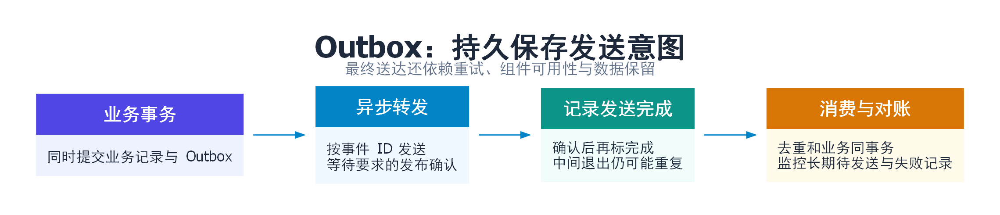
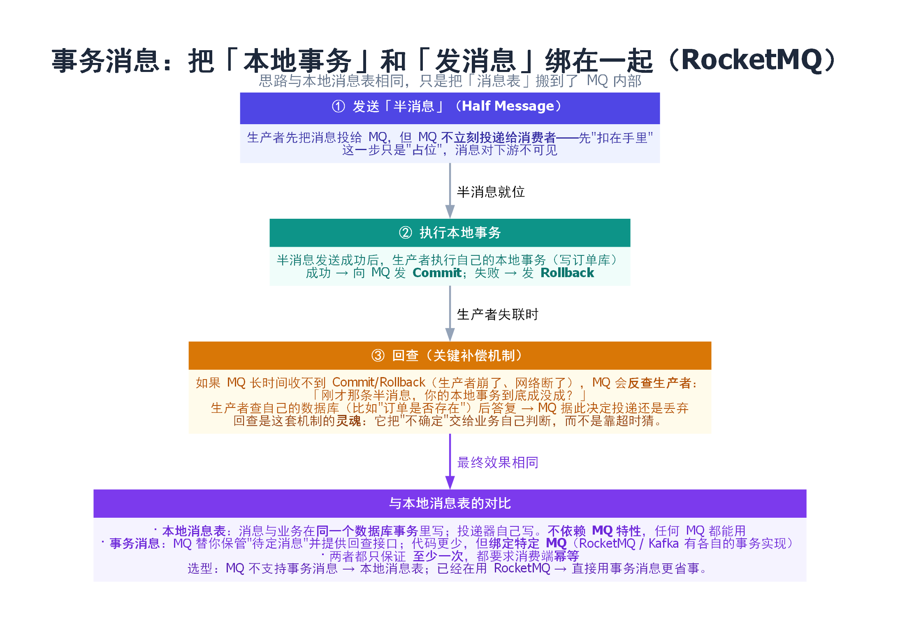
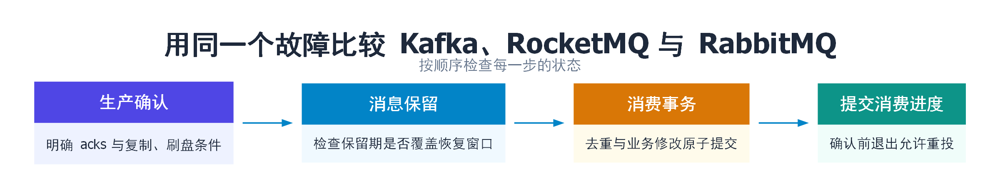
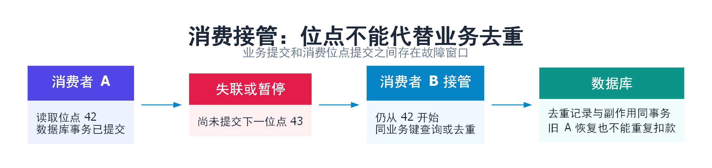
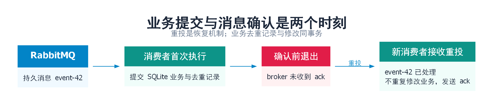
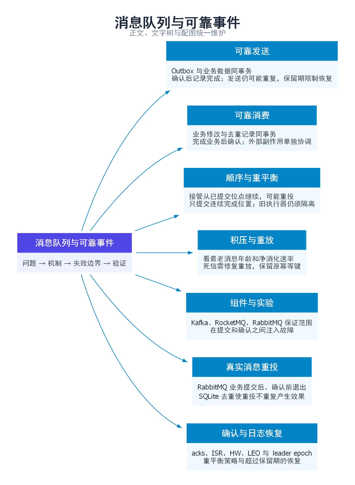

# 消息队列与可靠事件

订单写入数据库后进程崩溃，库存服务没收到事件，怎样补发？

[上一篇：事务与跨服务业务一致性](../06-%E4%BA%8B%E5%8A%A1%E4%B8%8E%E8%B7%A8%E6%9C%8D%E5%8A%A1%E4%B8%9A%E5%8A%A1%E4%B8%80%E8%87%B4%E6%80%A7/%E4%BA%8B%E5%8A%A1%E4%B8%8E%E8%B7%A8%E6%9C%8D%E5%8A%A1%E4%B8%9A%E5%8A%A1%E4%B8%80%E8%87%B4%E6%80%A7.md) · [返回目录](../README.md) · [下一篇：存储、分片与缓存](../08-%E5%AD%98%E5%82%A8%E3%80%81%E5%88%86%E7%89%87%E4%B8%8E%E7%BC%93%E5%AD%98/%E5%AD%98%E5%82%A8%E3%80%81%E5%88%86%E7%89%87%E4%B8%8E%E7%BC%93%E5%AD%98.md)

上一篇用状态和补偿推进跨服务业务。本篇补上步骤之间的通信，解释订单提交后怎样把事件可靠交给消费者。

**阅读准备：** 先读上一篇的主线案例；本文涉及的 C++ 实验需要理解函数、容器与基本线程同步。

**快速阅读：**先读“把发送和消费拆成四个故障点”，再读“面试表达”和 Q&A；遇到说不清原因的结论，回到对应原理小节。

**深入学习：**按正文顺序推演每一步，运行文内完整示例，修改故障发生位置并核对结果。模拟程序只验证写明的假设；真实网络、磁盘和组件行为需按文中的验证步骤另行测试。

<details>
<summary>本文目录</summary>

- [把发送和消费拆成四个故障点](#section-01)
- [本地消息表](#section-02)
- [消费确认与去重](#section-03)
- [积压与重放](#section-04)
- [把崩溃点放在两次提交之间](#section-05)
- [武器一：本地消息表（Outbox）](#section-06)
- [武器二：事务消息](#section-07)
- [武器三：最大努力通知](#section-08)
- [「恰好一次」的三层保证](#section-09)
- [动手：四种写法 + 崩溃，看清差别（C++）](#section-10)
- [常见坑](#section-11)
- [用同一个故障比较 Kafka、RocketMQ 与 RabbitMQ](#section-12)
- [消费组重平衡：换一个消费者，为什么又执行了一次](#section-13)
- [三种消息系统内部怎样保存和投递消息](#section-14)
- [真实 RabbitMQ 与 C++：提交后退出，消息重新投递](#section-15)
- [Kafka：生产确认到底确认了哪一步](#section-16)
- [面试表达](#section-17)
- [Q&A（常见问题与解答）](#section-18)
- [进一步阅读](#section-19)
- [思维导图总结](#section-20)

</details>

<a id="section-01"></a>

## 把发送和消费拆成四个故障点

订单、消息平台和库存库各自有提交时刻。以事件 E 为例，按恢复时仍存在的记录推导结果。

| 进程停在哪里 | 已留下什么 | 恢复后怎样继续 |
| --- | --- | --- |
| 订单事务提交前 | 订单和待发事件都未提交 | 按订单键重试创建 |
| 订单提交后，发布前 | 订单和 E 都在订单库 | 转发器重新读取 E |
| 发布成功后，标记已发前 | 消息平台已有 E，订单库仍标记待发 | 可能再发一次 E |
| 库存提交后，确认消息前 | 库存已修改，去重表已有 E | 收到 E 时跳过修改，再确认 |

消费去重表可以按事件 ID 建唯一约束。插入去重记录和扣库存放在同一事务。若扣库存失败，去重记录随事务回滚，下一次仍能处理。若把去重记录先单独提交，之后扣库存失败，重试就可能被错误跳过。

还有顺序问题。订单创建和取消若要按序处理，可以按订单 ID 路由到同一分区，并为事件带上业务版本。消费失败后把旧事件移到延迟队列，后续事件可能先到，此时应明确等待、拒绝还是按状态处理。分区内顺序和业务状态正确性都要检查。

<a id="section-02"></a>

## 本地消息表

把订单和一条待发送事件写进同一本地事务。事务提交后，两条记录同时可见。转发程序轮询事件表或读取变更日志，再发布到消息系统。若发布成功后、标记已发送前崩溃，重启会再次发布。这就是 Outbox 的重复发送窗口。

<a id="section-03"></a>

## 消费确认与去重

消费者用事件 ID 去重。把“已处理此事件”和“修改库存”放在同一个本地事务，提交成功后再确认消息。若提交后尚未确认就崩溃，下次会收到同一事件，但查到已处理后可以直接确认。若副作用在事务外，例如发邮件，仍要额外设计幂等协议。

<a id="section-04"></a>

## 积压与重放

同一个订单的事件可以按订单 ID 分区，明确需要的是分区内顺序还是业务状态顺序。消费者处理慢时，先看积压年龄、处理速度和错误率。重试要有限，反复失败的事件进入死信队列，修复后按原业务 ID 重放。

<a id="section-05"></a>

## 把崩溃点放在两次提交之间

订单提交后转发器停止，待发记录仍在。转发恢复后可能连续投递两次事件 E。消费者首次处理 E 时，库存和去重记录同时提交。第二次看到 E 已处理就确认消息。分别检查两次崩溃后哪些记录仍存在，就能推导恢复行为。


<a id="section-06"></a>

## 武器一：本地消息表（Outbox）



### 核心一招

**把"要发的消息"也写进同一个数据库**，用一个本地事务保证它和业务数据同时落盘：

```sql
BEGIN;
  INSERT INTO orders (id, ...) VALUES ('order-1', ...);          -- 业务表
  INSERT INTO outbox (msg_id, body, status)                      -- 消息表
    VALUES ('msg-1', 'order-1 created', 'PENDING');
COMMIT;
```

**为什么这样就安全？** 因为"两个写入"变成了"一个本地事务"——数据库自己保证原子性，**不需要跨系统协调，也不需要 2PC**。

之后的投递由**独立的投递器**完成：

```text
循环：
  ① 扫描 outbox 里 status = PENDING 的记录
  ② 投递到 MQ
  ③ 投递成功 → 把状态改成 SENT（或删除）
  ④ 失败 → 保持 PENDING，下一轮重试（指数退避）
```

### 投递器的三个细节

| 细节 | 为什么 |
|------|--------|
| **必须先投递、再改状态** | 反过来（先改状态再投递）会在中间崩溃时**丢消息**；而"先投递后改状态"最坏只是**重复投递**——重复可以用幂等消化，丢失不行 |
| **同一条业务记录的消息要保序** | 按聚合根 ID 分片投递（Kafka 用同一个 partition key），否则"创建"和"更新"可能乱序 |
| **outbox 表要定期清理** | SENT 的记录保留 N 天用于排查即可，否则表会无限膨胀 |

> 注意第 ① 条与 [事务与跨服务业务一致性](../06-%E4%BA%8B%E5%8A%A1%E4%B8%8E%E8%B7%A8%E6%9C%8D%E5%8A%A1%E4%B8%9A%E5%8A%A1%E4%B8%80%E8%87%B4%E6%80%A7/%E4%BA%8B%E5%8A%A1%E4%B8%8E%E8%B7%A8%E6%9C%8D%E5%8A%A1%E4%B8%9A%E5%8A%A1%E4%B8%80%E8%87%B4%E6%80%A7.md) 的 TCC 是同一个思路：**把"不确定"变成"重复"，再靠幂等吃掉重复**。这是分布式系统里最常用的一个转换。

### CDC 变体

自己写投递器是最直观的做法，但也可以用 **CDC（Change Data Capture）**：

```text
Debezium / Canal 订阅数据库 binlog
  → 把 outbox 表的变更当成"变更流"读出来，直接投给 MQ
```

好处是**不用自己写扫描与重试逻辑**；代价是多了一个组件，而且要求 binlog 格式正确（`ROW` 模式）并长期保留。

<a id="section-07"></a>

## 武器二：事务消息



**事务消息**把"消息表"搬到了 MQ 内部，思路和 Outbox 完全一样，只是少写一张表：

```text
① 生产者发送【半消息】→ MQ 收下但不投递给消费者（对下游不可见）
② 生产者执行本地事务 → 成功则发 Commit，失败则发 Rollback
③ 若 MQ 长时间收不到 Commit/Rollback（生产者崩了）→ MQ 主动【回查】生产者：
     "刚才那条半消息，你的本地事务到底成没成？"
   生产者查自己的数据库后答复，MQ 据此决定投递还是丢弃
```

**第 ③ 步的"回查"是这套机制的灵魂**：它不靠超时猜，而是**把"不确定"交回给业务自己判断**（业务最清楚"这个订单到底建了没"）。

| | 本地消息表 | 事务消息 |
|---|---|---|
| 消息存哪 | 自己的数据库 | MQ 内部 |
| 依赖 MQ 特性 | 不依赖（任何 MQ 都行） | **依赖**（RocketMQ 原生支持） |
| 代码量 | 要自己写投递器 | 少（实现回查接口即可） |
| 一致性 | 至少一次 | 至少一次 |

<a id="section-08"></a>

## 武器三：最大努力通知

最"轻"的方案，适合**对一致性要求最低**的场景（比如"通知用户已发货"这种丢了也不致命的消息）：

```text
① 业务方处理完，尽力调用对方接口通知（失败就重试 N 次，指数退避）
② 对方如果一直没收到 → 提供一个【查询接口】，让它自己定时来拉
③ 双方约定一个对账周期，过期不再补偿
```

它的诚实之处在于：**明确声明"我只尽力，不保证"**。适合"通知类"消息，不适合"资金类"操作。

<a id="section-09"></a>

## 「恰好一次」的三层保证


这是本文最该记住的一张图。**分布式系统里不存在"恰好投递一次"的机制**，只有：

> **至少一次投递 + 幂等消费 = 恰好一次的效果**

| 层 | 手段 | 解决的问题 | 做不到的 |
|----|------|-----------|---------|
| **① 可靠投递** | 业务与发送记录同事务，发布确认、复制和持久化按故障目标配置，业务完成后消费确认 | 在约定故障范围内可恢复并重试 | 仍可能重复；不承诺任意故障下不丢 |
| **② 消费幂等** | 去重表 / 业务唯一键 / CAS | 重复不产生副作用 | 无法发现"逻辑性不一致" |
| **③ 定时对账** | 比对上下游状态 + 自动补偿 + 告警 | 业务级偏差（规则理解不同、手工改数据） | 需要人设计对账规则 |

**幂等的三种实现**（都是"用业务唯一标识去重"）：

```sql
-- ① 去重表（和业务在同一个本地事务里）
INSERT INTO processed(msg_id) VALUES ('msg-1');   -- 唯一索引，插入失败即已处理
UPDATE inventory SET ... WHERE ...;

-- ② 业务唯一键 + 状态机（最可靠，不需要额外表）
UPDATE orders SET status='PAID' WHERE id='order-1' AND status='PENDING';
-- 影响行数为 0 → 说明已支付过，直接返回成功

-- ③ 乐观锁 / CAS
UPDATE account SET balance = balance - 100, version = version + 1
  WHERE id = 1 AND version = 7;
```

> **反例**：用"消息到达时间"做幂等键——它每次都不同，等于没做幂等。

<a id="section-10"></a>

## 动手：四种写法 + 崩溃，看清差别（C++）

下面这个程序把第 1、2、5 节的场景全部跑一遍：**丢消息 → 脏数据 → 本地消息表救回来 → 重复投递被幂等挡住 → 不做幂等的代价**。

### 代码

```cpp
// 最终一致方案的核心：本地消息表（Outbox）+ 投递器 + 消费端幂等
// 四个场景递进，看清"业务写成功"和"下游知道"为什么难以同时保证：
//   ① 先写业务库、再发 MQ —— 中间崩溃 → 消息永久丢失（下游永远不知道）
//   ② 先发 MQ、再写业务库 —— 中间崩溃 → 下游收到一条"业务根本没发生"的消息（脏数据）
//   ③ 本地消息表：业务与消息在同一个本地事务里写入 → 崩溃后由投递器补发（至少一次）
//   ④ 投递器也可能重复投递 → 消费端靠消息 ID 幂等去重 → 最终"恰好一次"的效果
// 编译：g++ -std=c++11 -Wall -Wextra -O2 -o outbox_demo outbox_demo.cpp
#include <iostream>
#include <map>
#include <set>
#include <string>
#include <vector>

struct Db {
    std::map<std::string, std::string> biz;        // 业务表
    std::map<std::string, std::string> outbox;     // 本地消息表：msgId -> 内容（已投递的会被删掉）
};

struct Mq {
    std::vector<std::pair<std::string, std::string> > inbox;   // (msgId, 内容)
    void publish(const std::string& id, const std::string& body) {
        inbox.push_back(std::make_pair(id, body));
        std::cout << "      → MQ 收到消息 " << id << "（" << body << "）\n";
    }
};

struct Downstream {
    std::set<std::string> processed;   // 已处理过的 msgId（幂等表）
    std::vector<std::string> applied;  // 实际生效的业务效果
    void consume(const std::string& id, const std::string& body, bool idempotent) {
        if (idempotent && processed.count(id)) {
            std::cout << "      ⇢ 下游收到重复消息 " << id << " → 幂等表里已有，直接忽略\n";
            return;
        }
        processed.insert(id);
        applied.push_back(body);
        std::cout << "      ⇢ 下游处理消息 " << id << " → 生效：" << body << "\n";
    }
};

// 投递器：扫描本地消息表并投递（投递成功才删除）
static void deliverOnce(Db& db, Mq& mq, Downstream& down, bool idempotent, bool crashBeforeDelete) {
    std::cout << "  [投递器] 扫描本地消息表……\n";
    std::vector<std::string> ids;
    for (std::map<std::string, std::string>::iterator it = db.outbox.begin(); it != db.outbox.end(); ++it)
        ids.push_back(it->first);
    for (std::size_t i = 0; i < ids.size(); ++i) {
        const std::string id = ids[i], body = db.outbox[id];
        mq.publish(id, body);
        down.consume(id, body, idempotent);
        if (crashBeforeDelete) {
            std::cout << "      ✗ 投递器在删除消息表记录之前崩溃 → 这条消息下次还会被投递\n";
            return;                    // 不删除，模拟"投递成功但状态未更新"
        }
        db.outbox.erase(id);
    }
}

int main() {
    std::cout << "场景：用户下单成功（写业务库）后，要通知下游（发 MQ）\n";

    // ---------- ① 先写库、再发 MQ ----------
    std::cout << "\n① 先写业务库，再发 MQ —— 中间崩溃\n";
    {
        Db db; Mq mq; Downstream down;
        db.biz["order-1"] = "订单已创建";
        std::cout << "      业务库写入 order-1 ✓\n";
        std::cout << "      ✗ 还没来得及发 MQ，进程崩溃\n";
        std::cout << "      结果：业务库有订单，但 MQ 里 0 条消息，下游永远不知道 → 【消息丢失】\n";
    }

    // ---------- ② 先发 MQ、再写库 ----------
    std::cout << "\n② 先发 MQ，再写业务库 —— 中间崩溃\n";
    {
        Db db; Mq mq; Downstream down;
        mq.publish("msg-1", "订单已创建: order-1");
        std::cout << "      ✗ 还没写业务库，进程崩溃\n";
        down.consume("msg-1", "订单已创建: order-1", true);
        std::cout << "      结果：下游按消息扣了库存，但业务库里根本没有这笔订单 → 【脏数据】\n";
    }

    // ---------- ③ 本地消息表 ----------
    std::cout << "\n③ 本地消息表：业务与消息在同一个本地事务里写入\n";
    {
        Db db; Mq mq; Downstream down;
        // 一个本地事务：同时写业务表和消息表
        db.biz["order-2"] = "订单已创建";
        db.outbox["msg-2"] = "订单已创建: order-2";
        std::cout << "      本地事务提交：业务表 + 消息表 一起落盘 ✓\n";
        std::cout << "      ✗ 事务刚提交，进程崩溃（还没投递）\n";
        std::cout << "      —— 消息没有丢：它在本地消息表里躺着，等投递器来取\n";
        deliverOnce(db, mq, down, true, false);
        std::cout << "      结果：下游最终收到了消息 → 【至少一次投递】\n";
    }

    // ---------- ④ 重复投递 + 消费端幂等 ----------
    std::cout << "\n④ 投递器在「投递成功、状态未更新」时崩溃 → 重复投递\n";
    {
        Db db; Mq mq; Downstream down;
        db.biz["order-3"] = "订单已创建";
        db.outbox["msg-3"] = "订单已创建: order-3";
        std::cout << "      第一轮投递（故意在删除记录前崩溃）：\n";
        deliverOnce(db, mq, down, true, true);
        std::cout << "      投递器重启，再次扫描（消息表里还有 msg-3）：\n";
        deliverOnce(db, mq, down, true, false);
        std::cout << "      结果：下游收到 2 次，但幂等表挡住了第 2 次 → 【幂等消费】\n";
        std::cout << "      下游实际生效次数 = " << down.applied.size() << " 次\n";
    }

    std::cout << "\n⑤ 反例：消费端【不做幂等】会怎样\n";
    {
        Db db; Mq mq; Downstream down;   // 同一个下游，但这次不幂等
        db.biz["order-4"] = "订单已创建";
        db.outbox["msg-4"] = "订单已创建: order-4";
        deliverOnce(db, mq, down, false, true);   // 投递成功但没删记录
        deliverOnce(db, mq, down, false, false);  // 重复投递，且不做幂等
        std::cout << "      下游实际生效次数 = " << down.applied.size()
                  << " 次 → 【重复扣减/重复发货】\n";
    }

    std::cout << "\n结论：\n";
    std::cout << "  · \"写业务库\"和\"通知下游\"无法用一个本地事务覆盖 → 必须有【本地消息表】这种落地手段。\n";
    std::cout << "  · 投递器保证【至少一次】，重复不可避免 → 消费端必须【幂等】才能真正做到\"恰好一次的效果\"。\n";
    std::cout << "  · 还差最后一道：定期【对账】，把长期不一致的脏数据人工/自动修回来（见安全、发布与灾难恢复中的对账实验）。\n";
    return 0;
}
```

### 运行结果与解读

```text
场景：用户下单成功（写业务库）后，要通知下游（发 MQ）

① 先写业务库，再发 MQ —— 中间崩溃
      业务库写入 order-1 ✓
      ✗ 还没来得及发 MQ，进程崩溃
      结果：业务库有订单，但 MQ 里 0 条消息，下游永远不知道 → 【消息丢失】

② 先发 MQ，再写业务库 —— 中间崩溃
      → MQ 收到消息 msg-1（订单已创建: order-1）
      ✗ 还没写业务库，进程崩溃
      ⇢ 下游处理消息 msg-1 → 生效：订单已创建: order-1
      结果：下游按消息扣了库存，但业务库里根本没有这笔订单 → 【脏数据】

③ 本地消息表：业务与消息在同一个本地事务里写入
      本地事务提交：业务表 + 消息表 一起落盘 ✓
      ✗ 事务刚提交，进程崩溃（还没投递）
      —— 消息没有丢：它在本地消息表里躺着，等投递器来取
  [投递器] 扫描本地消息表……
      → MQ 收到消息 msg-2（订单已创建: order-2）
      ⇢ 下游处理消息 msg-2 → 生效：订单已创建: order-2
      结果：下游最终收到了消息 → 【至少一次投递】

④ 投递器在「投递成功、状态未更新」时崩溃 → 重复投递
      第一轮投递（故意在删除记录前崩溃）：
  [投递器] 扫描本地消息表……
      → MQ 收到消息 msg-3（订单已创建: order-3）
      ⇢ 下游处理消息 msg-3 → 生效：订单已创建: order-3
      ✗ 投递器在删除消息表记录之前崩溃 → 这条消息下次还会被投递
      投递器重启，再次扫描（消息表里还有 msg-3）：
  [投递器] 扫描本地消息表……
      → MQ 收到消息 msg-3（订单已创建: order-3）
      ⇢ 下游收到重复消息 msg-3 → 幂等表里已有，直接忽略
      结果：下游收到 2 次，但幂等表挡住了第 2 次 → 【幂等消费】
      下游实际生效次数 = 1 次

⑤ 反例：消费端【不做幂等】会怎样
  [投递器] 扫描本地消息表……
      → MQ 收到消息 msg-4（订单已创建: order-4）
      ⇢ 下游处理消息 msg-4 → 生效：订单已创建: order-4
      ✗ 投递器在删除消息表记录之前崩溃 → 这条消息下次还会被投递
  [投递器] 扫描本地消息表……
      → MQ 收到消息 msg-4（订单已创建: order-4）
      ⇢ 下游处理消息 msg-4 → 生效：订单已创建: order-4
      下游实际生效次数 = 2 次 → 【重复扣减/重复发货】

结论：
  · "写业务库"和"通知下游"无法用一个本地事务覆盖 → 必须有【本地消息表】这种落地手段。
  · 投递器保证【至少一次】，重复不可避免 → 消费端必须【幂等】才能真正做到"恰好一次的效果"。
  · 还差最后一道：定期【对账】，把长期不一致的脏数据人工/自动修回来（见安全、发布与灾难恢复中的对账实验）。
```

逐条对照：

| 输出片段 | 印证了什么 |
|----------|-----------|
| ① `业务库写入 order-1 ✓` 然后 `还没来得及发 MQ，进程崩溃` | **先写库后发消息 → 丢消息**（下游永远不知道） |
| ② `MQ 收到消息 msg-1` 然后 `还没写业务库，进程崩溃` | **先发消息后写库 → 脏数据**（下游扣了不存在的订单） |
| ③ `本地事务提交：业务表 + 消息表 一起落盘 ✓` → `投递器` 补发 | **本地消息表的关键**：崩溃不影响，消息在表里等着被投递 |
| ④ `下游收到 2 次，但幂等表挡住了第 2 次` → `实际生效次数 = 1` | **至少一次 + 幂等 = 恰好一次的效果** |
| ⑤ `下游实际生效次数 = 2 次 → 重复扣减/重复发货` | **不做幂等的代价**：同一笔业务被执行两次 |
| ④ 里 `投递器在删除消息表记录之前崩溃` | **重复的来源**：投递器本身也会崩，所以本例转发流程可能重复，不能承诺恰好一次网络投递 |

> 第 ⑤ 个场景特别值得留意：**它和第 ④ 个场景的投递行为完全一样，唯一的区别是消费端有没有幂等表**。也就是说——**避免重复效果需要消费端事务，避免漏发还需要生产端可靠记录与转发**。这和 [分布式锁、租约与 ID](../05-%E5%88%86%E5%B8%83%E5%BC%8F%E9%94%81%E3%80%81%E7%A7%9F%E7%BA%A6%E4%B8%8E%20ID/%E5%88%86%E5%B8%83%E5%BC%8F%E9%94%81%E3%80%81%E7%A7%9F%E7%BA%A6%E4%B8%8E%20ID.md) 的 fencing token 是同一个哲学：**把正确性的责任放在离数据最近的地方**。

<a id="section-11"></a>

## 常见坑

**① 投递器先改状态、再投递**

如果先把记录标为已完成，再发送，中间退出会使投递器跳过未发送事件。可靠转发应先获得所要求的发布确认，再把记录标为完成；确认后、更新前退出可能重复。这个顺序只解决该崩溃窗口，仍依赖数据库、broker 持久化、重试与保留策略，不能概括成任意故障下不会丢。

**② 消费端不做幂等**

见本文消息投递实验的场景 ⑤。而且这个 bug 有个恶劣特性：普通成功路径测试容易漏掉；主动在提交后、确认前注入退出或丢包就能复现，且表现为"数据莫名多了一笔"。

**③ 幂等键选错**

用"消息到达时间""随机 ID"做幂等键等于没做。必须用**业务唯一标识**（订单号、支付流水号、`msg_id`）。

**④ 去重表和业务不在同一个事务里**

"先插去重表、再改业务数据"，中间崩溃 → 消息被标记为已处理但业务没执行 → **消息被静默丢弃**。去重表的写入必须和业务在**同一个本地事务**。

**⑤ 忽略消息顺序**

同一条业务记录的多条消息（创建 → 更新 → 删除）如果走不同 partition，可能乱序到达。要么按聚合根 ID 分片，要么在消费端按版本号丢弃旧消息。

**⑥ outbox 表无限膨胀**

PENDING 一直重试失败（比如 MQ 地址配错了），表会涨到几千万行。要**监控 PENDING 的数量与最老记录的时间**，并设告警。

**⑦ 以为用了 MQ 就"自动可靠"**

MQ 只保证"进了 MQ 的消息不容易丢"。**"业务成功 → 消息进 MQ"这一段**才是真正容易出问题的地方——这正是本地消息表/事务消息要解决的。

**⑧ 忘了对账**

代码层面做到"看起来完美"，也挡不住业务规则理解不一致、人工改数据这类偏差。**对账是最后一道防线，不是可选项**。

<a id="section-12"></a>

## 用同一个故障比较 Kafka、RocketMQ 与 RabbitMQ

假设消费者扣完库存、回复确认前崩溃。Kafka 中消费进度是分区 offset，重启后可重新读到尚未提交进度的事件。并发处理同一分区时，提交的进度不能越过仍未完成的消息。RocketMQ 要明确消费重试、顺序消费与死信策略。事务消息解决生产侧本地事务与消息可见性的衔接，消费侧仍需按业务键去重。RabbitMQ 用 exchange 路由到队列，publisher confirm 表示发布侧确认，consumer acknowledgement 表示消费侧确认，两者分别观察。

验证时先开一条队列或分区，发送订单 E，故意在数据库提交后退出消费者，重启并检查库存流水仍只有一笔。再令一个事件始终失败，观察重试是否阻塞同分区后续事件、何时进入死信、重放是否沿用原事件 ID。生产确认还要结合副本与持久化配置检查。[Kafka 设计](https://kafka.apache.org/32/design/design/) · [RabbitMQ 确认](https://www.rabbitmq.com/docs/confirms) · [RocketMQ 事务消息](https://rocketmq.apache.org/docs/featureBehavior/04transactionmessage/)



<a id="section-13"></a>

## 消费组重平衡：换一个消费者，为什么又执行了一次

以 Kafka 分区消费为例，同一消费组把分区分给消费者。消费者退出或组成员变化后，需要重新分配分区，这叫重平衡。分区保证日志顺序，并不自动保证业务回调的完成顺序。[Kafka 设计文档](https://kafka.apache.org/41/design/design/)

设分区下一条待处理位点是 42。消费者 A 读取 42，数据库已完成扣款，但 A 尚未提交消费位点就失联。分区交给 B，B 从 42 重新消费。这是至少一次处理的正常失败路径，所以业务键去重必须落在数据库事务中。



还有一个更隐蔽的情况：A 只是长时间暂停，B 接管后 A 又恢复。消费组协议可以拒绝旧成员提交位点，但旧线程已经发给外部数据库的操作，不会因此自动撤回。外部副作用仍需幂等键、条件更新，必要时使用所有权世代校验。

并发处理同一分区时，若 43 已完成而 42 仍在执行，就不能直接提交“下一条为 44”。否则进程崩溃后将跳过 42。程序应维护连续完成位置，只有前面所有消息都完成才能推进位点。若要求同一订单的事件依次生效，还要按订单串行执行，或用状态版本拒绝过期事件。

### 积压、死信与重放如何闭合

积压不是只看“还差多少条”。同时记录最老消息等待时间、进入速率和处理速率。假设积压 6000 条，生产每秒 80 条、消费每秒 100 条，净消化速率为 20 条/秒，理想情况下约 300 秒追平；生产和消费速率相等时，增加等待时间不会减少积压。该估算假设速率稳定，不包含重试和故障停顿。

毒消息反复失败时，若直接跳过到死信队列，同一订单的后续消息可能越过它。应先明确业务是否允许乱序，再选择暂停该订单、整个分区，或采用可校验版本的处理方式。死信记录应保存原消息、业务键、错误原因和重试次数。修复后重放仍沿用原幂等键，先小批量核对副作用，再逐步放量。把失败消息移走只是解除阻塞，不代表业务已经完成。


<a id="section-14"></a>

## 三种消息系统内部怎样保存和投递消息

消息队列像中转站，但“中转站已签收”和“收件人办完业务”是两次不同确认。理解组件时沿消息走一遍，比只记产品名字有用。

| 组件 | 内部主线 | 消费进度在哪里 | 失败后检查什么 |
| --- | --- | --- | --- |
| Kafka | topic 分为 partition，记录追加到有序日志，由 leader 与副本复制 | 消费组按分区保存已提交 offset | 确认配置、选主策略、消费位点与外部业务提交顺序 |
| RocketMQ | Broker 保存消息内容，队列索引帮助按队列消费；事务消息还有待确认与回查过程 | 按消费模式维护队列进度 | 回查应查询真实业务状态，不能把超时一律判回滚 |
| RabbitMQ | exchange 根据绑定把消息路由到 queue，消费者从队列获得投递 | Broker 跟踪本 channel 尚未确认的 delivery tag | 发布确认与消费确认分开；断线后的未确认消息可能重投 |

Kafka 的分区日志适合顺序追加与重放，但把所有消息放在一个分区会限制并行度；增加分区也不会自动保持跨分区全局顺序。RabbitMQ 的 exchange 不等于存储队列，没有匹配路由时不能仅凭发送未报错认定消息已保存。RocketMQ 的半消息也不是先把业务结果猜出来，事务状态不明时要回查本地记录。

发布确认覆盖 Broker 一侧，不覆盖消费者业务；消费确认说明消费者愿意结束这次投递，不代表外部支付可以不做去重。[RabbitMQ 确认机制](https://www.rabbitmq.com/docs/confirms)

<a id="section-15"></a>

## 真实 RabbitMQ 与 C++：提交后退出，消息重新投递

本实验使用真实 Broker、C++ AMQP 客户端和 SQLite。发送者等 publisher confirm 才报告发送成功。第一次消费在业务提交后退出，没有 ack；第二次消费收到重投，数据库拦住重复副作用，然后才 ack。



环境：Ubuntu 24.04、发行版 RabbitMQ 3.x、rabbitmq-c、SQLite 3、C++17。本轮没有 Broker，以下为待执行实验。使用全新测试目录，确保 `consume.db` 起初不存在；guest 账户仅在本机使用。

```bash
sudo apt install -y rabbitmq-server librabbitmq-dev libsqlite3-dev sqlite3 build-essential
sudo systemctl start rabbitmq-server
sudo rabbitmq-diagnostics -q ping
dpkg-query -W rabbitmq-server librabbitmq-dev libsqlite3-dev
```

保存为 `rabbit_recovery.cpp`：

```cpp
#include <amqp.h>
#include <amqp_tcp_socket.h>
#include <sqlite3.h>
#include <sys/time.h>
#include <cstdlib>
#include <iostream>
#include <stdexcept>
#include <string>

void rpc_ok(amqp_rpc_reply_t r) {
    if (r.reply_type != AMQP_RESPONSE_NORMAL)
        throw std::runtime_error("AMQP RPC failed; inspect broker log");
}
void sql(sqlite3* db, const char* s) {
    if (sqlite3_exec(db, s, nullptr, nullptr, nullptr) != SQLITE_OK)
        throw std::runtime_error(sqlite3_errmsg(db));
}
int record_once() {
    sqlite3* db = nullptr;
    if (sqlite3_open("consume.db", &db) != SQLITE_OK) {
        sqlite3_close(db); throw std::runtime_error("open DB failed");
    }
    try {
        sql(db, "PRAGMA synchronous=FULL; PRAGMA busy_timeout=3000;"
            "BEGIN IMMEDIATE;"
            "CREATE TABLE IF NOT EXISTS effect(id INTEGER PRIMARY KEY,n INTEGER NOT NULL);"
            "INSERT OR IGNORE INTO effect VALUES(1,0);"
            "CREATE TABLE IF NOT EXISTS inbox(k TEXT PRIMARY KEY);"
            "UPDATE effect SET n=n+1 WHERE id=1 AND NOT EXISTS(SELECT 1 FROM inbox WHERE k='event-42');"
            "INSERT OR IGNORE INTO inbox VALUES('event-42');"
            "COMMIT;");
        sqlite3_stmt* stmt = nullptr;
        if (sqlite3_prepare_v2(db, "SELECT n FROM effect WHERE id=1", -1, &stmt, nullptr) != SQLITE_OK)
            throw std::runtime_error("prepare failed");
        int rc = sqlite3_step(stmt);
        int n = rc == SQLITE_ROW ? sqlite3_column_int(stmt, 0) : -1;
        sqlite3_finalize(stmt);
        if (n < 0) throw std::runtime_error("query failed");
        sqlite3_close(db); return n;
    } catch (...) {
        sqlite3_exec(db, "ROLLBACK", nullptr, nullptr, nullptr);
        sqlite3_close(db); throw;
    }
}
int main(int argc, char** argv) {
    if (argc != 2) { std::cerr << "usage: rabbit_recovery send|drop|ack\n"; return 2; }
    std::string mode = argv[1];
    if (mode != "send" && mode != "drop" && mode != "ack") return 2;
    amqp_connection_state_t c = amqp_new_connection();
    if (!c) return 1;
    try {
        auto* sock = amqp_tcp_socket_new(c);
        timeval timeout{5, 0};
        if (!sock || amqp_socket_open_noblock(sock, "127.0.0.1", 5672, &timeout) != AMQP_STATUS_OK)
            throw std::runtime_error("connect failed");
        amqp_set_rpc_timeout(c, &timeout);
        rpc_ok(amqp_login(c, "/", 0, 131072, 0, AMQP_SASL_METHOD_PLAIN, "guest", "guest"));
        amqp_channel_open(c, 1); rpc_ok(amqp_get_rpc_reply(c));
        amqp_queue_declare(c, 1, amqp_cstring_bytes("lab.recovery"), 0, 1, 0, 0, amqp_empty_table);
        rpc_ok(amqp_get_rpc_reply(c));
        if (mode == "send") {
            amqp_confirm_select(c, 1); rpc_ok(amqp_get_rpc_reply(c));
            amqp_basic_properties_t props{};
            props._flags = AMQP_BASIC_DELIVERY_MODE_FLAG | AMQP_BASIC_MESSAGE_ID_FLAG;
            props.delivery_mode = 2; props.message_id = amqp_cstring_bytes("event-42");
            int rc = amqp_basic_publish(c, 1, amqp_empty_bytes, amqp_cstring_bytes("lab.recovery"),
                                        0, 0, &props, amqp_cstring_bytes("event-42"));
            if (rc != AMQP_STATUS_OK) throw std::runtime_error("publish outcome unknown");
            amqp_frame_t frame{};
            if (amqp_simple_wait_frame_noblock(c, &frame, &timeout) != AMQP_STATUS_OK ||
                frame.frame_type != AMQP_FRAME_METHOD || frame.channel != 1 ||
                frame.payload.method.id != AMQP_BASIC_ACK_METHOD)
                throw std::runtime_error("publisher confirm missing or rejected");
            std::cout << "publisher_confirm=ack\n";
        } else {
            amqp_basic_qos(c, 1, 0, 1, 0); rpc_ok(amqp_get_rpc_reply(c));
            amqp_basic_consume(c, 1, amqp_cstring_bytes("lab.recovery"), amqp_empty_bytes,
                               0, 0, 0, amqp_empty_table);
            rpc_ok(amqp_get_rpc_reply(c));
            amqp_envelope_t envelope{};
            rpc_ok(amqp_consume_message(c, &envelope, &timeout, 0));
            const std::string body(static_cast<char*>(envelope.message.body.bytes), envelope.message.body.len);
            if (body != "event-42") {
                amqp_destroy_envelope(&envelope);
                throw std::runtime_error("unexpected payload; use a dedicated queue");
            }
            const int effects = record_once();
            std::cout << "effects=" << effects << " redelivered=" << envelope.redelivered << std::endl;
            if (mode == "drop") std::_Exit(23); // 业务已提交；不发送消费确认。
            if (amqp_basic_ack(c, 1, envelope.delivery_tag, 0) != AMQP_STATUS_OK)
                throw std::runtime_error("consumer ack outcome unknown");
            amqp_destroy_envelope(&envelope);
        }
        rpc_ok(amqp_channel_close(c, 1, AMQP_REPLY_SUCCESS));
        rpc_ok(amqp_connection_close(c, AMQP_REPLY_SUCCESS));
        amqp_destroy_connection(c);
    } catch (const std::exception& e) {
        std::cerr << e.what() << '\n'; amqp_destroy_connection(c); return 1;
    }
}
```

```bash
g++ -std=c++17 -O2 -Wall -Wextra rabbit_recovery.cpp -lrabbitmq -lsqlite3 -o rabbit_recovery
./rabbit_recovery send
./rabbit_recovery drop
./rabbit_recovery ack
sqlite3 consume.db 'SELECT * FROM effect; SELECT * FROM inbox;'
sudo rabbitmqctl list_queues name messages_ready messages_unacknowledged
```

预期：发送确认成功；drop 打印 `effects=1` 后退出码为 23；ack 再次打印 `effects=1`，通常 `redelivered=1`；最后队列 ready/unacknowledged 都为 0。重投标记只是提示，不是业务去重键。

若 ack 超时，先确认 send 成功且消息未被其他消费者取走；若 PRECONDITION_FAILED，可能同名队列原先声明了不同属性，改用新的测试队列名。ACCESS_REFUSED 时检查本机登录和 vhost 权限。结果未知的发布不能换新业务键重发。

本例固定单条消息、单 channel，关闭心跳并使用短超时，便于观察。工程实现要循环处理心跳、basic.return、nack 和连接关闭，维护发布序号与待确认消息表，支持连接恢复。单节点 durable 队列不意味着能承受 Broker 整机丢失。远程支付等副作用不能由这里的 SQLite 事务包住，仍需支付方幂等能力。


**本节机制与实验参考：** [Kafka 日志与复制设计](https://kafka.apache.org/41/design/design/)；[RocketMQ 事务消息与状态回查](https://rocketmq.apache.org/docs/featureBehavior/04transactionmessage/)；[RabbitMQ 发布确认与消费确认](https://www.rabbitmq.com/docs/confirms)。

<a id="section-16"></a>

## Kafka：生产确认到底确认了哪一步

设一个分区有 leader A 与 follower B、C。A 写入新消息后，B、C 尚未追上。如果此时向生产者返回成功，接下来能承受什么故障，取决于确认规则，而不是“使用了 Kafka”这个名字。

| acks | 返回成功的条件 | 需要注意的失败窗口 |
| --- | --- | --- |
| 0 | 不等待 broker 确认 | 本地发送完成也不能证明消息已到 broker |
| 1 | leader 按协议接收写入 | 未复制前 leader 丢失可能导致已确认数据丢失 |
| all | 等待当前 ISR 中的副本完成所需确认 | ISR 不是所有配置副本；若缩到一个，保护会减弱 |

ISR 是当前被认为足够同步的副本集合。`min.insync.replicas=2` 配合 `acks=all`，可在 ISR 少于 2 时拒绝写入，而不是继续以单副本承诺成功。副本因子 3 不等于每次都有三份同步数据。`unclean.leader.election.enable` 允许不在 ISR 中的落后副本接任时，可能用恢复可用性换取数据丢失。以上按 Kafka 4.1 配置语义说明，不把默认值当推荐值。[生产配置](https://kafka.apache.org/41/configuration/producer-configs/)

LEO（Log End Offset）表示本副本下一条日志的偏移，HW（High Watermark）标记复制提交边界。两台副本 LEO 相同，也可能在某些位置拥有不同历史，不能只看长度决定保留什么。leader epoch 给每段领导任期编号，恢复时通过任期边界比较共同历史，识别应截断和追赶的位置；它与消费者业务去重是不同层次。

Kafka 确认复制不等于每条消息都强制各副本 fsync。应把进程崩溃、整机断电、多副本同时丢盘分开建模。RabbitMQ 则对路由到 durable 队列的持久消息，在持久化后发送相应 publisher confirm；quorum 队列再提供多数副本确认语义。RocketMQ 的确认边界需要检查使用版本的刷盘与复制模式。不要把不同产品的 ack 都翻译成同一句“已经安全”。

### 重平衡与保留期会怎样影响恢复

消费者加入、退出、超时或分区分配变化都会触发重新分配。传统 eager 分配先撤销较大范围的分区所有权，再统一分配；cooperative 策略分阶段只移交需要迁移的分区，减少停顿，但要求客户端与协议支持。无论哪种策略，旧消费者的线程都可能尚未停止，业务侧仍要去重或隔离旧执行器。

保留期不是“保证落后消费者总能追上”的承诺。若消费者需要的 offset 已早于日志起点，数据已被清理，仅扩容不能补回。最老消息年龄逼近保留期时，应同时计算积压量与净消化速度：积压 600 万条、每秒消费 3 万而新入 2 万，净消化 1 万，至少还需约 600 秒。若剩余保留时间不足，应尽快保护原始数据、调整保留策略或安排从业务事实源重建；不能悄悄跳到最新 offset 并宣称恢复成功。


<a id="section-17"></a>

## 面试表达

可靠消息包含发送与消费两个事务边界。生产侧把业务和待发送记录一起提交，再按确认结果重试；消费侧把去重记录和业务效果一起提交，最后确认消息。这样确认前崩溃会重投，但不会重复修改业务。保证仍取决于 broker 的复制、持久化、保留期及故障范围。代价是重复投递、状态存储和对账，不是开了手动 ACK 就永远不丢。

<a id="section-18"></a>

## Q&A（常见问题与解答）

### Outbox 发送成功后为什么还可能丢业务效果？

发送的成功标准可能不足，broker 也可能超过保留期清理数据；消费端还可能未完成事务。必须串起发布确认、持久化、消费事务与对账证据。

### acks=all 为什么还要 min.insync.replicas？

all 等当前 ISR，而不是配置的所有副本。最小 ISR 阈值避免只剩一个同步副本时仍承诺足够的复制保护。

### 消费者落后超过保留范围还能直接重试吗？

需要的日志已被删除时，重试无法取回。应从业务事实源或备份恢复并对账，跳到最新位置会留下缺失业务。

### RabbitMQ 重投标志能替代业务去重吗？

不能。它描述投递经历，不是业务是否提交的证据。同一个业务事件也可能被发布成不同消息。去重依据稳定事件 ID，并与业务修改在同一事务中提交。

**重平衡后旧消费者还活着怎么办？**

消费组拒绝旧位点提交，不等于撤回外部副作用。数据库仍需用业务键原子去重，涉及所有权写入时还需校验世代。

**消息进入死信队列，业务就算处理完成了吗？**

死信只表明常规消费停止重试。要保存业务编号和失败原因，修复后核对当前状态，再决定重放或人工处理。

**消息平台支持恰好一次，外部库存库就安全了吗？**

要看保证覆盖哪些存储和操作。外部库存事务仍需要去重，或者与消息处理采用明确的共同提交协议。

[延伸阅读](https://microservices.io/patterns/data/transactional-outbox.html)

<a id="section-19"></a>

## 进一步阅读

- **模式命名**：Chris Richardson 的 *Microservices Patterns* 第 4 章（Saga）与 **Transactional Outbox** 模式（[microservices.io/patterns/data/transactional-outbox.html](https://microservices.io/patterns/data/transactional-outbox.html)）—— 本文本地消息表的正式名字与取舍讨论。
- **事务消息实现**：Apache RocketMQ 官方文档的 *Transaction Message* 一节（半消息、回查机制的完整流程与限制）；Kafka 的 `Transactions`（`read_committed` 隔离级）与本篇的区别（Kafka 事务保证的是"多条消息 + offset 的原子"，不等于跨系统事务）。
- **CDC**：Debezium 官方文档的 *Outbox Event Router*（SMT）—— 直接把 outbox 表转成事件流；Canal 的 binlog 订阅。
- **幂等与去重**：Stripe 的 [Idempotency Keys](https://stripe.com/docs/api/idempotent_requests) 设计（把幂等键做成 HTTP 语义）；《数据密集型应用系统设计》第 11 章（流处理里的"恰好一次"讨论）。
- **对账**：支付行业的对账体系（日切、轧账、长款短款），可搜索"支付对账系统设计"；这是把工程一致性延伸到业务一致性的关键一环。
- **顺着往下读**：[事务与跨服务业务一致性](../06-%E4%BA%8B%E5%8A%A1%E4%B8%8E%E8%B7%A8%E6%9C%8D%E5%8A%A1%E4%B8%9A%E5%8A%A1%E4%B8%80%E8%87%B4%E6%80%A7/%E4%BA%8B%E5%8A%A1%E4%B8%8E%E8%B7%A8%E6%9C%8D%E5%8A%A1%E4%B8%9A%E5%8A%A1%E4%B8%80%E8%87%B4%E6%80%A7.md)（TCC 与 Saga）、[本文：消息队列与可靠事件](%E6%B6%88%E6%81%AF%E9%98%9F%E5%88%97%E4%B8%8E%E5%8F%AF%E9%9D%A0%E4%BA%8B%E4%BB%B6.md)（MQ 侧的丢/重/序问题）。

下一篇要回答的问题是：订单越来越多，一台数据库放不下。怎样把数据分开，又能快速查到？

<a id="section-20"></a>

## 思维导图总结

```text
消息队列与可靠事件
├── 可靠发送
│   ├── Outbox 与业务数据同事务
│   └── 确认后记录完成；发送仍可能重复，保留期限制恢复
├── 可靠消费
│   ├── 业务修改与去重记录同事务
│   └── 完成业务后确认；外部副作用单独协调
├── 顺序与重平衡
│   ├── 接管从已提交位点继续，可能重投
│   └── 只提交连续完成位置；旧执行器仍须隔离
├── 积压与重放
│   ├── 看最老消息年龄和净消化速率
│   └── 死信需修复重放，保留原幂等键
├── 组件与实验
│   ├── Kafka、RocketMQ、RabbitMQ 保证范围
│   └── 在提交和确认之间注入故障
├── 真实消息重投
│   ├── RabbitMQ 业务提交后、确认前退出
│   └── SQLite 去重使重投不重复产生效果
└── 确认与日志恢复
    ├── acks、ISR、HW、LEO 与 leader epoch
    └── 重平衡策略与超过保留期的恢复
```


