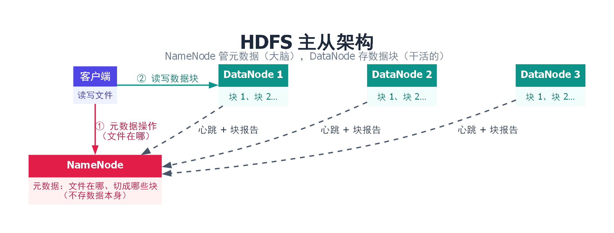
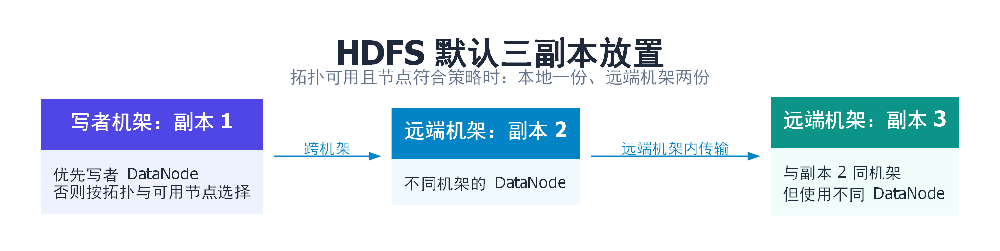
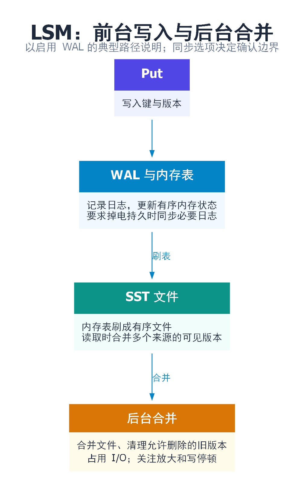
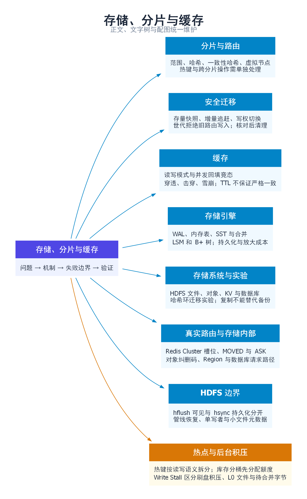

# 存储、分片与缓存

订单越来越多，一台数据库放不下。怎样把数据分开，又能快速查到？

[上一篇：消息队列与可靠事件](../07-%E6%B6%88%E6%81%AF%E9%98%9F%E5%88%97%E4%B8%8E%E5%8F%AF%E9%9D%A0%E4%BA%8B%E4%BB%B6/%E6%B6%88%E6%81%AF%E9%98%9F%E5%88%97%E4%B8%8E%E5%8F%AF%E9%9D%A0%E4%BA%8B%E4%BB%B6.md) · [返回目录](../README.md) · [下一篇：服务发现、配置与网关](../09-%E6%9C%8D%E5%8A%A1%E5%8F%91%E7%8E%B0%E3%80%81%E9%85%8D%E7%BD%AE%E4%B8%8E%E7%BD%91%E5%85%B3/%E6%9C%8D%E5%8A%A1%E5%8F%91%E7%8E%B0%E3%80%81%E9%85%8D%E7%BD%AE%E4%B8%8E%E7%BD%91%E5%85%B3.md)

上一篇解决了事件怎样到达下游。数据量增长后，还需要决定订单分布在哪些机器、迁移时怎样接住持续写入。

**阅读准备：** 先读上一篇的主线案例；本文涉及的 C++ 实验需要理解函数、容器与基本线程同步。

**快速阅读：**先读“迁移一个分片时跟踪读写权”，再读“面试表达”和 Q&A；遇到说不清原因的结论，回到对应原理小节。

**深入学习：**按正文顺序推演每一步，运行文内完整示例，修改故障发生位置并核对结果。模拟程序只验证写明的假设；真实网络、磁盘和组件行为需按文中的验证步骤另行测试。

实验前先核对[环境、依赖与验证边界](../README.md#lab-compatibility)，各篇已执行与待执行的状态以对应实验说明为准。

<details>
<summary>本文目录（含小节）</summary>

- [迁移一个分片时跟踪读写权](#section-01)
- [分片路由](#section-02)
- [迁移与存储引擎](#section-03)
- [缓存一致性](#section-04)
- [一次缓存回填怎样带回旧值](#section-05)
- [怎样选存储形式](#section-06)
- [HDFS 架构](#section-07)
  - [NameNode（元数据节点，大脑）](#detail-08-1)
  - [DataNode（数据节点，干活的）](#detail-08-2)
  - [Secondary NameNode（辅助节点）](#detail-08-3)
- [核心设计](#section-08)
  - [数据块（Block）：默认 128MB](#detail-08-4)
  - [副本机制：默认 3 副本](#detail-08-5)
  - [机架感知（Rack Awareness）](#detail-08-6)
- [读写流程](#section-09)
  - [写流程（流水线写入）](#detail-08-7)
  - [读流程](#detail-08-8)
  - [用 C++ 模拟核心机制](#detail-08-9)
- [容错机制](#section-10)
  - [副本容错](#detail-08-10)
  - [数据完整性](#detail-08-11)
  - [NameNode 的单点故障与 HA](#detail-08-12)
- [虚拟节点、缓存写入策略和存储选型](#section-11)
  - [可运行的 C++17 实验](#detail-08-13)
- [从一次 Put 看清 WAL、LSM 与 B+ 树](#section-12)
- [一个键占大部分流量，为什么扩分片仍然没用？](#hot-key)
- [LSM 的写停顿：为什么平时很快，偶尔却突然卡住？](#lsm-write-stall)
- [分片迁移怎样保证切换时不漏写](#section-13)
- [Redis Cluster：槽位路由怎样变成一次实际请求](#section-14)
  - [真实三节点路由实验](#detail-08-14)
- [MinIO、TiDB、CockroachDB：内部路径有什么不同](#section-15)
- [HDFS 写入成功、可见与抗掉电是三种检查](#section-16)
- [面试表达](#section-17)
- [Q&A（常见问题与解答）](#section-18)
  - [给库存键随机加后缀就能安全分散扣减吗？](#detail-08-15)
  - [达到 Compaction 触发阈值就一定停写吗？](#detail-08-16)
  - [hflush 与 hsync 能互相替代吗？](#detail-08-17)
  - [小文件为什么会耗尽 NameNode 内存？](#detail-08-18)
  - [三个 Redis 主节点启动成功就验证高可用了吗？](#detail-08-19)
- [进一步阅读](#section-19)
- [思维导图总结](#section-20)

</details>

<a id="section-01"></a>

## 迁移一个分片时跟踪读写权

假设订单按用户 ID 分片，用户 42 的数据要从 A 迁到 B。直接改路由会使 B 缺少旧订单，只复制旧数据又会漏掉复制期间的新订单。

1. A 仍接收写入，记录一个可用于追赶的快照位置。
2. B 复制截至该位置的存量，再按后续日志追赶新写入。
3. 到达切换边界时约束 A 停止旧路由的写入，确认 B 已追到约定位置，再发布新路由版本。
4. 旧客户端仍可能请求 A。A 应拒绝或按协议转发旧版本请求，避免旧分片和新分片同时各自提交。

迁移验收要检查条数、版本和具体业务记录。读到“订单不存在”时，还要区分是真没有，还是路由指到了尚未追完的分片。热点问题也要单独处理。如果 90% 的请求都查同一个用户，一致性哈希可以均匀分配许多键，但这一位用户的请求仍集中在一个位置。可按读写特征考虑缓存、读副本或改变拆分粒度。

<a id="section-02"></a>

## 分片路由

按订单 ID 哈希分片可以让单笔查询直接找到目标分片，但按日期查订单可能需要访问多个分片。范围分片方便范围查询，持续递增的新订单也可能集中写到最新的范围。一致性哈希通过环上的位置定位节点，节点变化时只迁移部分键。虚拟节点有助于平衡分布，单个热门键仍可能很热。

<a id="section-03"></a>

## 迁移与存储引擎

迁移一个分片时，先复制存量，再追上迁移期间的新写入，最后切换路由。切换前后要约束谁有权接收写入。分片解决一份数据放在哪里，副本解决这一份坏了从哪里恢复。底层若用 LSM，写入先累积再形成有序文件，后台合并会占用 I/O，读放大和写放大都要实测。

<a id="section-04"></a>

## 缓存一致性

缓存旁路通常先读缓存，未命中再查库并回填。一次慢查询可能在新值提交并删除缓存之后，把旧值填回去。业务要根据容忍度选择 TTL、版本校验或可靠失效。穿透是反复查不存在的数据，击穿是单个热点过期，雪崩是一批键集中失效，三种情况要分别观察。

<a id="section-05"></a>

## 一次缓存回填怎样带回旧值

A 缓存未命中，从库读到旧值 10。B 把值更新到 11 并删除缓存。A 随后把 10 填回缓存，下一次读取就可能读到 10。若要挡住这类回填，版本校验需要知道更新后的版本，单凭一次删除无法提供该信息。


<a id="section-06"></a>

## 怎样选存储形式

按键读取订单状态需要高效的 KV 查询。按用户和时间筛选订单需要索引和查询能力，跨分片查询还要汇总结果。大量图片或备份文件可以通过对象存储按对象键读写。HDFS 则把大文件拆成块，元数据节点告诉客户端块的位置，客户端直接访问数据节点。先写出访问路径和故障后的恢复要求，再比较组件。

<a id="section-07"></a>

## HDFS 架构

HDFS 是典型的**主从（Master-Slave）架构**，两个核心角色：



<a id="detail-08-1"></a>

### NameNode（元数据节点，大脑）

NameNode **不存数据**，只存**元数据**：

- 目录树结构（有哪些目录、哪些文件）；
- 每个文件被切成哪些块（block）；
- 每个块存在哪些 DataNode 上（副本位置）。

NameNode 把元数据放在**内存**里（为了快），并持久化到磁盘（FsImage + EditLog）。它是整个集群的**单点**（未部署 HA 时；生产可采用 Active/Standby NameNode 与相应恢复协议）。

> **类比**：NameNode 就是**图书管理员**——他不放书，只拿一个索引本，记录「《三国演义》这本书在第 3、7、12 号书架各有一本」。

<a id="detail-08-2"></a>

### DataNode（数据节点，干活的）

DataNode 存**真正的数据块**。每个 DataNode 定期向 NameNode 发送**心跳**（证明自己还活着）和**块报告**（汇报自己存了哪些块）。

> **类比**：DataNode 就是**书架**——真正放书的地方，定期向管理员报告「我还活着，我这里有这些书」。

<a id="detail-08-3"></a>

### Secondary NameNode（辅助节点）

注意：Secondary NameNode **不是** NameNode 的热备份。它的作用是**定期合并 NameNode 的 EditLog 到 FsImage**，防止 EditLog 无限增长（用于 NameNode 重启时快速恢复，不是实时容错）。

<a id="section-08"></a>

## 核心设计

<a id="detail-08-4"></a>

### 数据块（Block）：默认 128MB

HDFS 把文件切成大块（block），默认 **128MB**（旧版 64MB）。对比普通文件系统块大小只有 4KB，HDFS 的块**大得多**。

为什么这么大？两个原因：

1. **减少元数据**：一个 1GB 的文件，按 4KB 切是 25 万个块，按 128MB 切只有 8 个块。块越少，NameNode 要记的元数据越少。
2. **适合大文件**：HDFS 面向 GB、TB 级的大文件，块太小会浪费。

<a id="detail-08-5"></a>

### 副本机制：默认 3 副本

每个块默认存 **3 份副本**（副本因子 replication factor = 3），分别放在**不同的 DataNode** 上。这样任何一个 DataNode 挂了，数据还能从其他副本读。

> **类比**：重要的书，图书馆会**多买几本**放在不同的书架上。烧掉一个书架，其他书架还有。

<a id="detail-08-6"></a>

### 机架感知（Rack Awareness）

3 个副本不是随便放的，而是遵循「机架感知」策略：

- **第一个副本**优先放在写者所在的 DataNode；写者不是 DataNode 时，按可用节点及机架策略选择。
- **第二个副本**放在另一个机架。
- **第三个副本**放在第二个副本所在机架的另一台机器。

这是 Hadoop 3.3.5 文档描述的默认三副本放置思路，存储策略、可用节点和自定义放置策略可能改变选择。拓扑映射必须正确：未配置机架拓扑时节点通常落在 `/default-rack`，系统无法据此实现跨真实机架隔离。

写入管线从本地机架进入远端机架后，在远端机架内传递，减少跨机架传输。三份数据跨两个机架，能在对应副本完整可用的前提下承受其中一个机架失效；并非任意多重故障都能恢复。[HDFS 副本放置](https://hadoop.apache.org/docs/stable/hadoop-project-dist/hadoop-hdfs/HdfsDesign.html)



<a id="section-09"></a>

## 读写流程

<a id="detail-08-7"></a>

### 写流程（流水线写入）

客户端要写文件时，流程如下：

1. 客户端问 NameNode：「我要写 `bigfile.txt`，放哪？」
2. NameNode 返回一组 DataNode 列表（比如 3 个，对应 3 副本）；
3. 客户端把**第一个数据块**发给**第一个 DataNode**；
4. 第一个 DataNode 边收边转发给**第二个 DataNode**，第二个再转发给**第三个**——形成一条**流水线（pipeline）**；
5. 一个块写完，继续写下一个块（重复 1-4）。

关键点：客户端只跟第一个 DataNode 交互，后面的复制由 DataNode 之间**接力**完成，客户端不用操心。

<a id="detail-08-8"></a>

### 读流程

读比写简单：

1. 客户端问 NameNode：「`bigfile.txt` 的块在哪些 DataNode 上？」
2. NameNode 返回每个块的副本位置（通常按「距离客户端最近」排序）；
3. 客户端从**最近的 DataNode** 读数据。

<a id="detail-08-9"></a>

### 用 C++ 模拟核心机制

下面用一个简化版，模拟 HDFS 的「切块 + 副本 + 元数据」：

```cpp
#include <iostream>
#include <string>
#include <vector>
#include <map>

struct Block {
    int id;
    std::string data;          // 简化：一个块就是一段字符串
};

struct DataNode {
    std::string name;
    std::vector<Block> blocks;  // 这个 DataNode 存的块
};

struct NameNode {
    std::map<std::string, std::vector<int>> file_to_blocks;      // 文件 → 块列表
    std::map<int, std::vector<std::string>> block_to_nodes;      // 块 → DataNode 列表（副本位置）
};

int main() {
    NameNode nn;
    std::vector<DataNode*> dns;
    DataNode dn1{"dn1", {}}, dn2{"dn2", {}}, dn3{"dn3", {}};
    dns = {&dn1, &dn2, &dn3};

    // 写一个 256MB 的文件，切成 2 个 128MB 的块，每个块 3 副本
    std::string file = "bigfile.txt";
    std::vector<Block> blocks = {{1, "前 128MB"}, {2, "后 128MB"}};

    for (auto& b : blocks) {
        nn.file_to_blocks[file].push_back(b.id);
        for (int i = 0; i < 3; ++i) {                       // 3 副本
            DataNode* dn = dns[(b.id + i) % 3];             // 机架感知会分散，这里简化为轮流
            dn->blocks.push_back(b);
            nn.block_to_nodes[b.id].push_back(dn->name);
        }
    }

    // 打印元数据 + 副本位置
    std::cout << "文件 " << file << " 切成 " << nn.file_to_blocks[file].size() << " 个块\n";
    for (auto& [bid, nodes] : nn.block_to_nodes) {
        std::cout << "块 " << bid << " 的 3 个副本在：";
        for (auto& n : nodes) std::cout << n << " ";
        std::cout << "\n";
    }

    // 容错演示：dn1 挂了，块 1 还有 dn2、dn3 的副本
    std::cout << "dn1 宕机后，块 1 仍能从 dn2 / dn3 读 → 副本容错\n";
    return 0;
}
```

保存为 `hdfs_layout.cpp`，使用 `g++ -std=c++17 -O2 -Wall -Wextra hdfs_layout.cpp -o hdfs_layout` 编译，运行 `./hdfs_layout`。输出会列出两块的副本位置。这里只在内存中保存字符串标签，并打印故障说明，没有实际读取 256 MB、模拟节点宕机或执行故障恢复；因此输出不能作为 HDFS 故障测试的证据。

<a id="section-10"></a>

## 容错机制

<a id="detail-08-10"></a>

### 副本容错

DataNode 挂了怎么办？NameNode 靠**心跳**发现 DataNode 失联（检测超时取决于版本和心跳相关配置，超时表示怀疑失联），然后：

1. 把这个 DataNode 上所有块的副本标记为「不足」；
2. 在**其他 DataNode** 上重新复制，补足到 3 副本。

<a id="detail-08-11"></a>

### 数据完整性

每个块有**校验和（checksum）**，读取时校验，发现损坏就从其他副本读。

<a id="detail-08-12"></a>

### NameNode 的单点故障与 HA

NameNode 是集群的**单点**——它挂了，整个集群就「失明」了（不知道文件在哪）。Secondary NameNode 负责合并 fsimage 与 edits、生成检查点，并不是能够直接接管服务的热备或自动冷备。

现代 HDFS 通过 **HA（High Availability）**解决：部署两个 NameNode（Active + Standby），通过 **JournalNode** 共享 EditLog、通过 **ZooKeeper**（ZKFC）做自动故障切换。故障切换需要故障检测、旧主隔离和状态追赶，不是瞬时完成。[Hadoop 3.4.1 的 QJM 高可用说明](https://hadoop.apache.org/docs/r3.4.1/hadoop-project-dist/hadoop-hdfs/HDFSHighAvailabilityWithQJM.html)

<a id="section-11"></a>

## 虚拟节点、缓存写入策略和存储选型

把哈希环简化成 0 到 99。A 的位置是 20 和 70，B 是 45 和 90。键顺时针找到第一个节点，键 35 原来归 B 的 45。加 C 的虚拟点 40 后，只有 (20, 40] 的键在这一段迁到 C，41 仍归 B。虚拟点让同一物理节点占多个分散区间，增加点数可以改善区间不均，热门单键仍需另外处理。

| 缓存策略 | 谁负责读写 | 主要故障窗口 |
| --- | --- | --- |
| Cache-Aside | 应用读缓存，未命中读库并回填，更新后失效 | 慢读取可能把旧版本填回 |
| Read-Through | 缓存层加载缺失数据 | 缓存层需要可控的超时和回源并发 |
| Write-Through | 写经过缓存层同步传到底层 | 底层变慢会增加写延迟，两边更新仍需协议 |
| Write-Behind | 先接收写入，再异步刷到底层 | 未刷的数据可能丢失，要定义持久队列及重放顺序 |

穿透可用短期空值缓存和布隆过滤器。布隆过滤器查出“不存在”才适合拦截，误判“存在”会继续查库，且新增键要及时进入过滤器。热点过期用同键请求合并，只有一个工作者回源，其他请求等待或返回可接受的旧值。批量过期或缓存集群故障应限制回源并发，配合 TTL 抖动和分区隔离。

Redis Cluster 使用固定槽位及槽位迁移，和本文的哈希环算例是不同实现。etcd 适合协调元数据，需要区分线性一致读与可能陈旧的读取。HDFS 用块和目录组织文件，MinIO 用桶和对象键提供对象访问。TiDB 与 CockroachDB 可从 SQL 请求如何路由到分布式数据范围、范围怎样复制、跨范围事务怎样提交这三个问题入手。[Redis Cluster 规范](https://redis.io/docs/latest/operate/oss_and_stack/reference/cluster-spec/)

<a id="detail-08-13"></a>

### 可运行的 C++17 实验

保存为 `hash_ring.cpp`。

```cpp
#include <cassert>
#include <iostream>
#include <map>
#include <stdexcept>

char owner(const std::map<int, char>& ring, int hash) {
    if (ring.empty()) throw std::invalid_argument("empty ring");
    auto it = ring.lower_bound(hash);
    return (it == ring.end() ? ring.begin() : it)->second;
}

int main() {
    const std::map<int, char> before{{20,'A'},{45,'B'},{70,'A'},{90,'B'}};
    auto after = before;
    after.emplace(40, 'C');
    int moved = 0;
    for (int hash = 0; hash < 100; ++hash) {
        const bool changed = owner(before, hash) != owner(after, hash);
        assert(changed == (hash > 20 && hash <= 40));
        moved += changed;
    }
    assert(owner(after, 99) == 'A'); // 环尾回到第一个点。
    std::cout << "moved=" << moved << "/100\n";
}
```

```bash
g++ -std=c++17 -Wall -Wextra hash_ring.cpp -o hash_ring
./hash_ring
```

MSYS2 UCRT64 的 GCC 实测结果为 `moved=20/100`。固定位置便于验证迁移边界。实际环用稳定哈希计算节点位置，定义位置冲突处理，并在迁移时管理路由版本。查找用 lower_bound，复杂度为 O(log V)，V 是环上的虚拟点总数。


<a id="section-12"></a>

## 从一次 Put 看清 WAL、LSM 与 B+ 树

单机存储引擎决定一个副本内部怎样读写磁盘。分布式复制决定多个副本怎样协作，两层都要正确：多数节点“收到了”数据，却都只放在内存里，仍可能一起在断电后丢失。

以启用 WAL 的 LSM 路径建立直觉：先顺序记录修改日志，再更新内存中的有序表；内存表满后生成不可变的有序文件 SST；后台将多个文件合并，清理不再需要的旧版本。RocksDB 采用这类结构，是否同步 WAL 由写入选项决定，不能把“写入返回”一律理解为已经承受掉电。[RocksDB 架构与持久化说明](https://github.com/facebook/rocksdb/wiki/RocksDB-Overview)



读取时可能需要检查内存表和多个文件，比较版本后返回最新可见值。删除也常先写一条删除标记，否则旧文件中的值会重新出现。合并时只有确认旧值和快照不再需要它，才可清理相关版本。布隆过滤器能快速排除不可能含某个键的文件；它不能告诉你值是什么，也不能把所有读都变成一次磁盘访问。

| 取舍 | LSM 类结构 | B+ 树类结构 |
| --- | --- | --- |
| 更新组织 | 先追加、缓冲，再批量合并 | 找到索引页和叶子页后修改，必要时分裂 |
| 主要额外工作 | 合并反复读写数据，查询可能查多层 | 页维护、随机访问和日志，缓存影响很大 |
| 范围查询 | 多个有序来源合并读取 | 沿有序叶子范围扫描 |
| 要测的指标 | 合并积压、写停顿、读写放大 | 缓存命中、页分裂、随机 I/O 与锁竞争 |

不能据此认定 LSM 永远写得快、B+ 树永远读得快。值大小、缓存、压缩、读写比例和磁盘都会改变结果。一次基准至少记录键值大小、总量、冷热分布、同步选项、吞吐与 P99，并让后台合并进入稳定状态。只测刚启动时向空内存表写入，会漏掉长期成本。

<a id="hot-key"></a>

## 一个键占大部分流量，为什么扩分片仍然没用？

哈希分片把不同键分散到不同位置，却通常把同一个键路由到同一拥有者。秒杀商品只有一个库存键时，增加分片或虚拟节点可能移动瓶颈，却不会把该键的每次扣减自动并行化。

| 热点类型 | 可用措施 | 一并引入的约束 |
| --- | --- | --- |
| 热门内容的重复读取 | 进程内短期缓存、同键请求合并、读副本分流 | 本地副本失效、陈旧读范围、缓存失效时的回源上限 |
| 可合并的计数写入 | 将键加不同后缀分成多个子计数，批量汇总 | 读取需要合并；重试去重、精确快照和删除更复杂 |
| 不能超卖的库存扣减 | 原子条件扣减，或先把有限额度分配到多个子桶 | 子桶额度总和不能超过库存；回收转移必须防止重复分配 |
| 单条记录的严格顺序更新 | 在拥有者处串行化、限流与排队 | 不应为了分散写入而破坏该记录的顺序规则 |

“加盐”就是把一个逻辑键改成 `key:0`、`key:1` 等多个物理键。它适合能拆分再合并的数据，不适合直接给一个库存值复制十份并允许各自扣减。库存分桶需要事先划分额度，可能出现某桶用完而别的桶还有余量的利用率损失。

先按键观测请求量、等待、锁冲突和回源次数，再选择读扩散还是写拆分。演练应让热键流量突增、缓存同时失效、某个额度桶失联；检查冷键延迟、源库负载与总库存约束，而不只看平均 QPS。

<a id="lsm-write-stall"></a>

## LSM 的写停顿：为什么平时很快，偶尔却突然卡住？

LSM 先把更新放入内存表，内存表满后转为等待刷盘的不可变表，后台生成 SST 文件；后续 Compaction 再合并这些文件。如果进入速度长期超过刷盘或合并能力，待处理内容会越积越多。系统必须减慢或阻止新写入，否则内存、文件数和读放大会继续失控。

以 RocksDB 为例，应区分三个压力来源：待刷盘的内存表过多、L0 文件过多、预计待合并字节数过大。它们可能分别触发限速或停写，不要求所有条件同时成立。开始 Compaction 的阈值也不等于触发减速或停止写入的阈值，参数与作用范围应按版本核对。[RocksDB Write Stalls](https://github.com/facebook/rocksdb/wiki/Write-Stalls)

```text
前台写入持续过快 → flush / compaction 积压
                 → 达到保护阈值 → 减速或暂停接收新写
                 → 后台赶上后恢复 → 队列中的请求仍可能已经超时
```

排查要把写延迟尖刺与 stall 时长、不可变内存表数量、L0 文件数、待合并字节、磁盘吞吐和 CPU 占用放在同一时间轴。磁盘饱和时，单纯加后台线程可能加剧竞争；提高阈值只能推迟触发，还可能让恢复更慢。可以结合负载限速、合理的后台资源、存储带宽和键分布调整。

压测需要跑到后台合并进入稳定阶段，不能只测空库刚开始的一小段时间。持续观察吞吐、尾延迟与积压能否收敛；把测试数据集大小、压缩、WAL 同步和后台配置一并记录，才能解释性能差异。

<a id="section-13"></a>

## 分片迁移怎样保证切换时不漏写

假设分片 S 从 A 搬到 B。只复制一次文件再更新路由，会漏掉复制期间到 A 的新写入。可采用“快照 + 增量 + 写权切换”的过程：

1. 为 S 记录当前所有权世代 e 和复制起点，建立一致的存量快照。
2. B 导入快照，同时保留并追赶快照之后的增量。每次重试按日志位置去重。
3. 短暂阻止旧所有者接受新写入，确定最后一个已确认位置 L。B 应用到 L 后，才可进入接管阶段。
4. 通过可靠的元数据协议发布新世代 e+1，让 B 获得写权。A 即使仍被旧客户端访问，也应拒绝旧世代写入或转发到 B。
5. 核对数据和业务计数后再清理 A 的旧副本。切换中断时根据持久化阶段记录继续恢复，不能由 A、B 各自猜测谁是主。

这里的暂停写入是一种便于推导的方案，高可用迁移可使用更复杂的转发和双路追踪协议，但不能省掉唯一写权和增量边界。跨分片查询还会带来多次请求、结果合并和部分失败；跨分片事务则进一步需要提交协调。

单个热键不能靠增加虚拟节点拆开：同一键仍落到一个位置。计数可以在业务允许时拆成多个子计数，查询再求和；库存扣减不能随意拆分，需要预分配额度或集中协调，避免各分片重复销售。


<a id="section-14"></a>

## Redis Cluster：槽位路由怎样变成一次实际请求

Redis Cluster 把键映射到 16384 个槽，每个槽由一个主节点负责。客户端第一次找错节点时，MOVED 表示应该更新槽位归属；迁移中的 ASK 是一次临时转向，客户端按协议先发 ASKING 再访问目标，不能把两种响应都当成永久路由更新。槽位解决路由，主从复制解决副本，两者不是同一层。

当多键命令要求键在同一槽时，可以用 hash tag 让关联键共享槽，例如 `order:{42}:state` 与 `order:{42}:items`。这样方便同槽操作，但把大量热门数据都放进一个 tag 会形成热点。Redis Cluster 也不因有副本就自动获得 Raft 式的已确认写入保留保证，复制确认和故障切换窗口仍须检查。[Redis Cluster 规范](https://redis.io/docs/latest/operate/oss_and_stack/reference/cluster-spec/)

<a id="detail-08-14"></a>

### 真实三节点路由实验

环境：Ubuntu 24.04、Redis 7.x。三个主节点、无副本，只验证槽位与重定向，不验证高可用。本轮未运行。各实例只监听回环地址，目录用于本实验。

```bash
mkdir -p redis-cluster-lab
cd redis-cluster-lab
for port in 7000 7001 7002; do
  mkdir -p "$port"
  cat > "$port/redis.conf" <<EOF
bind 127.0.0.1
port $port
cluster-enabled yes
cluster-config-file nodes.conf
cluster-node-timeout 5000
appendonly yes
dir $PWD/$port
logfile $PWD/$port/redis.log
pidfile $PWD/$port/redis.pid
daemonize yes
EOF
  redis-server "$port/redis.conf"
done
redis-cli --cluster create 127.0.0.1:7000 127.0.0.1:7001 127.0.0.1:7002 --cluster-replicas 0 --cluster-yes
redis-cli -p 7000 CLUSTER INFO
redis-cli -p 7000 CLUSTER NODES
redis-cli -p 7000 CLUSTER KEYSLOT 'order:{42}:state'
redis-cli -p 7000 CLUSTER KEYSLOT 'order:{42}:items'
redis-cli -c -p 7000 SET 'order:{42}:state' paid
redis-cli -c -p 7001 GET 'order:{42}:state'
```

预期两个带 `{42}` 的键槽号相同，跨入口读取仍得到 paid。再分别在三个端口执行不带 `-c` 的 GET：拥有该槽的节点直接返回值，其他节点返回 MOVED。`-c` 只是让 redis-cli 处理重定向，应用客户端也必须实现或使用支持 Cluster 的库。

若 CLUSTER INFO 尚未为 ok，等待成员通信完成并检查三个端口及 cluster bus 端口；地址冲突时换一组专用端口。测试结束可逐个执行 `redis-cli -p 7000 SHUTDOWN`，同样关闭 7001、7002；目录保留以便观察 AOF 和 nodes.conf，不直接删除数据。

<a id="section-15"></a>

## MinIO、TiDB、CockroachDB：内部路径有什么不同

对象存储的对象键不是磁盘文件路径。以 MinIO 的纠删码部署为例，一次对象写入会生成数据片与校验片并保存元数据，读取时定位片、校验并在允许的故障范围内重建。纠删码用额外计算和重建流量换空间效率；不能只说“分成几份，所以坏几块盘都没事”，还要核对 erasure set、仲裁和故障落点。小对象很多时，元数据与请求开销可能比数据吞吐更早成为瓶颈。

TiDB 的 SQL 层处理解析、优化和执行；数据按键范围分成 Region，由 TiKV 保存并复制，PD 参与元数据、调度和时间戳服务。一个查询可能扇出到多个数据范围，再在上层合并结果。因此全表扫描、热点范围和跨范围事务的代价不同，不能把分布式 SQL 解释成“多个 MySQL 后面放一个代理”。[TiDB 架构](https://docs.pingcap.com/tidb/stable/tidb-architecture/)

CockroachDB 同样把 SQL 映射到分布式 KV 范围，但具体事务协调、时间戳、range lease 与副本读路径有自己的协议。某个节点能接受 SQL 连接，不意味着该节点本地就有查询需要的数据，仍可能转发到负责的范围。观察执行计划、跨节点 RPC、事务重试与范围热点，才能判断延迟来自 SQL 执行还是分布式协调。

| 需要解决的问题 | 应沿哪条路径看 |
| --- | --- |
| 大对象上传慢 | 分片上传、网络、纠删码写入与磁盘吞吐 |
| 单条 SQL 偶发慢 | 计划、范围路由、锁等待、事务重试和远程 RPC |
| 扩容后仍有热点 | 热键或范围是否被拆开，副本搬迁是否解决了写入所有权瓶颈 |
| 节点恢复很慢 | 日志追赶、快照传输、重建与前台请求是否争抢 I/O |

本节给出内部流程和可观测点，不把三个产品的完整运维体系压缩成一个“都支持分布式”的标签。真实集群验收还应固定产品版本、部署拓扑、存储介质和故障范围。


**本节机制与实验参考：** [MinIO AIStor 纠删码设计（以该产品文档范围为准）](https://docs.min.io/aistor/operations/core-concepts/erasure-coding/)；[TiDB 架构：TiDB、TiKV 与 PD](https://docs.pingcap.com/tidb/stable/tidb-architecture/)；[CockroachDB 架构概览](https://www.cockroachlabs.com/docs/stable/architecture/overview)。

<a id="section-16"></a>

## HDFS 写入成功、可见与抗掉电是三种检查

客户端把数据交给输出流，流可能先缓存在进程内。即使 pipeline 已接收数据，读者可见性和稳定存储仍是独立条件。Hadoop 3.3.5 的 Syncable 语义区分下列操作，不能把普通文件流的 flush 经验直接套过来。

| 操作 | 要解决的问题 | 不能据此推断什么 |
| --- | --- | --- |
| hflush() | 把流中数据推出，使新读者可看到已刷出的数据 | 不等于各 DataNode 的磁盘已完成同步 |
| hsync() | 要求数据按实现的持久化同步语义到达存储设备 | 仍取决于设备真实兑现刷新、有效副本等条件；长度元数据更新也要看具体选项 |
| close() | 完成流与文件收尾，使文件不再处于该写入过程 | 不应不检查配置就等同“对每个副本执行一次 hsync”；例如同步关闭相关配置会影响行为 |

验证时分别记录写入返回、hflush/hsync 返回、新读者看到的长度、DataNode 故障后读回内容。仅 kill 客户端无法模拟所有节点断电，不能据此证明抗掉电。操作异常后应保留文件与租约状态，按照恢复流程判断，而不是从成功写入字节数猜最终长度。[Hadoop 输出流契约](https://hadoop.apache.org/docs/stable/hadoop-project-dist/hadoop-common/filesystem/outputstream.html)

pipeline 中 DataNode 失效时，客户端需要识别失败节点、重建可用管线，并重发尚未确认的数据包。序号与块恢复协议负责识别已收包和恢复写入，应用不能简单自行追加同一段数据，否则可能重复。恢复期间是否补足副本、何时失败返回受客户端与 NameNode 策略影响；写成功后的副本修复仍是后台工作。

HDFS 面向大文件顺序访问，单个文件同一时刻由一个写者持有写租约，支持追加而非任意位置并发覆盖；另有受约束的 truncate 等操作，不能把“只追加”当成所有版本 API 的穷尽描述。大量小文件虽然数据总量小，却各自需要文件、目录和块元数据，压力集中到 NameNode 内存及元数据操作。增大块大小不会让一百万个文件变成一个元数据项，可考虑合并文件或换存储接口。

| 存储形式 | 典型访问方式 | 适用场景与代价 |
| --- | --- | --- |
| HDFS | 文件路径、流式读取、顺序写入 | 批处理大文件；小文件与元数据规模需规划 |
| 对象存储 | 对象键、整对象或分段上传、HTTP API | 海量对象与解耦计算；不能假设 POSIX 随机覆盖与目录事务 |
| Ceph | RADOS 基础上提供对象、块设备、CephFS | 可提供多种接口；部署、恢复流量与运维复杂度更高，必须按实际接口比较 |

这里比较接口和工作负载，而不是断言某产品总是更快。先用实际文件大小、读写比例、恢复时间和管理能力决定测试方案。


<a id="section-17"></a>

## 面试表达

数据增长后需要分片决定数据在哪，副本决定故障后从哪恢复，缓存则减少重复访问。迁移时先复制存量并追赶增量，再切换写入权，旧路由必须被拒绝。缓存还要处理并发回填覆盖新值，不能只靠 TTL 承诺一致。存储选择看访问接口、文件大小和恢复目标；HDFS 大文件、对象存储与数据库不是可以只按吞吐数字替换的同一种东西。

进一步追问工程边界时，我会补充：热键按读写语义拆分；库存分桶先分配额度；Write Stall 区分刷盘积压、L0 文件与待合并字节。故障验证既检查恢复进度，也检查恢复后是否仍满足原来的业务承诺。

<a id="section-18"></a>

## Q&A（常见问题与解答）

<a id="detail-08-15"></a>

### 给库存键随机加后缀就能安全分散扣减吗？

不能复制完整库存供各桶独立扣减。必须先分配有限额度，保证总额度不超库存，并防止额度转移和回收时重复分配。

<a id="detail-08-16"></a>

### 达到 Compaction 触发阈值就一定停写吗？

不一定。启动合并、减速和停止写入是不同条件；应核对当前引擎版本的内存表、L0 和待合并字节阈值。

<a id="detail-08-17"></a>

### hflush 与 hsync 能互相替代吗？

可见性与持久化是不同目标。hflush 不能当抗掉电证据；hsync 的效果还受具体文件系统、元数据选项和存储设备约束。

<a id="detail-08-18"></a>

### 小文件为什么会耗尽 NameNode 内存？

每个文件与块都需要元数据，成本与对象数量有关，不仅取决于总字节数。增大块大小不会消除每个文件的元数据项。

<a id="detail-08-19"></a>

### 三个 Redis 主节点启动成功就验证高可用了吗？

没有。无副本集群只能验证槽位分布和路由；主节点故障后对应数据没有副本接管。高可用还需配置副本、注入故障并核对已确认数据。

**扩容能解决所有热点吗？**

不能。虚拟节点改善键空间分布，但一个热门键仍落在一个位置。要按业务判断能否拆分计数、缓存或预分配额度。

**一致性哈希能保证每个节点负载相同吗？**

它分配的是键空间，负载还取决于每个键的访问量和节点容量。应分别测键的分布与请求的分布。

**把缓存 TTL 调到很长能解决一致性吗？**

较长 TTL 可以降低回源频率，却可能延长旧值可见的时间。严格的读取保证需要额外协议。

[延伸阅读](https://redis.io/docs/latest/operate/oss_and_stack/reference/cluster-spec/)

<a id="section-19"></a>

## 进一步阅读

- **论文**（HDFS 是"读论文读出来的系统"，两篇原始论文是绕不开的）：
  - Ghemawat, Gobioff, Leung《The Google File System》（SOSP 2003）—— GFS 原文，HDFS 的直接蓝本；「一次写多次读」「大块」「把可靠性交给软件」这些设计取舍都出自这里；
  - Shvachko, Kuang, Radia, Chansler《The Hadoop Distributed File System》（MSST 2010）—— HDFS 自己的论文，重点看它与 GFS 的差异（写流程、Secondary NameNode 的角色、机架感知的默认策略）；
  - Weil 等《Ceph: A Scalable, High-Performance Distributed File System》（OSDI 2006）—— **去中心化**路线的代表：没有 NameNode 这种单点，用 CRUSH 算法让客户端自己算出数据位置，与 HDFS 形成鲜明对照。
- **官方文档**（查参数和默认值最权威）：
  - Apache Hadoop 的 *HDFS Architecture*、*HDFS High Availability Using the Quorum Journal Manager*、*HDFS Commands Guide* 三篇，分别在 [hadoop.apache.org](https://hadoop.apache.org/docs/stable/) 的 HDFS 章节下；
  - 重点看 `dfs.blocksize`、`dfs.replication`、`dfs.namenode.handler.count`、`dfs.datanode.max.transfer.threads` 这几个参数的含义与默认值。
- **工程对照**：
  - Amazon S3 在 2020 年[把一致性模型升级为强一致](https://aws.amazon.com/blogs/aws/amazon-s3-update-strong-read-after-write-consistency/)—— 对象存储的语义演进，正好和 HDFS 的"单一 NameNode 保证强一致"做对比；
  - 想继续挖「元数据怎么扩展」这条线，可以看 HDFS Federation 与阿里 OSS / JuiceFS 这类元数据与数据分离的架构（第 22、24 篇会涉及）。
- **顺着往下读**：[副本、共识与 Raft](../03-%E5%89%AF%E6%9C%AC%E3%80%81%E5%85%B1%E8%AF%86%E4%B8%8E%20Raft/%E5%89%AF%E6%9C%AC%E3%80%81%E5%85%B1%E8%AF%86%E4%B8%8E%20Raft.md)（副本坏了怎么修）与 [本文：存储、分片与缓存](%E5%AD%98%E5%82%A8%E3%80%81%E5%88%86%E7%89%87%E4%B8%8E%E7%BC%93%E5%AD%98.md)（HDFS 面向大文件，LSM-Tree 面向高频小写入，两者对比着看更能理解存储引擎的取舍）。

下一篇要回答的问题是：订单服务扩容了两个实例，客户端怎样找到它们，又怎样避开正在停机的实例？

<a id="section-20"></a>

## 思维导图总结

```text
存储、分片与缓存
├── 热点与后台积压
│   ├── 热键按读写语义拆分；库存分桶先分配额度
│   └── Write Stall 区分刷盘积压、L0 文件与待合并字节
├── 分片与路由
│   ├── 范围、哈希、一致性哈希、虚拟节点
│   └── 热键与跨分片操作需单独处理
├── 安全迁移
│   ├── 存量快照、增量追赶、写权切换
│   └── 世代拒绝旧路由写入；核对后清理
├── 缓存
│   ├── 读写模式与并发回填竞态
│   └── 穿透、击穿、雪崩；TTL 不保证严格一致
├── 存储引擎
│   ├── WAL、内存表、SST 与合并
│   └── LSM 和 B+ 树；持久化与放大成本
├── 存储系统与实验
│   ├── HDFS 文件、对象、KV 与数据库
│   └── 哈希环迁移实验；复制不能替代备份
├── 真实路由与存储内部
│   ├── Redis Cluster 槽位、MOVED 与 ASK
│   └── 对象纠删码、Region 与数据库请求路径
└── HDFS 边界
    ├── hflush 可见与 hsync 持久化分开
    └── 管线恢复、单写者与小文件元数据
```


