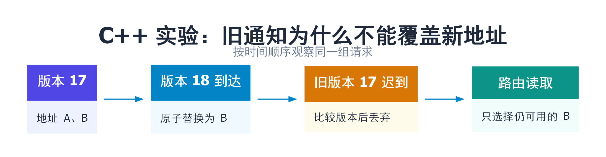
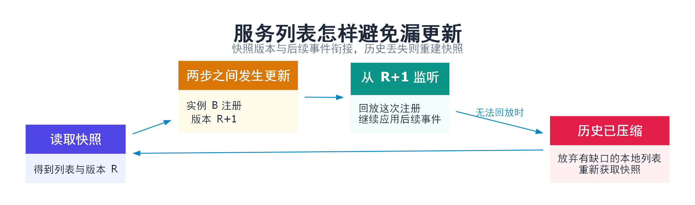
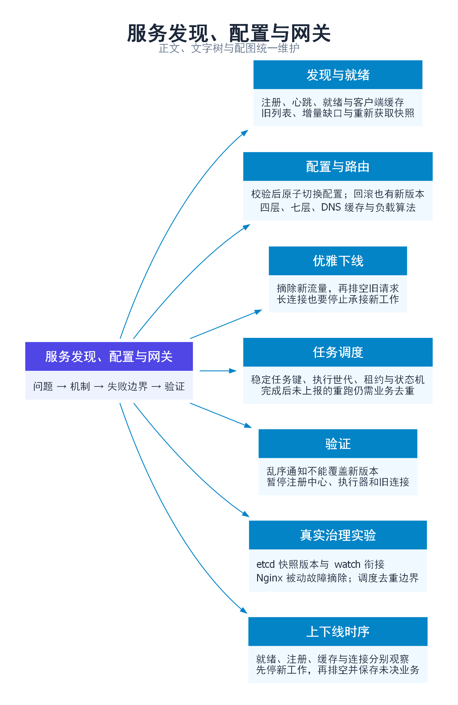

# 服务发现、配置与网关

订单服务扩容了两个实例，客户端怎样找到它们，又怎样避开正在停机的实例？

[上一篇：存储、分片与缓存](../08-%E5%AD%98%E5%82%A8%E3%80%81%E5%88%86%E7%89%87%E4%B8%8E%E7%BC%93%E5%AD%98/%E5%AD%98%E5%82%A8%E3%80%81%E5%88%86%E7%89%87%E4%B8%8E%E7%BC%93%E5%AD%98.md) · [返回目录](../README.md) · [下一篇：流量、容量与过载保护](../10-%E6%B5%81%E9%87%8F%E3%80%81%E5%AE%B9%E9%87%8F%E4%B8%8E%E8%BF%87%E8%BD%BD%E4%BF%9D%E6%8A%A4/%E6%B5%81%E9%87%8F%E3%80%81%E5%AE%B9%E9%87%8F%E4%B8%8E%E8%BF%87%E8%BD%BD%E4%BF%9D%E6%8A%A4.md)

上一篇用分片路由定位数据。本篇讨论请求怎样找到可以工作的服务实例，以及实例列表变化后如何切换。

**阅读准备：** 先读上一篇的主线案例；本文涉及的 C++ 实验需要理解函数、容器与基本线程同步。

**快速阅读：**先读“一次请求怎样经过网关和服务发现”，再读“面试表达”和 Q&A；遇到说不清原因的结论，回到对应原理小节。

**深入学习：**按正文顺序推演每一步，运行文内完整示例，修改故障发生位置并核对结果。模拟程序只验证写明的假设；真实网络、磁盘和组件行为需按文中的验证步骤另行测试。

<details>
<summary>本文目录</summary>

- [一次请求怎样经过网关和服务发现](#section-01)
- [发现与就绪](#section-02)
- [负载均衡与路由](#section-03)
- [发布与调度](#section-04)
- [从停机实例撤走流量](#section-05)
- [注册中心断开后如何继续服务](#section-06)
- [C++ 实验：旧通知为什么不能覆盖新地址](#section-07)
- [负载均衡怎样选择实例](#section-08)
- [分布式任务调度：到点启动不等于只执行一次](#section-09)
- [注册中心与配置中心内部怎样更新客户端](#section-10)
- [网关、服务框架与调度器怎样接在一起](#section-11)
- [新实例发现与故障摘除，为什么都有延迟](#section-12)
- [面试表达](#section-13)
- [Q&A（常见问题与解答）](#section-14)
- [思维导图总结](#section-15)

</details>

<a id="section-01"></a>

## 一次请求怎样经过网关和服务发现

用户访问订单详情时，网关先按 HTTP 路径匹配订单服务，再从发现结果里选一个就绪实例，最后用连接池转发。一次 503 可能发生在三个位置。

| 发生位置 | 可能原因 | 去哪里找证据 |
| --- | --- | --- |
| 路由匹配 | 新版本路由尚未发布 | 查网关路由版本和匹配结果 |
| 选择实例 | 服务未注册，或全部未就绪 | 查发现结果、地址缓存和健康状态 |
| 建连或转发 | 地址已过期，实例正在停机，或连接池已满 | 查连接失败、排队时间和实例日志 |

服务发现可以由客户端自己订阅，也可以由代理持有列表。无论谁持有列表，都要回答更新从哪里来、缓存多久、重连后怎样补齐，以及没有可用实例时怎样失败。健康探测也要区分进程是否存活与能否接收流量。若把短暂的下游故障直接当成进程死亡，反复重启可能让恢复更慢。

下线实例 A 时，先让它退出新请求的候选列表，再留出时间处理已有请求。使用长连接时还要让上游停止往旧连接发新工作。验证时观察请求是否仍被分给 A、已有请求是否完成，以及配置传播花了多久。

<a id="section-02"></a>

## 发现与就绪

服务注册保存地址和元数据，发现机制把实例列表交给客户端或代理。心跳能反映实例是否仍在上报，就绪检查则用来决定此时能否接收请求。列表的传播和缓存都有延迟，客户端仍要处理地址过期和连接失败。

<a id="section-03"></a>

## 负载均衡与路由

负载均衡从可用实例里挑一个。四层根据连接等信息分流，七层可以看 HTTP 路径等应用数据。实例性能接近时可以轮询，能力不同可按权重分流。网关负责入口路由与策略，服务网格主要处理服务之间的通信。代理也有连接池和超时，要一起纳入请求预算。

<a id="section-04"></a>

## 发布与调度

配置要有版本，逐批发布并验证结果。下线实例时先标记不可接收新流量，再等待已有请求结束。分布式任务调度同样需要明确分片所有者和接管规则，重跑任务时复用稳定任务 ID 防止重复处理。

<a id="section-05"></a>

## 从停机实例撤走流量

网关缓存了实例 A 的地址。A 停止接收新请求前，先把就绪状态设为失败。等路由更新，并给已有请求留出退出时间。即使某个网关仍持有旧地址，也要有失败处理和有限重试。


<a id="section-06"></a>

## 注册中心断开后如何继续服务

已有地址列表的客户端可以在允许的有效期内继续请求，并报告发现结果已过期。新启动的实例如果没有缓存，就要等待发现恢复或按预设策略失败。摘除时先停止接收新请求，再等待连接和已有请求排空。配置更新同样要处理断线后重新订阅和版本补齐，否则一个实例可能长期用旧规则。

验收时可以先登记 A、B 两个实例，再断开其中一个客户端与注册中心的连接，随后摘除 A。分别观察联网客户端和失联客户端的路由结果，检查过期地址失败后是否在截止时间内切换到 B。

### 如何保证配置更新可追踪？

设网关 A 使用配置版本 17，B 已使用 18。发布系统要能看到每个实例当前生效的版本。实例收到 18 后先解析并校验，成功后再切换到整份新配置。若校验失败，应保留上一份可用配置并上报原因。断线重连后重新获取当前版本，避免从丢失的增量继续拼接。

回滚也要作为一次发布，例如版本 19 恢复了 17 的规则。这样订阅端仍能按版本向前推进，排查时也能区分“仍没收到新配置”与“已执行回滚”。

<a id="section-07"></a>

## C++ 实验：旧通知为什么不能覆盖新地址

注册中心保存服务的地址列表，客户端把列表缓存在本地。设版本 17 中 A、B 都可用，版本 18 中 A 开始下线，只剩 B。如果版本 18 先到、版本 17 后到，简单地用“最后收到的列表”覆盖缓存就会重新向 A 发流量。

下面模拟接收**完整快照**。每次替换前比较版本，整份快照在同一把锁内更新，读请求只会看到切换前或切换后的完整列表。若实际使用增量订阅，还要检查版本是否连续。发现缺口时重新拉取快照。



把下面代码保存为 `discovery_revision.cpp`。需要支持 C++17 和线程库的 GCC。Ubuntu 可用 `sudo apt install build-essential` 安装工具链。

```cpp
#include <cassert>
#include <cstdint>
#include <iostream>
#include <mutex>
#include <string>
#include <utility>
#include <vector>

class Discovery {
    std::mutex mutex_;
    std::uint64_t version_ = 0;
    std::vector<std::string> addresses_;

public:
    bool apply(std::uint64_t version, std::vector<std::string> addresses) {
        std::lock_guard<std::mutex> lock(mutex_);
        if (version <= version_) return false;
        addresses_ = std::move(addresses);
        version_ = version;
        return true;
    }

    std::vector<std::string> snapshot() {
        std::lock_guard<std::mutex> lock(mutex_);
        return addresses_;
    }
};

int main() {
    Discovery discovery;
    const bool initial = discovery.apply(17, {"A", "B"});
    const bool removed = discovery.apply(18, {"B"});
    const bool late = discovery.apply(17, {"A", "B"});
    assert(initial && removed && !late);
    assert(discovery.snapshot() == std::vector<std::string>{"B"});

    const bool empty = discovery.apply(19, {});
    assert(empty && discovery.snapshot().empty());
    std::cout << "stale=ignored selected=B empty=accepted\n";
}
```

```bash
g++ -std=c++17 -O2 -Wall -Wextra -pthread discovery_revision.cpp -o discovery_revision
./discovery_revision
```

在 Windows MSYS2 UCRT64 的 GCC 上编译并运行，实测输出如下。

```text
stale=ignored selected=B empty=accepted
```

空列表也可能是合法结果，例如服务的所有实例同时进入维护。如果客户端忽略空列表，反而会继续请求已经退出的实例。服务端还要区分“成功返回空列表”和“本次获取失败”，后者可以在缓存有效期内沿用上次快照。

代码中每次读取会复制列表，耗时随地址数量增长。高吞吐路径可以在更新时构造不可变快照，让请求持有该快照的共享所有权，缩短读路径的临界区。生产实现还需要规定版本的作用域，注册中心迁移或恢复后，应重新建立订阅并确认新旧版本是否可比较。

<a id="section-08"></a>

## 负载均衡怎样选择实例

假设 A 能处理约两倍于 B 的请求。轮询把六次请求分成 3:3，权重 2:1 可以按 4:2 分配。随机在长期趋近目标比例，小样本波动更大。若 A 有 8 条活跃连接而 B 有 1 条，最少连接会选 B，但长连接里可能并发多条请求，所以还要观察实际在途请求数。哈希适合维持会话亲和，热点用户也会集中到同一个实例。

Nacos、Eureka、Consul、etcd 可按注册模型、健康状态来源与订阅恢复方式比较。配置中心则重点看版本、校验和回退，Nacos、Apollo、Spring Cloud Config 可放在同一测试流程下观察。网关测试可用一条订单路由比较 Kong、APISIX 或 Spring Cloud Gateway 的转发、鉴权与超时。Nginx、HAProxy、LVS 和 DNS 轮询应按决策位置、连接粒度与故障摘除速度比较，DNS 客户端缓存可能延迟生效。Spring Cloud 与 Dubbo 是服务框架选型入口，不能据框架名称推断请求路径。

XXL-JOB、Elastic-Job 的实践要验证任务分片、执行器离线接管与重复执行。以每日结算为例，给每个日期和分片固定一个业务键，调度器重派后按同一个键结算。


<a id="section-09"></a>

## 分布式任务调度：到点启动不等于只执行一次

假设每天零点生成账单，有两个调度器用于容错。两者都看到“今天账单没生成”，各发起一次任务；或者执行器完成账单后没来得及报告，调度器又重派一次。即使只有一个调度器，第二种情况仍会发生。

一个任务记录至少包含：稳定业务键（例如日期与客户号）、当前状态、尝试次数、所有者世代、租约期限和结果位置。先用唯一约束创建任务，再用条件更新取得执行权。执行器定期续租；调度器只能把超时任务标为待接管，不能由此推断旧线程已经停止。

| 状态变化 | 必须检查的条件 | 失败后的处理 |
| --- | --- | --- |
| 待执行 → 运行中 | 当前无有效持有者，原子分配新世代 | 竞争失败者不要执行 |
| 运行中 → 续租 | 所有者与世代仍匹配 | 续租失败后停止发起新工作 |
| 运行中 → 完成 | 结果已保存，当前世代仍匹配 | 不确定时按业务键查询结果 |
| 超时 → 重新执行 | 分配新世代，外部副作用可去重或隔离 | 不能只重置状态后盲目再做一次 |

若任务向数据库写账单，让业务键唯一约束与结果写入在同一事务中完成；若发送邮件，外部服务也需要支持幂等或接受可能重复的业务约定。第 05 篇的 fencing token 用于拒绝旧执行器写入，第 04 篇的幂等键用于避免重试重复生效，二者解决不同问题。

任务分片时把稳定的任务键分配到不同执行器；扩容后需要明确未完成任务怎样移交。XXL-JOB、Elastic-Job 等组件可以承担调度职责，业务仍需定义重跑语义。验证方法是让执行器在“副作用已提交、完成状态未回报”处退出，再重启接管，检查结果只有一份，而不只是日志里出现一次“成功”。


<a id="section-10"></a>

## 注册中心与配置中心内部怎样更新客户端

发现系统的核心不是保存一个地址字符串，而是维护“地址何时有效、客户端怎样跟上变化”。注册实例后，服务端保存实例元数据，按租约或健康探测决定有效性；客户端获取列表、缓存并订阅更新。断线期间能否继续使用旧列表，是另外一条业务约定。

| 组件家族 | 重点观察的内部过程 | 不能忽略的边界 |
| --- | --- | --- |
| etcd | revision 标记变更，事务更新键，lease 关联临时记录，watch 传递变化 | 历史被压缩后不能无限补看，需要重新取得快照 |
| Consul | catalog 保存服务实例，健康检查影响发现结果 | 注册成功不等于健康检查通过；DNS 与 HTTP 读取路径不同 |
| Eureka | 实例注册与续约，服务端及客户端缓存列表 | 缓存与摘除延迟决定失效地址还能被使用多久 |
| Nacos | 命名服务管理实例，订阅通知推动客户端缓存更新 | 临时/持久实例及版本配置影响健康与一致性行为 |
| Apollo / Spring Cloud Config | 将配置版本交给应用，再由应用解析与应用 | 收到配置不等于所有线程已经采用，也不等于整组服务原子升级 |

具体实现随版本变化，分析时要画出“存储、缓存、通知、应用”四步。配置先完整校验再切换，失败时保留旧版本；不能边解析边改正在被线程读取的配置对象。C++ 可把一份不可变配置放到共享所有权对象中，校验成功后原子替换引用，旧请求继续持有旧对象直到结束。

### 真实 etcd：从快照 revision 接上 watch



环境：Ubuntu 24.04、发行版 etcd 3.x、etcdctl 与 jq。本轮未运行。新开实验目录，在前台启动专用实例，避免使用系统默认端口：

```bash
sudo apt install -y etcd-server etcd-client jq
mkdir -p etcd-discovery-lab
cd etcd-discovery-lab
etcd --name lab --data-dir "$PWD/data" --listen-client-urls http://127.0.0.1:23790 --advertise-client-urls http://127.0.0.1:23790 --listen-peer-urls http://127.0.0.1:23890 --initial-advertise-peer-urls http://127.0.0.1:23890 --initial-cluster lab=http://127.0.0.1:23890 --initial-cluster-state new
```

另一个终端配置端点并登记实例：

```bash
export ETCDCTL_API=3
export ETCDCTL_ENDPOINTS=http://127.0.0.1:23790
etcdctl put /lab/services/orders/A 127.0.0.1:18081
etcdctl get /lab/services/orders/ --prefix -w json > snapshot.json
revision=$(jq -r '.header.revision' snapshot.json)
# 故意在快照与 watch 之间修改，制造需要补齐的间隙。
etcdctl put /lab/services/orders/B 127.0.0.1:18082
etcdctl watch /lab/services/orders/ --prefix --rev "$((revision+1))"
```

预期 watch 能收到快照之后新增 B 的事件。若直接从“现在”开始监听，快照和监听之间的变化可能漏掉。实际客户端应先应用完整快照，再从 R+1 处理增量；断线重连从已处理的位置继续，若服务端返回历史已压缩，就重新拉取快照。[etcd watch 教程](https://etcd.io/docs/v3.5/tutorials/how-to-watch-keys/)

再开终端，配置同样的环境变量并执行：

```bash
lease_id=$(etcdctl lease grant 10 | awk '/^lease / {print $2}')
etcdctl put /lab/services/orders/C 127.0.0.1:18083 --lease="$lease_id"
etcdctl get /lab/services/orders/ --prefix
```

不执行 keep-alive，约十秒后 C 会因租约失效被删除，watch 应收到删除事件。删除时间还受调度影响，不能用这一观察证明精确十秒到期。A、B 是未绑定租约的普通键，不会随命令进程退出而自动消失。真实注册客户端需持续续租，续租失败时主动报告状态不确定。

### 真实 Nginx：后端退出后请求怎样转移

下面用三个 Nginx 进程分别充当 A、B 和网关，避免用虚构的地址解释负载均衡。环境：Ubuntu 24.04、Nginx 发行版包、curl；本轮未运行。

```bash
sudo apt install -y nginx curl
mkdir -p nginx-routing-lab
cd nginx-routing-lab
```

保存 `a.conf`：

```nginx
pid a.pid;
error_log a-error.log;
events {}
http {
    access_log a-access.log;
    server { listen 127.0.0.1:18081; location / { return 200 "A\n"; } }
}
```

保存 `b.conf`：

```nginx
pid b.pid;
error_log b-error.log;
events {}
http {
    access_log b-access.log;
    server { listen 127.0.0.1:18082; location / { return 200 "B\n"; } }
}
```

保存 `gateway.conf`：

```nginx
pid gateway.pid;
error_log gateway-error.log;
events {}
http {
    log_format lab '$status upstream=$upstream_addr upstream_status=$upstream_status';
    access_log gateway-access.log lab;
    upstream orders {
        server 127.0.0.1:18081 max_fails=1 fail_timeout=5s;
        server 127.0.0.1:18082 max_fails=1 fail_timeout=5s;
    }
    server {
        listen 127.0.0.1:18080;
        location / {
            proxy_pass http://orders;
            proxy_connect_timeout 200ms;
            proxy_read_timeout 1s;
            proxy_next_upstream error timeout;
            proxy_next_upstream_tries 2;
        }
    }
}
```

```bash
mkdir -p logs
nginx -p "$PWD/" -c a.conf
nginx -p "$PWD/" -c b.conf
nginx -p "$PWD/" -c gateway.conf
for i in 1 2 3 4; do curl --fail http://127.0.0.1:18080/; done
nginx -p "$PWD/" -c a.conf -s quit
for i in 1 2 3 4; do curl --fail http://127.0.0.1:18080/; done
cat gateway-access.log
nginx -p "$PWD/" -c b.conf -s quit
nginx -p "$PWD/" -c gateway.conf -s quit
```

预期初始请求到 A/B，A 退出后后续 GET 能转到 B。看日志中的 upstream 地址和状态，区分第一次尝试失败与第二次成功。这里是被动失败探测：请求遇到失败才更新判断，不是注册中心主动推送摘除。[Nginx 负载均衡](https://nginx.org/en/docs/http/load_balancing.html)

端口占用时先检查监听进程；配置错误用 `nginx -t -p "$PWD/" -c gateway.conf`。实验只转发无副作用的 GET；写请求能否重试，必须回到第 04 篇检查是否已执行和业务幂等，不能为了“请求不报错”一律重新转发。

<a id="section-11"></a>

## 网关、服务框架与调度器怎样接在一起

Kong/APISIX 一类网关先匹配路由，再按插件阶段执行认证、限流等策略，随后选择 upstream 并代理请求。插件顺序会改变结果：认证前按来源限流，与认证后按租户限流，保护对象不同。转发开始前做的校验，也不能替代业务服务对订单归属的检查。

Spring Cloud 是一组服务开发与治理组件的组合，Dubbo 围绕服务接口、注册发现、调用与集群容错组织 RPC。客户端在“多个 provider 中选哪个”和“失败后是否重试”两个步骤都可能改变流量；配置中心、网关和 RPC 框架若各自重试，会放大同一业务请求。C++ 项目应理解这些阶段，再映射到所用客户端库，不必为了框架名切换语言。

XXL-JOB/Elastic-Job 一类调度器负责触发、分片和执行器分配，但“收到任务”“开始执行”“副作用已提交”“回报完成”仍是分离步骤。执行器失联后重派，只能提高任务完成机会；重复副作用仍由前文的任务键、状态机与资源端隔离处理。核对执行日志时，至少关联调度触发 ID、业务任务键和执行尝试 ID，不能拿三者中的任意一个替代其余两个。


**本节机制与实验参考：** [etcd 从指定版本监听](https://etcd.io/docs/v3.5/tutorials/how-to-watch-keys/)；[Nginx HTTP 负载均衡与故障处理](https://nginx.org/en/docs/http/load_balancing.html)。

<a id="section-12"></a>

## 新实例发现与故障摘除，为什么都有延迟

新实例从启动到真正接流量，要经过应用初始化、就绪检查、注册或健康状态更新、通知传播、客户端缓存更新与负载均衡选择。发现延迟衡量新实例已经可服务之后，调用方多久开始使用它；扩容数量已经增加，不代表调用方已获得这部分容量。

故障摘除走另一条链：健康探测或心跳超时判定失败，服务端更新状态，客户端收到或轮询到变化，连接池停止给旧地址发送新工作。即使列表已删除实例，已有长连接仍可能继续提交请求。因此摘除延迟不能只看注册中心的心跳周期，还要看通知、缓存和连接行为。

排查时记录四个时间点：实例就绪、注册端状态变化、客户端列表变化、首个实际请求；停机则记录不再就绪、客户端停止选择、最后一个在途请求完成。不要只对比两台机器的墙上时间就精确归因，应校准时钟或用同一观察进程计时。

优雅下线的操作顺序是先停止接收新业务并撤销就绪/注册，通知连接不再承接新工作，再等待在途请求排空，最后关闭进程。排空有截止时间，超时后记录未决业务键，供恢复时查询；不能靠无限等待一个卡住的请求完成下线。注册中心暂时不可达时，旧列表是否继续使用应按业务容错目标决定。


<a id="section-13"></a>

## 面试表达

服务发现维护的是地址和有效状态，客户端通过快照与增量更新跟踪实例。新增实例要经过就绪、注册和缓存传播，故障实例也不会瞬间从所有连接消失。配置更新应先完整校验再原子切换，下线先停新流量再排空。代价是缓存陈旧与控制面故障处理，需明确断连时继续用旧列表还是拒绝，而不能只看注册成功。

<a id="section-14"></a>

## Q&A（常见问题与解答）

### 注册成功为什么还没有新请求？

还需应用就绪、列表传播、客户端缓存更新及负载选择。逐段记录时间才能区分启动慢与发现慢。

### 列表删掉实例为什么还不能立刻停机？

旧连接与在途请求可能仍在执行。应停止新工作并排空，否则写入成功但响应丢失又会产生未知结果。

### 先读取实例列表，再从当前时刻监听，有什么问题？

两步之间的变更会丢失。应保存快照版本 R，从 R+1 接收后续事件。若历史已压缩，要重新获取快照，不能继续使用有缺口的列表。

**调度器保证只派发一次，业务就只执行一次吗？**

不能仅靠派发。任务完成后报告丢失会触发重派，旧执行器也可能暂停后恢复。需要结果持久化、稳定业务键以及必要的世代校验。

**为什么发现列表里有两个实例，请求还可能全压到一个实例？**

可能是连接长期复用、权重不同、另一个实例尚未就绪，或负载均衡按连接分配。要对照实际连接数和请求数。

**进程还能回复心跳，为什么仍要从流量列表摘除？**

它可能正在排空请求，或者暂时没有能力处理业务。存活检查和就绪检查回答不同问题。

[延伸阅读](https://kubernetes.io/docs/concepts/configuration/liveness-readiness-startup-probes/)

下一篇要回答的问题是：系统每秒最多处理 100 个请求，连续收到 120 个时会发生什么？

<a id="section-15"></a>

## 思维导图总结

```text
服务发现、配置与网关
├── 发现与就绪
│   ├── 注册、心跳、就绪与客户端缓存
│   └── 旧列表、增量缺口与重新获取快照
├── 配置与路由
│   ├── 校验后原子切换配置；回滚也有新版本
│   └── 四层、七层、DNS 缓存与负载算法
├── 优雅下线
│   ├── 摘除新流量，再排空旧请求
│   └── 长连接也要停止承接新工作
├── 任务调度
│   ├── 稳定任务键、执行世代、租约与状态机
│   └── 完成后未上报的重跑仍需业务去重
├── 验证
│   ├── 乱序通知不能覆盖新版本
│   └── 暂停注册中心、执行器和旧连接
├── 真实治理实验
│   ├── etcd 快照版本与 watch 衔接
│   └── Nginx 被动故障摘除；调度去重边界
└── 上下线时序
    ├── 就绪、注册、缓存与连接分别观察
    └── 先停新工作，再排空并保存未决业务
```


