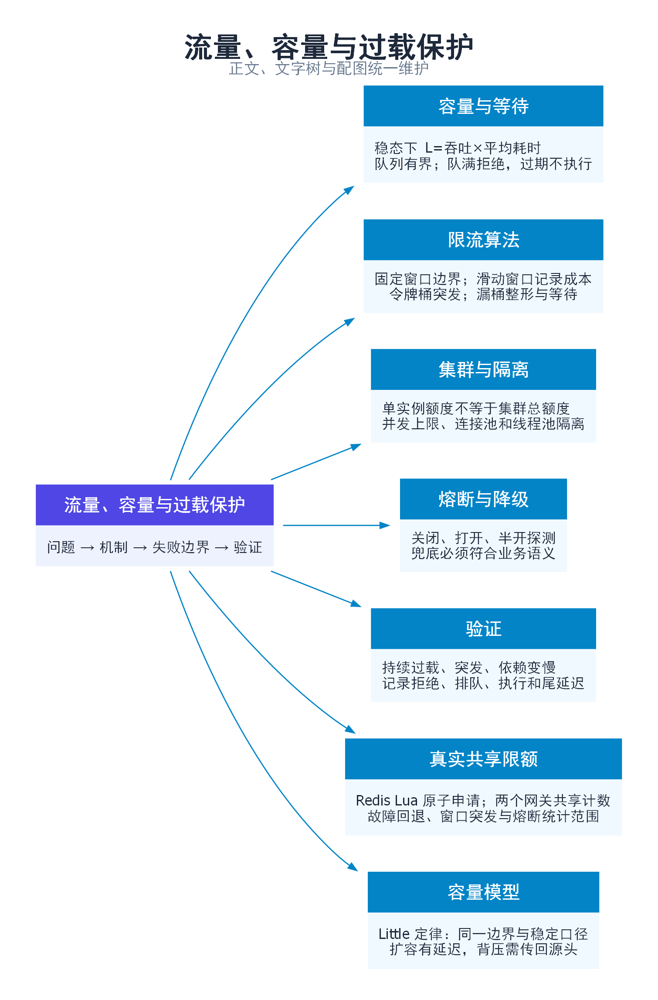

# 流量、容量与过载保护

系统每秒最多处理 100 个请求，连续收到 120 个时会发生什么？

[上一篇：服务发现、配置与网关](../09-%E6%9C%8D%E5%8A%A1%E5%8F%91%E7%8E%B0%E3%80%81%E9%85%8D%E7%BD%AE%E4%B8%8E%E7%BD%91%E5%85%B3/%E6%9C%8D%E5%8A%A1%E5%8F%91%E7%8E%B0%E3%80%81%E9%85%8D%E7%BD%AE%E4%B8%8E%E7%BD%91%E5%85%B3.md) · [返回目录](../README.md) · [下一篇：可观测性与故障验证](../11-%E5%8F%AF%E8%A7%82%E6%B5%8B%E6%80%A7%E4%B8%8E%E6%95%85%E9%9A%9C%E9%AA%8C%E8%AF%81/%E5%8F%AF%E8%A7%82%E6%B5%8B%E6%80%A7%E4%B8%8E%E6%95%85%E9%9A%9C%E9%AA%8C%E8%AF%81.md)

上一篇解决请求要发到哪台实例。本篇讨论实例都很忙时，入口还能接收多少工作。

**阅读准备：** 先读上一篇的主线案例；本文涉及的 C++ 实验需要理解函数、容器与基本线程同步。

**快速阅读：**先读“用吞吐、等待和并发解释过载”，再读“面试表达”和 Q&A；遇到说不清原因的结论，回到对应原理小节。

**深入学习：**按正文顺序推演每一步，运行文内完整示例，修改故障发生位置并核对结果。模拟程序只验证写明的假设；真实网络、磁盘和组件行为需按文中的验证步骤另行测试。

<details>
<summary>本文目录</summary>

- [用吞吐、等待和并发解释过载](#section-01)
- [有界队列](#section-02)
- [过载保护](#section-03)
- [测量与验证](#section-04)
- [用数字看队列什么时候满](#section-05)
- [限流、排队和降级怎么配合](#section-06)
- [C++ 实验：队满拒绝与排队过期](#section-07)
- [固定窗口、漏桶和熔断的状态变化](#section-08)
- [滑动窗口、令牌桶与集群额度](#section-09)
- [两个网关共用一个限额：真实 Redis 原子计数实验](#section-10)
- [Sentinel 与 Hystrix：熔断器在调用前后各做什么](#section-11)
- [Little 定律与扩容延迟：容量公式什么时候成立](#section-12)
- [面试表达](#section-13)
- [Q&A（常见问题与解答）](#section-14)
- [思维导图总结](#section-15)

</details>

<a id="section-01"></a>

## 用吞吐、等待和并发解释过载

一个依赖最多同时处理 20 个请求。每个请求平均占用 50 毫秒时，按简化模型每秒约能完成 400 个。如果占用变成 500 毫秒，同样的并发量每秒约只能完成 40 个。此时入口仍按 100 个每秒放行，队列就会增长。

- 限流控制单位时间放多少请求进来。令牌桶允许一定突发，但长期放行速率受补充速率限制。
- 并发限制控制同时占用多少连接、线程或其他资源。下游变慢时，正在占用的请求会更快碰到上限。
- 有界队列控制最多等待多少请求。等待超过期限的工作应尽快撤出，避免继续占资源。
- 熔断在依赖持续失败时停止大部分调用，稍后只放少量探测请求。舱壁把不同业务的资源池分开，避免互相拖累。

压测不要只记吞吐。可以固定入口为每秒 100 个，先跑正常依赖，再把耗时提高十倍。记录完成量、拒绝量、排队 P99 和恢复耗时。若拒绝上升而完成量稳定，说明入口保护开始工作。若完成量下降且重试持续放大，继续检查超时与重试层。

<a id="section-02"></a>

## 有界队列

若持续接收全部请求，在入口 100/s、处理 40/s 的算例中，队列每秒大约增长 60 个。加大队列只能延后队满，排队延迟仍会增长。设置有界队列与并发上限，满时拒绝或向上游施加背压，让进入系统的工作量接近实际处理能力。

<a id="section-03"></a>

## 过载保护

令牌桶按固定速率产生令牌，请求消耗令牌，桶容量允许有限突发。熔断根据依赖失败率等信号短时间停止调用，随后通过少量探测判断能否恢复。舱壁为不同业务分开线程池、连接池或队列，避免一个慢依赖占满所有资源。降级前要明确可以省略哪些功能或接受多旧的数据。

<a id="section-04"></a>

## 测量与验证

同时记录吞吐、排队时间、依赖耗时和 P99。P99 表示 99% 的样本耗时在该值及以下。平均值可能掩盖少量极慢请求。压测要分别施加持续超载、突发流量与慢依赖，观察拒绝数量和回到正常状态所需时间。

<a id="section-05"></a>

## 用数字看队列什么时候满

队列能等 200 个请求，每秒净增加 20 个。从空队列开始，大约 约 3.33 秒就会满。若队列扩大到 400，只会把队满延后到约 20 秒。实际到达率会波动，因此应同时观察排队时间，并给每个请求设置等待上限。


<a id="section-06"></a>

## 限流、排队和降级怎么配合

假设库存依赖只能承受 20 个并发调用。先把调用库存的并发限制在 20，再给等待队列设容量和最长等待时间。队满后可对查询接口返回缓存，对扣库存请求则要明确拒绝。令牌桶限制每秒进入的请求量，并发上限限制同一时刻占用的资源量。即使请求速率没变，依赖变慢也会拉长占用时间，因此两者可以同时使用。

把依赖从 50 毫秒变慢到 500 毫秒，观察在固定并发上限下的完成量、拒绝量与尾延迟。若连接池被耗尽，先检查工作是否堆在池前，再决定是否调整入口配额。

### 排队超时后，为什么还要主动停止工作？

客户端等 200 毫秒就放弃，服务器却把请求留在队列里，500 毫秒后仍然执行。此时结果可能没人接收，但请求已经占用连接和 CPU。队列取出任务时应核对剩余预算，给可取消的下游操作传递期限。涉及业务修改的请求仍要记录最终结果，以便调用方用幂等键查询。

压力测试时应记录丢弃了多少已经过期的请求，以及它们在队列里停留多久。若大量请求还没开始就过期，优先考虑缩短队列或降低进入速率。[Google SRE 过载处理](https://sre.google/sre-book/handling-overload/)

<a id="section-07"></a>

## C++ 实验：队满拒绝与排队过期

用一个工作线程和两个排队名额观察过载。任务 1 开始执行后先停在一个受控的等待点，任务 2 和 3 进入队列，任务 4 到达时队列已满。释放任务 1 后，工作线程要检查任务 2 的截止时间。如果调用方已经放弃，这份工作应在开始之前就被丢弃。

队列的容量只统计等待任务，因此此例最多有 1 个执行中和 2 个等待。截止时间从进入系统时开始计算，排队也会消耗预算。实验用可控制的时钟来演示这段时间，避免机器负载或线程唤醒速度影响测试结果。


把下面代码保存为 `overload_queue.cpp`。需要支持 C++17 和线程库的 GCC。Ubuntu 可用 `sudo apt install build-essential` 安装工具链。

```cpp
#include <atomic>
#include <cassert>
#include <condition_variable>
#include <deque>
#include <functional>
#include <future>
#include <iostream>
#include <mutex>
#include <thread>
#include <utility>

class Worker {
    struct Job {
        int deadline_ms;
        std::function<void()> run;
    };
    std::atomic<int>& now_;
    std::mutex mutex_;
    std::condition_variable changed_;
    std::deque<Job> queue_;
    bool stopping_ = false;
    int expired_ = 0;
    std::thread thread_;

    void loop() {
        for (;;) {
            Job job;
            {
                std::unique_lock<std::mutex> lock(mutex_);
                changed_.wait(lock, [&] { return stopping_ || !queue_.empty(); });
                if (queue_.empty()) return;  // 关闭且已排空。
                job = std::move(queue_.front());
                queue_.pop_front();
            }
            // 业务代码在队列锁之外执行，提交线程仍可检查队列容量。
            if (now_.load() >= job.deadline_ms) ++expired_;
            else job.run();
        }
    }

public:
    explicit Worker(std::atomic<int>& now)
        : now_(now), thread_([this] { loop(); }) {}

    bool submit(int deadline_ms, std::function<void()> run) {
        {
            std::lock_guard<std::mutex> lock(mutex_);
            if (stopping_ || queue_.size() == 2) return false;
            queue_.push_back(Job{deadline_ms, std::move(run)});
        }
        changed_.notify_one();
        return true;
    }

    void drain_and_join() {
        {
            std::lock_guard<std::mutex> lock(mutex_);
            stopping_ = true;
        }
        changed_.notify_one();
        if (thread_.joinable()) thread_.join();
    }

    int expired_after_join() const { return expired_; }
    ~Worker() { drain_and_join(); }
};

int main() {
    std::atomic<int> now{0};
    std::promise<void> started;
    std::promise<void> release;
    auto started_future = started.get_future();
    auto release_future = release.get_future();
    int ran = 0;
    Worker worker(now);

    const bool first = worker.submit(100, [&] {
        started.set_value();
        release_future.wait();
        ++ran;
    });
    assert(first);
    started_future.wait();
    const bool second = worker.submit(10, [&] { ++ran; });
    const bool third = worker.submit(100, [&] { ++ran; });
    const bool fourth = worker.submit(100, [&] { ++ran; });
    assert(second && third && !fourth);
    now.store(20);
    release.set_value();
    worker.drain_and_join();
    assert(ran == 2 && worker.expired_after_join() == 1);
    std::cout << "executed=2 expired=1 rejected=1\n";
}
```

```bash
g++ -std=c++17 -O2 -Wall -Wextra -pthread overload_queue.cpp -o overload_queue
./overload_queue
```

在 Windows MSYS2 UCRT64 的 GCC 上编译并运行，实测输出如下。

```text
executed=2 expired=1 rejected=1
```

队列锁只保护入队、出队和关闭状态。工作线程持锁检查等待条件，出队后释放锁，再运行回调。否则任务 1 停顿时，提交者连队列是否已满都无法判断。析构会先停止接收、排空队列，再等待线程退出，避免线程继续访问已经销毁的队列。

实际服务应使用 `steady_clock` 度量本机等待时长，将结果通过 RPC 回复或任务状态交还给调用方，并在线程入口捕获业务异常。这里的回调假定会结束且不抛异常，关闭仅由控制线程调用。运行中的任务需要单独传播取消信号，队列超期检查只覆盖尚未开始的工作。

过载时若正常服务耗时约 50 ms、允许 20 个并发，理想完成速率约为每秒 400 个。依赖慢到 500 ms 时，速率约为每秒 40 个。入口每秒仍放 100 个，积压就会持续增加。应分别观察已接收、完成、过期和拒绝，而不是只看 HTTP 成功率。队列保护保留了处理已有任务的机会，拒绝策略还要按业务优先级和客户端重试行为设计。[Google SRE 过载处理](https://sre.google/sre-book/handling-overload/)

<a id="section-08"></a>

## 固定窗口、漏桶和熔断的状态变化

固定窗口每秒计数上限为 100。若 0.999 秒来了 100 个、1.001 秒又来 100 个，两个窗口都合法，约 2 ms 内却通过了 200 个。令牌桶可用容量限制突发，空闲后可以积攒令牌。漏桶整形把到来的工作放进有界队列，再按近似固定速度送出，队满则拒绝或反压，代价是排队延迟。

熔断器平时关闭，调用通过。达到最小样本数后，失败比例超过阈值则打开，直接拒绝一段时间。之后进入半开，限定少量探测请求。探测成功才逐步关闭，失败则重新打开。并发实现要原子地申请探测名额，不能让所有线程同时看到“可探测”就放行。依赖恢复时还要配合限流，防止排队请求一次性涌入。Sentinel、Hystrix 等组件应按实际版本验证窗口、探测和隔离策略。

把 100 个失败请求后接 100 个并发探测作为验收，观察真正抵达依赖的数量，核对打开期间的快速失败和半开配额。


<a id="section-09"></a>

## 滑动窗口、令牌桶与集群额度

固定窗口在边界两侧可能放过两批请求。若要限制“任意过去一秒最多 100 次”，一种直观实现是保存最近请求的时间戳：新请求到达时删除一秒前的记录，剩余数量不足 100 才加入。它准确表达滑动时间窗，但每个活跃主体需要存多条记录；把时间切成小桶只保存计数更省空间，代价是桶边界误差。

令牌桶则表达另一种约定：允许积攒额度后突发。桶容量 B、补充速率 r、距上次更新经过 dt 时，先计算 `tokens = min(B, tokens + r * dt)`，再检查能否扣除本次请求成本。更新和扣减必须在同一临界区完成，否则两个线程可能同时消费最后一个令牌。进程内计时使用单调时钟，避免墙上时钟回拨改变速率。

假设 B=20，r=10/秒，空闲足够久后可以立即通过 20 个请求，之后长期按每秒约 10 个补充。它不等价于“任意一秒最多 10 个”。限流规则必须说明允许的突发，否则测试和业务承诺会对不上。

如果 10 个实例各自限 100 次/秒，集群总量可能达到 1000 次/秒。需要总额度时，可以由中心原子计数，或把额度分配给实例。中心方案增加网络依赖；本地分配快但可能额度闲置，重新分配和失联时还要决定是否允许超额。限流系统自身不可用时，是拒绝请求还是按本地保守额度放行，应按业务风险预先约定。


<a id="section-10"></a>

## 两个网关共用一个限额：真实 Redis 原子计数实验

假设接口每分钟最多放行 100 次。两个网关各自在内存里记 100 次，合起来就能放行 200 次。若要求共享限额，两者需要向同一个计数状态申请额度。可以把 Redis 想成统一发票处，但真正起作用的不是“集中存储”四个字，而是检查、递增、设置过期时间作为一次不可被其他请求插入的操作执行。

下面故意选固定窗口，先验证共享计数的原子性，不把它包装成平滑限流器。窗口从首次请求开始持续 60 秒；边界附近仍可能出现两批突发。Ubuntu 24.04、Redis 7.x，安装 `sudo apt install redis-server redis-tools`。在独立终端启动只供实验的实例：

```bash
redis-server --bind 127.0.0.1 --port 6381 --save '' --appendonly no
```

保存以下脚本为 `limit.lua`。在 Redis 中 Lua 脚本连续执行，其他客户端不能在它的读取与写入之间修改计数。脚本必须短小，因为长脚本也会阻塞其他请求。[Redis Lua 执行语义](https://redis.io/docs/latest/develop/programmability/eval-intro/)

```lua
-- KEYS[1] 是限流对象；ARGV[1] 是额度，ARGV[2] 是窗口毫秒数。
local cap = tonumber(ARGV[1])
local window = tonumber(ARGV[2])
if not cap or cap < 1 or cap % 1 ~= 0 or
   not window or window < 1 or window % 1 ~= 0 then
  return redis.error_reply('positive integer cap and window required')
end
local count = tonumber(redis.call('GET', KEYS[1]) or '0')
if count >= cap then
  return {0, count, redis.call('PTTL', KEYS[1])}
end
count = redis.call('INCR', KEYS[1])
if count == 1 then redis.call('PEXPIRE', KEYS[1], window) end
return {1, count, redis.call('PTTL', KEYS[1])}
```

在同一 Bash 终端让两个后台进程扮演网关，各申请 4 次，额度设为 5。使用全新的测试 key，避免上一次结果影响本轮。两个进程都要在 60 秒内完成。

```bash
key="lab:limit:$(date +%s):$$"
request_four() {
  for i in 1 2 3 4; do
    redis-cli -p 6381 --raw --eval limit.lua "$key" , 5 60000 | head -n 1
  done
}
request_four > gateway-a.txt &
a_pid=$!
request_four > gateway-b.txt &
b_pid=$!
wait "$a_pid" "$b_pid"
cat gateway-a.txt gateway-b.txt | sort | uniq -c
redis-cli -p 6381 GET "$key"
```

预期计数是 3 个 `0`、5 个 `1`，Redis 中保存 `5`。哪个网关抢到更多额度不确定。脚本返回第一项是是否放行，第二项是已放行次数，第三项是剩余窗口时间；客户端可以据此生成重试提示，但请求重试仍应使用退避，不能让所有客户端同时重试。

**这段脚本保证单实例内申请额度不互相穿插，不保证故障切换后额度绝不回退。** 示例关闭了持久化，Redis 重启会丢失计数。网络超时也可能发生在扣除额度之后：自动重试会再消耗一次额度。若业务要求重试不重复计费，还需要请求 ID 和去重记录，不能直接把这个限流计数当支付账本。

如果 Redis 不可达，应预先确定拒绝请求，还是使用保守的本地临时额度。前者保护下游但降低可用性，后者继续服务但可能超过集群预算。不要等到故障发生才临时决定。`WRONGTYPE` 表示 key 被其他用途占用；连接失败先检查端口与进程；放行数不是 5 时，检查 key 是否新建、窗口是否已跨过、命令是否执行失败。本机没有 Redis，本节命令和输出尚未实测。

<a id="section-11"></a>

## Sentinel 与 Hystrix：熔断器在调用前后各做什么

把依赖调用想成一道闸门：调用前决定是否让请求进入，调用结束后记录结果。熔断器要持续更新统计，而不只是检查一个开关。

以 Sentinel 1.8+ 的熔断策略为例，调用结束时将耗时和异常记入统计窗口；达到最小请求量等规则条件后，慢调用比例、异常比例或异常数触发熔断。打开状态直接拒绝新的调用，等待指定时间后允许探测；探测结果决定恢复还是继续打开。因此，“错误率 50%”还必须说明统计窗口、最小样本量和哪些结果算错误。一次请求失败和连续一百次失败不该被当成同样充分的证据。[Sentinel 熔断规则](https://sentinelguard.io/en-us/docs/circuit-breaking.html)

Hystrix 的经典调用链还会检查线程池、队列或信号量是否已满，然后执行依赖调用；拒绝、超时或执行失败可以转入 fallback。隔离限制同时占用的资源，熔断根据近期结果减少继续尝试，两者解决的问题不同。这里用于理解设计，不将 Java 框架直接当作 C++ 依赖。[Hystrix 调用过程](https://github.com/Netflix/Hystrix/wiki/How-it-Works)

C++ 服务实现同样机制时，要把“调用方已超时”和“后台任务已经停止”分开统计。网络库返回超时后，远端可能仍在执行。若每次超时立即补发一个请求，真实并发可能越积越多。需要传播截止时间、限制在途请求，并在业务可取消的位置检查取消状态。fallback 也不能为扣款接口编造成功；应返回处理中或结果未知，并通过业务键查询真实结果。


<a id="section-12"></a>

## Little 定律与扩容延迟：容量公式什么时候成立

把系统想成一个办事窗口：到达率决定多久来一人，平均停留时间决定一个人占多久。稳定运行时，平均系统内请求数 L、实际完成吞吐 λ 与平均停留时间 W 满足 `L = λW`。三项必须来自同一系统边界和可比较的统计区间；不能把仅执行中的并发乘上包含排队的耗时，也不能对一直增长的队列假设到达与离开已平衡。

前文 `20 / 0.5 = 40/s` 是“20 个执行槽一直忙、每个平均占用 0.5 秒”的简化容量估计。入口 100/s 全部接收时净积压约 60/s，空的 200 容量队列约 3.33 秒满；真实时间还受突发、耗时分布、拒绝策略影响。若依赖最多只允许 20 个并行请求，把上游线程加到 40，只会让另外 20 个等待，不会自动把依赖吞吐翻倍。

弹性扩容也不是立即生效。监控窗口先发现压力，调度器申请机器或容器，进程启动、加载数据、建立连接、完成就绪，再经过服务发现传播，才真正分担请求。如果以上合计 60 秒，而队列 3.33 秒就满，单靠扩容来不及阻止本轮过载。应预留容量、设置有界队列和入口拒绝，并把扩容作为持续压力的补充。

背压要求等待或拒绝能向源头传播。例如数据库连接池满时，服务端应限制进入该路径的工作，而不是继续塞入无界线程队列；调用方收到过载信号后退避且保留总截止时间。如果每一层都换一个队列继续接收，压力只是被藏起来。观察每层在途数、队列年龄、拒绝率与完成量，才能判断压力到底在哪一层被控制。


<a id="section-13"></a>

## 面试表达

过载说明进入系统的工作超过完成能力。先限制在途数与队列长度，再用限流控制入口；依赖持续失败时熔断，避免重试继续放大。以入口 100/s、处理 40/s 为例，持续全收会每秒积压约 60 个。扩容还需启动、预热和发现传播，救不了几秒内满掉的队列。取舍是有控制地拒绝部分请求，换取其余请求的延迟和恢复能力。

<a id="section-14"></a>

## Q&A（常见问题与解答）

### 线程数翻倍为什么不保证吞吐翻倍？

瓶颈可能是固定数量的数据库连接、锁或下游执行槽。多出的线程只会排队并增加切换成本。

### 扩容为什么赶不上队列溢出？

排队按净进入速率增长，而扩容包含检测、启动、预热和发现传播。队列先满时必须靠入口保护。

### Redis 限流器超时后可以无条件重试吗？

不能假定额度没有扣除。超时可能发生在计数更新之后。允许保守多扣还是需要请求级去重，应由业务定义；不能把限流计数当作准确计费。

**每个实例限流 100，集群也是 100 吗？**

不是。十个实例可能合计放过 1000。集群总额度需要中心协调或额度分配，还要处理失联与重新分配。

**提高队列容量会提高每秒完成量吗？**

处理能力不变时，扩大队列主要延长能等待的时间。长期超载还需要降低进入速率、缩短处理时间或增加处理能力。

**队列满时让每层都重试会怎样？**

下游还在过载时，额外尝试会继续占用资源。应有重试预算，并让调用方能区分过载与永久错误。

[延伸阅读](https://sre.google/sre-book/handling-overload/)

下一篇要回答的问题是：订单接口偶尔要等五秒，平均耗时却正常。怎样查出是哪一段慢？

<a id="section-15"></a>

## 思维导图总结

```text
流量、容量与过载保护
├── 容量与等待
│   ├── 稳态下 L=吞吐×平均耗时
│   └── 队列有界；队满拒绝，过期不执行
├── 限流算法
│   ├── 固定窗口边界；滑动窗口记录成本
│   └── 令牌桶突发；漏桶整形与等待
├── 集群与隔离
│   ├── 单实例额度不等于集群总额度
│   └── 并发上限、连接池和线程池隔离
├── 熔断与降级
│   ├── 关闭、打开、半开探测
│   └── 兜底必须符合业务语义
├── 验证
│   ├── 持续过载、突发、依赖变慢
│   └── 记录拒绝、排队、执行和尾延迟
├── 真实共享限额
│   ├── Redis Lua 原子申请；两个网关共享计数
│   └── 故障回退、窗口突发与熔断统计范围
└── 容量模型
    ├── Little 定律：同一边界与稳定口径
    └── 扩容有延迟，背压需传回源头
```


