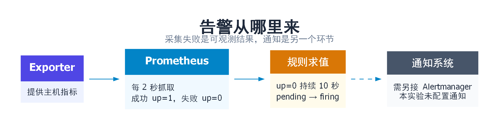
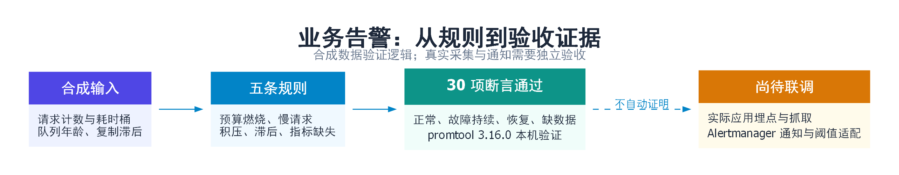
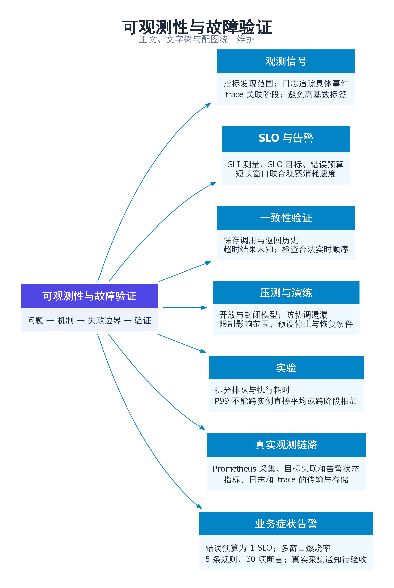

# 可观测性与故障验证

订单接口偶尔要等五秒，平均耗时却正常。怎样查出是哪一段慢？

[上一篇：流量、容量与过载保护](../10-%E6%B5%81%E9%87%8F%E3%80%81%E5%AE%B9%E9%87%8F%E4%B8%8E%E8%BF%87%E8%BD%BD%E4%BF%9D%E6%8A%A4/%E6%B5%81%E9%87%8F%E3%80%81%E5%AE%B9%E9%87%8F%E4%B8%8E%E8%BF%87%E8%BD%BD%E4%BF%9D%E6%8A%A4.md) · [返回目录](../README.md) · [下一篇：安全、发布与灾难恢复](../12-%E5%AE%89%E5%85%A8%E3%80%81%E5%8F%91%E5%B8%83%E4%B8%8E%E7%81%BE%E9%9A%BE%E6%81%A2%E5%A4%8D/%E5%AE%89%E5%85%A8%E3%80%81%E5%8F%91%E5%B8%83%E4%B8%8E%E7%81%BE%E9%9A%BE%E6%81%A2%E5%A4%8D.md)

上一篇列出过载时要看的延迟和队列数据。本篇用它们定位一条慢请求，并检验故障发生时系统是否兑现承诺。

**阅读准备：** 先读上一篇的主线案例；本文涉及的 C++ 实验需要理解函数、容器与基本线程同步。

**快速阅读：**先读“从一条慢请求追到根因”，再读“面试表达”和 Q&A；遇到说不清原因的结论，回到对应原理小节。

**深入学习：**按正文顺序推演每一步，运行文内完整示例，修改故障发生位置并核对结果。模拟程序只验证写明的假设；真实网络、磁盘和组件行为需按文中的验证步骤另行测试。

<details>
<summary>本文目录</summary>

- [从一条慢请求追到根因](#section-01)
- [指标日志与追踪](#section-02)
- [可靠性目标](#section-03)
- [故障注入](#section-04)
- [把三个观测信号串起来](#section-05)
- [怎样判断演练是否通过](#section-06)
- [C++ 实验：把慢请求拆成排队与执行](#section-07)
- [从真实请求收集证据](#section-08)
- [怎样检验线性一致，而不是只看最终值相同](#section-09)
- [压测为何可能把长尾测得过于乐观](#section-10)
- [真实 Prometheus：采集、查询、告警与目标失联](#section-11)
- [从采集端点告警走到业务症状告警](#section-12)
- [面试表达](#section-13)
- [Q&A（常见问题与解答）](#section-14)
- [思维导图总结](#section-15)

</details>

<a id="section-01"></a>

## 从一条慢请求追到根因

假设订单接口 P99 从 100 毫秒变成 2 秒。先按接口、版本和机房看分布，发现问题集中在刚灰度的新版本。再抽取慢请求的 trace，发现 1.7 秒都花在等待数据库连接。最后看连接池占用和日志，定位是哪类请求长期持有连接。

若追踪只记录数据库执行 SQL 的时间，你会看到每条 SQL 都很快，却漏掉取连接之前的等待。应把排队、取连接、执行、返回分别记录。跨服务传递 trace ID 可以把调用链连起来，业务订单 ID 则用于查重试、补偿和消息流水。指标应选有限维度，避免每个订单生成一条时间序列。

故障验证也要记录时间线。例如暂停一个副本后连续读写，保存每次操作的调用时间、返回时间和结果。若读请求在成功写入之后才发起，却读到旧值，就检查线性一致性承诺是否破坏。只看最后一刻所有副本相同，会错过中途读错的历史。

<a id="section-02"></a>

## 指标日志与追踪

先看延迟分位数、错误率和流量，确定影响范围。再拿一条慢请求的追踪记录，找出耗时最长的调用或排队区间，最后用关联 ID 查日志。指标适合看整体变化，追踪展示某次请求经过的步骤，日志补充状态和错误细节。只在单个服务打日志，跨服务因果关系很难还原。

<a id="section-03"></a>

## 可靠性目标

把用户可感知的结果写成 SLI，例如过去 30 天内符合耗时要求的成功请求占比。SLO 是目标值，剩余可接受的失误份额称为错误预算。指标维度要受控，例如订单 ID 适合放日志或追踪，用它作指标标签会产生大量时间序列。

<a id="section-04"></a>

## 故障注入

验证时先写假设，例如副本暂停期间已确认订单仍可查，再注入故障并保存操作历史。恢复之后核对订单、库存和消息状态。一致性检查要对照所承诺的模型。一次演练通过只能提供本次条件下的证据，故障类型和时序仍要逐步扩展。

<a id="section-05"></a>

## 把三个观测信号串起来

指标显示订单接口 P99 从 100 毫秒涨到 2 秒。抽取慢请求追踪，看到多数时间花在等待数据库连接。再根据请求 ID 查日志，确认是连接池超时。接下来检查连接持有时间和当前并发，再决定是否要扩池。


<a id="section-06"></a>

## 怎样判断演练是否通过

为每次操作记录请求编号、开始与结束时间、返回值、使用的副本。故障期间继续发读写，恢复后按编号核对结果。如果写入 W 已返回成功，之后才发起的读取返回旧值，就要检查线性一致性承诺。若读取和写入时间重叠，则需要检查两者是否存在符合规范的解释。

追踪可用采样降低开销。对低频高延迟故障，按结果保留慢请求和错误请求有助于复盘。告警应说明受影响的业务、时间窗口和对应的排查入口。

### 从告警到定位，先确定时间范围

先用请求成功率和耗时目标判断用户是否受影响，再对比变更时间、不同版本和不同机房。若同一版本只在一个机房变慢，检查该机房共享的网络和依赖。若多个机房在灰度后都出现问题，检查新代码和配置。指标能缩小范围，具体请求仍要靠追踪和日志确认。

跨进程需要传递追踪上下文，接收方据此把自己的 span 接到上游调用。异步消息也可以在消息元数据中携带相关上下文。订单编号适合查业务过程，trace ID 用来关联这一次调用经过的节点。[OpenTelemetry 上下文传播](https://opentelemetry.io/docs/concepts/context-propagation/)

<a id="section-07"></a>

## C++ 实验：把慢请求拆成排队与执行

假设服务总耗时 2000 ms。若只记录 SQL 执行时间，看到 100 ms 就容易误判。应在同一台机器上分别记录开始等待连接、拿到连接和执行完成三个时刻。

实验输入是固定时间戳，模拟五个请求。用最近秩法计算 P99。把 N 个值排序后，取从小到大第 ceil(0.99 × N) 个。五条样本时 P99 恰好等于最大值，因此这些数据适合验证计算规则，线上尾延迟要用更多样本。


把下面代码保存为 `latency_breakdown.cpp`。需要支持 C++17 和线程库的 GCC。Ubuntu 可用 `sudo apt install build-essential` 安装工具链。

```cpp
#include <algorithm>
#include <cassert>
#include <iostream>
#include <stdexcept>
#include <vector>

struct Sample {
    int start_ms;
    int acquired_ms;
    int finished_ms;
};

int p99(std::vector<int> values) {
    if (values.empty()) throw std::invalid_argument("empty sample");
    std::sort(values.begin(), values.end());
    // ceil(0.99 * N) 等于 N - floor(N / 100)。
    const auto rank = values.size() - values.size() / 100;
    return values[rank - 1];
}

int main() {
    std::vector<Sample> samples{
        {0, 10, 110}, {0, 20, 120}, {0, 30, 130},
        {0, 40, 140}, {0, 1900, 2000}
    };
    std::vector<int> total;
    std::vector<int> queue;
    std::vector<int> execute;
    for (const auto& sample : samples) {
        assert(sample.start_ms <= sample.acquired_ms);
        assert(sample.acquired_ms <= sample.finished_ms);
        total.push_back(sample.finished_ms - sample.start_ms);
        queue.push_back(sample.acquired_ms - sample.start_ms);
        execute.push_back(sample.finished_ms - sample.acquired_ms);
    }
    assert(p99(total) == 2000);
    assert(p99(queue) == 1900);
    assert(p99(execute) == 100);
    std::cout << "p99_total=2000 p99_wait=1900 p99_sql=100\n";
}
```

```bash
g++ -std=c++17 -O2 -Wall -Wextra -pthread latency_breakdown.cpp -o latency_breakdown
./latency_breakdown
```

在 Windows MSYS2 UCRT64 的 GCC 上编译并运行，实测输出如下。

```text
p99_total=2000 p99_wait=1900 p99_sql=100
```

可以把最后一条样本改成 100 ms 排队、1900 ms 执行。总耗时仍是 2000 ms，定位方向已经变了。在线上应按同一个请求关联各阶段，不能把不同请求的阶段 P99 直接相加。汇总多个实例时需要合并原始数据或兼容的直方图桶，平均各实例的 P99 会丢掉请求分布和流量权重。

实验使用排序，时间复杂度 O(N log N)。线上通常按固定区间累计直方图，再用桶计数估算分位数。桶边界决定估算精度，阈值附近应有合适的区间。

<a id="section-08"></a>

## 从真实请求收集证据

接入时可以先在订单接口记录请求总数、耗时直方图和当前在途量，通过指标端点让 Prometheus 抓取。标签用接口模板、状态类别与版本，避免为每个订单创建时间序列。结构化日志记录业务键、请求 ID 和 trace ID，ELK/EFK 用于集中检索。OpenTelemetry 在跨服务请求中传播上下文并记录 span，SkyWalking 或 Zipkin 可以作为观测与分析链路的一部分，具体接收协议与采集方式要按部署核对。

演练可用 Chaos Mesh 或 ChaosBlade 控制目标实例的延迟或退出，先定义停止条件和恢复步骤。给订单服务增加 500 ms 的依赖延迟，只影响一个测试实例，观察入口超时、队列增长与调用链变化，再撤销故障并检查恢复耗时。将一次慢请求的直方图变化、追踪区间和日志串起来，才能判断慢在网络、连接池还是执行。现有 C++ 分段实验可以验证计算，接入链路后还需核对采样导致的缺失和多实例汇总。[OpenTelemetry 信号](https://opentelemetry.io/docs/concepts/signals/)


<a id="section-09"></a>

## 怎样检验线性一致，而不是只看最终值相同

三个副本最终都变成 1，不能证明它们提供了线性一致性。过程中可能先成功读到 1，随后又成功读到 0。最终校验数据库会漏掉这段违规历史。

记录每个操作的调用时间、返回时间、参数、结果和客户端标识。检查器寻找一个顺序：每个操作放在自己的调用与返回之间，同时满足对象语义。例如寄存器读取应返回这个顺序里最近一次写入的值。如果找不到这样的顺序，就得到一个反例。[Jepsen 的线性一致性说明](https://jepsen.io/consistency/models/linearizable)

| 历史 | 判断 |
| --- | --- |
| 写 1 已返回；之后读返回 0 | 违反线性一致 |
| 写 1 尚未返回；与之重叠的读返回 0 | 可以把读排在写之前，不能仅凭旧值判错 |
| 写 1 超时；之后读返回 1 | 超时操作可能已经生效，不能强行当成没执行 |

不确定操作必须纳入检查器允许的完成方式。多个测试客户端的物理时钟也可能偏移；应由可比较的历史记录机制提供顺序约束，或明确时间误差范围，不能把未校准的时间戳当作绝对先后。

测试先在小范围构造“提交后丢响应”“旧主暂停后恢复”“副本落后时读”三个场景，再保存历史、随机种子与故障时间线，便于复现。Jepsen 一类工具可以帮助采集和分析历史，但一次测试通过只能说明没有在这组执行中发现反例，不能代替协议证明。

<a id="section-10"></a>

## 压测为何可能把长尾测得过于乐观

若压测器每收到一次响应才发下一个请求，服务卡住五秒时，它也暂停发送。这五秒本应到来的请求没有进入样本，排队和超时便被低估。这类测量偏差通常称为协调遗漏。

压测应区分按固定到达计划发请求的开放模型与固定并发、完成后再发的封闭模型，说明模拟哪一种用户行为。记录计划发送时间、实际发送时间和完成时间，并检查压测机本身是否饱和。失败和超时也必须计入报告；只统计成功响应的 P99，会把最差请求排除出去。

SLO 告警要结合错误预算。例如目标成功率 99.9%，实际错误率持续为 1%，预算消耗速度就是允许错误率的 10 倍。短窗口快速发现突发，长窗口确认持续影响；两者配合，避免仅凭某一分钟抖动频繁呼叫值班人员。


<a id="section-11"></a>

## 真实 Prometheus：采集、查询、告警与目标失联



Prometheus 定期访问指标 HTTP 端点，把每个指标名和标签组合存为时间序列。一次抓取失败会影响 `up`；进程仍存活但业务全部失败时，`up` 仍可能为 1。因此业务成功率必须由应用指标表达，而不是只监控端口。[Prometheus 入门](https://prometheus.io/docs/prometheus/latest/getting_started/)

环境：Ubuntu 24.04、发行版 prometheus 与 prometheus-node-exporter。本轮未运行。这里用真实主机指标验证采集链路，不能把它当作已经完成 C++ 应用埋点。

```bash
sudo apt install -y prometheus prometheus-node-exporter curl
mkdir -p prometheus-lab
cd prometheus-lab
prometheus-node-exporter --web.listen-address=127.0.0.1:19100
```

保存 `prometheus.yml`：

```yaml
global:
  scrape_interval: 2s
  evaluation_interval: 2s
rule_files:
  - alerts.yml
scrape_configs:
  - job_name: host_lab
    static_configs:
      - targets: ['127.0.0.1:19100']
```

保存 `alerts.yml`：

```yaml
groups:
  - name: lab
    rules:
      - alert: LabExporterDown
        expr: up{job="host_lab"} == 0
        for: 10s
        labels:
          severity: warning
        annotations:
          summary: '实验采集端点连续失联'
```

第二个终端进入同一目录：

```bash
promtool check config prometheus.yml
promtool check rules alerts.yml
prometheus --config.file=prometheus.yml --storage.tsdb.path=./data --web.listen-address=127.0.0.1:19090
```

第三个终端查询：

```bash
curl --get --data-urlencode 'query=up{job="host_lab"}' http://127.0.0.1:19090/api/v1/query
curl --get --data-urlencode 'query=rate(node_cpu_seconds_total{mode="idle"}[1m])' http://127.0.0.1:19090/api/v1/query
curl http://127.0.0.1:19090/api/v1/alerts
```

预期 up 为 1；CPU rate 至少需要两个样本，刚启动时为空不一定是错误。到 exporter 终端按 Ctrl+C，稍后 up 变为 0，告警先 pending，再在连续满足约十秒后 firing。恢复 exporter 后观察告警解除。此流程验证了采集与规则评估，**尚未配置 Alertmanager，也不会向任何人发送通知**。

如果配置检查通过但 target down，检查端口是否一致、服务是否监听回环地址。若业务高延迟而 up 一直为 1，不要调低抓取间隔来代替业务指标，应补请求计数、失败计数与耗时直方图。

### 从 C++ 请求到指标、日志和 trace

一次请求入口记录开始时间和请求 ID，排队结束、下游调用、数据库提交分别记录区间。指标累计每类接口的次数和耗时；日志记录这次请求的参数摘要、业务键和失败阶段；trace 用父子 span 连接跨进程调用。线程切换和异步回调必须传递上下文，否则下游 span 会变成无关的根节点。

ELK/EFK 的采集器读取日志、解析字段、送入索引，再由查询界面检索；日志洪峰可能堵塞采集，不能把“业务日志输出成功”当作“已能在索引查到”。OpenTelemetry SDK 收集并导出遥测，Collector 可以批处理、过滤、路由；它不是自动保存所有 trace 的数据库。Zipkin/SkyWalking 等后端承担接收、存储与分析职责，具体兼容协议按部署版本核对。

采样决定哪些请求留下完整链路。若只采成功请求，会漏掉最重要的失败；若按订单号做指标标签，会制造大量时间序列。把业务键放在受访问控制的日志或 trace 中，指标标签保留接口模板和有限状态类别。

### 故障注入要记录什么

先像本实验一样只停止一个测试 exporter，再扩展到服务进程暂停、依赖超时和网络分区。Chaos Mesh/ChaosBlade 将这些动作组织成可声明的故障任务，但仍需要明确目标实例、持续时间、停止条件和撤销动作。每次保存故障开始/结束时间、请求历史、指标与业务对账结果。组件显示“故障注入成功”只证明动作执行了，不证明系统恢复正确。


**本节机制与实验参考：** [Prometheus 采集配置](https://prometheus.io/docs/prometheus/latest/getting_started/)。

<a id="section-12"></a>

## 从采集端点告警走到业务症状告警

`up==0` 只表示 Prometheus 抓取失败。用户看到支付超时，而 `/metrics` 正常返回时，up 仍然为 1。因此需另定义业务 SLI：分母是什么请求，哪些是有效成功，哪些延迟算不可接受。客户端取消、业务拒绝、内部错误不能不分青红皂白地混成一种状态。

若 30 天成功率 SLO 为 99.9%，允许错误比例是 `1-SLO=0.001`。某窗口错误比例为 0.0144，燃烧率就是 `0.0144/0.001=14.4`；持续一小时约消耗 30 天错误预算的 2%。同时要求 5 分钟和 1 小时都超过该倍率，可以兼顾当前仍在恶化与持续影响。低流量时还要设置最小样本量或合成探测，避免一次错误触发不适当的告警。

以下为 Prometheus 2.x/3.x 可使用的规则模板，保存为 `business.rules.yml`。它依赖应用实际暴露以下指标，不是上一节 node_exporter 自带指标：`app_requests_total{service,result}`，其中 result 为 ok/error；`app_request_duration_seconds_bucket` 含 0.5 秒桶；`queue_oldest_age_seconds{service}`；`replica_apply_lag_seconds{service}`。需要先统一这些指标的业务口径。

```yaml
groups:
  - name: business
    rules:
      - alert: ErrorBudgetBurn
        expr: |
          (
            sum by(service) (rate(app_requests_total{result="error"}[1h]))
            / sum by(service) (rate(app_requests_total[1h])) > 0.0144
          )
          and on(service)
          (
            sum by(service) (rate(app_requests_total{result="error"}[5m]))
            / sum by(service) (rate(app_requests_total[5m])) > 0.0144
          )
          and on(service)
          (sum by(service) (increase(app_requests_total[5m])) >= 100)
        for: 2m
        labels:
          severity: page
      - alert: TooManySlowRequests
        expr: |
          (
            1 - sum by(service) (rate(app_request_duration_seconds_bucket{le="0.5"}[5m]))
            / sum by(service) (rate(app_request_duration_seconds_bucket{le="+Inf"}[5m]))
          ) > 0.01
        for: 5m
      - alert: QueueTooOld
        expr: max by(service) (queue_oldest_age_seconds) > 300
        for: 2m
      - alert: ReplicaTooFarBehind
        expr: max by(service) (replica_apply_lag_seconds) > 30
        for: 2m
      - alert: ServiceRequestMetricsMissing
        expr: absent_over_time(app_requests_total{service="orders"}[5m])
        for: 2m
```

使用已有 Prometheus 环境执行 `promtool check rules business.rules.yml` 检查语法，将文件加入 `rule_files` 后加载。在测试服务制造错误与延迟，观察计数器、规则表达式和 pending/firing 状态，再恢复流量验证告警消退。规则阈值只是教学选择：队列 300 秒应依据保留期和业务期限，副本 30 秒应依据读陈旧承诺设置。无数据不是零错误，指标缺失要配合 up 或 absent 类规则单独检查。

### 可复现的规则测试：不启动服务器也能检查触发与恢复



本轮用官方 Prometheus 3.16.0 的 Windows amd64 `promtool` 验证了这份规则，未安装系统服务。发布压缩包 SHA-256 与发布资产的 digest 一致：`89c03c2f24400fb58668440b6d7226f68564acda27d657e77acfbda42be32cb3`。工具来自[官方 3.16.0 发布页](https://github.com/prometheus/prometheus/releases/tag/v3.16.0)。这说明以下工具与测试版本已实测，不表示所有 Prometheus 2.x/3.x 版本都完成验证。

新增的 `ServiceRequestMetricsMissing` 针对已知服务 orders。`absent_over_time` 检测过去五分钟完全没有请求计数器样本，再持续两分钟才告警。应用启动后应初始化零值计数器，让“无请求”与“指标消失”可以区分。生产中要按服务清单配置或关联服务目录，不能靠一个固定 orders 规则发现所有消失的服务；部分实例消失、部分状态标签丢失也需单独检查。

下面完整文件保存为 `business.test.yml`，与 `business.rules.yml` 放在同一目录。测试只注入时间序列，不会访问真实服务。`0+10x70` 表示从 0 开始每分钟增加 10，共生成后续 70 个样本；这不是每秒 10 次。比例计算不受单位换算影响，样本量阈值仍用真实时间窗口计算。

四组数据分别验证正常、持续故障、恢复、完全缺数据，共有 30 个“告警名称 + 评估时刻”的断言。持续故障在 1 分钟时不得提前触发；恢复场景还检查 10 分钟时曾触发、30 分钟时已消退。空的 `exp_alerts` 表示这个时刻不应有 firing 告警，不能用“测试没打印错误”猜测期望。

```yaml
rule_files:
  - "business.rules.yml"
evaluation_interval: "1m"
tests:
  -
    name: "normal"
    interval: "1m"
    input_series:
      -
        series: "app_requests_total{service=\"orders\",result=\"error\"}"
        values: "0+0x70"
      -
        series: "app_requests_total{service=\"orders\",result=\"ok\"}"
        values: "0+90x70"
      -
        series: "app_request_duration_seconds_bucket{service=\"orders\",le=\"0.5\"}"
        values: "0+100x70"
      -
        series: "app_request_duration_seconds_bucket{service=\"orders\",le=\"+Inf\"}"
        values: "0+100x70"
      -
        series: "queue_oldest_age_seconds{service=\"orders\"}"
        values: "0+0x70"
      -
        series: "replica_apply_lag_seconds{service=\"orders\"}"
        values: "0+0x70"
    alert_rule_test:
      -
        eval_time: "10m"
        alertname: "ErrorBudgetBurn"
        exp_alerts: []
      -
        eval_time: "10m"
        alertname: "TooManySlowRequests"
        exp_alerts: []
      -
        eval_time: "10m"
        alertname: "QueueTooOld"
        exp_alerts: []
      -
        eval_time: "10m"
        alertname: "ReplicaTooFarBehind"
        exp_alerts: []
      -
        eval_time: "10m"
        alertname: "ServiceRequestMetricsMissing"
        exp_alerts: []
  -
    name: "sustained_fault"
    interval: "1m"
    input_series:
      -
        series: "app_requests_total{service=\"orders\",result=\"error\"}"
        values: "0+10x70"
      -
        series: "app_requests_total{service=\"orders\",result=\"ok\"}"
        values: "0+90x70"
      -
        series: "app_request_duration_seconds_bucket{service=\"orders\",le=\"0.5\"}"
        values: "0+90x70"
      -
        series: "app_request_duration_seconds_bucket{service=\"orders\",le=\"+Inf\"}"
        values: "0+100x70"
      -
        series: "queue_oldest_age_seconds{service=\"orders\"}"
        values: "400+0x70"
      -
        series: "replica_apply_lag_seconds{service=\"orders\"}"
        values: "40+0x70"
    alert_rule_test:
      -
        eval_time: "10m"
        alertname: "ErrorBudgetBurn"
        exp_alerts:
          -
            exp_labels:
              service: "orders"
              severity: "page"
            exp_annotations: {}
      -
        eval_time: "10m"
        alertname: "TooManySlowRequests"
        exp_alerts:
          -
            exp_labels:
              service: "orders"
            exp_annotations: {}
      -
        eval_time: "10m"
        alertname: "QueueTooOld"
        exp_alerts:
          -
            exp_labels:
              service: "orders"
            exp_annotations: {}
      -
        eval_time: "10m"
        alertname: "ReplicaTooFarBehind"
        exp_alerts:
          -
            exp_labels:
              service: "orders"
            exp_annotations: {}
      -
        eval_time: "10m"
        alertname: "ServiceRequestMetricsMissing"
        exp_alerts: []
      -
        eval_time: "1m"
        alertname: "ErrorBudgetBurn"
        exp_alerts: []
      -
        eval_time: "1m"
        alertname: "TooManySlowRequests"
        exp_alerts: []
      -
        eval_time: "1m"
        alertname: "QueueTooOld"
        exp_alerts: []
      -
        eval_time: "1m"
        alertname: "ReplicaTooFarBehind"
        exp_alerts: []
      -
        eval_time: "1m"
        alertname: "ServiceRequestMetricsMissing"
        exp_alerts: []
  -
    name: "recovered"
    interval: "1m"
    input_series:
      -
        series: "app_requests_total{service=\"orders\",result=\"error\"}"
        values: "0+10x15 150+0x54"
      -
        series: "app_requests_total{service=\"orders\",result=\"ok\"}"
        values: "0+90x70"
      -
        series: "app_request_duration_seconds_bucket{service=\"orders\",le=\"0.5\"}"
        values: "0+90x15 1450+100x54"
      -
        series: "app_request_duration_seconds_bucket{service=\"orders\",le=\"+Inf\"}"
        values: "0+100x70"
      -
        series: "queue_oldest_age_seconds{service=\"orders\"}"
        values: "400+0x15 0+0x54"
      -
        series: "replica_apply_lag_seconds{service=\"orders\"}"
        values: "40+0x15 0+0x54"
    alert_rule_test:
      -
        eval_time: "30m"
        alertname: "ErrorBudgetBurn"
        exp_alerts: []
      -
        eval_time: "30m"
        alertname: "TooManySlowRequests"
        exp_alerts: []
      -
        eval_time: "30m"
        alertname: "QueueTooOld"
        exp_alerts: []
      -
        eval_time: "30m"
        alertname: "ReplicaTooFarBehind"
        exp_alerts: []
      -
        eval_time: "30m"
        alertname: "ServiceRequestMetricsMissing"
        exp_alerts: []
      -
        eval_time: "10m"
        alertname: "ErrorBudgetBurn"
        exp_alerts:
          -
            exp_labels:
              service: "orders"
              severity: "page"
            exp_annotations: {}
      -
        eval_time: "10m"
        alertname: "TooManySlowRequests"
        exp_alerts:
          -
            exp_labels:
              service: "orders"
            exp_annotations: {}
      -
        eval_time: "10m"
        alertname: "QueueTooOld"
        exp_alerts:
          -
            exp_labels:
              service: "orders"
            exp_annotations: {}
      -
        eval_time: "10m"
        alertname: "ReplicaTooFarBehind"
        exp_alerts:
          -
            exp_labels:
              service: "orders"
            exp_annotations: {}
      -
        eval_time: "10m"
        alertname: "ServiceRequestMetricsMissing"
        exp_alerts: []
  -
    name: "metrics_missing"
    interval: "1m"
    input_series: []
    alert_rule_test:
      -
        eval_time: "10m"
        alertname: "ErrorBudgetBurn"
        exp_alerts: []
      -
        eval_time: "10m"
        alertname: "TooManySlowRequests"
        exp_alerts: []
      -
        eval_time: "10m"
        alertname: "QueueTooOld"
        exp_alerts: []
      -
        eval_time: "10m"
        alertname: "ReplicaTooFarBehind"
        exp_alerts: []
      -
        eval_time: "10m"
        alertname: "ServiceRequestMetricsMissing"
        exp_alerts:
          -
            exp_labels:
              service: "orders"
            exp_annotations: {}
```

运行命令（Windows 下使用对应的 `promtool.exe`）：

```bash
promtool --version
promtool check rules business.rules.yml
promtool test rules business.test.yml
```

本轮实际结果：版本为 `3.16.0`；检查输出 `SUCCESS: 5 rules found`；规则测试输出 `SUCCESS`，两个命令退出码均为 0。若找不到规则文件，检查工作目录；若标签不匹配，检查 `service` 聚合与期望标签；若触发时间不符，分别检查 range window、求值间隔和 `for` 持续时间。不能为了让测试通过就删除失败的断言。

**验收边界：**语法与合成时间序列测试已通过；真实应用埋点、抓取链路、阈值适配及 Alertmanager 通知尚未验收。上一节 node_exporter 服务实验也仍待执行。[Prometheus 规则测试说明](https://prometheus.io/docs/prometheus/latest/configuration/unit_testing_rules/)


<a id="section-13"></a>

## 面试表达

观测首先围绕用户结果：成功率、延迟和任务是否及时完成。指标帮助定位范围，日志说明具体事件，trace 串起调用阶段。SLO 转成错误预算后，用短长窗口观察消耗速度，同时监控积压和复制滞后。up 正常不代表业务正常，平均耗时也藏得住长尾。代价是采集与存储成本，应控制标签基数并用故障实验验证告警真的能发现问题。

<a id="section-14"></a>

## Q&A（常见问题与解答）

### 为什么不只设一个五分钟错误率阈值？

短窗口易受突发影响，长窗口反应慢。多窗口结合确认故障持续且当前仍存在，阈值按错误预算消耗推导。

### 指标消失可以当零错误吗？

不能。无流量、目标不可达、埋点故障都可能没有序列。需要结合请求量、up 与缺数据检测判断。

### Prometheus 告警变成 firing，就一定已经发出通知了吗？

没有。firing 是规则计算状态；发送通知还需要 Alertmanager 等接收方、路由和有效渠道。本节只验证采集与规则，不宣称通知链路已验收。

**测试结束后三副本相同，是否证明线性一致？**

不能。中间可能返回过旧值。要记录调用和返回历史，检查是否存在符合实时顺序及对象语义的合法排列。

**看到数据库调用慢，就该先增加连接池吗？**

先确认慢在排队、网络还是 SQL。连接持有过久或数据库已饱和时，增大池子可能让竞争更激烈。

**服务进程都在运行，能据此认为 SLO 达标吗？**

进程存活只反映局部状态。SLO 应由实际请求的成功率、时延等用户可感知指标计算。

[延伸阅读](https://opentelemetry.io/docs/concepts/signals/)

下一篇要回答的问题是：发布后新版本写入了旧程序读不了的数据，同时主机房失联。怎样恢复？

<a id="section-15"></a>

## 思维导图总结

```text
可观测性与故障验证
├── 观测信号
│   ├── 指标发现范围；日志追踪具体事件
│   └── trace 关联阶段；避免高基数标签
├── SLO 与告警
│   ├── SLI 测量、SLO 目标、错误预算
│   └── 短长窗口联合观察消耗速度
├── 一致性验证
│   ├── 保存调用与返回历史
│   └── 超时结果未知；检查合法实时顺序
├── 压测与演练
│   ├── 开放与封闭模型；防协调遗漏
│   └── 限制影响范围，预设停止与恢复条件
├── 实验
│   ├── 拆分排队与执行耗时
│   └── P99 不能跨实例直接平均或跨阶段相加
├── 真实观测链路
│   ├── Prometheus 采集、目标失联和告警状态
│   └── 指标、日志和 trace 的传输与存储
└── 业务症状告警
    ├── 错误预算为 1-SLO；多窗口燃烧率
    └── 5 条规则、30 项断言；真实采集通知待验收
```


