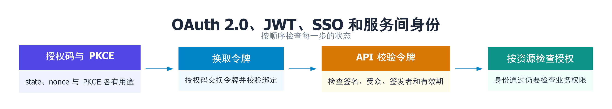
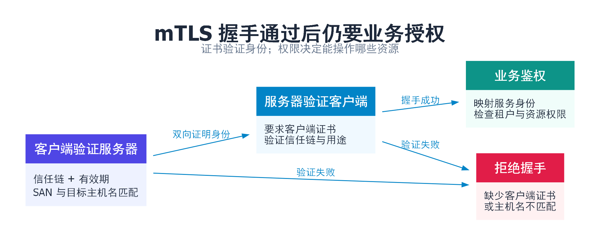
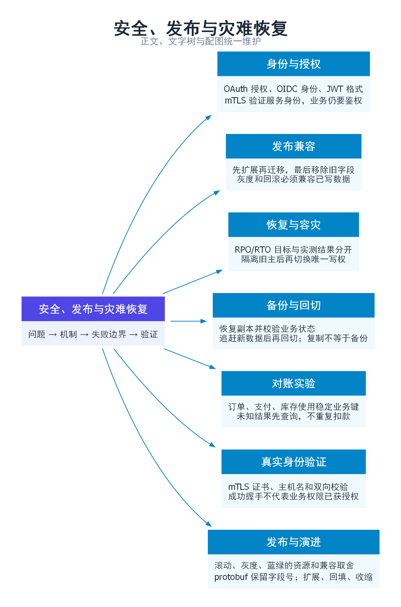

# 安全、发布与灾难恢复

发布后新版本写入了旧程序读不了的数据，同时主机房失联。怎样恢复？

[上一篇：可观测性与故障验证](../11-%E5%8F%AF%E8%A7%82%E6%B5%8B%E6%80%A7%E4%B8%8E%E6%95%85%E9%9A%9C%E9%AA%8C%E8%AF%81/%E5%8F%AF%E8%A7%82%E6%B5%8B%E6%80%A7%E4%B8%8E%E6%95%85%E9%9A%9C%E9%AA%8C%E8%AF%81.md) · [返回目录](../README.md) · [下一篇：面试与综合练习](../13-%E9%9D%A2%E8%AF%95%E4%B8%8E%E7%BB%BC%E5%90%88%E7%BB%83%E4%B9%A0/%E9%9D%A2%E8%AF%95%E4%B8%8E%E7%BB%BC%E5%90%88%E7%BB%83%E4%B9%A0.md)

上一篇讨论怎样发现故障和验证承诺。本篇沿着故障之后的处理过程，讨论权限、发布回退和数据恢复。

**阅读准备：** 先读上一篇的主线案例；本文涉及的 C++ 实验需要理解函数、容器与基本线程同步。

**快速阅读：** 先读“把故障恢复拆成可验收的步骤”，再读“面试表达”和 Q&A；遇到说不清原因的结论，回到对应原理小节。

**深入学习：** 按正文顺序推演每一步，运行文内完整示例，修改故障发生位置并核对结果。模拟程序只验证写明的假设；真实网络、磁盘和组件行为需按文中的验证步骤另行测试。

实验前先核对[环境、依赖与验证边界](../README.md#lab-compatibility)。新增故障检查步骤与既有实测记录分开阅读。

<details>
<summary>本文目录</summary>

- [1 把故障恢复拆成可验收的步骤](#section-01)
- [2 身份与授权](#section-02)
- [3 发布兼容](#section-03)
- [4 恢复目标](#section-04)
- [5 按业务时间计算恢复结果](#section-05)
- [6 发布和恢复都需要核对业务状态](#section-06)
  - [6.1 怎样检查备份真的可以恢复？](#detail-12-7)
- [7 C++ 实验：恢复订单后怎样对账](#section-07)
- [8 OAuth 2.0、JWT、SSO 和服务间身份](#section-08)
  - [8.1 用户改了密码，旧 JWT 为什么还能访问 API？](#jwt-revocation)
- [9 多机房切换与回切：恢复机器之前先恢复唯一写权](#section-09)
  - [9.1 已经切走流量，为什么旧主还能改数据？](#recovery-fencing)
- [10 登录链路内部：授权码、令牌和业务权限各管什么](#section-10)
- [11 真实 mTLS 实验：只有服务器证书还不够](#section-11)
- [12 发布策略怎样选择，为什么回滚也会失败](#section-12)
  - [12.1 protobuf 演进：字段号不能被赋予新含义](#detail-12-16)
  - [12.2 数据库 expand-contract：先扩展再收缩](#detail-12-17)
  - [12.3 跨库双写失败或乱序，新表怎样追上旧表？](#migration-dual-write)
- [13 面试表达](#section-13)
- [14 Q&A（常见问题与解答）](#section-14)
  - [14.1 JWT 签名正确，是否说明用户现在还有权限？](#detail-12-21)
  - [14.2 新库按版本拒绝旧事件，就不会丢更新了吗？](#detail-12-22)
  - [14.3 拿到更大的 fencing token，就已经隔离旧主了吗？](#detail-12-23)
  - [14.4 蓝绿切回旧环境就能撤销新版写入吗？](#detail-12-24)
  - [14.5 protobuf 新字段编号必须大于所有旧编号吗？](#detail-12-25)
  - [14.6 为什么证书校验成功后还要鉴权？](#detail-12-26)
- [15 思维导图总结](#section-15)

</details>

<a id="section-01"></a>

<a id="把故障恢复拆成可验收的步骤"></a>

## 1 把故障恢复拆成可验收的步骤

10:00 主机房失联，备用机房只同步到 09:55。先划定写入权，再恢复流量。若旧主还可能接收写入，应先隔离它，防止两个机房同时对同一订单给出成功回复。

1. 确定最后可恢复的数据位置，估算受影响的订单范围。
2. 恢复数据库和消费进度，核对支付流水、库存流水和订单状态。
3. 对数据库缺失但外部已经扣款的订单，按业务编号补单或走退款流程。
4. 先恢复少量流量，观察错误率、重复操作和滞后的事件，确认后再逐步放量。

如果 10:12 恢复，服务中断约 12 分钟，恢复点距故障约 5 分钟。这两个数字分别与 RTO 和 RPO 目标核对。演练还要验证备份账号能读备份、密钥可用、恢复人员有相应权限。备份文件存在只是起点，能按时恢复出正确业务状态才是验收结果。

发布也遵循同样的思路。先部署能读取旧格式和新格式的版本，再开启写新格式。回滚前核对旧版本是否读得懂已经写出的数据，避免回滚应用后数据库仍无法使用。

<a id="section-02"></a>

<a id="身份与授权"></a>

## 2 身份与授权

先限制谁能访问什么。认证确认调用方身份，授权判断它能否读写指定资源。服务间 mTLS 可以校验对端身份并保护传输，业务授权仍要检查资源与操作。密钥和证书要有轮换与失效策略。

<a id="section-03"></a>

<a id="发布兼容"></a>

## 3 发布兼容

发布前让读方先兼容新旧格式，再逐步启用新写法，最后清理旧字段。灰度期间观察错误率和业务数据。回滚代码前检查新版本已经写出的状态能否被旧版本处理。跨机房切换也要约束谁有写权限，防止两边各自接受互相冲突的修改。

<a id="section-04"></a>

<a id="恢复目标"></a>

## 4 恢复目标

RPO 描述允许丢失多少时间范围内的数据，RTO 描述恢复服务的目标耗时。副本能提高可用性，也会传播误删。备份需要独立保留，并实际验证恢复流程。可以在隔离环境恢复快照和日志，核对数据后再按步骤恢复业务流量。

<a id="section-05"></a>

<a id="按业务时间计算恢复结果"></a>

## 5 按业务时间计算恢复结果

假设最后可恢复的订单状态是 09:55，10:00 发生故障，10:12 恢复服务。本次恢复点落后 5 分钟，恢复耗时 12 分钟。要分别与 RPO、RTO 目标比较，并核对这 5 分钟内哪些订单可以从外部支付记录补回。


<a id="section-06"></a>

<a id="发布和恢复都需要核对业务状态"></a>

## 6 发布和恢复都需要核对业务状态

新增字段时先让旧版本能忽略该字段，同时让新版本能读取没有该字段的数据。灰度确认后才让写方开始写新格式。删除旧字段应等所有消费者完成迁移。

恢复数据库后，要先核对订单、支付与消息消费进度。数据库回到了十分钟前，外部支付可能仍保留最近十分钟的扣款，直接重放扣款会造成重复。应从可信流水对账，按业务 ID 补单，再恢复流量。

<a id="detail-12-7"></a>

<a id="怎样检查备份真的可以恢复"></a>

### 6.1 怎样检查备份真的可以恢复？

选一个已知时间点恢复到隔离环境。先恢复基础快照，再按日志顺序重放到目标位置。挑选目标点前后几笔已确认订单，核对哪些应存在，哪些应排除。然后启动读服务、消息转发器和消费者，确认它们能读取恢复后的数据和进度。演练期间应隔离真实支付等外部副作用。

记录下载备份、重放日志、对账和恢复流量分别花了多久。如果大部分时间花在对账，即使数据库恢复更快，也未必能达到业务 RTO。

<a id="section-07"></a>

<a id="c-实验恢复订单后怎样对账"></a>

## 7 C++ 实验：恢复订单后怎样对账

主库恢复到了 09:55，外部支付系统还保留之后的扣款流水。若恢复任务只检查订单库，看到订单 42 缺失就再次发起扣款，会使同一笔订单付两次钱。

下面将支付流水视为已核实的输入。恢复任务只生成待处理项，不向支付系统发送任何请求。用订单编号建立索引，区分已一致、缺订单和金额不一致三种情况。


把下面代码保存为 `restore_reconcile.cpp`。需要支持 C++17 和线程库的 GCC。Ubuntu 可用 `sudo apt install build-essential` 安装工具链。

```cpp
#include <cassert>
#include <iostream>
#include <string>
#include <unordered_map>
#include <vector>

struct Payment {
    std::string order;
    int amount;
};

int main() {
    const std::unordered_map<std::string, int> orders{
        {"41", 5000}, {"43", 900}
    };
    const std::vector<Payment> settled{
        {"41", 5000}, {"42", 3000}, {"43", 1000}
    };
    int matched = 0;
    int missing = 0;
    int mismatch = 0;
    for (const auto& payment : settled) {
        const auto order = orders.find(payment.order);
        if (order == orders.end()) {
            ++missing;
            std::cout << payment.order << " missing_order\n";
        } else if (order->second != payment.amount) {
            ++mismatch;
            std::cout << payment.order << " amount_mismatch\n";
        } else {
            ++matched;
        }
    }
    assert(matched == 1 && missing == 1 && mismatch == 1);
    std::cout << "matched=1 missing=1 mismatch=1\n";
}
```

```bash
g++ -std=c++17 -O2 -Wall -Wextra -pthread restore_reconcile.cpp -o restore_reconcile
./restore_reconcile
```

在 Windows MSYS2 UCRT64 的 GCC 上编译并运行，实测输出如下。

```text
42 missing_order
43 amount_mismatch
matched=1 missing=1 mismatch=1
```

真实对账还要检查反方向，即订单库标记已支付、外部却没有对应成功流水。查询应绑定商户、货币和支付交易编号，分次付款、退款和撤销需要单独建模。补单动作要有稳定操作键，重复跑恢复任务也只会处理一次。金额不一致的记录应保留两边证据，交给明确的核对流程。

<a id="section-08"></a>

<a id="oauth-20jwtsso-和服务间身份"></a>

## 8 OAuth 2.0、JWT、SSO 和服务间身份

以用户登录订单页面为例。应用将浏览器引导至身份提供方。授权码流程中，客户端保留 PKCE verifier 并发送其 challenge，回调拿到授权码后用 verifier 换令牌，同时校验流程关联信息。若目标是登录，使用 OIDC 来获取和校验 ID Token。访问订单 API 时则使用面向该 API 的访问令牌。SSO 来自多个应用复用身份提供方的登录会话，各应用仍有自己的会话和授权边界。

JWT 是令牌格式。API 应按可信配置选择签发者和允许的算法，验证签名、受众、有效期及适用的权限声明。能解码 JSON 只说明能读内容。令牌被撤销后的表现取决于有效期、检查机制和密钥轮换策略。身份提供方签发的令牌也不能代替业务校验，例如访问订单前仍需检查订单归属。

服务之间可以用 mTLS 双向校验身份和保护传输，授权策略再决定某个服务能调用哪些方法。零信任要求每次访问按身份与策略判断，内部网段本身不能充当授权。验收时用正确令牌、错误受众、已过期令牌和正确令牌访问他人订单，分别检查认证失败与授权拒绝。[OAuth 安全 BCP](https://www.rfc-editor.org/rfc/rfc9700.html) · [JWT 安全 BCP](https://www.rfc-editor.org/rfc/rfc8725.html) · [OpenID Connect Core](https://openid.net/specs/openid-connect-core-1_0.html)



<a id="jwt-revocation"></a>

<a id="用户改了密码旧-jwt-为什么还能访问-api"></a>

### 8.1 用户改了密码，旧 JWT 为什么还能访问 API？

假设 10:00 签发的访问令牌在 10:30 到期，用户 10:05 修改密码。若 API 只离线检查签名、受众和有效期，它没有读取“密码已修改”这一新状态，旧令牌就可能继续通过检查。问题在于检查方式，而不是 JWT 格式禁止撤销。

先定义撤销要求：是禁止继续刷新，还是要求已发出的访问令牌也在数秒内失效？只撤销刷新令牌，可以阻止后续换取访问令牌，但不会自动通知所有 API 拒绝已经签发的 JWT。[OAuth 令牌撤销 RFC 7009](https://www.rfc-editor.org/rfc/rfc7009.html)

| 方案 | API 怎样判断 | 换来的能力与代价 |
| --- | --- | --- |
| 短期访问令牌，控制刷新资格 | 离线验证访问令牌；刷新时查状态 | 减少在线查询，但撤销窗口仍可能持续到访问令牌到期 |
| 撤销名单或用户会话版本 | 查令牌唯一标识是否撤销，或比较令牌版本与当前用户版本 | 可以更快失效，但引入共享状态、查询开销和缓存传播延迟 |
| 引用令牌与在线查询 | 令牌只作凭据索引；资源服务器向授权服务器查询是否有效及权限 | 便于集中控制，但依赖查询服务可用性；缓存有效结果会延长撤销窗口 |

引用令牌通常不直接携带完整权限内容；OAuth Token Introspection 定义了查询有效状态的接口，JWT 也可以配合在线查询。是否即时生效，取决于检查频率和缓存，而不是令牌名字。[RFC 7662](https://www.rfc-editor.org/rfc/rfc7662)

若用 Redis 保存撤销名单，要防止记录被淘汰或切换时丢失；保留时间应覆盖令牌剩余可接受时间，包括验证端允许的时钟偏差。用户级版本可一次撤销该用户的一批旧会话，但每个 API 必须真正检查版本。查询服务不可用时，是拒绝敏感操作还是允许有限操作，也要预先定义。轮换整个签名密钥会影响一批用户，通常不适合只撤销一个人的会话。

验收时保留修改密码前的令牌，修改后分别访问各 API 实例；记录最后一次被接受的时间，并检查撤销缓存及状态服务故障。这样才能测出实际撤销窗口，不能只看登录页面已经退出。

<a id="section-09"></a>

<a id="多机房切换与回切恢复机器之前先恢复唯一写权"></a>

## 9 多机房切换与回切：恢复机器之前先恢复唯一写权

主机房失联后，备机房有一份复制数据，并不意味着可以立即接管。先判断能否隔离旧主：它可能只是与控制面失联，仍在接受业务写入。如果两地同时接收互斥写入，就会发生脑裂。

一次可核查的切换分为：确认故障范围；按协议隔离旧写入权；确认备份或副本可恢复的位置；切换入口；对账；恢复后台任务。把每一步的操作人、时间和证据记录下来。没有可靠隔离手段时，必须明确是否接受停服，不能用“应该已经停了”作为写入安全条件。

RPO 是业务允许丢失的最大数据时间窗口，RTO 是业务允许的最长恢复时间，二者首先是目标。演练后应分别报告实际丢失范围和实际恢复耗时。同步复制可以缩小某些故障下的丢失窗口，却不能代替备份：误删除可能被立即同步到所有副本。

备份恢复后，订单表与外部支付系统可能不在同一时间点。先用稳定业务键查询支付结果，区分已支付未记账、已记账未发货等状态，再补事件或退款。不能因为恢复后的订单表没有某笔记录就再次扣款。

回切也相当于一次数据迁移。旧机房需要先追上新主的修改、校验数据、重新取得写权，再切回流量。直接启动旧主并恢复 DNS，可能让旧数据重新成为权威。异地多活若采用按用户或租户划分写入归属，还应说明跨单元访问与单元迁移过程，不能把多个机房都部署服务等同于数据层多活。


<a id="recovery-fencing"></a>

<a id="已经切走流量为什么旧主还能改数据"></a>

### 9.1 已经切走流量，为什么旧主还能改数据？

切换 DNS 或网关，只改变经过这些入口的新请求。旧连接、后台任务和分区内的客户端可能继续访问旧主。若它们还能写存储，入口切换并没有撤销旧主的写权限。

一种做法是为每次接管分配更大的世代号（epoch，也称 fencing token），并让存储端检查它。例：旧主 A 持有 41，新主 B 取得 42。接管流程先让受保护存储原子地登记当前有效世代 42，之后携带 41 的写入就被拒绝。登记、比较和数据修改必须按存储提供的事务或原子操作协调；只在应用中“先查世代、再写数据”仍有并发空隙。[Fencing 的机制与限制](https://martin.kleppmann.com/2016/02/08/how-to-do-distributed-locking.html)

这个保证有明确前提：世代号不能因恢复而倒退或重复；所有相关写入路径都要接受检查；检查结果必须约束实际提交。分布式锁只负责发放资格时，不会自动替存储拒绝旧请求。对于两个完全隔离、各自可写的数据库，如果旧库不知道世代已变，它仍可能接受旧写；此时需要存储自身的多数派协议，或可靠撤销旧库访问能力、断电隔离等措施。不能只在新库写入 42 就宣称旧库已被隔离。

可靠的硬隔离本身也可以撤销旧写权，并非所有系统都必须再加同一种 token。关键是取得可验证的“旧方不能再提交”证据。演练时应让 A 保持旧连接和后台任务，B 接管后恢复 A，检查旧写确实被拒绝；没有隔离证据时，不应继续承诺两边同时可写且无冲突。

<a id="section-10"></a>

<a id="登录链路内部授权码令牌和业务权限各管什么"></a>

## 10 登录链路内部：授权码、令牌和业务权限各管什么

用户点“登录”时，并不是把密码交给订单服务所有副本。应用把浏览器引导到身份提供方完成身份验证，授权码回到应用后，再换取令牌。PKCE 把换令牌操作绑定到发起流程时生成的 verifier，减少授权码被截走后的风险；state 用于关联请求与回调，OIDC nonce 用于把身份令牌与登录请求关联。它们不是三个可随意互换的随机字符串。

| 步骤 | 谁保存或检查什么 | 漏掉后的问题 |
| --- | --- | --- |
| 发起登录 | 应用保存会话关联、state、PKCE verifier，向认证端发送 challenge | 回调无法与原请求可靠关联 |
| 收到授权码 | 校验回调地址和流程关联，通过 token endpoint 兑换 | 可能接受错误流程的回调或泄露授权码 |
| 建立登录会话 | 按 OIDC 验证 ID Token 的签发者、受众、签名、时间和 nonce 等适用条件 | 把其他应用收到的身份声明当成本应用登录 |
| 调用 API | 验证访问令牌是否面向该 API、是否有需要的 scope | 令牌合法但用途不对也可能被放行 |
| 修改订单 | 检查当前用户能否访问该订单、租户是否匹配 | 认证成功却发生越权 |

JWT 只是可携带声明的格式，签名证明内容在信任链下未被篡改，不证明业务权限永远有效。密钥轮换时根据可信签发者配置获取公钥，不能接受令牌自己指定的任意下载地址。令牌撤销需要在线状态、短有效期或其他明确策略，不能靠“签名还对”判断用户仍有权操作。

SSO 让多个应用复用身份提供方的登录会话，但各应用仍须建立自己的会话和权限边界。注销某个应用的本地 session，与注销身份提供方会话、撤销所有访问令牌，也不是同一动作。[OIDC Core](https://openid.net/specs/openid-connect-core-1_0.html) · [OAuth 安全建议](https://www.rfc-editor.org/rfc/rfc9700.html)

<a id="section-11"></a>

<a id="真实-mtls-实验只有服务器证书还不够"></a>

## 11 真实 mTLS 实验：只有服务器证书还不够

普通 TLS 主要让客户端验证服务器身份并加密传输。mTLS 再要求服务端验证客户端证书。本实验用独立测试 CA 签出服务端和客户端证书，观察三条路径：正确客户端成功、没证书失败、服务器名称不匹配失败。



环境：OpenSSL 3.x、curl；Linux 可安装 `openssl curl`。以下证书仅用于本机实验，私钥不要上传仓库。生产证书的签发、吊销、轮换和私钥保护不由这个临时 CA 代替。

```bash
mkdir -p mtls-lab
cd mtls-lab
openssl version
openssl req -x509 -newkey rsa:2048 -noenc -keyout ca.key -out ca.crt -days 2 -subj '/CN=Notes Lab CA' -addext 'basicConstraints=critical,CA:TRUE' -addext 'keyUsage=critical,keyCertSign,cRLSign'
openssl req -new -newkey rsa:2048 -noenc -keyout server.key -out server.csr -subj '/CN=localhost'
openssl req -new -newkey rsa:2048 -noenc -keyout client.key -out client.csr -subj '/CN=notes-client'
```

保存 `server.ext`：

```ini
basicConstraints=critical,CA:FALSE
keyUsage=critical,digitalSignature,keyEncipherment
extendedKeyUsage=serverAuth
subjectAltName=DNS:localhost,IP:127.0.0.1
```

保存 `client.ext`：

```ini
basicConstraints=critical,CA:FALSE
keyUsage=critical,digitalSignature
extendedKeyUsage=clientAuth
```

```bash
openssl x509 -req -in server.csr -CA ca.crt -CAkey ca.key -CAcreateserial -out server.crt -days 2 -extfile server.ext
openssl x509 -req -in client.csr -CA ca.crt -CAkey ca.key -CAserial ca.srl -out client.crt -days 2 -extfile client.ext
openssl verify -CAfile ca.crt -purpose sslserver server.crt
openssl verify -CAfile ca.crt -purpose sslclient client.crt
openssl s_server -accept 127.0.0.1:18443 -cert server.crt -key server.key -CAfile ca.crt -Verify 1 -verify_return_error -www
```

大写 `-Verify` 要求客户端出示证书；`-verify_return_error` 让验证失败真正终止握手。另开终端进入同一目录执行：

```bash
curl --cacert ca.crt --cert client.crt --key client.key https://localhost:18443/
curl --cacert ca.crt https://localhost:18443/
curl --resolve wrong.invalid:18443:127.0.0.1 --noproxy '*' --cacert ca.crt --cert client.crt --key client.key https://wrong.invalid:18443/
```

第一条应取得 OpenSSL 测试页面；第二条因没有客户端证书失败；第三条因服务器名称不匹配失败。不能加 `-k` 绕过检查再宣称测试通过。TLS 1.3 下有些错误会在首次读写时暴露，因此不仅看“TCP 已连接”，还要确认是否收到 HTTP 成功响应。[OpenSSL s_server](https://docs.openssl.org/3.0/man1/openssl-s_server/)

报 `unknown ca` 时检查双方使用的 CA；名称不匹配时检查 SAN；证书过期时检查有效期与时钟。实验只验证证书身份与传输，OpenSSL 页面不会校验订单权限：一个持有效证书的服务，也不能因此修改所有租户的订单。零信任落到这里，就是把身份、资源和动作一起交给授权策略，而不是因为请求来自内网就放行。


**本轮实测：** Windows / MSYS2 OpenSSL 3.6.3，实际生成测试证书并启动 `s_server`，使用 Python `ssl` 客户端检验：合法双向证书返回 `HTTP/1.0 200 ok`；不提供客户端证书收到 `TLSV13_ALERT_CERTIFICATE_REQUIRED`；使用错误主机名收到 `CERTIFICATE_VERIFY_FAILED`。文中的 curl 路径未在本机执行，不能把上述结果记成 curl 实测。

**本节机制与实验参考：** [OpenSSL 3.0 s_server 的双向验证参数](https://docs.openssl.org/3.0/man1/openssl-s_server/)。

<a id="section-12"></a>

<a id="发布策略怎样选择为什么回滚也会失败"></a>

## 12 发布策略怎样选择，为什么回滚也会失败

发布订单服务时，新旧版本会同时处理请求。危险不只在新代码是否能启动，还在旧代码是否理解新版本写入的数据、消息和数据库字段。先把兼容性建立好，切换流量才有可退的路。

| 策略 | 怎样切换 | 主要代价和回退条件 |
| --- | --- | --- |
| 滚动发布 | 一批批替换实例，新旧版本共存 | 额外容量较少，但混跑时间长；协议与数据要双向兼容 |
| 金丝雀/灰度 | 少量实例或用户先用新版，观察后扩大 | 能降低暴露范围；路由应稳定，监控要按版本拆分，不能只看总体平均 |
| 蓝绿发布 | 同时准备两套完整环境，验证后切路由 | 额外资源多；数据库若共享，切回旧环境并不能撤销已写的新数据 |

具体下线先撤就绪、停止新请求和新后台任务，随后排空连接与在途事务，最后关闭进程。HTTP/2 可配合 GOAWAY 通知，消息消费者停止拉取后处理已领消息；超过排空期限则保留业务键供恢复。步骤与[服务发现、配置与网关](../09-服务发现、配置与网关/服务发现、配置与网关.md)一致。

<a id="detail-12-16"></a>

<a id="protobuf-演进字段号不能被赋予新含义"></a>

### 12.1 protobuf 演进：字段号不能被赋予新含义

接收端主要根据字段号和编码解析字段，不根据注释猜含义。删除字段后复用原号，旧二进制可能把新含义读成旧含义。新增字段应选未使用号码，不要求数字必须单调递增；删除字段应保留号码及名称。不要随意改类型，即使 wire type 相同也可能改变数值或业务含义。

假设旧版字段 2 是已经废弃的字符串地址，新版保留它的号码和名称，新增结构化地址。下面是完整 proto3 定义，可保存为 `order_v2.proto`，使用 `protoc --cpp_out=. order_v2.proto` 生成 C++ 类型。它只演示结构演进，不是网络服务。

```proto
syntax = "proto3";
package migration;
message Address {
  string city = 1;
  string street = 2;
}
message Order {
  string order_id = 1;
  reserved 2;
  reserved "address_text";
  Address shipping_address = 3;
}
```

本轮使用官方 `libprotoc 33.0`，从本文原样提取 `order_v2.proto`，执行 `protoc --cpp_out=. order_v2.proto` 成功生成 `.pb.h` 和 `.pb.cc`。再在临时副本里添加 `string forbidden_reuse = 2;`，编译器按预期退出码 1，报告 `Field "forbidden_reuse" uses reserved number 2.`。这验证语法、代码生成及保留号码约束，不代表生成的 C++ 已链接运行，也没有验证旧新服务混跑。[官方 protoc 33.0 发布](https://github.com/protocolbuffers/protobuf/releases/tag/v33.0)

部署期间若旧消费者仍需要 address_text，不能立刻删除旧字段并只写字段 3。应先部署可同时读旧新格式的中间版本，完成必要双写及回填，再确认旧消费者退出后移除。未知字段能被忽略，不等于旧业务能正确处理缺失信息。[proto3 字段演进规则](https://protobuf.dev/programming-guides/proto3/)

<a id="detail-12-17"></a>

<a id="数据库-expand-contract先扩展再收缩"></a>

### 12.2 数据库 expand-contract：先扩展再收缩

把 `address_text` 拆成结构化字段时，第一步新增可空字段，不立即删除旧列；第二步部署兼容读写，并明确哪个表示是事实来源；第三步按主键分批回填，校验条数和业务值；第四步切换读取，观察后才停止旧写、移除旧列。

回填不能覆盖并发新写。例如回填开始时读到旧地址 A，用户随后改成 B，回填若无条件把 A 写入新列就覆盖了 B。可以带上读取时的版本号，用条件更新保证版本仍匹配；失败则重新读取重算。双写跨两套存储时还需可靠事件或其他同步协议，不能假设两个独立 UPDATE 天然原子。

每一步都有回退检查：新列还未被旧代码依赖时可回滚代码；旧列已经删除或含义变化后，单纯切回旧二进制可能无法启动或误读数据。上线前应在备份恢复环境跑一次升级、回填、混跑和回退，保存校验结果。本节给出执行顺序，不宣称已完成具体数据库的在线迁移演练。


<a id="migration-dual-write"></a>

<a id="跨库双写失败或乱序新表怎样追上旧表"></a>

### 12.3 跨库双写失败或乱序，新表怎样追上旧表？

假设迁移期间旧表仍是事实来源：一次修改把地址从 A 改为 B，旧表成功、新表超时。应用看到超时无法断定新表没执行。随后用户又改成 C，如果补偿任务最后把 B 无条件写回新表，就会把新状态覆盖成旧状态。

当两份数据在同一数据库且可参加同一事务时，可以用本地事务把两次修改一起提交。跨独立存储则需要另一套约定，下面给出以旧表为主的异步迁移过程：

1. 在旧库的同一个事务中更新业务行、递增该行版本，并写入 Outbox 事件。事务成功只说明权威数据和待发送事件已保存，不说明新库已经追上。
2. 转发器允许重试。新库按业务键和版本条件更新：版本 12 已应用后，迟到的版本 11 不再覆盖它；检查版本和修改数据要原子完成。
3. 如果事件携带完整行状态，可以按协议跳过旧版本；如果是“余额加 10”之类增量事件，跳过中间版本可能丢失效果，需要按序应用、去重并检测缺口。删除操作也要携带版本并保留足够久的删除标记，防止旧回填把数据重新创建。
4. 回填与增量事件使用同一版本规则。切读前核对复制进度、删除记录和业务值；有写入持续发生时，要确定可比较的数据位置，不能只比较两个随时变化的总行数。

这里的业务版本用于排列同一行的修改，不宜用不同机器的墙上时钟代替。切换写入权时还要规定何时停止旧写、怎样排空在途修改，以及回滚时旧库怎样获得新产生的数据。否则“以旧为主”和“以新为主”同时存在，就重新产生冲突。Outbox 的提交和重投机制见[消息队列与可靠事件](../07-消息队列与可靠事件/消息队列与可靠事件.md)。

事件溯源（Event Sourcing）是把事件日志作为事实来源，再由事件重建状态。它要求完整事件历史、明确顺序与可重放语义；只有一份迁移消息表并不等于采用了事件溯源。已有系统无需为了回填临时重建整套事件溯源架构，也可以使用带版本的 Outbox 或数据库变更捕获。

验收至少覆盖旧库提交后转发器退出、新库成功后确认丢失、版本 12 先于 11 到达，以及删除后旧回填迟到。逐一验证无丢失、无倒退和无数据复活。本节给出待执行方案，不将其计为已完成的双库实验。

<a id="section-13"></a>

<a id="面试表达"></a>

## 13 面试表达

安全先验证通信对端身份，再检查它是否有权操作目标资源，mTLS 不代替业务鉴权。发布要让新旧代码与数据共存，采用先扩展、回填、切读、再收缩的步骤，灰度期间按版本观察指标。恢复则要实测备份、RPO 和 RTO，并隔离旧写者后切换。代价是额外容量、兼容代码和演练成本；能切回旧二进制不等于能读懂新版已经写入的数据。

进一步追问时，我会说明撤销令牌多久生效、双写怎样处理部分成功与乱序，以及旧主的写入在哪一层被拒绝。每项保证都要落到实际检查或提交位置，并用故障记录验收。

<a id="section-14"></a>

<a id="qa常见问题与解答"></a>

## 14 Q&A（常见问题与解答）

<a id="detail-12-21"></a>

<a id="jwt-签名正确是否说明用户现在还有权限"></a>

### 14.1 JWT 签名正确，是否说明用户现在还有权限？

签名只能帮助确认令牌的来源和完整性。密码、会话或权限变化不会自动改变旧令牌；API 需要按撤销要求检查在线状态，或接受短有效期带来的失效等待窗口。

<a id="detail-12-22"></a>

<a id="新库按版本拒绝旧事件就不会丢更新了吗"></a>

### 14.2 新库按版本拒绝旧事件，就不会丢更新了吗？

要看事件语义。完整状态事件可以按协议用新版本替代旧版本；增量事件不能任意跳过中间版本。还要保证条件检查与写入原子执行，并处理删除与回填的竞争。

<a id="detail-12-23"></a>

<a id="拿到更大的-fencing-token就已经隔离旧主了吗"></a>

### 14.3 拿到更大的 fencing token，就已经隔离旧主了吗？

还没有。受保护资源必须实际拒绝旧世代写入，且所有写路径都受约束。各自可写而互不通信的两套存储，不能靠新库记录一个较大编号来自动约束旧库。

<a id="detail-12-24"></a>

<a id="蓝绿切回旧环境就能撤销新版写入吗"></a>

### 14.4 蓝绿切回旧环境就能撤销新版写入吗？

不能。共享数据库和消息中的新数据仍然存在。先建立兼容读写或设计数据修复路径，才能承诺可回退。

<a id="detail-12-25"></a>

<a id="protobuf-新字段编号必须大于所有旧编号吗"></a>

### 14.5 protobuf 新字段编号必须大于所有旧编号吗？

不要求，但必须使用未占用且未保留的号码；不能复用已删字段的号码或擅自改变其语义。

<a id="detail-12-26"></a>

<a id="为什么证书校验成功后还要鉴权"></a>

### 14.6 为什么证书校验成功后还要鉴权？

证书证明通信对端持有被信任身份的私钥。这个身份是否能查看某个租户的数据，是独立的业务授权判断。

**副本切换成功是否意味着容灾验收通过？**

还要核对旧主隔离、实际丢失范围、恢复耗时、外部支付对账及回切过程。副本一致也不能代替独立备份。

**恢复后应该立即重放最近五分钟的全部业务吗？**

先按业务编号核对外部副作用。支付可能保留着最近五分钟的扣款，盲目重放会重复执行。

**两地都有最新副本，为什么还需要备份？**

如果删除被同步到了两地，副本都没有旧数据。独立保存的历史备份能提供删除前的恢复点。

[延伸阅读](https://csrc.nist.gov/pubs/sp/800/34/r1/upd1/final)

下一篇要回答的问题是：面试官要求设计下单系统，并追问“付钱了但页面显示失败”怎么办。怎样把前十二篇串起来？

<a id="section-15"></a>

<a id="思维导图总结"></a>

## 15 思维导图总结

```text
安全、发布与灾难恢复
├── 撤销、迁移与旧主隔离
│   ├── 令牌撤销明确生效窗口；双写处理部分成功和乱序
│   └── 接管世代在写入端校验；隔离覆盖所有旧写路径
├── 身份与授权
│   ├── OAuth 授权、OIDC 身份、JWT 格式
│   └── mTLS 验证服务身份，业务仍要鉴权
├── 发布兼容
│   ├── 先扩展再迁移，最后移除旧字段
│   └── 灰度和回滚必须兼容已写数据
├── 恢复与容灾
│   ├── RPO/RTO 目标与实测结果分开
│   └── 隔离旧主后再切换唯一写权
├── 备份与回切
│   ├── 恢复副本并校验业务状态
│   └── 追赶新数据后再回切；复制不等于备份
├── 对账实验
│   ├── 订单、支付、库存使用稳定业务键
│   └── 未知结果先查询，不重复扣款
├── 真实身份验证
│   ├── mTLS 证书、主机名和双向校验
│   └── 成功握手不代表业务权限已获授权
└── 发布与演进
    ├── 滚动、灰度、蓝绿的资源和兼容取舍
    └── protobuf 保留字段号；扩展、回填、收缩
```


