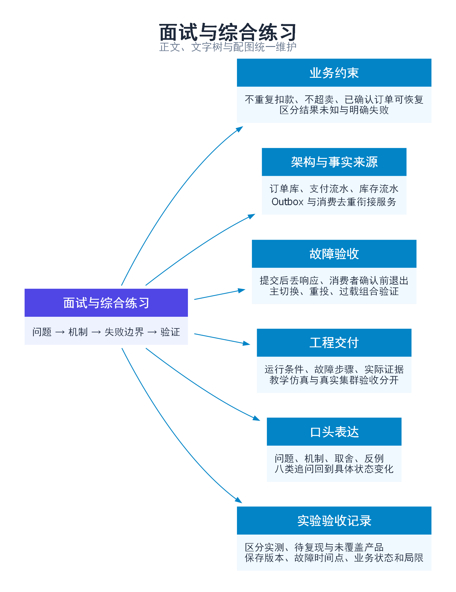

# 面试与综合练习

面试官要求设计下单系统，并追问“付钱了但页面显示失败”怎么办。怎样把前十二篇串起来？

[上一篇：安全、发布与灾难恢复](../12-%E5%AE%89%E5%85%A8%E3%80%81%E5%8F%91%E5%B8%83%E4%B8%8E%E7%81%BE%E9%9A%BE%E6%81%A2%E5%A4%8D/%E5%AE%89%E5%85%A8%E3%80%81%E5%8F%91%E5%B8%83%E4%B8%8E%E7%81%BE%E9%9A%BE%E6%81%A2%E5%A4%8D.md) · [返回目录](../README.md)

前十二篇分别处理请求、数据与故障恢复。本篇把这些机制放进一笔订单，逐步检查业务状态会怎样变化。

**阅读准备：** 先读上一篇的主线案例；本文涉及的 C++ 实验需要理解函数、容器与基本线程同步。

**快速阅读：**先读“把订单题写成一份可执行的验收方案”，再读“面试表达”和 Q&A；遇到说不清原因的结论，回到对应原理小节。

**深入学习：**按正文顺序推演每一步，运行文内完整示例，修改故障发生位置并核对结果。模拟程序只验证写明的假设；真实网络、磁盘和组件行为需按文中的验证步骤另行测试。

<details>
<summary>本文目录</summary>

- [把订单题写成一份可执行的验收方案](#section-01)
- [业务承诺](#section-02)
- [故障时间线](#section-03)
- [验证用例](#section-04)
- [把面试回答变成检查表](#section-05)
- [按失败点逐项验收](#section-06)
- [八个高频追问及对应知识](#section-07)
- [C++ 综合实验：重试和重投能否保住同一笔订单](#section-08)
- [从教学实验到工程验收，交付什么证据](#section-09)
- [真实组件实验的验收表：运行成功之后还要检查什么](#section-10)
- [面试表达](#section-11)
- [Q&A（常见问题与解答）](#section-12)
- [思维导图总结](#section-13)

</details>

<a id="section-01"></a>

## 把订单题写成一份可执行的验收方案

先给每个状态指定事实来源。订单库回答订单状态，支付流水回答是否扣款，库存流水回答是否扣库存。页面展示“处理中”时，用户应能按订单号查询。只有需要的状态确认后，订单才能进入可出库。

| 测试动作 | 预期看到什么 | 去哪里核对 |
| --- | --- | --- |
| 支付提交后丢弃响应，再用原键重试 | 返回同一付款结果，只有一次扣款 | 支付流水、幂等键记录 |
| 订单提交后停止转发器 | 恢复后补发事件 | 订单记录、待发事件表 |
| 消费者提交库存后停止，未确认消息 | 消息重投，库存只扣一次 | 库存流水、去重记录 |
| 主节点失联后重新查询已确认订单 | 新主可读到订单，或按承诺明确等待 | 写入确认记录、切换日志 |
| 下游变慢并持续灌入请求 | 队列有上限，超过预算的请求被拒绝 | 队列年龄、拒绝量、尾延迟 |

每次先只改变一个条件，记录请求编号、发生时刻和预期，才能判断是哪条保证起作用。最后组合故障，例如主节点切换时又遇到消息重投，验证同一个业务键在不同恢复路径里仍然一致。若测试失败，应能指出哪条记录丢失、哪一步确认太早，或者哪段超时预算不合理。

<a id="section-02"></a>

## 业务承诺

先定承诺。订单用业务编号标识，成功响应前明确写入达到什么持久化条件。支付用稳定幂等键，超时后展示结果未知并允许查询。库存变更按订单事件去重，并以订单状态限制发货。为每个步骤指出状态保存在哪里以及何时算成功。

<a id="section-03"></a>

## 故障时间线

再走一次故障时间线。订单库提交后立即宕机，由 Outbox 补发。消费者改完库存但确认丢失，重投由同事务的去重记录拦下。主节点切换时，核对哪些写入已提交。队列积压时用背压控制入口，观察最老事件年龄和端到端处理延迟。

<a id="section-04"></a>

## 验证用例

最后选三个验证点。让客户端重复发送同一支付请求，确认只有一笔扣款。让消费者在提交后确认前停止，确认重复投递不会重复扣库存。让主节点失联，确认新主可读到已确认的订单。逐一记录触发条件、预期状态、实际状态和失败后的恢复方式。

<a id="section-05"></a>

## 把面试回答变成检查表

为订单 K 连续提交两次同一付款请求，再让消息 E 重投。核对订单库只有一条 K、支付系统只有一次实际扣款、库存只扣一次。最后模拟主节点故障，核对成功响应过的 K 在切换后仍可查询。记录每一步的可见证据和恢复入口。

<a id="section-06"></a>

## 按失败点逐项验收

把综合练习分成四次运行。第一次记录正常下单的订单状态、支付流水和库存流水。第二次丢掉支付响应，验证查询与重试收敛到同一结果。第三次在消费者提交后、确认前停止进程，验证重投没有重复扣库存。第四次暂停主节点，验证已确认写入在切换后仍可读。每次只改变一个条件，保存请求编号与操作时间，最后再组合两种故障检查恢复流程。

### 用同一条时间线回答后续追问

从用户点击支付开始，顺序记录订单提交、支付提交、响应返回、事件发送、库存提交和消费确认。面试官若在任意两步之间插入一次宕机，先指出哪一边的状态已经保存，再说明由谁发现未完成工作。最后检查重跑动作是否复用原业务键。

做设计取舍时先给最小方案。例如订单和库存能放在同一个库，优先评估本地事务。拆成两个服务后，再根据能否容忍中间状态、故障多久能恢复、是否有外部副作用，选择消息衔接或补偿。这样可以说明为什么需要每个机制。

<a id="section-07"></a>

## 八个高频追问及对应知识

这里按[学习路线](../分布式系统学习路线.md)组织，覆盖脑裂、Raft 选主、租约、消息可靠性、分片、缓存、AT 与复制延迟。

| 问题 | 在哪一篇推演 | 回答时应能说清的过程 |
| --- | --- | --- |
| 脑裂如何避免 | 01、03、05 | 分区后谁还能提交，资源怎样拒绝旧写入 |
| Raft 怎样选主 | 03 | 任期、投票、日志新旧和多数派 |
| 锁怎样超时、续期、释放 | 05 | 租约失效、条件释放与 fencing |
| 消息如何防丢与去重 | 07 | Outbox、发送确认和消费事务 |
| 为什么要虚拟节点 | 08 | 哈希环查找与新增节点迁移范围 |
| 缓存三类故障 | 08 | 不存在的键、热点过期、批量失效 |
| Seata AT 怎样回滚 | 06 | 本地提交、全局锁、前后镜像 |
| 主从延迟如何处理 | 03 | 接收与应用进度、等待与回主库 |

<a id="section-08"></a>

## C++ 综合实验：重试和重投能否保住同一笔订单

先把验收范围缩小到两个故障点：付款成功后响应丢失，以及库存处理成功后消息确认丢失。下面用同一个订单号连接支付与消息，用断言检查“只扣一次钱、只扣一次库存”。

这是单进程顺序模拟，内存结构代表已经提交的数据库状态，提前返回代表丢失响应或确认。它没有实现跨进程持久化或事务引擎，不会证明真实崩溃下的原子性。第 04 篇的 SQLite 实验补充了独立进程重试；真实消息系统还要执行第 07 篇的故障步骤。

保存为 `order_recovery.cpp`。环境：C++17；Ubuntu 安装 `build-essential`，Windows 可用 MSYS2 UCRT64 GCC。

```cpp
#include <cassert>
#include <iostream>
#include <map>
#include <set>
#include <stdexcept>
#include <string>
#include <vector>

struct Event { std::string id; std::string order; };
struct Payment { int cents; };

class OrderSystem {
    // 整个模型单线程运行。工程中以下几组修改必须分别由本地事务保护。
    std::map<std::string, Payment> payments_;
    std::vector<Event> outbox_;
    std::set<std::string> consumed_;
    std::set<std::string> acknowledged_;
    int balance_ = 10000;
    int stock_ = 10;
public:
    bool pay(const std::string& order, int cents, bool lose_reply) {
        if (cents <= 0) throw std::invalid_argument("amount must be positive");
        auto it = payments_.find(order);
        if (it != payments_.end()) {
            // 同一个业务键不能用于另一笔金额不同的请求。
            if (it->second.cents != cents)
                throw std::invalid_argument("same key with different amount");
            return true; // 返回已保存的结果，不再扣款。
        }
        if (balance_ < cents) return false;
        // 模拟原子提交：扣款、结果记录、Outbox 应在同一本地事务内。
        balance_ -= cents;
        payments_.emplace(order, Payment{cents});
        outbox_.push_back({"paid:" + order, order});
        return !lose_reply; // false 在该分支代表未收到响应，不代表没扣款。
    }

    void deliver(bool lose_ack) {
        for (const auto& event : outbox_) {
            if (acknowledged_.count(event.id)) continue;
            if (!consumed_.count(event.id)) {
                if (stock_ <= 0) throw std::runtime_error("no stock: compensate payment");
                // 模拟另一个本地事务：库存修改与消费去重一起提交。
                --stock_;
                consumed_.insert(event.id);
            }
            if (lose_ack) return; // 未确认；下一轮会重新投递同一事件。
            acknowledged_.insert(event.id);
        }
    }
    int balance() const { return balance_; }
    int stock() const { return stock_; }
    std::size_t pending() const { return outbox_.size() - acknowledged_.size(); }
};

int main() {
    OrderSystem s;
    const bool first_reply = s.pay("order-42", 2000, true);
    assert(!first_reply && s.balance() == 8000); // 结果未知但扣款已发生。
    const bool retry_reply = s.pay("order-42", 2000, false);
    assert(retry_reply && s.balance() == 8000);
    s.deliver(true);
    assert(s.stock() == 9 && s.pending() == 1);
    s.deliver(false);
    assert(s.stock() == 9 && s.pending() == 0);
    bool rejected = false;
    try { s.pay("order-42", 3000, false); }
    catch (const std::invalid_argument&) { rejected = true; }
    assert(rejected && s.balance() == 8000);
    std::cout << "balance=8000 stock=9 pending=0 changed_amount=rejected\n";
}
```

```bash
g++ -std=c++17 -O2 -Wall -Wextra order_recovery.cpp -o order_recovery
./order_recovery
```

预期输出：

```text
balance=8000 stock=9 pending=0 changed_amount=rejected
```

如果删除支付结果检查，重试就会再次扣款；如果删除消费去重检查，第二次投递会再次扣库存。实验刻意让这两个反例能够触发断言。不要使用 `-DNDEBUG`，它会关闭断言。

库存不足时示例抛出异常，这明确暴露了尚未完成的业务分支。实际系统应记录待补偿状态、发起可重试的退款、对账，并给用户展示当前结果。对真实数据库，还需考虑事务中途异常和唯一约束冲突；上述内存操作不能代替数据库事务。

<a id="section-09"></a>

## 从教学实验到工程验收，交付什么证据

| 阶段 | 必须提供的材料 | 不能据此宣称什么 |
| --- | --- | --- |
| 本文内存实验 | 编译命令、断言、实际输出 | 不能证明断电不丢数据 |
| 独立进程恢复 | 持久化数据库、退出位置、重启后的流水 | 不能证明多机房分区行为 |
| 真实组件联调 | 固定组件版本、配置、拓扑、故障命令、操作历史 | 单次通过不能证明所有执行正确 |
| 容量与容灾验收 | 长时间负载、资源指标、恢复记录、业务对账 | 不能用仿真时延代替线上 SLO |

面试时可以用这些材料说明自己验证过哪些边界。阅读完文章建立机制理解，真正承担高级工程职责还需要完成组件联调、故障复现和性能测量，不能以文章数量替代这些能力。

<a id="section-10"></a>

## 真实组件实验的验收表：运行成功之后还要检查什么

模拟程序可让故障顺序稳定出现，但无法替代真实协议、数据库恢复与网络行为。下面将新增实验按要检查的业务事实组织。每次运行至少保存操作系统与组件版本、命令、退出码、服务端日志和最终业务状态；不能只截一张“启动成功”。

| 文章 | 实验与故障点 | 验收证据 | 本轮状态 |
| --- | --- | --- | --- |
| 04 | gRPC 服务提交后延迟响应 | 首次超时，同键重试余额不再减少；参数变化被拒绝 | Linux 环境待复现，含依赖代码未编译 |
| 05 | Redis 旧持有者恢复后释放锁 | 条件删除返回 0，新持有者 key 仍存在 | 待复现 |
| 05 | Snowflake 序列耗尽、回拨、进入下一毫秒 | 4096 个 ID 后拒绝继续发号；回拨拒绝；下一毫秒恢复 | GCC 编译运行通过，仅本地逻辑 |
| 06 | PostgreSQL Cancel 先于 Try、重复确认 | 取消记录阻止迟到预留；库存变化只发生一次 | 待复现 |
| 07 | RabbitMQ 消费业务提交后、ack 前退出 | 消息重投，SQLite effects 保持 1，最后队列清空 | Linux 环境待复现，含依赖代码未编译 |
| 08 | Redis Cluster 请求到错误节点 | 出现 MOVED；跟随路由能读回同一键 | 待复现；无副本，不验收高可用 |
| 09 | etcd 快照与 watch 间发生注册，租约过期 | 从 R+1 收到中间事件，观察删除事件 | 待复现 |
| 09 | Nginx 后端 A 停机 | 观察失败与转发日志，后续请求由 B 响应 | 待复现；被动检查，不保证零错误 |
| 10 | 两个客户端申请同一 Redis 限额 | 8 次请求共放行 5 次 | 待复现；不保证切主后预算不回退 |
| 11 | 停止 Prometheus 的采集目标 | up 变为 0，规则从 pending 到 firing | 待复现；没有配置通知发送 |
| 11 | 业务告警合成时间序列 | 5 条规则检查通过；正常、持续故障、恢复、缺数据共 30 项断言通过 | promtool 3.16.0 本机实测；真实采集与通知待验证 |
| 04、12 | proto 代码生成与保留号反例 | payment、order_v2 生成成功；复用 reserved 号码报错 | protoc 33.0 本机实测；未链接 C++ 或运行 gRPC |
| 12 | mTLS 正确证书、缺证书、错误主机名 | 成功返回 HTTP 200；另外两种 TLS 验证失败 | OpenSSL 服务端与 Python ssl 客户端实测；curl 步骤待复现 |

“待复现”表示提供了步骤与预期，当前 Windows 环境未安装相应 Linux 服务，并非已经通过。实验失败时先核对版本、端口占用、依赖链接和目录权限，再比对故障是否发生在规定时间点。不要通过关闭证书校验、改用自动 ack 或跳过去重事务来让输出看似成功，这会把被验证的性质一起删掉。

### 怎样把一次演示变成有说服力的验收

先固定业务键和初始状态，再记录每次调用与返回。故障注入要精确到“数据库提交之后、响应或确认之前”，只在进程启动时随便退出无法检验这个边界。恢复后分别查询组件状态和业务状态：例如消息队列清空只能说明投递结束，还要检查余额或库存没有重复变化。

接着改变一个条件：把重复请求换成不同参数、把暂停改成进程退出、把重试间隔加长到去重记录过期之后。记录保证在哪个条件下失效。局部示例没有实现的节点身份分配、持久化恢复、鉴权和多副本故障，应列为未覆盖项，不能默认为成立。

这轮补充深入了代表组件的内部请求路径，并新增真实组件实验步骤。Kafka、RocketMQ、MinIO、TiDB、CockroachDB、Seata 等产品仍不是逐一完成部署和故障演练；了解内部机制与完成产品验收是两个不同目标。


<a id="section-11"></a>

## 面试表达

我先明确不重复扣款、不超卖和已确认订单可恢复这三条约束。支付使用稳定业务键保存结果，订单与待发事件在同一事务中提交，库存消费把去重记录与库存变更一起提交。超时先查结果，消息重投沿用原事件键。代价是中间状态、持久化和恢复流程更复杂，因此还要通过提交后丢响应、确认前退出和主节点切换来验收。

<a id="section-12"></a>

## Q&A（常见问题与解答）

### 验收只检查接口最终成功够吗？

不够。还要核对余额、库存和事件去重事实，确认没有重复效果或丢失中间记录，并保存故障时间点。

### 模拟程序通过能证明协议安全吗？

只能验证写入模拟的场景和假设。真实实现还需覆盖持久化顺序、网络乱序、重启、成员变更与并发恢复。

**面试中被问“用什么中间件”时，怎样说出取舍？**

先说要保住哪条业务约束，再说选的机制能保证哪一步。最后指出它依赖什么、失败时怎样恢复，并给一个能验证的故障场景。

**回答时怎样避免只报中间件名字？**

先说哪个故障会破坏哪条业务约束，再说明状态由谁保存、何时确认、重试会发生什么，最后说明怎样验证。

[延伸阅读](https://raft.github.io/raft.pdf)

<a id="section-13"></a>

## 思维导图总结

```text
面试与综合练习
├── 业务约束
│   ├── 不重复扣款、不超卖、已确认订单可恢复
│   └── 区分结果未知与明确失败
├── 架构与事实来源
│   ├── 订单库、支付流水、库存流水
│   └── Outbox 与消费去重衔接服务
├── 故障验收
│   ├── 提交后丢响应、消费者确认前退出
│   └── 主切换、重投、过载组合验证
├── 工程交付
│   ├── 运行条件、故障步骤、实际证据
│   └── 教学仿真与真实集群验收分开
├── 口头表达
│   ├── 问题、机制、取舍、反例
│   └── 八类追问回到具体状态变化
└── 实验验收记录
    ├── 区分实测、待复现与未覆盖产品
    └── 保存版本、故障时间点、业务状态和局限
```


