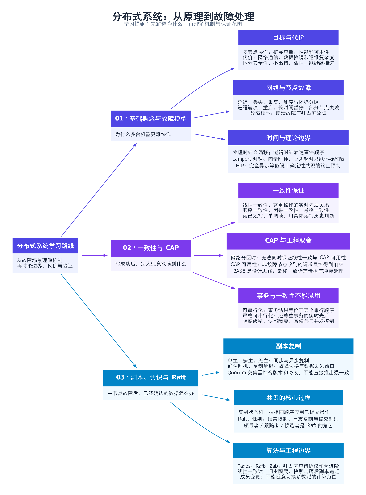
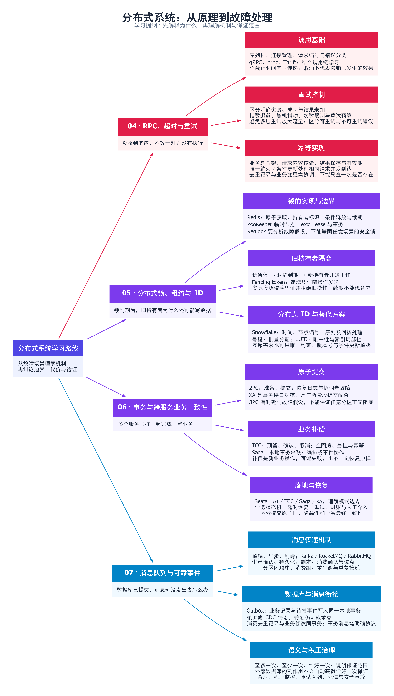
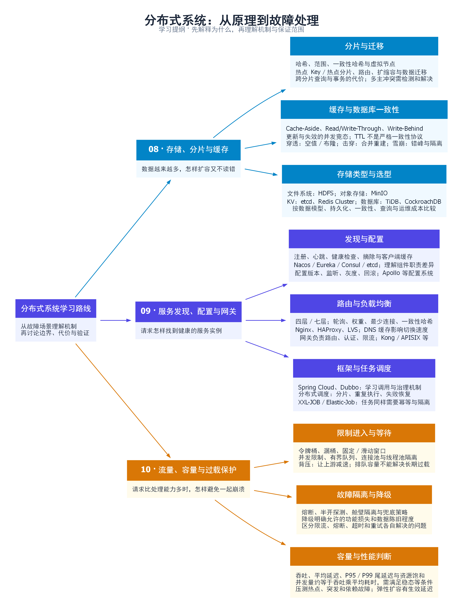
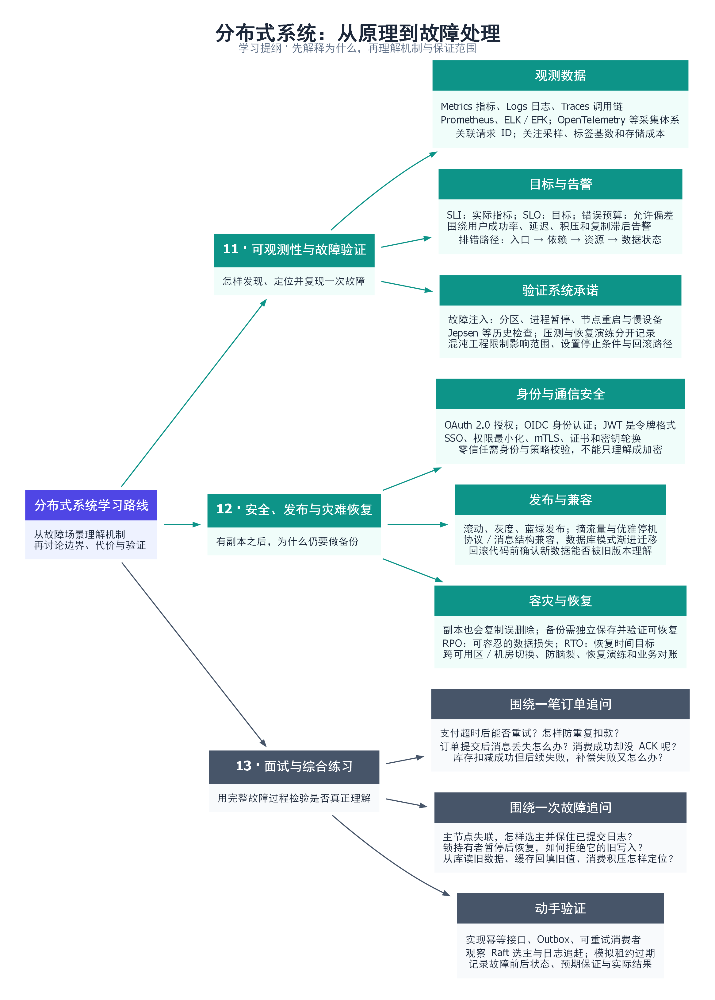

# 分布式系统学习笔记

目标岗位是 C++ 资深／高级分布式工程师。这份笔记按“机制 → C++ 实现 → 故障验证”组织：每篇从一个会真实发生的故障场景切入，讲清机制、它到底保证了什么、给出可编译运行的 C++ 示例，再用故障注入核对结果。读完的要求不是复述概念，而是能在自己的服务里把这些机制写对、说清它什么时候会失效，并用实验证明行为符合预期。

前置知识：C++11／17（RAII、智能指针、`std::thread` 与 `mutex`／`condition_variable`）、Linux 基础（socket、文件 IO、进程与信号）、数据库事务（ACID、隔离级别、提交与回滚）、网络请求（TCP／HTTP、请求与响应的基本过程）。

读法：先看完整思维导图建立关系，再按 01–12 顺序读，第 13 篇用来综合。每篇的“面试表达”和 Q&A 用来自检，不是重点；文中的代码和实验要自己跑一遍。

## 路线总览

## 13 个主题

| 主题 | 要回答的问题 | 讲什么 |
| --- | --- | --- |
| [01 · 基础概念与故障模型](01-%E5%9F%BA%E7%A1%80%E6%A6%82%E5%BF%B5%E4%B8%8E%E6%95%85%E9%9A%9C%E6%A8%A1%E5%9E%8B/%E5%9F%BA%E7%A1%80%E6%A6%82%E5%BF%B5%E4%B8%8E%E6%95%85%E9%9A%9C%E6%A8%A1%E5%9E%8B.md) | 订单服务发消息给仓库，半天没回音。对方是挂了，还是只是反应慢？ | 协作的收益与代价、网络与节点故障、故障模型、逻辑时钟、FLP |
| [02 · 一致性与 CAP](02-%E4%B8%80%E8%87%B4%E6%80%A7%E4%B8%8E%20CAP/%E4%B8%80%E8%87%B4%E6%80%A7%E4%B8%8E%20CAP.md) | 用户改完收货地址，刷新还是旧地址。系统说的“一致”到底保证到什么程度？ | 线性一致到最终一致、CAP 的可用性定义、BASE、可串行化与写偏斜 |
| [03 · 副本、共识与 Raft](03-%E5%89%AF%E6%9C%AC%E3%80%81%E5%85%B1%E8%AF%86%E4%B8%8E%20Raft/%E5%89%AF%E6%9C%AC%E3%80%81%E5%85%B1%E8%AF%86%E4%B8%8E%20Raft.md) | 订单刚提示创建成功，存它的那台机器就宕机了。换台机器接手，还找得到这笔订单吗？ | 单主与多主、确认时机与丢失窗口、复制状态机、Raft 选举与提交、成员变更 |
| [04 · RPC、超时与重试](04-RPC%E3%80%81%E8%B6%85%E6%97%B6%E4%B8%8E%E9%87%8D%E8%AF%95/RPC%E3%80%81%E8%B6%85%E6%97%B6%E4%B8%8E%E9%87%8D%E8%AF%95.md) | 支付那边钱已经扣了，回复却在半路丢了。超时后要不要重试、怎么重试才不重复扣款？ | 截止时间传递、结果未知、退避与抖动、重试预算、幂等键与去重 |
| [05 · 分布式锁、租约与 ID](05-%E5%88%86%E5%B8%83%E5%BC%8F%E9%94%81%E3%80%81%E7%A7%9F%E7%BA%A6%E4%B8%8E%20ID/%E5%88%86%E5%B8%83%E5%BC%8F%E9%94%81%E3%80%81%E7%A7%9F%E7%BA%A6%E4%B8%8E%20ID.md) | 上一个任务其实只是卡住了，锁过期被别人拿走。它醒过来还能继续写数据吗？ | Redis／ZooKeeper／etcd 锁、租约与续期、fencing token、Snowflake 与号段 |
| [06 · 事务与跨服务业务一致性](06-%E4%BA%8B%E5%8A%A1%E4%B8%8E%E8%B7%A8%E6%9C%8D%E5%8A%A1%E4%B8%9A%E5%8A%A1%E4%B8%80%E8%87%B4%E6%80%A7/%E4%BA%8B%E5%8A%A1%E4%B8%8E%E8%B7%A8%E6%9C%8D%E5%8A%A1%E4%B8%9A%E5%8A%A1%E4%B8%80%E8%87%B4%E6%80%A7.md) | 库存已经扣掉，支付却失败了。这笔订单现在算成功、算失败，还是第三种状态？ | 2PC 与 3PC、TCC 的空回滚与悬挂、Saga、Seata 模式边界、对账与人工介入 |
| [07 · 消息队列与可靠事件](07-%E6%B6%88%E6%81%AF%E9%98%9F%E5%88%97%E4%B8%8E%E5%8F%AF%E9%9D%A0%E4%BA%8B%E4%BB%B6/%E6%B6%88%E6%81%AF%E9%98%9F%E5%88%97%E4%B8%8E%E5%8F%AF%E9%9D%A0%E4%BA%8B%E4%BB%B6.md) | 订单已经写进数据库，程序在发消息前崩了。下游服务怎么才能收到这条消息？ | 确认与位点、Outbox 与 CDC、消费去重、三种投递语义、积压与死信 |
| [08 · 存储、分片与缓存](08-%E5%AD%98%E5%82%A8%E3%80%81%E5%88%86%E7%89%87%E4%B8%8E%E7%BC%93%E5%AD%98/%E5%AD%98%E5%82%A8%E3%80%81%E5%88%86%E7%89%87%E4%B8%8E%E7%BC%93%E5%AD%98.md) | 订单多到一台数据库装不下。怎么拆开存，查的时候还能查对？ | 分片与迁移、一致性哈希与虚拟节点、热点、缓存三大故障、存储选型 |
| [09 · 服务发现、配置与网关](09-%E6%9C%8D%E5%8A%A1%E5%8F%91%E7%8E%B0%E3%80%81%E9%85%8D%E7%BD%AE%E4%B8%8E%E7%BD%91%E5%85%B3/%E6%9C%8D%E5%8A%A1%E5%8F%91%E7%8E%B0%E3%80%81%E9%85%8D%E7%BD%AE%E4%B8%8E%E7%BD%91%E5%85%B3.md) | 订单服务新加了两台机器。客户端怎么知道该找谁，又怎么避开正在重启的那台？ | 注册与健康检查、配置灰度与回滚、四层／七层负载均衡、网关、分布式调度 |
| [10 · 流量、容量与过载保护](10-%E6%B5%81%E9%87%8F%E3%80%81%E5%AE%B9%E9%87%8F%E4%B8%8E%E8%BF%87%E8%BD%BD%E4%BF%9D%E6%8A%A4/%E6%B5%81%E9%87%8F%E3%80%81%E5%AE%B9%E9%87%8F%E4%B8%8E%E8%BF%87%E8%BD%BD%E4%BF%9D%E6%8A%A4.md) | 系统一秒最多处理 100 个请求，突然来了 120 个。多出来的 20 个会怎样？ | 令牌桶与窗口、并发限制与有界队列、背压、熔断降级、尾延迟与容量估算 |
| [11 · 可观测性与故障验证](11-%E5%8F%AF%E8%A7%82%E6%B5%8B%E6%80%A7%E4%B8%8E%E6%95%85%E9%9A%9C%E9%AA%8C%E8%AF%81/%E5%8F%AF%E8%A7%82%E6%B5%8B%E6%80%A7%E4%B8%8E%E6%95%85%E9%9A%9C%E9%AA%8C%E8%AF%81.md) | 接口偶尔卡五秒，平均耗时却看着正常。怎么找出到底哪一步慢？ | 指标／日志／链路、SLI 与 SLO、告警设计、故障注入与混沌工程 |
| [12 · 安全、发布与灾难恢复](12-%E5%AE%89%E5%85%A8%E3%80%81%E5%8F%91%E5%B8%83%E4%B8%8E%E7%81%BE%E9%9A%BE%E6%81%A2%E5%A4%8D/%E5%AE%89%E5%85%A8%E3%80%81%E5%8F%91%E5%B8%83%E4%B8%8E%E7%81%BE%E9%9A%BE%E6%81%A2%E5%A4%8D.md) | 新版本写的数据旧程序读不懂，偏偏这时主机房又断了。服务怎么救回来？ | OAuth 2.0／OIDC／JWT、mTLS 与轮换、发布与兼容、备份与 RPO／RTO |
| [13 · 面试与综合练习](13-%E9%9D%A2%E8%AF%95%E4%B8%8E%E7%BB%BC%E5%90%88%E7%BB%83%E4%B9%A0/%E9%9D%A2%E8%AF%95%E4%B8%8E%E7%BB%BC%E5%90%88%E7%BB%83%E4%B9%A0.md) | 面试官让你设计下单系统，追问“钱付了页面却显示失败”。怎么用前面十二篇答完整？ | 订单与故障两类追问、动手实现幂等与 Outbox、真实组件验收表 |

## 分组高清图

### 01–03 · 基础理论、一致性与共识

### 04–07 · 调用、锁、事务与消息

### 08–10 · 存储、服务治理与流量

### 11–13 · 可观测性、安全恢复与综合练习

## 实验环境与验证边界

文中的实验分三类：纯标准库模拟、带数据库的本地实验、需要真实服务的组件实验。三者能证明的范围不同。模拟程序的执行顺序可以解释故障窗口，但不能证明某个真实集群能抗分区、掉电或长时间暂停。

| 检查项 | 具体做什么 | 常见误区 |
| --- | --- | --- |
| 编译器与标准 | 按代码块标注的 C++11 或 C++17 编译，Linux 多线程示例加 `-pthread` | 没启用示例所需标准；把所有含 main 的示例拼在一起 |
| 头文件与链接库 | 区分运行库和开发包；核对 sqlite3、hiredis、rabbitmq-c、grpc++ 的版本与链接参数 | 服务能跑，就以为客户端开发头文件已装好 |
| 生成代码工具 | 核对 protoc、插件、生成代码与运行库的兼容性 | 只升级运行库，继续用不兼容的旧生成代码 |
| 组件配置 | 记录 Broker、Redis、etcd、数据库的版本及副本、持久化、确认与超时配置 | 沿用另一版本默认值，或把单机实验当成高可用验证 |
| 初始状态 | 使用独立的数据库、队列或键空间，保留清理步骤和输入 | 上次的幂等记录还在，误以为这次没有副作用 |
| 故障与观察 | 明确在哪一步暂停、断连或丢回复，保存业务键、世代、日志与最终数据 | 只看“最后成功”，忽略是否重复执行、丢写或读到旧值 |

排错顺序：编译与链接 → 连接与鉴权 → 正常业务路径 → 指定故障窗口 → 恢复后的业务不变量。一次只改一个变量，否则无法确认原因。

## 延伸阅读

- [Raft 论文](https://raft.github.io/raft.pdf)：选主、日志复制、安全性、快照与成员变更。
- [etcd/raft](https://github.com/etcd-io/raft)：Go 实现的独立 Raft 库，接口划分和状态机设计常被 C++ 服务参考，可对照第 03 篇读源码。
- [C++ 内存模型](https://en.cppreference.com/w/cpp/atomic/memory_order)：`memory_order` 与 happens-before 的规则，写并发组件前必须过一遍。
- [Jepsen 一致性模型](https://jepsen.io/consistency/models)：各种一致性保证之间的关系。
- [AWS：超时、重试与抖动](https://aws.amazon.com/builders-library/timeouts-retries-and-backoff-with-jitter/)：重试如何放大流量。
- [分布式锁与 fencing](https://martin.kleppmann.com/2016/02/08/how-to-do-distributed-locking.html)：租约失效后旧持有者的风险。
- [Transactional Outbox](https://microservices.io/patterns/data/transactional-outbox.html)：本地事务与发消息的衔接。
- [Kafka 设计文档](https://kafka.apache.org/32/design/design/)：确认、消费进度与“恰好一次”的范围。
