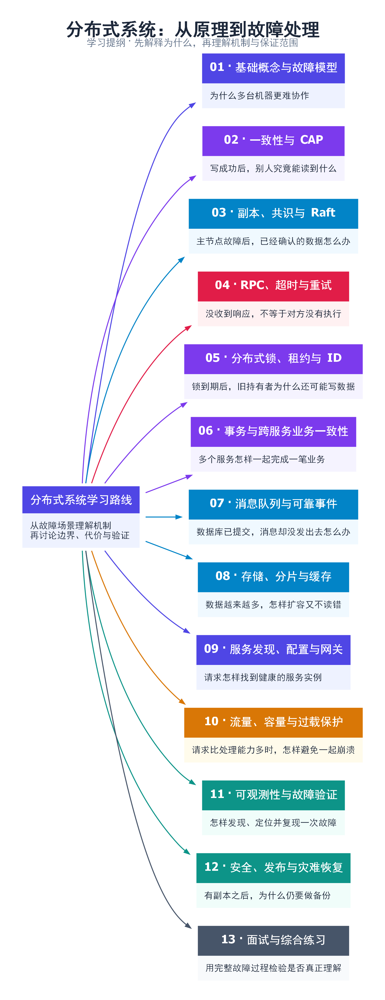
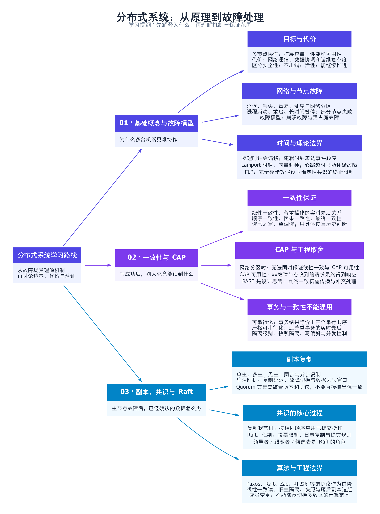
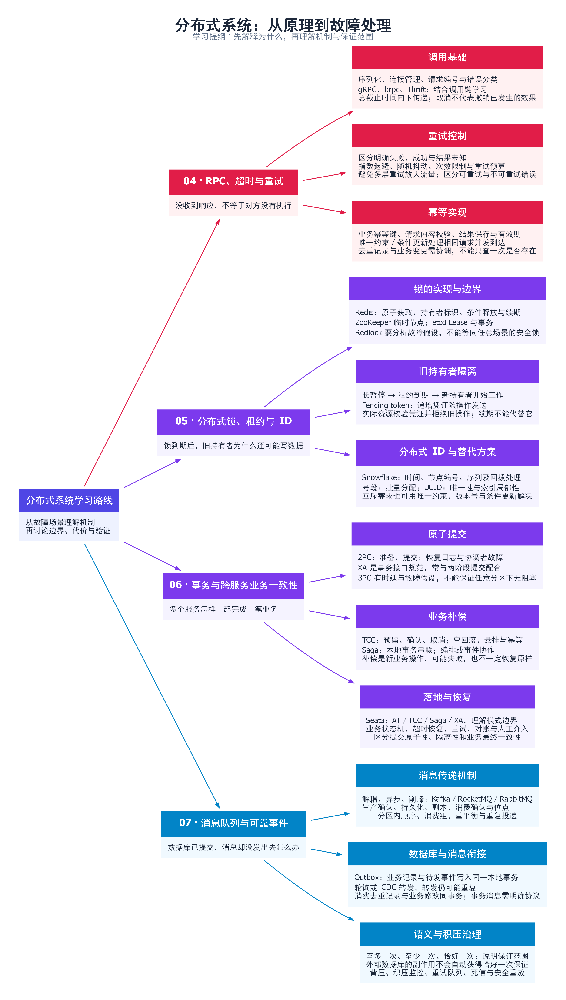
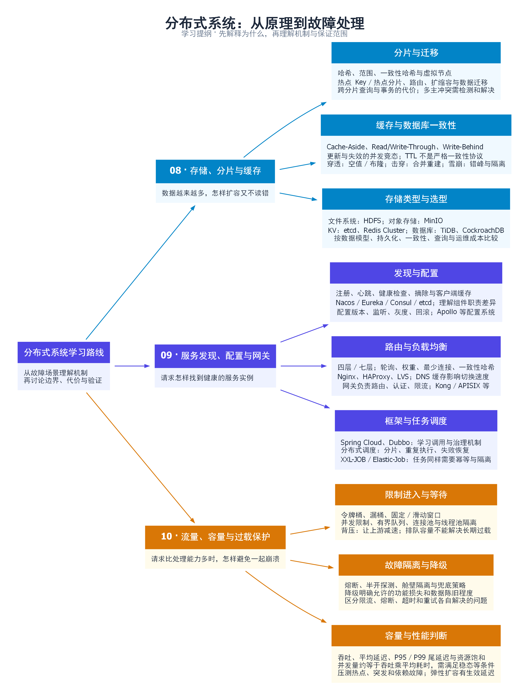
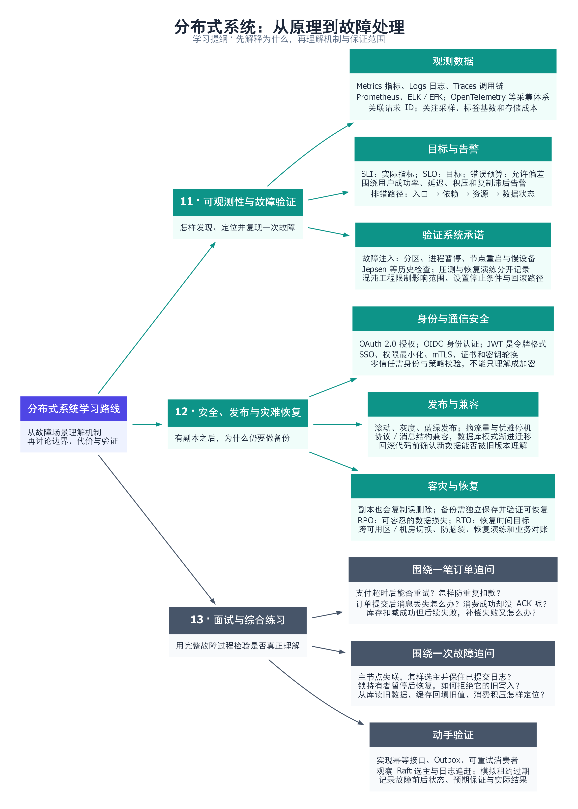

# 分布式系统学习路线与思维导图

这份提纲帮助你沿着“系统为什么会出错 → 用什么机制解决 → 保证到哪里 → 如何验证”的顺序学习分布式系统。

前置知识：进程与线程、网络请求、数据库事务和基本数据结构。本文是学习路线索引，具体机制在对应专题中展开，不把提纲当成完整实现规范。

先看总览建立关系，再按 01–12 学习，最后用 13 的故障场景复习。已有文章见[学习笔记目录](README.md)。



[完整高清思维导图](images/distributed-roadmap-full.png) · [完整 DOT 源文件](images/distributed-roadmap-full.dot)

## 01 · 基础概念与故障模型

[阅读本主题完整文章](01-%E5%9F%BA%E7%A1%80%E6%A6%82%E5%BF%B5%E4%B8%8E%E6%95%85%E9%9A%9C%E6%A8%A1%E5%9E%8B/%E5%9F%BA%E7%A1%80%E6%A6%82%E5%BF%B5%E4%B8%8E%E6%95%85%E9%9A%9C%E6%A8%A1%E5%9E%8B.md)

**核心问题：为什么多台机器更难协作。**

### 目标与代价

- 多节点协作：扩展容量、性能和可用性
- 代价：网络通信、数据协调和运维复杂度
- 区分安全性：不出错；活性：能继续推进

### 网络与节点故障

- 延迟、丢失、重复、乱序与网络分区
- 进程崩溃、重启、长时间暂停；部分节点失败
- 故障模型：崩溃故障与拜占庭故障

### 时间与理论边界

- 物理时钟会偏移；逻辑时钟表达事件顺序
- Lamport 时钟、向量时钟；心跳超时只能怀疑故障
- FLP：完全异步等假设下确定性共识的终止限制

## 02 · 一致性与 CAP

[阅读本主题完整文章](02-%E4%B8%80%E8%87%B4%E6%80%A7%E4%B8%8E%20CAP/%E4%B8%80%E8%87%B4%E6%80%A7%E4%B8%8E%20CAP.md)

**核心问题：写成功后，别人究竟能读到什么。**

### 一致性保证

- 线性一致性：尊重操作的实时先后关系
- 顺序一致性、因果一致性、最终一致性
- 读己之写、单调读；用具体读写历史判断

### CAP 与工程取舍

- 网络分区时：无法同时保证线性一致与 CAP 可用性
- CAP 可用性：非故障节点收到的请求最终得到响应
- BASE 是设计思路；最终一致仍需传播与冲突处理

### 事务与一致性不能混用

- 可串行化：事务结果等价于某个串行顺序
- 严格可串行化：还尊重事务的实时先后
- 隔离级别、快照隔离、写偏斜与并发控制

## 03 · 副本、共识与 Raft

[阅读本主题完整文章](03-%E5%89%AF%E6%9C%AC%E3%80%81%E5%85%B1%E8%AF%86%E4%B8%8E%20Raft/%E5%89%AF%E6%9C%AC%E3%80%81%E5%85%B1%E8%AF%86%E4%B8%8E%20Raft.md)

**核心问题：主节点故障后，已经确认的数据怎么办。**

### 副本复制

- 单主、多主、无主；同步与异步复制
- 确认时机、复制延迟、故障切换与数据丢失窗口
- Quorum 交集需结合版本和协议，不能直接推出强一致

### 共识的核心过程

- 复制状态机：按相同顺序应用已提交操作
- Raft：任期、投票限制、日志复制与提交规则
- 领导者／跟随者／候选者是 Raft 的角色

### 算法与工程边界

- Paxos、Raft、Zab；拜占庭容错协议作为进阶
- 线性一致读、旧主隔离、快照与落后副本追赶
- 成员变更：不能随意切换多数派的计算范围

## 04 · RPC、超时与重试

[阅读本主题完整文章](04-RPC%E3%80%81%E8%B6%85%E6%97%B6%E4%B8%8E%E9%87%8D%E8%AF%95/RPC%E3%80%81%E8%B6%85%E6%97%B6%E4%B8%8E%E9%87%8D%E8%AF%95.md)

**核心问题：没收到响应，不等于对方没有执行。**

### 调用基础

- 序列化、连接管理、请求编号与错误分类
- gRPC、brpc、Thrift：结合调用链学习
- 总截止时间向下传递；取消不代表撤销已发生的效果

### 重试控制

- 区分明确失败、成功与结果未知
- 指数退避、随机抖动、次数限制与重试预算
- 避免多层重试放大流量；区分可重试与不可重试错误

### 幂等实现

- 业务幂等键、请求内容校验、结果保存与有效期
- 唯一约束／条件更新处理相同请求并发到达
- 去重记录与业务变更需协调，不能只查一次是否存在

## 05 · 分布式锁、租约与 ID

[阅读本主题完整文章](05-%E5%88%86%E5%B8%83%E5%BC%8F%E9%94%81%E3%80%81%E7%A7%9F%E7%BA%A6%E4%B8%8E%20ID/%E5%88%86%E5%B8%83%E5%BC%8F%E9%94%81%E3%80%81%E7%A7%9F%E7%BA%A6%E4%B8%8E%20ID.md)

**核心问题：锁到期后，旧持有者为什么还可能写数据。**

### 锁的实现与边界

- Redis：原子获取、持有者标识、条件释放与续期
- ZooKeeper 临时节点；etcd Lease 与事务
- Redlock 要分析故障假设，不能等同任意场景的安全锁

### 旧持有者隔离

- 长暂停 → 租约到期 → 新持有者开始工作
- Fencing token：递增凭证随操作发送
- 实际资源校验凭证并拒绝旧操作；续期不能代替它

### 分布式 ID 与替代方案

- Snowflake：时间、节点编号、序列及回拨处理
- 号段：批量分配；UUID：唯一性与索引局部性
- 互斥需求也可用唯一约束、版本号与条件更新解决

## 06 · 事务与跨服务业务一致性

[阅读本主题完整文章](06-%E4%BA%8B%E5%8A%A1%E4%B8%8E%E8%B7%A8%E6%9C%8D%E5%8A%A1%E4%B8%9A%E5%8A%A1%E4%B8%80%E8%87%B4%E6%80%A7/%E4%BA%8B%E5%8A%A1%E4%B8%8E%E8%B7%A8%E6%9C%8D%E5%8A%A1%E4%B8%9A%E5%8A%A1%E4%B8%80%E8%87%B4%E6%80%A7.md)

**核心问题：多个服务怎样一起完成一笔业务。**

### 原子提交

- 2PC：准备、提交；恢复日志与协调者故障
- XA 是事务接口规范，常与两阶段提交配合
- 3PC 有时延与故障假设，不能保证任意分区下无阻塞

### 业务补偿

- TCC：预留、确认、取消；空回滚、悬挂与幂等
- Saga：本地事务串联；编排或事件协作
- 补偿是新业务操作，可能失败，也不一定恢复原样

### 落地与恢复

- Seata：AT／TCC／Saga／XA，理解模式边界
- 业务状态机、超时恢复、重试、对账与人工介入
- 区分提交原子性、隔离性和业务最终一致性

## 07 · 消息队列与可靠事件

[阅读本主题完整文章](07-%E6%B6%88%E6%81%AF%E9%98%9F%E5%88%97%E4%B8%8E%E5%8F%AF%E9%9D%A0%E4%BA%8B%E4%BB%B6/%E6%B6%88%E6%81%AF%E9%98%9F%E5%88%97%E4%B8%8E%E5%8F%AF%E9%9D%A0%E4%BA%8B%E4%BB%B6.md)

**核心问题：数据库已提交，消息却没发出去怎么办。**

### 消息传递机制

- 解耦、异步、削峰；Kafka／RocketMQ／RabbitMQ
- 生产确认、持久化、副本、消费确认与位点
- 分区内顺序、消费组、重平衡与重复投递

### 数据库与消息衔接

- Outbox：业务记录与待发事件写入同一本地事务
- 轮询或 CDC 转发，转发仍可能重复
- 消费去重记录与业务修改同事务；事务消息需明确协议

### 语义与积压治理

- 至多一次、至少一次、恰好一次：说明保证范围
- 外部数据库的副作用不会自动获得恰好一次保证
- 背压、积压监控、重试队列、死信与安全重放

## 08 · 存储、分片与缓存

[阅读本主题完整文章](08-%E5%AD%98%E5%82%A8%E3%80%81%E5%88%86%E7%89%87%E4%B8%8E%E7%BC%93%E5%AD%98/%E5%AD%98%E5%82%A8%E3%80%81%E5%88%86%E7%89%87%E4%B8%8E%E7%BC%93%E5%AD%98.md)

**核心问题：数据越来越多，怎样扩容又不读错。**

### 分片与迁移

- 哈希、范围、一致性哈希与虚拟节点
- 热点 Key／热点分片、路由、扩缩容与数据迁移
- 跨分片查询与事务的代价；多主冲突需检测和解决

### 缓存与数据库一致性

- Cache-Aside、Read/Write-Through、Write-Behind
- 更新与失效的并发竞态；TTL 不是严格一致性协议
- 穿透：空值／布隆；击穿：合并重建；雪崩：错峰与隔离

### 存储类型与选型

- 文件系统：HDFS；对象存储：MinIO
- KV：etcd、Redis Cluster；数据库：TiDB、CockroachDB
- 按数据模型、持久化、一致性、查询与运维成本比较

## 09 · 服务发现、配置与网关

[阅读本主题完整文章](09-%E6%9C%8D%E5%8A%A1%E5%8F%91%E7%8E%B0%E3%80%81%E9%85%8D%E7%BD%AE%E4%B8%8E%E7%BD%91%E5%85%B3/%E6%9C%8D%E5%8A%A1%E5%8F%91%E7%8E%B0%E3%80%81%E9%85%8D%E7%BD%AE%E4%B8%8E%E7%BD%91%E5%85%B3.md)

**核心问题：请求怎样找到健康的服务实例。**

### 发现与配置

- 注册、心跳、健康检查、摘除与客户端缓存
- Nacos／Eureka／Consul／etcd；理解组件职责差异
- 配置版本、监听、灰度、回滚；Apollo 等配置系统

### 路由与负载均衡

- 四层／七层；轮询、权重、最少连接、一致性哈希
- Nginx、HAProxy、LVS；DNS 缓存影响切换速度
- 网关负责路由、认证、限流；Kong／APISIX 等

### 框架与任务调度

- Spring Cloud、Dubbo：学习调用与治理机制
- 分布式调度：分片、重复执行、失败恢复
- XXL-JOB／Elastic-Job：任务同样需要幂等与隔离

## 10 · 流量、容量与过载保护

[阅读本主题完整文章](10-%E6%B5%81%E9%87%8F%E3%80%81%E5%AE%B9%E9%87%8F%E4%B8%8E%E8%BF%87%E8%BD%BD%E4%BF%9D%E6%8A%A4/%E6%B5%81%E9%87%8F%E3%80%81%E5%AE%B9%E9%87%8F%E4%B8%8E%E8%BF%87%E8%BD%BD%E4%BF%9D%E6%8A%A4.md)

**核心问题：请求比处理能力多时，怎样避免一起崩溃。**

### 限制进入与等待

- 令牌桶、漏桶、固定／滑动窗口
- 并发限制、有界队列、连接池与线程池隔离
- 背压：让上游减速；排队容量不能解决长期过载

### 故障隔离与降级

- 熔断、半开探测、舱壁隔离与兜底策略
- 降级明确允许的功能损失和数据陈旧程度
- 区分限流、熔断、超时和重试各自解决的问题

### 容量与性能判断

- 吞吐、平均延迟、P95／P99 尾延迟与资源饱和
- 并发量约等于吞吐乘平均耗时，需满足稳态等条件
- 压测热点、突发和依赖故障；弹性扩容有生效延迟

## 11 · 可观测性与故障验证

[阅读本主题完整文章](11-%E5%8F%AF%E8%A7%82%E6%B5%8B%E6%80%A7%E4%B8%8E%E6%95%85%E9%9A%9C%E9%AA%8C%E8%AF%81/%E5%8F%AF%E8%A7%82%E6%B5%8B%E6%80%A7%E4%B8%8E%E6%95%85%E9%9A%9C%E9%AA%8C%E8%AF%81.md)

**核心问题：怎样发现、定位并复现一次故障。**

### 观测数据

- Metrics 指标、Logs 日志、Traces 调用链
- Prometheus、ELK／EFK；OpenTelemetry 等采集体系
- 关联请求 ID；关注采样、标签基数和存储成本

### 目标与告警

- SLI：实际指标；SLO：目标；错误预算：允许偏差
- 围绕用户成功率、延迟、积压和复制滞后告警
- 排错路径：入口 → 依赖 → 资源 → 数据状态

### 验证系统承诺

- 故障注入：分区、进程暂停、节点重启与慢设备
- Jepsen 等历史检查；压测与恢复演练分开记录
- 混沌工程限制影响范围、设置停止条件与回滚路径

## 12 · 安全、发布与灾难恢复

[阅读本主题完整文章](12-%E5%AE%89%E5%85%A8%E3%80%81%E5%8F%91%E5%B8%83%E4%B8%8E%E7%81%BE%E9%9A%BE%E6%81%A2%E5%A4%8D/%E5%AE%89%E5%85%A8%E3%80%81%E5%8F%91%E5%B8%83%E4%B8%8E%E7%81%BE%E9%9A%BE%E6%81%A2%E5%A4%8D.md)

**核心问题：有副本之后，为什么仍要做备份。**

### 身份与通信安全

- OAuth 2.0 授权；OIDC 身份认证；JWT 是令牌格式
- SSO、权限最小化、mTLS、证书和密钥轮换
- 零信任需身份与策略校验，不能只理解成加密

### 发布与兼容

- 滚动、灰度、蓝绿发布；摘流量与优雅停机
- 协议／消息结构兼容，数据库模式渐进迁移
- 回滚代码前确认新数据能否被旧版本理解

### 容灾与恢复

- 副本也会复制误删除；备份需独立保存并验证可恢复
- RPO：可容忍的数据损失；RTO：恢复时间目标
- 跨可用区／机房切换、防脑裂、恢复演练和业务对账

## 13 · 面试与综合练习

[阅读本主题完整文章](13-%E9%9D%A2%E8%AF%95%E4%B8%8E%E7%BB%BC%E5%90%88%E7%BB%83%E4%B9%A0/%E9%9D%A2%E8%AF%95%E4%B8%8E%E7%BB%BC%E5%90%88%E7%BB%83%E4%B9%A0.md)

**核心问题：用完整故障过程检验是否真正理解。**

### 围绕一笔订单追问

- 支付超时后能否重试？怎样防重复扣款？
- 订单提交后消息丢失怎么办？消费成功却没 ACK 呢？
- 库存扣减成功但后续失败，补偿失败又怎么办？

### 围绕一次故障追问

- 主节点失联，怎样选主并保住已提交日志？
- 锁持有者暂停后恢复，如何拒绝它的旧写入？
- 从库读旧数据、缓存回填旧值、消费积压怎样定位？

### 动手验证

- 实现幂等接口、Outbox、可重试消费者
- 观察 Raft 选主与日志追赶；模拟租约过期
- 记录故障前后状态、预期保证与实际结果

## 分组高清图

### 基础理论、一致性与共识



[DOT 源文件](images/distributed-roadmap-part-1.dot)

### 调用、锁、事务与消息



[DOT 源文件](images/distributed-roadmap-part-2.dot)

### 存储、服务治理与流量



[DOT 源文件](images/distributed-roadmap-part-3.dot)

### 可观测性、安全恢复与综合练习



[DOT 源文件](images/distributed-roadmap-part-4.dot)

## 依据与延伸阅读

- [Raft 论文](https://raft.github.io/raft.pdf)：选主、日志复制、安全性、快照与成员变更。
- [Jepsen 一致性模型](https://jepsen.io/consistency/models)：不同一致性保证之间的关系。
- [AWS：超时、重试与抖动](https://aws.amazon.com/builders-library/timeouts-retries-and-backoff-with-jitter/)：失败重试与流量放大。
- [分布式锁与 fencing](https://martin.kleppmann.com/2016/02/08/how-to-do-distributed-locking.html)：租约失效后旧持有者的风险。
- [Transactional Outbox](https://microservices.io/patterns/data/transactional-outbox.html)：本地事务与消息发送的衔接及重复投递。
- [Kafka 消息处理语义](https://kafka.apache.org/32/design/design/)：确认、消费进度和恰好一次的范围。

## 配图维护

PNG 由 Graphviz 生成，200 DPI；对应 DOT 均保存在 images 目录，布局为 rankdir=LR。源文件指定 PingFang SC；当前 Windows 未安装该字体，实际渲染使用可用中文字体回退。

从本文所在目录运行以下 Bash 命令，需先安装 Graphviz：

```bash
for source in images/distributed-roadmap-*.dot; do
    dot -Tpng -Gdpi=200 "$source" -o "${source%.dot}.png"
done
```
